---
# Copyright (c) 2026 Angela Villota, and collaborators from the CyED block
# Licensed under the PolyForm Noncommercial License 1.0.0.
# Commercial use is prohibited without prior written authorization.
title: "Unidad 2 · Sesión 11: Recurrencias — iteración, árbol de recursión, lineales homogéneas y método maestro"
---

# Unidad 2 · Sesión 11: Recurrencias — iteración, árbol de recursión, lineales homogéneas y método maestro

## Agenda

1. Método de iteración y árbol de recursión
2. Recurrencias lineales homogéneas
3. Método maestro

En la [Sesión 10](../Sesion10-DivideVenceras/index.md) vimos que `mergeSort` parte la lista en dos mitades, ordena cada una y las mezcla en tiempo lineal. Si $T(n)$ es el número de operaciones que hace `mergeSort` sobre una lista de tamaño $n$:

$$
T(n) = 2T(n/2) + n
$$

**¿Cuánto vale $T(n)$?** Una expresión así, que define $T(n)$ en términos de $T$ evaluada en valores más pequeños, es una **relación de recurrencia**. Resolverla es encontrar una expresión para $T(n)$ que no dependa de $T$. En esta sesión vemos tres métodos para hacerlo.

Cada solución está en un desplegable. Dentro, las pestañas **Paso 1, Paso 2, …** construyen el desarrollo poco a poco, como diapositivas: cada paso repite lo anterior y agrega lo nuevo **en color**.

## 1. Método de iteración y árbol de recursión

**Método de iteración.** Expandir la recurrencia y expresarla como una suma de términos que dependen de $n$ y de las condiciones iniciales.

**Árbol de recursión.** Dibujar la misma expansión como un árbol: cada nodo es el costo de un subproblema (sin contar sus llamados recursivos), sus hijos son los llamados recursivos y las hojas son el caso base. El costo total es la suma de los costos de todos los niveles.

Los dos métodos hacen lo mismo: la iteración escribe la expansión como una suma y el árbol la dibuja por niveles. Por eso cada ejemplo se resuelve de las dos formas.

:::{admonition} Herramientas
:class: tip
**Sumatorias.**

$$
\sum_{i=1}^{n} c = c\,n \qquad
\sum_{k=1}^{n} k = \frac{n(n+1)}{2} \qquad
\sum_{k=1}^{n} k^2 = \frac{n(n+1)(2n+1)}{6} \qquad
\sum_{k=1}^{n} k^3 = \frac{n^2(n+1)^2}{4}
$$

**Serie geométrica.** Si $r \neq 1$:

$$
\sum_{i=0}^{k} r^i = \frac{r^{k+1}-1}{r-1}
\qquad\qquad
\text{si } |r|<1: \quad \sum_{i=0}^{\infty} r^i = \frac{1}{1-r}
$$

**Logaritmos.** $\;n/b^i = 1 \iff i = \log_b n$. $\;$ Además, $a^{\log_b n} = n^{\log_b a}$.

**Árboles.** Un árbol $m$-ario completo tiene $m^i$ nodos en el nivel $i$ y, si su altura es $h$, tiene $m^h$ hojas.
:::

En todos los ejemplos usamos $T(1) = 1$ y, cuando la recurrencia divide, suponemos que $n$ es una potencia exacta de $b$. Con $T(1) = \Theta(1)$ el resultado asintótico es el mismo.

### 1.1 Recurrencias que restan

En estas recurrencias cada llamado recursivo reduce el tamaño del problema en una cantidad fija: de $n$ pasa a $n-1$.


#### Ejemplo 1

Resolver $T(n) = T(n-1) + 1$, con $T(1) = 1$.

:::::{admonition} Solución por iteración
:class: dropdown
::::{tab-set}
:::{tab-item} Paso 1
$$
\begin{aligned}
T(n) &\textcolor{#a94700}{= T(n-1) + 1}
\end{aligned}
$$

> Para reemplazar $T(n-1)$ se aplica la misma recurrencia con $n-1$: $\;T(n-1) = T((n-1)-1) + 1 = T(n-2) + 1$.

:::
:::{tab-item} Paso 2
$$
\begin{aligned}
T(n) &= T(n-1) + 1 \\
&\textcolor{#a94700}{= \big(T(n-2) + 1\big) + 1} \\
&\textcolor{#a94700}{= T(n-2) + 1 + 1}
\end{aligned}
$$

> Ahora $T(n-2) = T(n-3) + 1$.

:::
:::{tab-item} Paso 3
$$
\begin{aligned}
T(n) &= T(n-1) + 1 \\
&= \big(T(n-2) + 1\big) + 1 \\
&= T(n-2) + 1 + 1 \\
&\textcolor{#a94700}{= \big(T(n-3) + 1\big) + 1 + 1} \\
&\textcolor{#a94700}{= T(n-3) + 1 + 1 + 1}
\end{aligned}
$$

> Una expansión más: $T(n-3) = T(n-4) + 1$.

:::
:::{tab-item} Paso 4
$$
\begin{aligned}
T(n) &= T(n-1) + 1 \\
&= \big(T(n-2) + 1\big) + 1 \\
&= T(n-2) + 1 + 1 \\
&= \big(T(n-3) + 1\big) + 1 + 1 \\
&= T(n-3) + 1 + 1 + 1 \\
&\textcolor{#a94700}{= T(n-4) + 1 + 1 + 1 + 1}
\end{aligned}
$$

> **¿Qué patrón aparece después de $i$ expansiones?**

:::
:::{tab-item} Paso 5
$$
\begin{aligned}
T(n) &= T(n-1) + 1 \\
&= \big(T(n-2) + 1\big) + 1 \\
&= T(n-2) + 1 + 1 \\
&= \big(T(n-3) + 1\big) + 1 + 1 \\
&= T(n-3) + 1 + 1 + 1 \\
&= T(n-4) + 1 + 1 + 1 + 1 \\
&\textcolor{#a94700}{\;\;\vdots} \\
&\textcolor{#a94700}{= T(n-i) + \underbrace{1 + \cdots + 1}_{i}}
\end{aligned}
$$

> **¿Cuándo se detienen las iteraciones?**

:::
:::{tab-item} Paso 6
$$
\begin{aligned}
T(n) &= T(n-1) + 1 \\
&= \big(T(n-2) + 1\big) + 1 \\
&= T(n-2) + 1 + 1 \\
&= \big(T(n-3) + 1\big) + 1 + 1 \\
&= T(n-3) + 1 + 1 + 1 \\
&= T(n-4) + 1 + 1 + 1 + 1 \\
&\;\;\vdots \\
&= T(n-i) + \underbrace{1 + \cdots + 1}_{i} \\
&\textcolor{#a94700}{= T(1) + \underbrace{1 + \cdots + 1}_{n-1}}
\end{aligned}
$$

Las iteraciones se detienen cuando se calcula $T(1)$, esto es, cuando $n - i = 1$, es decir, cuando $i = n-1$.

:::
:::{tab-item} Paso 7
$$
\begin{aligned}
T(n) &= T(n-1) + 1 \\
&= \big(T(n-2) + 1\big) + 1 \\
&= T(n-2) + 1 + 1 \\
&= \big(T(n-3) + 1\big) + 1 + 1 \\
&= T(n-3) + 1 + 1 + 1 \\
&= T(n-4) + 1 + 1 + 1 + 1 \\
&\;\;\vdots \\
&= T(n-i) + \underbrace{1 + \cdots + 1}_{i} \\
&= T(1) + \underbrace{1 + \cdots + 1}_{n-1} \\
&\textcolor{#a94700}{= 1 + \underbrace{1 + \cdots + 1}_{n-1}}
\end{aligned}
$$

Las iteraciones se detienen cuando se calcula $T(1)$, esto es, cuando $n - i = 1$, es decir, cuando $i = n-1$.

> Según la recurrencia, $T(1) = 1$.

:::
:::{tab-item} Paso 8
$$
\begin{aligned}
T(n) &= T(n-1) + 1 \\
&= \big(T(n-2) + 1\big) + 1 \\
&= T(n-2) + 1 + 1 \\
&= \big(T(n-3) + 1\big) + 1 + 1 \\
&= T(n-3) + 1 + 1 + 1 \\
&= T(n-4) + 1 + 1 + 1 + 1 \\
&\;\;\vdots \\
&= T(n-i) + \underbrace{1 + \cdots + 1}_{i} \\
&= T(1) + \underbrace{1 + \cdots + 1}_{n-1} \\
&= 1 + \underbrace{1 + \cdots + 1}_{n-1} \\
&\textcolor{#a94700}{= \sum_{i=1}^{n} 1 = n}
\end{aligned}
$$

Las iteraciones se detienen cuando se calcula $T(1)$, esto es, cuando $n - i = 1$, es decir, cuando $i = n-1$.

> Después de iterar, se expresa el resultado como una sumatoria.

:::
:::{tab-item} Paso 9
$$
\begin{aligned}
T(n) &= T(n-1) + 1 \\
&= \big(T(n-2) + 1\big) + 1 \\
&= T(n-2) + 1 + 1 \\
&= \big(T(n-3) + 1\big) + 1 + 1 \\
&= T(n-3) + 1 + 1 + 1 \\
&= T(n-4) + 1 + 1 + 1 + 1 \\
&\;\;\vdots \\
&= T(n-i) + \underbrace{1 + \cdots + 1}_{i} \\
&= T(1) + \underbrace{1 + \cdots + 1}_{n-1} \\
&= 1 + \underbrace{1 + \cdots + 1}_{n-1} \\
&= \sum_{i=1}^{n} 1 = n \\
&\textcolor{#a94700}{= O(n)}
\end{aligned}
$$

Las iteraciones se detienen cuando se calcula $T(1)$, esto es, cuando $n - i = 1$, es decir, cuando $i = n-1$.

:::
::::
:::::
:::::{admonition} Solución con árbol de recursión
:class: dropdown
::::{tab-set}
:::{tab-item} Paso 1


> Empezamos con la raíz: el problema original $T(n)$.

:::
:::{tab-item} Paso 2


> El problema de tamaño $n$ hace un trabajo de $1$ fuera del llamado recursivo y genera **un** subproblema de tamaño $n-1$.

:::
:::{tab-item} Paso 3


> Cada subproblema se expande con la misma regla: su costo propio queda en el nodo y sus hijos son los nuevos subproblemas.

:::
:::{tab-item} Paso 4


> Cada subproblema se expande con la misma regla: su costo propio queda en el nodo y sus hijos son los nuevos subproblemas.

:::
:::{tab-item} Paso 5


> Seguimos expandiendo hasta llegar al caso base $T(1)$ en las hojas.

:::
:::{tab-item} Paso 6


> **¿Cuántos niveles tiene el árbol?**

:::
:::{tab-item} Paso 7
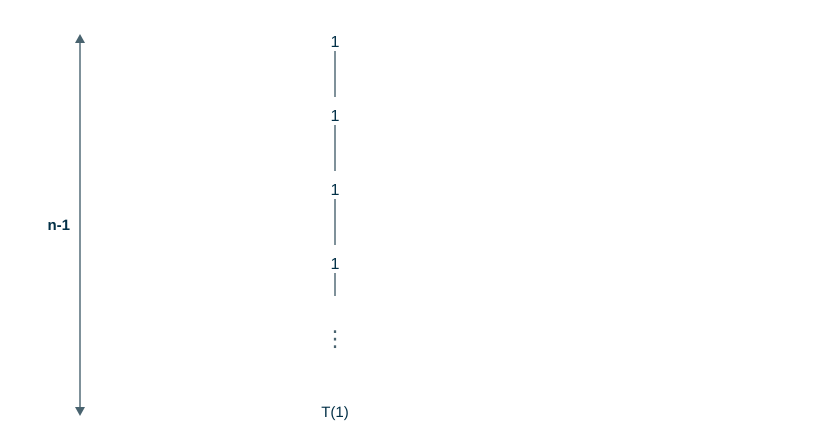

> En el nivel $i$ está el subproblema $T(n-i)$. Se llega a $T(1)$ cuando $n - i = 1$, es decir, en el nivel $i = n-1$. Los niveles van de $0$ a $n-1$.

:::
:::{tab-item} Paso 8
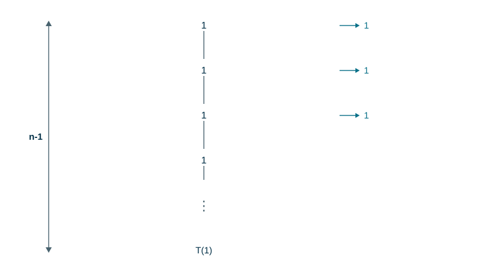

> Sumamos el costo de los nodos de cada nivel (columna de la derecha).

:::
:::{tab-item} Paso 9
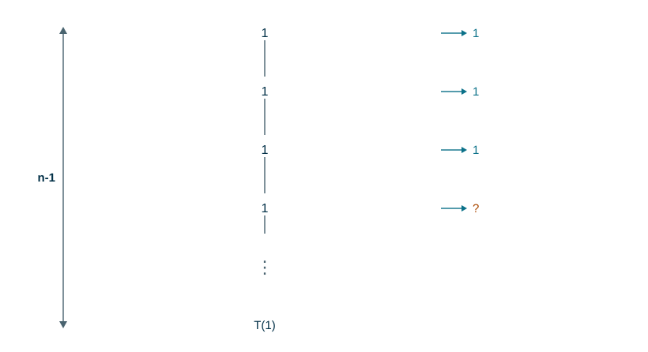

> **¿Cuánto cuesta el nivel 3?**

:::
:::{tab-item} Paso 10
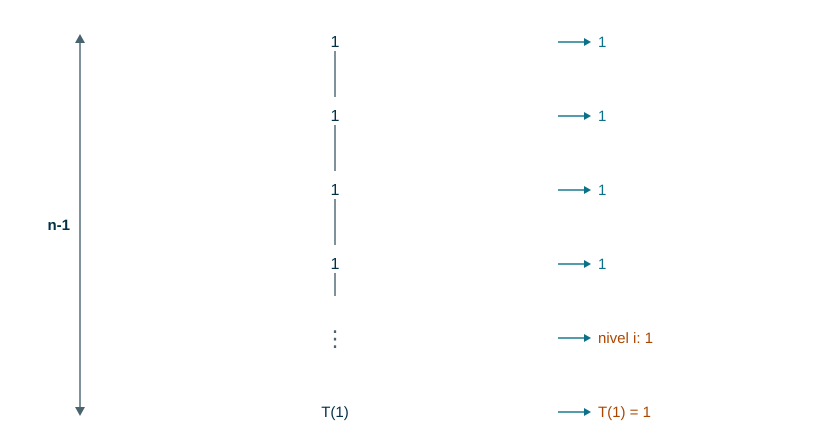

> Todos los niveles cuestan $1$, incluida la hoja $T(1) = 1$.

:::
:::{tab-item} Paso 11


$$
\begin{aligned}
\text{Total} &\textcolor{#a94700}{= \sum_{i=0}^{n-1} 1} \\
&\textcolor{#a94700}{= n = O(n)}
\end{aligned}
$$

> Es el mismo resultado que por iteración: el árbol es una cadena de $n$ nodos que cuestan $1$ cada uno.

:::
::::
:::::

#### Ejemplo 2

Resolver $T(n) = T(n-1) + n$, con $T(1) = 1$.

:::::{admonition} Solución por iteración
:class: dropdown
::::{tab-set}
:::{tab-item} Paso 1
$$
\begin{aligned}
T(n) &\textcolor{#a94700}{= T(n-1) + n}
\end{aligned}
$$

> Se aplica la recurrencia con $n-1$: $\;T(n-1) = T((n-1)-1) + (n-1) = T(n-2) + (n-1)$.

:::
:::{tab-item} Paso 2
$$
\begin{aligned}
T(n) &= T(n-1) + n \\
&\textcolor{#a94700}{= \big(T(n-2) + (n-1)\big) + n} \\
&\textcolor{#a94700}{= T(n-2) + (n-1) + n}
\end{aligned}
$$

> Ahora $T(n-2) = T(n-3) + (n-2)$.

:::
:::{tab-item} Paso 3
$$
\begin{aligned}
T(n) &= T(n-1) + n \\
&= \big(T(n-2) + (n-1)\big) + n \\
&= T(n-2) + (n-1) + n \\
&\textcolor{#a94700}{= \big(T(n-3) + (n-2)\big) + (n-1) + n} \\
&\textcolor{#a94700}{= T(n-3) + (n-2) + (n-1) + n}
\end{aligned}
$$

:::
:::{tab-item} Paso 4
$$
\begin{aligned}
T(n) &= T(n-1) + n \\
&= \big(T(n-2) + (n-1)\big) + n \\
&= T(n-2) + (n-1) + n \\
&= \big(T(n-3) + (n-2)\big) + (n-1) + n \\
&= T(n-3) + (n-2) + (n-1) + n \\
&\textcolor{#a94700}{= T(n-4) + (n-3) + (n-2) + (n-1) + n}
\end{aligned}
$$

> **¿Cuándo se detienen las iteraciones?**

:::
:::{tab-item} Paso 5
$$
\begin{aligned}
T(n) &= T(n-1) + n \\
&= \big(T(n-2) + (n-1)\big) + n \\
&= T(n-2) + (n-1) + n \\
&= \big(T(n-3) + (n-2)\big) + (n-1) + n \\
&= T(n-3) + (n-2) + (n-1) + n \\
&= T(n-4) + (n-3) + (n-2) + (n-1) + n \\
&\textcolor{#a94700}{\;\;\vdots} \\
&\textcolor{#a94700}{= T(1) + 2 + \cdots + (n-3) + (n-2) + (n-1) + n}
\end{aligned}
$$

Las iteraciones se detienen cuando se calcula $T(1)$: el llamado recursivo se hace cada vez sobre un subproblema más pequeño y $n - i = 1$ cuando $i = n-1$.

:::
:::{tab-item} Paso 6
$$
\begin{aligned}
T(n) &= T(n-1) + n \\
&= \big(T(n-2) + (n-1)\big) + n \\
&= T(n-2) + (n-1) + n \\
&= \big(T(n-3) + (n-2)\big) + (n-1) + n \\
&= T(n-3) + (n-2) + (n-1) + n \\
&= T(n-4) + (n-3) + (n-2) + (n-1) + n \\
&\;\;\vdots \\
&= T(1) + 2 + \cdots + (n-3) + (n-2) + (n-1) + n \\
&\textcolor{#a94700}{= 1 + 2 + \cdots + (n-3) + (n-2) + (n-1) + n}
\end{aligned}
$$

Las iteraciones se detienen cuando se calcula $T(1)$: el llamado recursivo se hace cada vez sobre un subproblema más pequeño y $n - i = 1$ cuando $i = n-1$.

> Según la recurrencia, $T(1) = 1$.

:::
:::{tab-item} Paso 7
$$
\begin{aligned}
T(n) &= T(n-1) + n \\
&= \big(T(n-2) + (n-1)\big) + n \\
&= T(n-2) + (n-1) + n \\
&= \big(T(n-3) + (n-2)\big) + (n-1) + n \\
&= T(n-3) + (n-2) + (n-1) + n \\
&= T(n-4) + (n-3) + (n-2) + (n-1) + n \\
&\;\;\vdots \\
&= T(1) + 2 + \cdots + (n-3) + (n-2) + (n-1) + n \\
&= 1 + 2 + \cdots + (n-3) + (n-2) + (n-1) + n \\
&\textcolor{#a94700}{= \sum_{i=1}^{n} i}
\end{aligned}
$$

Las iteraciones se detienen cuando se calcula $T(1)$: el llamado recursivo se hace cada vez sobre un subproblema más pequeño y $n - i = 1$ cuando $i = n-1$.

> Después de iterar, se expresa el resultado como una sumatoria.

:::
:::{tab-item} Paso 8
$$
\begin{aligned}
T(n) &= T(n-1) + n \\
&= \big(T(n-2) + (n-1)\big) + n \\
&= T(n-2) + (n-1) + n \\
&= \big(T(n-3) + (n-2)\big) + (n-1) + n \\
&= T(n-3) + (n-2) + (n-1) + n \\
&= T(n-4) + (n-3) + (n-2) + (n-1) + n \\
&\;\;\vdots \\
&= T(1) + 2 + \cdots + (n-3) + (n-2) + (n-1) + n \\
&= 1 + 2 + \cdots + (n-3) + (n-2) + (n-1) + n \\
&= \sum_{i=1}^{n} i \\
&\textcolor{#a94700}{= \frac{n(n+1)}{2}}
\end{aligned}
$$

Las iteraciones se detienen cuando se calcula $T(1)$: el llamado recursivo se hace cada vez sobre un subproblema más pequeño y $n - i = 1$ cuando $i = n-1$.

> Se usa la forma cerrada $\sum_{k=1}^{n} k = \frac{n(n+1)}{2}$.

:::
:::{tab-item} Paso 9
$$
\begin{aligned}
T(n) &= T(n-1) + n \\
&= \big(T(n-2) + (n-1)\big) + n \\
&= T(n-2) + (n-1) + n \\
&= \big(T(n-3) + (n-2)\big) + (n-1) + n \\
&= T(n-3) + (n-2) + (n-1) + n \\
&= T(n-4) + (n-3) + (n-2) + (n-1) + n \\
&\;\;\vdots \\
&= T(1) + 2 + \cdots + (n-3) + (n-2) + (n-1) + n \\
&= 1 + 2 + \cdots + (n-3) + (n-2) + (n-1) + n \\
&= \sum_{i=1}^{n} i \\
&= \frac{n(n+1)}{2} \\
&\textcolor{#a94700}{= O(n^2)}
\end{aligned}
$$

Las iteraciones se detienen cuando se calcula $T(1)$: el llamado recursivo se hace cada vez sobre un subproblema más pequeño y $n - i = 1$ cuando $i = n-1$.

:::
::::
:::::
:::::{admonition} Solución con árbol de recursión
:class: dropdown
::::{tab-set}
:::{tab-item} Paso 1


> Empezamos con la raíz: el problema original $T(n)$.

:::
:::{tab-item} Paso 2


> El problema de tamaño $n$ hace un trabajo de $n$ y genera un subproblema de tamaño $n-1$.

:::
:::{tab-item} Paso 3


> Cada subproblema se expande con la misma regla: su costo propio queda en el nodo y sus hijos son los nuevos subproblemas.

:::
:::{tab-item} Paso 4


> Cada subproblema se expande con la misma regla: su costo propio queda en el nodo y sus hijos son los nuevos subproblemas.

:::
:::{tab-item} Paso 5
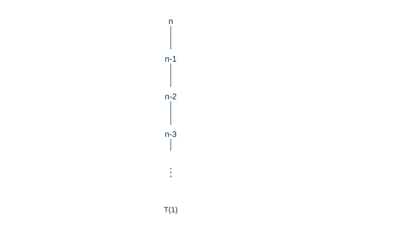

> Seguimos expandiendo hasta llegar al caso base $T(1)$ en las hojas.

:::
:::{tab-item} Paso 6
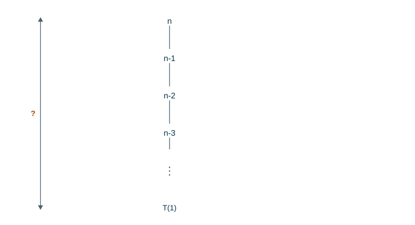

> **¿Cuántos niveles tiene el árbol?**

:::
:::{tab-item} Paso 7
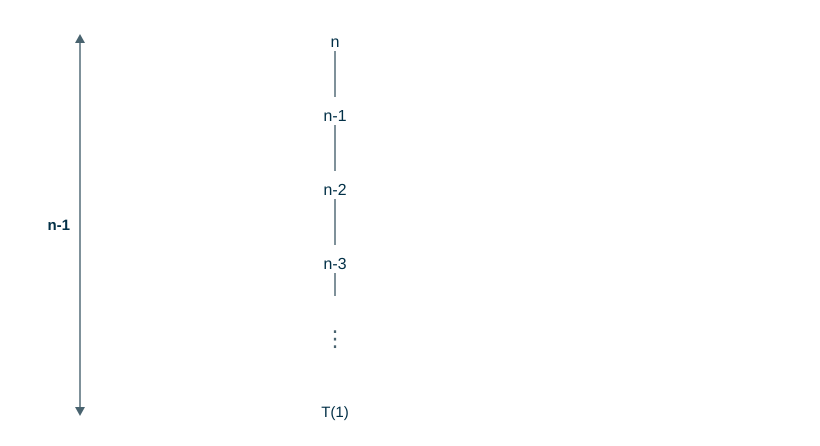

> En el nivel $i$ está $T(n-i)$; se llega a $T(1)$ en el nivel $i = n-1$.

:::
:::{tab-item} Paso 8
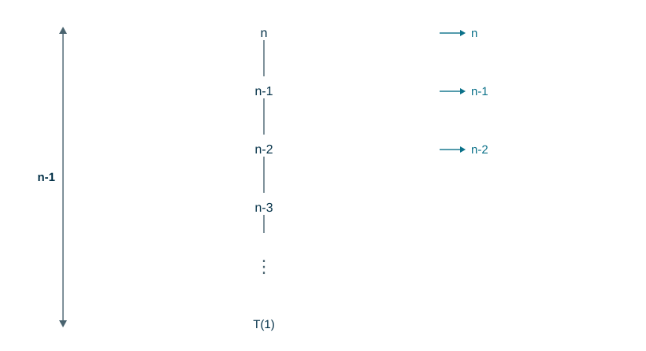

> Sumamos el costo de los nodos de cada nivel (columna de la derecha).

:::
:::{tab-item} Paso 9
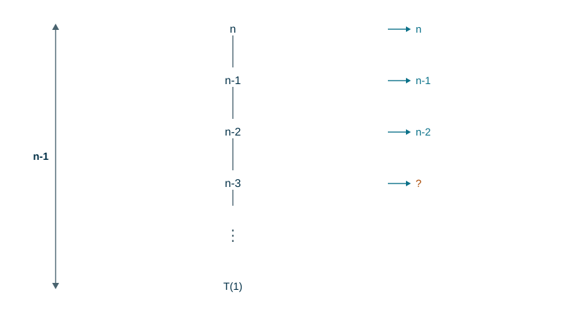

> **¿Cuánto cuesta el nivel 3?**

:::
:::{tab-item} Paso 10
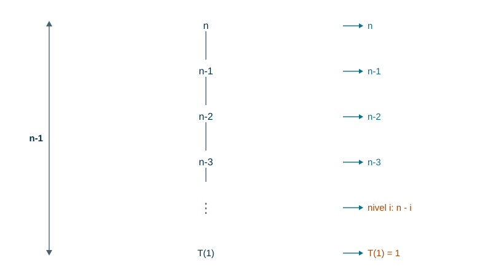

> El nivel $3$ cuesta $n-3$. En general, el nivel $i$ cuesta $n - i$, y la hoja cuesta $T(1) = 1$.

:::
:::{tab-item} Paso 11


$$
\begin{aligned}
\text{Total} &\textcolor{#a94700}{= n + (n-1) + (n-2) + \cdots + 2 + 1} \\
&\textcolor{#a94700}{= \sum_{i=1}^{n} i = \frac{n(n+1)}{2}} \\
&\textcolor{#a94700}{= O(n^2)}
\end{aligned}
$$

:::
::::
:::::

#### Ejemplo 3

Resolver $T(n) = 2T(n-1) + 1$, con $T(1) = 1$.

Esta recurrencia cuenta los movimientos de las **Torres de Hanoi**: para mover $n$ discos se mueven $n-1$ discos a la barra auxiliar, luego el disco más grande y luego otra vez los $n-1$ discos encima de él.

:::::{admonition} Solución por iteración
:class: dropdown
::::{tab-set}
:::{tab-item} Paso 1
$$
\begin{aligned}
T(n) &\textcolor{#a94700}{= 2T(n-1) + 1}
\end{aligned}
$$

> Se aplica la recurrencia con $n-1$: $\;T(n-1) = 2T((n-1)-1) + 1 = 2T(n-2) + 1$.

:::
:::{tab-item} Paso 2
$$
\begin{aligned}
T(n) &= 2T(n-1) + 1 \\
&\textcolor{#a94700}{= 2\big(2T(n-2) + 1\big) + 1} \\
&\textcolor{#a94700}{= 2^2\,T(n-2) + 2 + 1}
\end{aligned}
$$

> Ahora $T(n-2) = 2T(n-3) + 1$.

:::
:::{tab-item} Paso 3
$$
\begin{aligned}
T(n) &= 2T(n-1) + 1 \\
&= 2\big(2T(n-2) + 1\big) + 1 \\
&= 2^2\,T(n-2) + 2 + 1 \\
&\textcolor{#a94700}{= 2^2\big(2T(n-3) + 1\big) + 2 + 1} \\
&\textcolor{#a94700}{= 2^3\,T(n-3) + 2^2 + 2 + 1}
\end{aligned}
$$

:::
:::{tab-item} Paso 4
$$
\begin{aligned}
T(n) &= 2T(n-1) + 1 \\
&= 2\big(2T(n-2) + 1\big) + 1 \\
&= 2^2\,T(n-2) + 2 + 1 \\
&= 2^2\big(2T(n-3) + 1\big) + 2 + 1 \\
&= 2^3\,T(n-3) + 2^2 + 2 + 1 \\
&\textcolor{#a94700}{= 2^4\,T(n-4) + 2^3 + 2^2 + 2 + 1}
\end{aligned}
$$

> **¿Cuándo se detienen las iteraciones?**

:::
:::{tab-item} Paso 5
$$
\begin{aligned}
T(n) &= 2T(n-1) + 1 \\
&= 2\big(2T(n-2) + 1\big) + 1 \\
&= 2^2\,T(n-2) + 2 + 1 \\
&= 2^2\big(2T(n-3) + 1\big) + 2 + 1 \\
&= 2^3\,T(n-3) + 2^2 + 2 + 1 \\
&= 2^4\,T(n-4) + 2^3 + 2^2 + 2 + 1 \\
&\textcolor{#a94700}{\;\;\vdots} \\
&\textcolor{#a94700}{= 2^{n-1}\,T(n-(n-1)) + \cdots + 2^3 + 2^2 + 2^1 + 2^0}
\end{aligned}
$$

Las iteraciones se detienen en $T(1)$, es decir, cuando $n - i = 1$: $\;i = n-1$.

> Se escribe $2 = 2^1$ y $1 = 2^0$ para que el patrón quede a la vista.

:::
:::{tab-item} Paso 6
$$
\begin{aligned}
T(n) &= 2T(n-1) + 1 \\
&= 2\big(2T(n-2) + 1\big) + 1 \\
&= 2^2\,T(n-2) + 2 + 1 \\
&= 2^2\big(2T(n-3) + 1\big) + 2 + 1 \\
&= 2^3\,T(n-3) + 2^2 + 2 + 1 \\
&= 2^4\,T(n-4) + 2^3 + 2^2 + 2 + 1 \\
&\;\;\vdots \\
&= 2^{n-1}\,T(n-(n-1)) + \cdots + 2^3 + 2^2 + 2^1 + 2^0 \\
&\textcolor{#a94700}{= 2^{n-1}\,T(1) + \cdots + 2^3 + 2^2 + 2^1 + 2^0}
\end{aligned}
$$

Las iteraciones se detienen en $T(1)$, es decir, cuando $n - i = 1$: $\;i = n-1$.

:::
:::{tab-item} Paso 7
$$
\begin{aligned}
T(n) &= 2T(n-1) + 1 \\
&= 2\big(2T(n-2) + 1\big) + 1 \\
&= 2^2\,T(n-2) + 2 + 1 \\
&= 2^2\big(2T(n-3) + 1\big) + 2 + 1 \\
&= 2^3\,T(n-3) + 2^2 + 2 + 1 \\
&= 2^4\,T(n-4) + 2^3 + 2^2 + 2 + 1 \\
&\;\;\vdots \\
&= 2^{n-1}\,T(n-(n-1)) + \cdots + 2^3 + 2^2 + 2^1 + 2^0 \\
&= 2^{n-1}\,T(1) + \cdots + 2^3 + 2^2 + 2^1 + 2^0 \\
&\textcolor{#a94700}{= 2^{n-1} + \cdots + 2^3 + 2^2 + 2^1 + 2^0}
\end{aligned}
$$

Las iteraciones se detienen en $T(1)$, es decir, cuando $n - i = 1$: $\;i = n-1$.

> Según la recurrencia, $T(1) = 1$.

:::
:::{tab-item} Paso 8
$$
\begin{aligned}
T(n) &= 2T(n-1) + 1 \\
&= 2\big(2T(n-2) + 1\big) + 1 \\
&= 2^2\,T(n-2) + 2 + 1 \\
&= 2^2\big(2T(n-3) + 1\big) + 2 + 1 \\
&= 2^3\,T(n-3) + 2^2 + 2 + 1 \\
&= 2^4\,T(n-4) + 2^3 + 2^2 + 2 + 1 \\
&\;\;\vdots \\
&= 2^{n-1}\,T(n-(n-1)) + \cdots + 2^3 + 2^2 + 2^1 + 2^0 \\
&= 2^{n-1}\,T(1) + \cdots + 2^3 + 2^2 + 2^1 + 2^0 \\
&= 2^{n-1} + \cdots + 2^3 + 2^2 + 2^1 + 2^0 \\
&\textcolor{#a94700}{= \sum_{i=0}^{n-1} 2^i}
\end{aligned}
$$

Las iteraciones se detienen en $T(1)$, es decir, cuando $n - i = 1$: $\;i = n-1$.

:::
:::{tab-item} Paso 9
$$
\begin{aligned}
T(n) &= 2T(n-1) + 1 \\
&= 2\big(2T(n-2) + 1\big) + 1 \\
&= 2^2\,T(n-2) + 2 + 1 \\
&= 2^2\big(2T(n-3) + 1\big) + 2 + 1 \\
&= 2^3\,T(n-3) + 2^2 + 2 + 1 \\
&= 2^4\,T(n-4) + 2^3 + 2^2 + 2 + 1 \\
&\;\;\vdots \\
&= 2^{n-1}\,T(n-(n-1)) + \cdots + 2^3 + 2^2 + 2^1 + 2^0 \\
&= 2^{n-1}\,T(1) + \cdots + 2^3 + 2^2 + 2^1 + 2^0 \\
&= 2^{n-1} + \cdots + 2^3 + 2^2 + 2^1 + 2^0 \\
&= \sum_{i=0}^{n-1} 2^i \\
&\textcolor{#a94700}{= 2^n - 1}
\end{aligned}
$$

Las iteraciones se detienen en $T(1)$, es decir, cuando $n - i = 1$: $\;i = n-1$.

> Serie geométrica con $r = 2$: $\;\sum_{i=0}^{k} 2^i = \frac{2^{k+1}-1}{2-1} = 2^{k+1} - 1$, con $k = n-1$.

:::
:::{tab-item} Paso 10
$$
\begin{aligned}
T(n) &= 2T(n-1) + 1 \\
&= 2\big(2T(n-2) + 1\big) + 1 \\
&= 2^2\,T(n-2) + 2 + 1 \\
&= 2^2\big(2T(n-3) + 1\big) + 2 + 1 \\
&= 2^3\,T(n-3) + 2^2 + 2 + 1 \\
&= 2^4\,T(n-4) + 2^3 + 2^2 + 2 + 1 \\
&\;\;\vdots \\
&= 2^{n-1}\,T(n-(n-1)) + \cdots + 2^3 + 2^2 + 2^1 + 2^0 \\
&= 2^{n-1}\,T(1) + \cdots + 2^3 + 2^2 + 2^1 + 2^0 \\
&= 2^{n-1} + \cdots + 2^3 + 2^2 + 2^1 + 2^0 \\
&= \sum_{i=0}^{n-1} 2^i \\
&= 2^n - 1 \\
&\textcolor{#a94700}{= O(2^n)}
\end{aligned}
$$

Las iteraciones se detienen en $T(1)$, es decir, cuando $n - i = 1$: $\;i = n-1$.

:::
::::
:::::
:::::{admonition} Solución con árbol de recursión
:class: dropdown
::::{tab-set}
:::{tab-item} Paso 1


> Empezamos con la raíz: el problema original $T(n)$.

:::
:::{tab-item} Paso 2


> El nodo raíz hace un trabajo de $1$ y genera **dos** subproblemas de tamaño $n-1$.

:::
:::{tab-item} Paso 3
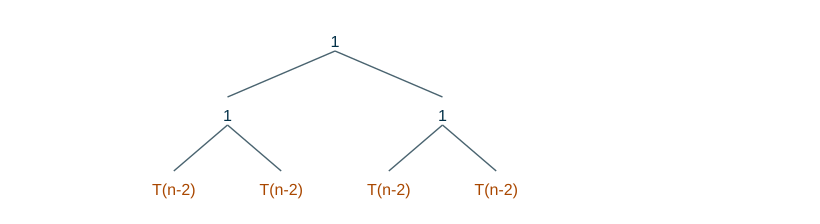

> Cada subproblema se expande con la misma regla: su costo propio queda en el nodo y sus hijos son los nuevos subproblemas.

:::
:::{tab-item} Paso 4
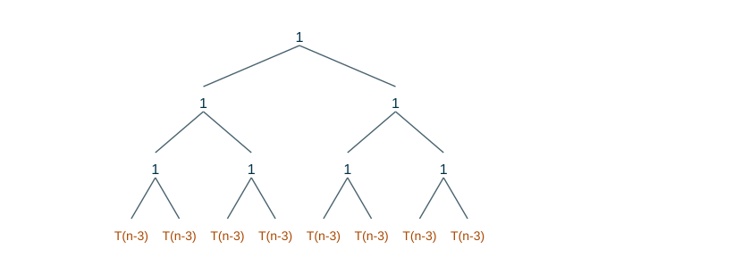

> Cada subproblema se expande con la misma regla: su costo propio queda en el nodo y sus hijos son los nuevos subproblemas.

:::
:::{tab-item} Paso 5
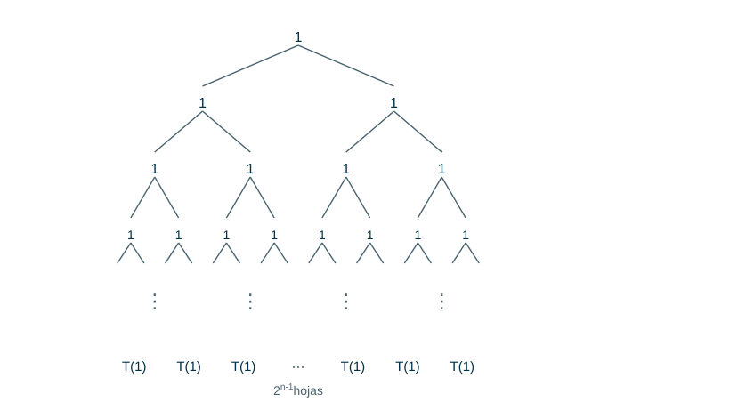

> Seguimos expandiendo hasta llegar al caso base $T(1)$ en las hojas.

:::
:::{tab-item} Paso 6
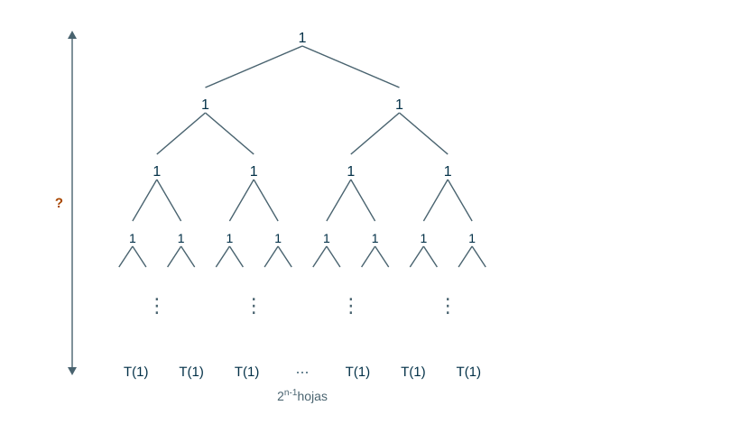

> **¿Cuántos niveles tiene el árbol?**

:::
:::{tab-item} Paso 7
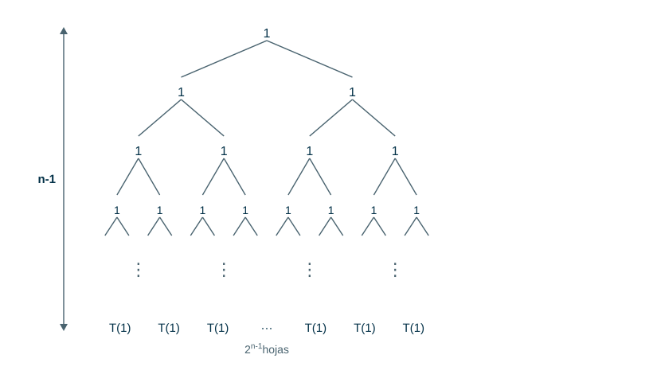

> Cada nivel reduce el tamaño en $1$; las hojas $T(1)$ están en el nivel $n-1$.

:::
:::{tab-item} Paso 8
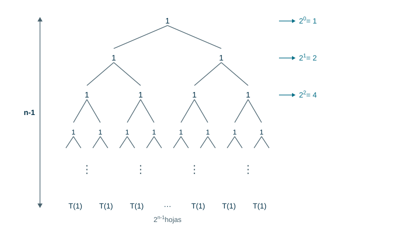

> Sumamos el costo de los nodos de cada nivel (columna de la derecha).

:::
:::{tab-item} Paso 9
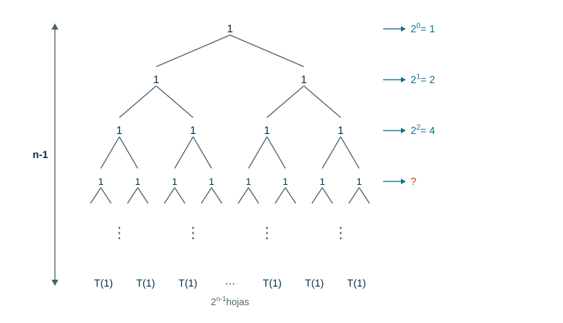

> **¿Cuánto cuesta el nivel 3?**

:::
:::{tab-item} Paso 10
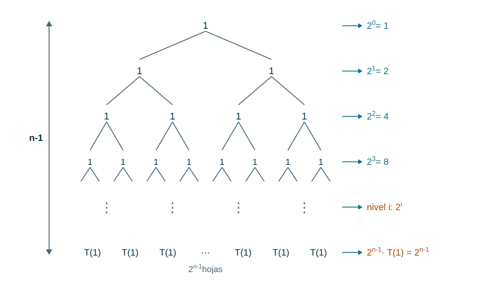

> El nivel $3$ tiene $2^3 = 8$ nodos de costo $1$. En general, el nivel $i$ tiene $2^i$ nodos y cuesta $2^i$.

:::
:::{tab-item} Paso 11


$$
\begin{aligned}
\text{Total} &\textcolor{#a94700}{= \sum_{i=0}^{n-1} 2^i} \\
&\textcolor{#a94700}{= 2^n - 1 = O(2^n)}
\end{aligned}
$$

:::
::::
:::::

### 1.2 Recurrencias que dividen

En estas recurrencias cada llamado recursivo trabaja sobre una **fracción** del problema: de $n$ pasa a $n/2$, $n/3$, $n/4$… Son las recurrencias de los algoritmos divide y vencerás.

#### Ejemplo 4

¿Qué recurrencia describe el número de comparaciones de la siguiente función?

```scala
def misterio(datos: Vector[Int], i: Int, j: Int, b: Int): Unit =
  if (i > j) println("No encontrado")
  else {
    val medio = (i + j) / 2
    if (datos(medio) == b) println("Encontrado")
    else if (datos(medio) < b) misterio(datos, medio + 1, j, b)
    else misterio(datos, i, medio - 1, b)
  }
```

Es la **búsqueda binaria**: en cada llamado hace un trabajo constante y continúa en **una** de las dos mitades. Por eso:

$$
T(n) = T(n/2) + 1, \qquad T(1) = 1
$$

:::::{admonition} Solución por iteración
:class: dropdown
::::{tab-set}
:::{tab-item} Paso 1
$$
\begin{aligned}
T(n) &\textcolor{#a94700}{= T(n/2) + 1}
\end{aligned}
$$

> Se aplica la recurrencia con $n/2$: $\;T(n/2) = T\big((n/2)/2\big) + 1 = T(n/4) + 1$.

:::
:::{tab-item} Paso 2
$$
\begin{aligned}
T(n) &= T(n/2) + 1 \\
&\textcolor{#a94700}{= \big(T(n/4) + 1\big) + 1} \\
&\textcolor{#a94700}{= T(n/2^2) + 1 + 1}
\end{aligned}
$$

> Ahora $T(n/4) = T(n/8) + 1$.

:::
:::{tab-item} Paso 3
$$
\begin{aligned}
T(n) &= T(n/2) + 1 \\
&= \big(T(n/4) + 1\big) + 1 \\
&= T(n/2^2) + 1 + 1 \\
&\textcolor{#a94700}{= T(n/2^3) + 1 + 1 + 1}
\end{aligned}
$$

> **¿Qué patrón aparece después de $i$ expansiones?**

:::
:::{tab-item} Paso 4
$$
\begin{aligned}
T(n) &= T(n/2) + 1 \\
&= \big(T(n/4) + 1\big) + 1 \\
&= T(n/2^2) + 1 + 1 \\
&= T(n/2^3) + 1 + 1 + 1 \\
&\textcolor{#a94700}{\;\;\vdots} \\
&\textcolor{#a94700}{= T(n/2^i) + \underbrace{1 + \cdots + 1}_{i}}
\end{aligned}
$$

> **¿Cuándo se detienen las iteraciones?**

:::
:::{tab-item} Paso 5
$$
\begin{aligned}
T(n) &= T(n/2) + 1 \\
&= \big(T(n/4) + 1\big) + 1 \\
&= T(n/2^2) + 1 + 1 \\
&= T(n/2^3) + 1 + 1 + 1 \\
&\;\;\vdots \\
&= T(n/2^i) + \underbrace{1 + \cdots + 1}_{i} \\
&\textcolor{#a94700}{= T(1) + \underbrace{1 + \cdots + 1}_{\log_2 n}}
\end{aligned}
$$

Las iteraciones se detienen en $T(1)$, es decir, cuando $n/2^i = 1$: $\;2^i = n$, $\;i = \log_2 n$.

:::
:::{tab-item} Paso 6
$$
\begin{aligned}
T(n) &= T(n/2) + 1 \\
&= \big(T(n/4) + 1\big) + 1 \\
&= T(n/2^2) + 1 + 1 \\
&= T(n/2^3) + 1 + 1 + 1 \\
&\;\;\vdots \\
&= T(n/2^i) + \underbrace{1 + \cdots + 1}_{i} \\
&= T(1) + \underbrace{1 + \cdots + 1}_{\log_2 n} \\
&\textcolor{#a94700}{= 1 + \log_2 n}
\end{aligned}
$$

Las iteraciones se detienen en $T(1)$, es decir, cuando $n/2^i = 1$: $\;2^i = n$, $\;i = \log_2 n$.

> Según la recurrencia, $T(1) = 1$.

:::
:::{tab-item} Paso 7
$$
\begin{aligned}
T(n) &= T(n/2) + 1 \\
&= \big(T(n/4) + 1\big) + 1 \\
&= T(n/2^2) + 1 + 1 \\
&= T(n/2^3) + 1 + 1 + 1 \\
&\;\;\vdots \\
&= T(n/2^i) + \underbrace{1 + \cdots + 1}_{i} \\
&= T(1) + \underbrace{1 + \cdots + 1}_{\log_2 n} \\
&= 1 + \log_2 n \\
&\textcolor{#a94700}{= O(\log n)}
\end{aligned}
$$

Las iteraciones se detienen en $T(1)$, es decir, cuando $n/2^i = 1$: $\;2^i = n$, $\;i = \log_2 n$.

:::
::::
:::::
:::::{admonition} Solución con árbol de recursión
:class: dropdown
::::{tab-set}
:::{tab-item} Paso 1


> Empezamos con la raíz: el problema original $T(n)$.

:::
:::{tab-item} Paso 2


> El problema de tamaño $n$ hace un trabajo de $1$ y genera **un** subproblema de tamaño $n/2$.

:::
:::{tab-item} Paso 3


> Cada subproblema se expande con la misma regla: su costo propio queda en el nodo y sus hijos son los nuevos subproblemas.

:::
:::{tab-item} Paso 4


> Cada subproblema se expande con la misma regla: su costo propio queda en el nodo y sus hijos son los nuevos subproblemas.

:::
:::{tab-item} Paso 5
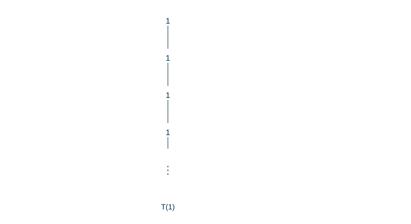

> Seguimos expandiendo hasta llegar al caso base $T(1)$ en las hojas.

:::
:::{tab-item} Paso 6
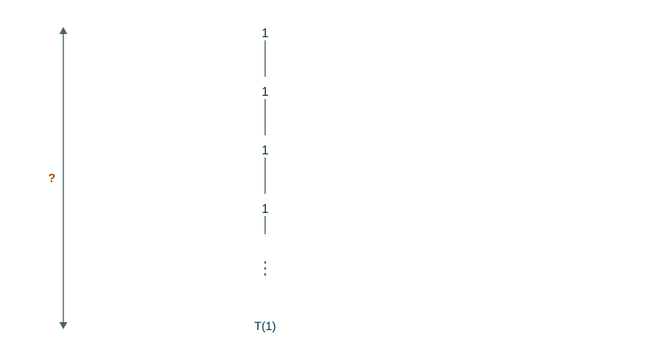

> **¿Cuántos niveles tiene el árbol?**

:::
:::{tab-item} Paso 7
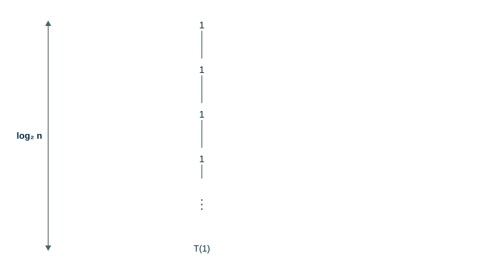

> En el nivel $i$ está $T(n/2^i)$. Se llega a $T(1)$ cuando $n/2^i = 1$, es decir, en el nivel $i = \log_2 n$.

:::
:::{tab-item} Paso 8


> Sumamos el costo de los nodos de cada nivel (columna de la derecha).

:::
:::{tab-item} Paso 9
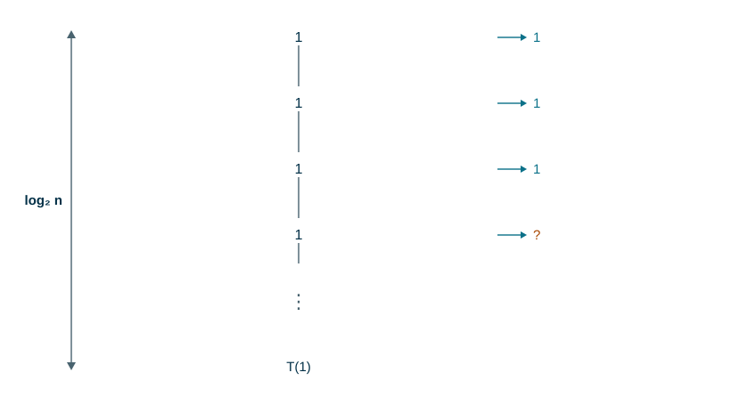

> **¿Cuánto cuesta el nivel 3?**

:::
:::{tab-item} Paso 10


> Todos los niveles cuestan $1$.

:::
:::{tab-item} Paso 11


$$
\begin{aligned}
\text{Total} &\textcolor{#a94700}{= \sum_{i=0}^{\log_2 n} 1} \\
&\textcolor{#a94700}{= \log_2 n + 1 = O(\log n)}
\end{aligned}
$$

:::
::::
:::::

#### Ejemplo 5

Resolver $T(n) = 2T(n/2) + 1$, con $T(1) = 1$.

:::::{admonition} Solución por iteración
:class: dropdown
::::{tab-set}
:::{tab-item} Paso 1
$$
\begin{aligned}
T(n) &\textcolor{#a94700}{= 2T(n/2) + 1}
\end{aligned}
$$

> Se aplica la recurrencia con $n/2$: $\;T(n/2) = 2T\big((n/2)/2\big) + 1 = 2T(n/4) + 1$.

:::
:::{tab-item} Paso 2
$$
\begin{aligned}
T(n) &= 2T(n/2) + 1 \\
&\textcolor{#a94700}{= 2\big(2T(n/4) + 1\big) + 1} \\
&\textcolor{#a94700}{= 2^2\,T(n/2^2) + 2 + 1}
\end{aligned}
$$

> Ahora $T(n/4) = 2T(n/8) + 1$.

:::
:::{tab-item} Paso 3
$$
\begin{aligned}
T(n) &= 2T(n/2) + 1 \\
&= 2\big(2T(n/4) + 1\big) + 1 \\
&= 2^2\,T(n/2^2) + 2 + 1 \\
&\textcolor{#a94700}{= 2^2\big(2T(n/2^3) + 1\big) + 2 + 1} \\
&\textcolor{#a94700}{= 2^3\,T(n/2^3) + 2^2 + 2^1 + 2^0}
\end{aligned}
$$

> **¿Qué patrón aparece después de $i$ expansiones?**

:::
:::{tab-item} Paso 4
$$
\begin{aligned}
T(n) &= 2T(n/2) + 1 \\
&= 2\big(2T(n/4) + 1\big) + 1 \\
&= 2^2\,T(n/2^2) + 2 + 1 \\
&= 2^2\big(2T(n/2^3) + 1\big) + 2 + 1 \\
&= 2^3\,T(n/2^3) + 2^2 + 2^1 + 2^0 \\
&\textcolor{#a94700}{\;\;\vdots} \\
&\textcolor{#a94700}{= 2^i\,T(n/2^i) + 2^{i-1} + \cdots + 2^1 + 2^0}
\end{aligned}
$$

> **¿Cuándo se detienen las iteraciones?**

:::
:::{tab-item} Paso 5
$$
\begin{aligned}
T(n) &= 2T(n/2) + 1 \\
&= 2\big(2T(n/4) + 1\big) + 1 \\
&= 2^2\,T(n/2^2) + 2 + 1 \\
&= 2^2\big(2T(n/2^3) + 1\big) + 2 + 1 \\
&= 2^3\,T(n/2^3) + 2^2 + 2^1 + 2^0 \\
&\;\;\vdots \\
&= 2^i\,T(n/2^i) + 2^{i-1} + \cdots + 2^1 + 2^0 \\
&\textcolor{#a94700}{= 2^{\log_2 n}\,T(1) + \sum_{j=0}^{\log_2 n - 1} 2^j}
\end{aligned}
$$

Las iteraciones se detienen cuando $n/2^i = 1$, es decir, cuando $i = \log_2 n$.

:::
:::{tab-item} Paso 6
$$
\begin{aligned}
T(n) &= 2T(n/2) + 1 \\
&= 2\big(2T(n/4) + 1\big) + 1 \\
&= 2^2\,T(n/2^2) + 2 + 1 \\
&= 2^2\big(2T(n/2^3) + 1\big) + 2 + 1 \\
&= 2^3\,T(n/2^3) + 2^2 + 2^1 + 2^0 \\
&\;\;\vdots \\
&= 2^i\,T(n/2^i) + 2^{i-1} + \cdots + 2^1 + 2^0 \\
&= 2^{\log_2 n}\,T(1) + \sum_{j=0}^{\log_2 n - 1} 2^j \\
&\textcolor{#a94700}{= n + \big(2^{\log_2 n} - 1\big)}
\end{aligned}
$$

Las iteraciones se detienen cuando $n/2^i = 1$, es decir, cuando $i = \log_2 n$.

> $2^{\log_2 n} = n$, $\;T(1) = 1$ y la serie geométrica da $\sum_{j=0}^{k-1} 2^j = 2^k - 1$.

:::
:::{tab-item} Paso 7
$$
\begin{aligned}
T(n) &= 2T(n/2) + 1 \\
&= 2\big(2T(n/4) + 1\big) + 1 \\
&= 2^2\,T(n/2^2) + 2 + 1 \\
&= 2^2\big(2T(n/2^3) + 1\big) + 2 + 1 \\
&= 2^3\,T(n/2^3) + 2^2 + 2^1 + 2^0 \\
&\;\;\vdots \\
&= 2^i\,T(n/2^i) + 2^{i-1} + \cdots + 2^1 + 2^0 \\
&= 2^{\log_2 n}\,T(1) + \sum_{j=0}^{\log_2 n - 1} 2^j \\
&= n + \big(2^{\log_2 n} - 1\big) \\
&\textcolor{#a94700}{= n + n - 1 = 2n - 1}
\end{aligned}
$$

Las iteraciones se detienen cuando $n/2^i = 1$, es decir, cuando $i = \log_2 n$.

:::
:::{tab-item} Paso 8
$$
\begin{aligned}
T(n) &= 2T(n/2) + 1 \\
&= 2\big(2T(n/4) + 1\big) + 1 \\
&= 2^2\,T(n/2^2) + 2 + 1 \\
&= 2^2\big(2T(n/2^3) + 1\big) + 2 + 1 \\
&= 2^3\,T(n/2^3) + 2^2 + 2^1 + 2^0 \\
&\;\;\vdots \\
&= 2^i\,T(n/2^i) + 2^{i-1} + \cdots + 2^1 + 2^0 \\
&= 2^{\log_2 n}\,T(1) + \sum_{j=0}^{\log_2 n - 1} 2^j \\
&= n + \big(2^{\log_2 n} - 1\big) \\
&= n + n - 1 = 2n - 1 \\
&\textcolor{#a94700}{= O(n)}
\end{aligned}
$$

Las iteraciones se detienen cuando $n/2^i = 1$, es decir, cuando $i = \log_2 n$.

:::
::::
:::::
:::::{admonition} Solución con árbol de recursión
:class: dropdown
::::{tab-set}
:::{tab-item} Paso 1


> Empezamos con la raíz: el problema original $T(n)$.

:::
:::{tab-item} Paso 2


> El nodo raíz hace un trabajo de $1$ y genera dos subproblemas de tamaño $n/2$.

:::
:::{tab-item} Paso 3
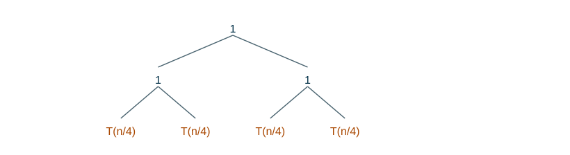

> Cada subproblema se expande con la misma regla: su costo propio queda en el nodo y sus hijos son los nuevos subproblemas.

:::
:::{tab-item} Paso 4
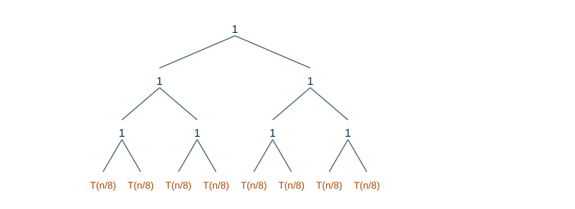

> Cada subproblema se expande con la misma regla: su costo propio queda en el nodo y sus hijos son los nuevos subproblemas.

:::
:::{tab-item} Paso 5


> Seguimos expandiendo hasta llegar al caso base $T(1)$ en las hojas.

:::
:::{tab-item} Paso 6
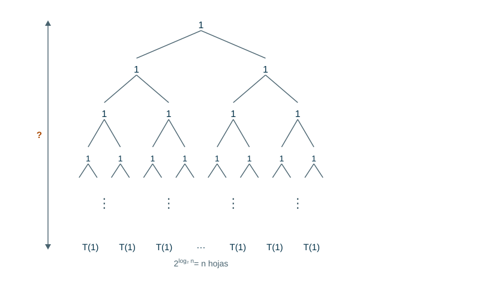

> **¿Cuántos niveles tiene el árbol?**

:::
:::{tab-item} Paso 7
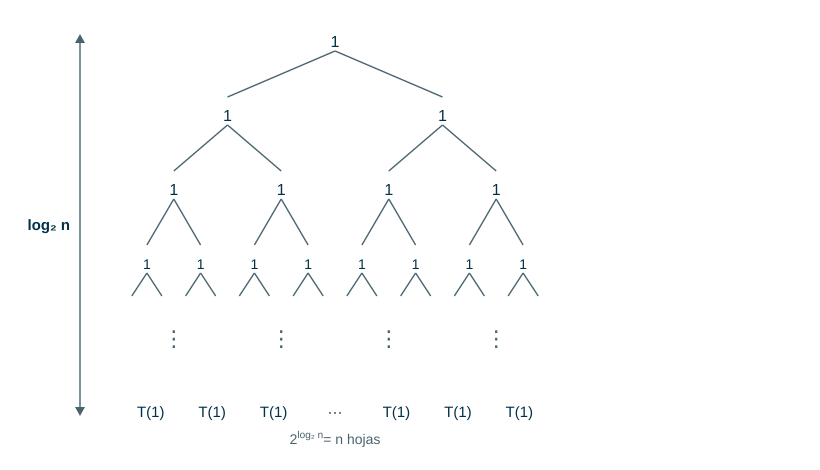

> El tamaño se divide por $2$ en cada nivel: $n/2^i = 1$ cuando $i = \log_2 n$. Las hojas están en el nivel $\log_2 n$ y son $2^{\log_2 n} = n$.

:::
:::{tab-item} Paso 8
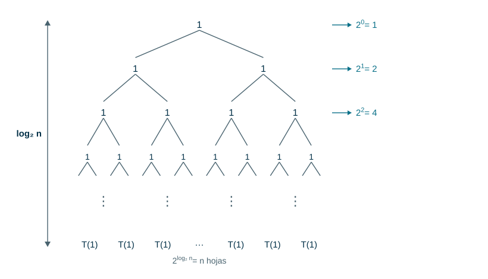

> Sumamos el costo de los nodos de cada nivel (columna de la derecha).

:::
:::{tab-item} Paso 9
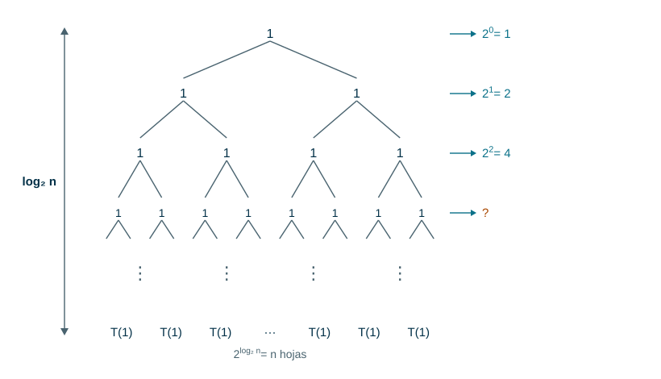

> **¿Cuánto cuesta el nivel 3?**

:::
:::{tab-item} Paso 10
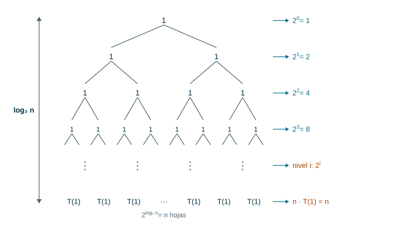

> El nivel $3$ tiene $8$ nodos de costo $1$. En general, el nivel $i$ cuesta $2^i$; el último nivel (las hojas) cuesta $2^{\log_2 n} = n$.

:::
:::{tab-item} Paso 11


$$
\begin{aligned}
\text{Total} &\textcolor{#a94700}{= \sum_{i=0}^{\log_2 n} 2^i} \\
&\textcolor{#a94700}{= 2^{\log_2 n + 1} - 1} \\
&\textcolor{#a94700}{= 2n - 1 = O(n)}
\end{aligned}
$$

> El costo de cada nivel se duplica: el último nivel, el de las hojas, es el que más pesa.

:::
::::
:::::

#### Ejemplo 6

Resolver $T(n) = 2T(n/2) + n$, con $T(1) = 1$. Es la recurrencia de `mergeSort`.

:::::{admonition} Solución por iteración
:class: dropdown
::::{tab-set}
:::{tab-item} Paso 1
$$
\begin{aligned}
T(n) &\textcolor{#a94700}{= 2T(n/2) + n}
\end{aligned}
$$

> Se aplica la recurrencia con $n/2$: $\;T(n/2) = 2T\big((n/2)/2\big) + n/2 = 2T(n/4) + n/2$.

:::
:::{tab-item} Paso 2
$$
\begin{aligned}
T(n) &= 2T(n/2) + n \\
&\textcolor{#a94700}{= 2\Big(2T(n/4) + \frac{n}{2}\Big) + n} \\
&\textcolor{#a94700}{= 2^2\,T(n/2^2) + n + n}
\end{aligned}
$$

> Ahora $T(n/4) = 2T(n/8) + n/4$.

:::
:::{tab-item} Paso 3
$$
\begin{aligned}
T(n) &= 2T(n/2) + n \\
&= 2\Big(2T(n/4) + \frac{n}{2}\Big) + n \\
&= 2^2\,T(n/2^2) + n + n \\
&\textcolor{#a94700}{= 2^2\Big(2T(n/2^3) + \frac{n}{2^2}\Big) + n + n} \\
&\textcolor{#a94700}{= 2^3\,T(n/2^3) + n + n + n}
\end{aligned}
$$

> **¿Qué patrón aparece después de $i$ expansiones?**

:::
:::{tab-item} Paso 4
$$
\begin{aligned}
T(n) &= 2T(n/2) + n \\
&= 2\Big(2T(n/4) + \frac{n}{2}\Big) + n \\
&= 2^2\,T(n/2^2) + n + n \\
&= 2^2\Big(2T(n/2^3) + \frac{n}{2^2}\Big) + n + n \\
&= 2^3\,T(n/2^3) + n + n + n \\
&\textcolor{#a94700}{\;\;\vdots} \\
&\textcolor{#a94700}{= 2^i\,T(n/2^i) + i \cdot n}
\end{aligned}
$$

> **¿Cuándo se detienen las iteraciones?**

:::
:::{tab-item} Paso 5
$$
\begin{aligned}
T(n) &= 2T(n/2) + n \\
&= 2\Big(2T(n/4) + \frac{n}{2}\Big) + n \\
&= 2^2\,T(n/2^2) + n + n \\
&= 2^2\Big(2T(n/2^3) + \frac{n}{2^2}\Big) + n + n \\
&= 2^3\,T(n/2^3) + n + n + n \\
&\;\;\vdots \\
&= 2^i\,T(n/2^i) + i \cdot n \\
&\textcolor{#a94700}{= 2^{\log_2 n}\,T(1) + n\log_2 n}
\end{aligned}
$$

Las iteraciones se detienen cuando $n/2^i = 1$, es decir, cuando $i = \log_2 n$.

:::
:::{tab-item} Paso 6
$$
\begin{aligned}
T(n) &= 2T(n/2) + n \\
&= 2\Big(2T(n/4) + \frac{n}{2}\Big) + n \\
&= 2^2\,T(n/2^2) + n + n \\
&= 2^2\Big(2T(n/2^3) + \frac{n}{2^2}\Big) + n + n \\
&= 2^3\,T(n/2^3) + n + n + n \\
&\;\;\vdots \\
&= 2^i\,T(n/2^i) + i \cdot n \\
&= 2^{\log_2 n}\,T(1) + n\log_2 n \\
&\textcolor{#a94700}{= n + n\log_2 n}
\end{aligned}
$$

Las iteraciones se detienen cuando $n/2^i = 1$, es decir, cuando $i = \log_2 n$.

> $2^{\log_2 n} = n$ y $T(1) = 1$.

:::
:::{tab-item} Paso 7
$$
\begin{aligned}
T(n) &= 2T(n/2) + n \\
&= 2\Big(2T(n/4) + \frac{n}{2}\Big) + n \\
&= 2^2\,T(n/2^2) + n + n \\
&= 2^2\Big(2T(n/2^3) + \frac{n}{2^2}\Big) + n + n \\
&= 2^3\,T(n/2^3) + n + n + n \\
&\;\;\vdots \\
&= 2^i\,T(n/2^i) + i \cdot n \\
&= 2^{\log_2 n}\,T(1) + n\log_2 n \\
&= n + n\log_2 n \\
&\textcolor{#a94700}{= O(n\log n)}
\end{aligned}
$$

Las iteraciones se detienen cuando $n/2^i = 1$, es decir, cuando $i = \log_2 n$.

:::
::::
:::::
:::::{admonition} Solución con árbol de recursión
:class: dropdown
::::{tab-set}
:::{tab-item} Paso 1


> Empezamos con la raíz: el problema original $T(n)$.

:::
:::{tab-item} Paso 2


> El nodo raíz hace un trabajo de $n$ (mezclar) y genera dos subproblemas de tamaño $n/2$.

:::
:::{tab-item} Paso 3
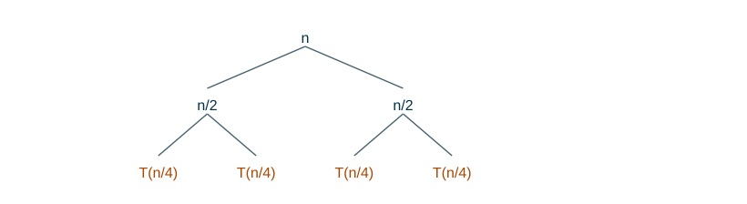

> Cada subproblema se expande con la misma regla: su costo propio queda en el nodo y sus hijos son los nuevos subproblemas.

:::
:::{tab-item} Paso 4
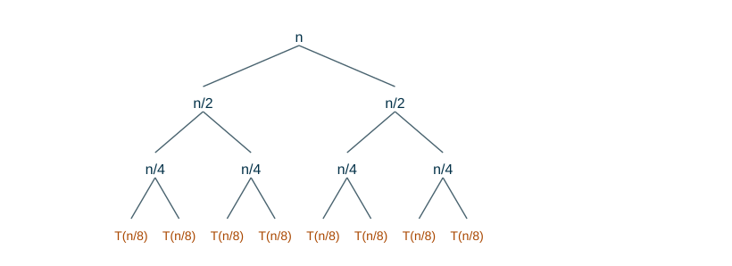

> Cada subproblema se expande con la misma regla: su costo propio queda en el nodo y sus hijos son los nuevos subproblemas.

:::
:::{tab-item} Paso 5
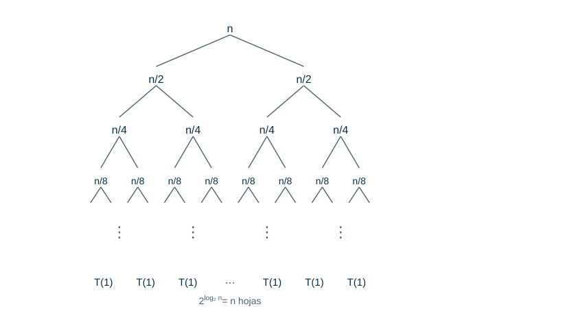

> Seguimos expandiendo hasta llegar al caso base $T(1)$ en las hojas.

:::
:::{tab-item} Paso 6
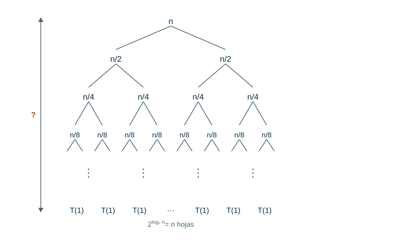

> **¿Cuántos niveles tiene el árbol?**

:::
:::{tab-item} Paso 7
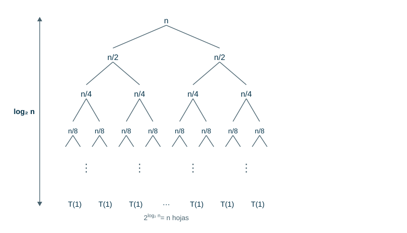

> El tamaño se divide por $2$ en cada nivel: se llega a $T(1)$ en el nivel $\log_2 n$.

:::
:::{tab-item} Paso 8
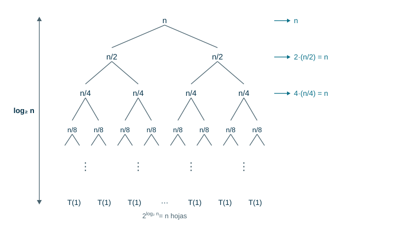

> Sumamos el costo de los nodos de cada nivel (columna de la derecha).

:::
:::{tab-item} Paso 9
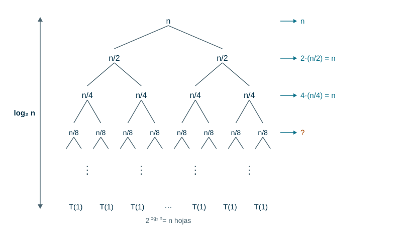

> **¿Cuánto cuesta el nivel 3?**

:::
:::{tab-item} Paso 10
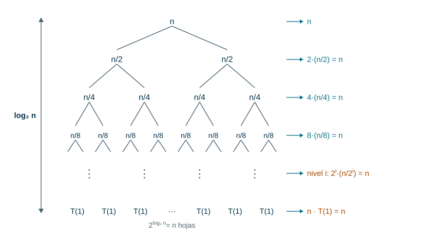

> El nivel $3$ tiene $8$ nodos de costo $n/8$: cuesta $n$. **Todos** los niveles cuestan $n$, y hay $\log_2 n$ niveles internos más el de las hojas.

:::
:::{tab-item} Paso 11


$$
\begin{aligned}
\text{Total} &\textcolor{#a94700}{= \sum_{i=0}^{\log_2 n - 1} n \;+\; n} \\
&\textcolor{#a94700}{= n\log_2 n + n} \\
&\textcolor{#a94700}{= O(n\log n)}
\end{aligned}
$$

:::
::::
:::::

#### Ejemplo 7

Resolver $T(n) = 3T(n/3) + n$, con $T(1) = 1$.

:::::{admonition} Solución por iteración
:class: dropdown
::::{tab-set}
:::{tab-item} Paso 1
$$
\begin{aligned}
T(n) &\textcolor{#a94700}{= 3T(n/3) + n}
\end{aligned}
$$

> Se aplica la recurrencia con $n/3$: $\;T(n/3) = 3T(n/9) + n/3$.

:::
:::{tab-item} Paso 2
$$
\begin{aligned}
T(n) &= 3T(n/3) + n \\
&\textcolor{#a94700}{= 3\Big(3T(n/9) + \frac{n}{3}\Big) + n} \\
&\textcolor{#a94700}{= 3^2\,T(n/3^2) + n + n}
\end{aligned}
$$

> Ahora $T(n/9) = 3T(n/27) + n/9$.

:::
:::{tab-item} Paso 3
$$
\begin{aligned}
T(n) &= 3T(n/3) + n \\
&= 3\Big(3T(n/9) + \frac{n}{3}\Big) + n \\
&= 3^2\,T(n/3^2) + n + n \\
&\textcolor{#a94700}{= 3^2\Big(3T(n/3^3) + \frac{n}{3^2}\Big) + n + n} \\
&\textcolor{#a94700}{= 3^3\,T(n/3^3) + n + n + n}
\end{aligned}
$$

> **¿Qué patrón aparece después de $i$ expansiones?**

:::
:::{tab-item} Paso 4
$$
\begin{aligned}
T(n) &= 3T(n/3) + n \\
&= 3\Big(3T(n/9) + \frac{n}{3}\Big) + n \\
&= 3^2\,T(n/3^2) + n + n \\
&= 3^2\Big(3T(n/3^3) + \frac{n}{3^2}\Big) + n + n \\
&= 3^3\,T(n/3^3) + n + n + n \\
&\textcolor{#a94700}{\;\;\vdots} \\
&\textcolor{#a94700}{= 3^i\,T(n/3^i) + i\cdot n}
\end{aligned}
$$

> **¿Cuándo se detienen las iteraciones?**

:::
:::{tab-item} Paso 5
$$
\begin{aligned}
T(n) &= 3T(n/3) + n \\
&= 3\Big(3T(n/9) + \frac{n}{3}\Big) + n \\
&= 3^2\,T(n/3^2) + n + n \\
&= 3^2\Big(3T(n/3^3) + \frac{n}{3^2}\Big) + n + n \\
&= 3^3\,T(n/3^3) + n + n + n \\
&\;\;\vdots \\
&= 3^i\,T(n/3^i) + i\cdot n \\
&\textcolor{#a94700}{= 3^{\log_3 n}\,T(1) + n\log_3 n}
\end{aligned}
$$

Las iteraciones se detienen cuando $n/3^i = 1$, es decir, cuando $i = \log_3 n$.

:::
:::{tab-item} Paso 6
$$
\begin{aligned}
T(n) &= 3T(n/3) + n \\
&= 3\Big(3T(n/9) + \frac{n}{3}\Big) + n \\
&= 3^2\,T(n/3^2) + n + n \\
&= 3^2\Big(3T(n/3^3) + \frac{n}{3^2}\Big) + n + n \\
&= 3^3\,T(n/3^3) + n + n + n \\
&\;\;\vdots \\
&= 3^i\,T(n/3^i) + i\cdot n \\
&= 3^{\log_3 n}\,T(1) + n\log_3 n \\
&\textcolor{#a94700}{= n + n\log_3 n}
\end{aligned}
$$

Las iteraciones se detienen cuando $n/3^i = 1$, es decir, cuando $i = \log_3 n$.

> $3^{\log_3 n} = n$ y $T(1) = 1$.

:::
:::{tab-item} Paso 7
$$
\begin{aligned}
T(n) &= 3T(n/3) + n \\
&= 3\Big(3T(n/9) + \frac{n}{3}\Big) + n \\
&= 3^2\,T(n/3^2) + n + n \\
&= 3^2\Big(3T(n/3^3) + \frac{n}{3^2}\Big) + n + n \\
&= 3^3\,T(n/3^3) + n + n + n \\
&\;\;\vdots \\
&= 3^i\,T(n/3^i) + i\cdot n \\
&= 3^{\log_3 n}\,T(1) + n\log_3 n \\
&= n + n\log_3 n \\
&\textcolor{#a94700}{= O(n\log n)}
\end{aligned}
$$

Las iteraciones se detienen cuando $n/3^i = 1$, es decir, cuando $i = \log_3 n$.

> $\log_3 n = \frac{\log_2 n}{\log_2 3}$: cambiar la base del logaritmo solo multiplica por una constante.

:::
::::
:::::
:::::{admonition} Solución con árbol de recursión
:class: dropdown
::::{tab-set}
:::{tab-item} Paso 1


> Empezamos con la raíz: el problema original $T(n)$.

:::
:::{tab-item} Paso 2


> El nodo raíz hace un trabajo de $n$ y genera **tres** subproblemas de tamaño $n/3$.

:::
:::{tab-item} Paso 3


> Cada subproblema se expande con la misma regla: su costo propio queda en el nodo y sus hijos son los nuevos subproblemas.

:::
:::{tab-item} Paso 4
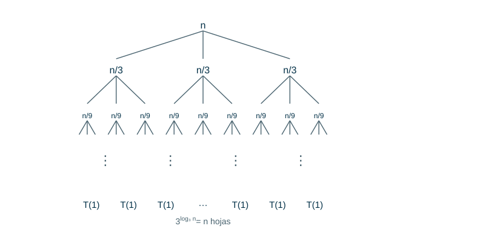

> Seguimos expandiendo hasta llegar al caso base $T(1)$ en las hojas.

:::
:::{tab-item} Paso 5
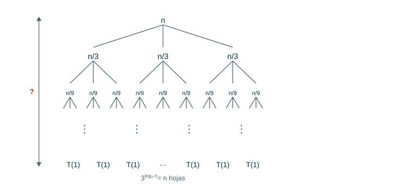

> **¿Cuántos niveles tiene el árbol?**

:::
:::{tab-item} Paso 6
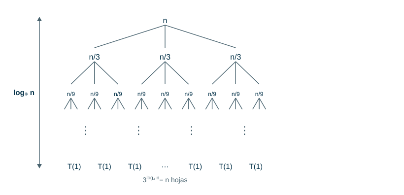

> El tamaño se divide por $3$ en cada nivel: se llega a $T(1)$ en el nivel $\log_3 n$.

:::
:::{tab-item} Paso 7
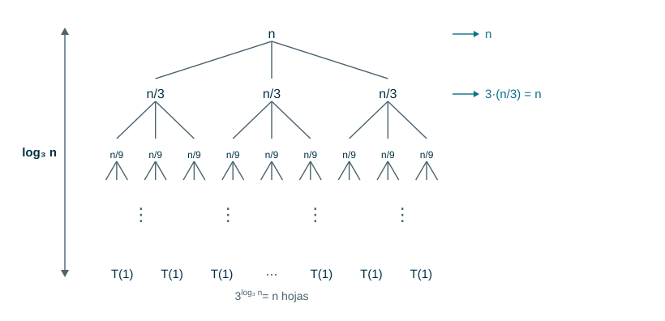

> Sumamos el costo de los nodos de cada nivel (columna de la derecha).

:::
:::{tab-item} Paso 8
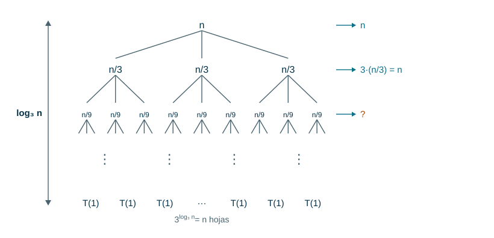

> **¿Cuánto cuesta el nivel 2?**

:::
:::{tab-item} Paso 9
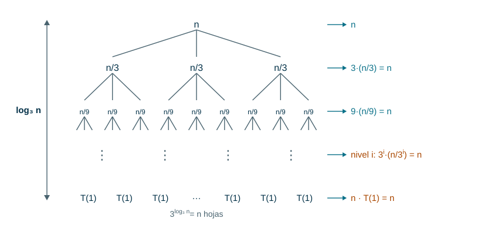

> El nivel $2$ tiene $9$ nodos de costo $n/9$: cuesta $n$. Todos los niveles cuestan $n$.

:::
:::{tab-item} Paso 10


$$
\begin{aligned}
\text{Total} &\textcolor{#a94700}{= \sum_{i=0}^{\log_3 n - 1} n \;+\; n} \\
&\textcolor{#a94700}{= n\log_3 n + n} \\
&\textcolor{#a94700}{= O(n\log n)}
\end{aligned}
$$

:::
::::
:::::

#### Ejemplo 8

Resolver $T(n) = 2T(n/2) + n^2$, con $T(1) = 1$.

:::::{admonition} Solución por iteración
:class: dropdown
::::{tab-set}
:::{tab-item} Paso 1
$$
\begin{aligned}
T(n) &\textcolor{#a94700}{= 2T(n/2) + n^2}
\end{aligned}
$$

> Se aplica la recurrencia con $n/2$: $\;T(n/2) = 2T(n/4) + (n/2)^2 = 2T(n/4) + \frac{n^2}{4}$.

:::
:::{tab-item} Paso 2
$$
\begin{aligned}
T(n) &= 2T(n/2) + n^2 \\
&\textcolor{#a94700}{= 2\Big(2T(n/4) + \frac{n^2}{4}\Big) + n^2} \\
&\textcolor{#a94700}{= 2^2\,T(n/2^2) + \frac{n^2}{2} + n^2}
\end{aligned}
$$

> Ahora $T(n/4) = 2T(n/8) + (n/4)^2 = 2T(n/8) + \frac{n^2}{16}$.

:::
:::{tab-item} Paso 3
$$
\begin{aligned}
T(n) &= 2T(n/2) + n^2 \\
&= 2\Big(2T(n/4) + \frac{n^2}{4}\Big) + n^2 \\
&= 2^2\,T(n/2^2) + \frac{n^2}{2} + n^2 \\
&\textcolor{#a94700}{= 2^2\Big(2T(n/2^3) + \frac{n^2}{16}\Big) + \frac{n^2}{2} + n^2} \\
&\textcolor{#a94700}{= 2^3\,T(n/2^3) + \frac{n^2}{2^2} + \frac{n^2}{2^1} + \frac{n^2}{2^0}}
\end{aligned}
$$

> **¿Qué patrón aparece después de $i$ expansiones?**

:::
:::{tab-item} Paso 4
$$
\begin{aligned}
T(n) &= 2T(n/2) + n^2 \\
&= 2\Big(2T(n/4) + \frac{n^2}{4}\Big) + n^2 \\
&= 2^2\,T(n/2^2) + \frac{n^2}{2} + n^2 \\
&= 2^2\Big(2T(n/2^3) + \frac{n^2}{16}\Big) + \frac{n^2}{2} + n^2 \\
&= 2^3\,T(n/2^3) + \frac{n^2}{2^2} + \frac{n^2}{2^1} + \frac{n^2}{2^0} \\
&\textcolor{#a94700}{\;\;\vdots} \\
&\textcolor{#a94700}{= 2^i\,T(n/2^i) + \sum_{j=0}^{i-1} \frac{n^2}{2^j}}
\end{aligned}
$$

> **¿Cuándo se detienen las iteraciones?**

:::
:::{tab-item} Paso 5
$$
\begin{aligned}
T(n) &= 2T(n/2) + n^2 \\
&= 2\Big(2T(n/4) + \frac{n^2}{4}\Big) + n^2 \\
&= 2^2\,T(n/2^2) + \frac{n^2}{2} + n^2 \\
&= 2^2\Big(2T(n/2^3) + \frac{n^2}{16}\Big) + \frac{n^2}{2} + n^2 \\
&= 2^3\,T(n/2^3) + \frac{n^2}{2^2} + \frac{n^2}{2^1} + \frac{n^2}{2^0} \\
&\;\;\vdots \\
&= 2^i\,T(n/2^i) + \sum_{j=0}^{i-1} \frac{n^2}{2^j} \\
&\textcolor{#a94700}{= 2^{\log_2 n}\,T(1) + n^2\sum_{j=0}^{\log_2 n - 1} \Big(\frac{1}{2}\Big)^j}
\end{aligned}
$$

Las iteraciones se detienen cuando $n/2^i = 1$, es decir, cuando $i = \log_2 n$.

:::
:::{tab-item} Paso 6
$$
\begin{aligned}
T(n) &= 2T(n/2) + n^2 \\
&= 2\Big(2T(n/4) + \frac{n^2}{4}\Big) + n^2 \\
&= 2^2\,T(n/2^2) + \frac{n^2}{2} + n^2 \\
&= 2^2\Big(2T(n/2^3) + \frac{n^2}{16}\Big) + \frac{n^2}{2} + n^2 \\
&= 2^3\,T(n/2^3) + \frac{n^2}{2^2} + \frac{n^2}{2^1} + \frac{n^2}{2^0} \\
&\;\;\vdots \\
&= 2^i\,T(n/2^i) + \sum_{j=0}^{i-1} \frac{n^2}{2^j} \\
&= 2^{\log_2 n}\,T(1) + n^2\sum_{j=0}^{\log_2 n - 1} \Big(\frac{1}{2}\Big)^j \\
&\textcolor{#a94700}{= n + n^2 \cdot 2\Big(1 - \frac{1}{n}\Big)}
\end{aligned}
$$

Las iteraciones se detienen cuando $n/2^i = 1$, es decir, cuando $i = \log_2 n$.

> Serie geométrica con $r = \tfrac12$: $\;\sum_{j=0}^{k-1}\big(\tfrac12\big)^j = \frac{1-(1/2)^k}{1-1/2} = 2\big(1 - \tfrac{1}{2^k}\big)$, y $2^{\log_2 n} = n$.

:::
:::{tab-item} Paso 7
$$
\begin{aligned}
T(n) &= 2T(n/2) + n^2 \\
&= 2\Big(2T(n/4) + \frac{n^2}{4}\Big) + n^2 \\
&= 2^2\,T(n/2^2) + \frac{n^2}{2} + n^2 \\
&= 2^2\Big(2T(n/2^3) + \frac{n^2}{16}\Big) + \frac{n^2}{2} + n^2 \\
&= 2^3\,T(n/2^3) + \frac{n^2}{2^2} + \frac{n^2}{2^1} + \frac{n^2}{2^0} \\
&\;\;\vdots \\
&= 2^i\,T(n/2^i) + \sum_{j=0}^{i-1} \frac{n^2}{2^j} \\
&= 2^{\log_2 n}\,T(1) + n^2\sum_{j=0}^{\log_2 n - 1} \Big(\frac{1}{2}\Big)^j \\
&= n + n^2 \cdot 2\Big(1 - \frac{1}{n}\Big) \\
&\textcolor{#a94700}{= 2n^2 - n}
\end{aligned}
$$

Las iteraciones se detienen cuando $n/2^i = 1$, es decir, cuando $i = \log_2 n$.

:::
:::{tab-item} Paso 8
$$
\begin{aligned}
T(n) &= 2T(n/2) + n^2 \\
&= 2\Big(2T(n/4) + \frac{n^2}{4}\Big) + n^2 \\
&= 2^2\,T(n/2^2) + \frac{n^2}{2} + n^2 \\
&= 2^2\Big(2T(n/2^3) + \frac{n^2}{16}\Big) + \frac{n^2}{2} + n^2 \\
&= 2^3\,T(n/2^3) + \frac{n^2}{2^2} + \frac{n^2}{2^1} + \frac{n^2}{2^0} \\
&\;\;\vdots \\
&= 2^i\,T(n/2^i) + \sum_{j=0}^{i-1} \frac{n^2}{2^j} \\
&= 2^{\log_2 n}\,T(1) + n^2\sum_{j=0}^{\log_2 n - 1} \Big(\frac{1}{2}\Big)^j \\
&= n + n^2 \cdot 2\Big(1 - \frac{1}{n}\Big) \\
&= 2n^2 - n \\
&\textcolor{#a94700}{= O(n^2)}
\end{aligned}
$$

Las iteraciones se detienen cuando $n/2^i = 1$, es decir, cuando $i = \log_2 n$.

:::
::::
:::::
:::::{admonition} Solución con árbol de recursión
:class: dropdown
::::{tab-set}
:::{tab-item} Paso 1


> Empezamos con la raíz: el problema original $T(n)$.

:::
:::{tab-item} Paso 2


> El nodo raíz hace un trabajo de $n^2$ y genera dos subproblemas de tamaño $n/2$.

:::
:::{tab-item} Paso 3
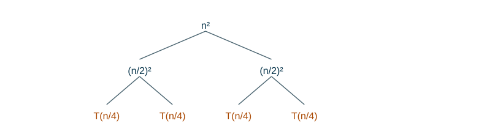

> Cada subproblema se expande con la misma regla: su costo propio queda en el nodo y sus hijos son los nuevos subproblemas.

:::
:::{tab-item} Paso 4
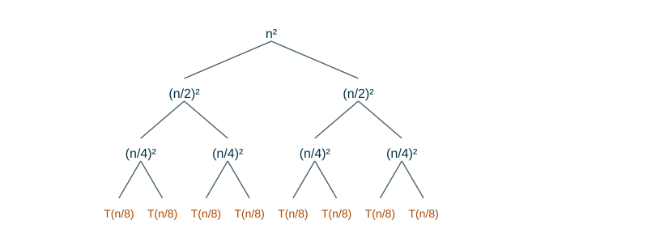

> Cada subproblema se expande con la misma regla: su costo propio queda en el nodo y sus hijos son los nuevos subproblemas.

:::
:::{tab-item} Paso 5
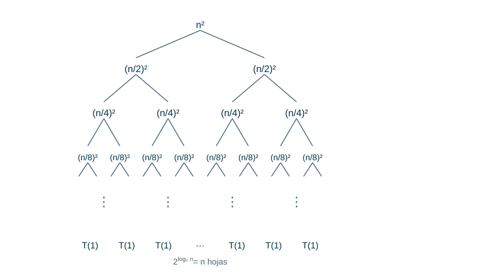

> Seguimos expandiendo hasta llegar al caso base $T(1)$ en las hojas.

:::
:::{tab-item} Paso 6
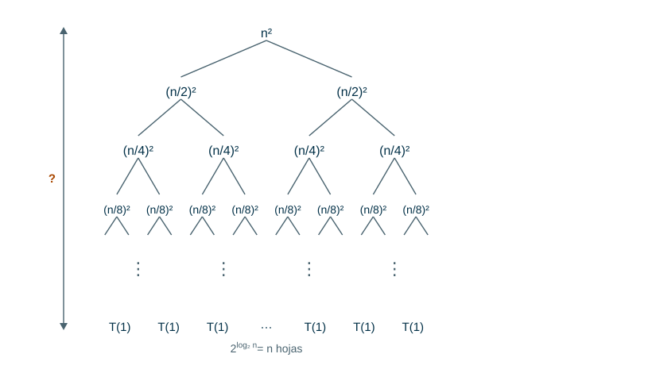

> **¿Cuántos niveles tiene el árbol?**

:::
:::{tab-item} Paso 7
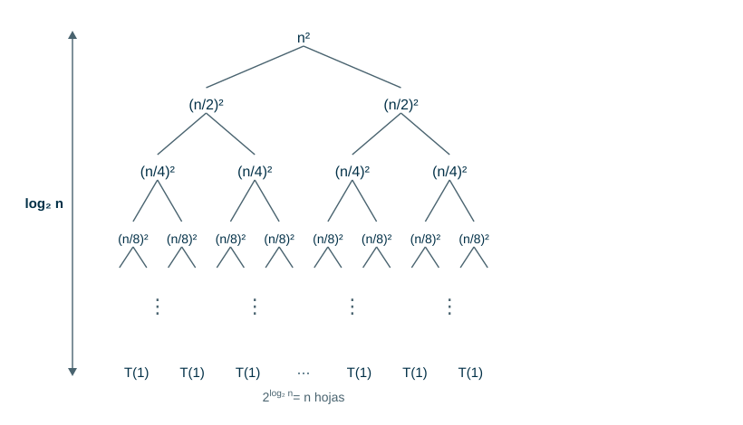

> El tamaño se divide por $2$ en cada nivel: se llega a $T(1)$ en el nivel $\log_2 n$.

:::
:::{tab-item} Paso 8
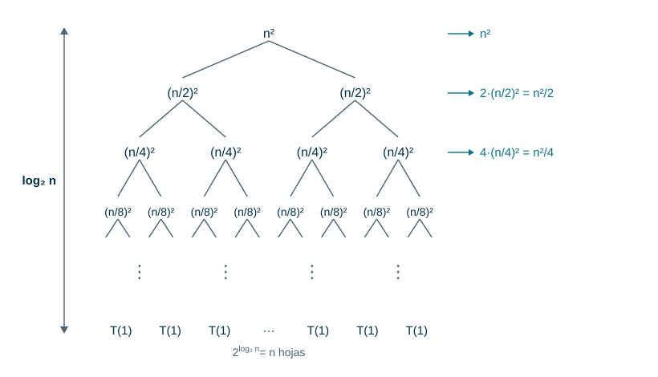

> Sumamos el costo de los nodos de cada nivel (columna de la derecha).

:::
:::{tab-item} Paso 9
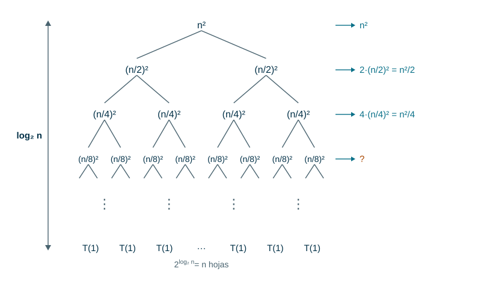

> **¿Cuánto cuesta el nivel 3?**

:::
:::{tab-item} Paso 10


> El nivel $3$ tiene $8$ nodos de costo $(n/8)^2$: cuesta $n^2/8$. En general, el nivel $i$ cuesta $n^2/2^i$: cada nivel cuesta la mitad del anterior.

:::
:::{tab-item} Paso 11


$$
\begin{aligned}
\text{Total} &\textcolor{#a94700}{= \sum_{i=0}^{\log_2 n} \frac{n^2}{2^i} = n^2 \sum_{i=0}^{\log_2 n} \Big(\frac{1}{2}\Big)^i} \\
&\textcolor{#a94700}{= n^2 \cdot \frac{(1/2)^{\log_2 n + 1} - 1}{1/2 - 1}} \\
&\textcolor{#a94700}{= 2n^2 - n = O(n^2)}
\end{aligned}
$$

> Como $r = \tfrac12 < 1$, la serie está dominada por su primer término: la raíz ($n^2$) es la que más pesa.

:::
::::
:::::

#### Ejemplo 9

Resolver $T(n) = 3T(n/4) + n$, con $T(1) = 1$.

:::::{admonition} Solución por iteración
:class: dropdown
::::{tab-set}
:::{tab-item} Paso 1
$$
\begin{aligned}
T(n) &\textcolor{#a94700}{= 3T(n/4) + n}
\end{aligned}
$$

> Se aplica la recurrencia con $n/4$: $\;T(n/4) = 3T(n/16) + n/4$.

:::
:::{tab-item} Paso 2
$$
\begin{aligned}
T(n) &= 3T(n/4) + n \\
&\textcolor{#a94700}{= 3\Big(3T(n/16) + \frac{n}{4}\Big) + n} \\
&\textcolor{#a94700}{= 3^2\,T(n/4^2) + \frac{3n}{4} + n}
\end{aligned}
$$

> Ahora $T(n/16) = 3T(n/64) + n/16$.

:::
:::{tab-item} Paso 3
$$
\begin{aligned}
T(n) &= 3T(n/4) + n \\
&= 3\Big(3T(n/16) + \frac{n}{4}\Big) + n \\
&= 3^2\,T(n/4^2) + \frac{3n}{4} + n \\
&\textcolor{#a94700}{= 3^3\,T(n/4^3) + \frac{3^2 n}{4^2} + \frac{3n}{4} + n}
\end{aligned}
$$

> **¿Qué patrón aparece después de $i$ expansiones?**

:::
:::{tab-item} Paso 4
$$
\begin{aligned}
T(n) &= 3T(n/4) + n \\
&= 3\Big(3T(n/16) + \frac{n}{4}\Big) + n \\
&= 3^2\,T(n/4^2) + \frac{3n}{4} + n \\
&= 3^3\,T(n/4^3) + \frac{3^2 n}{4^2} + \frac{3n}{4} + n \\
&\textcolor{#a94700}{\;\;\vdots} \\
&\textcolor{#a94700}{= 3^i\,T(n/4^i) + n\sum_{j=0}^{i-1}\Big(\frac{3}{4}\Big)^j}
\end{aligned}
$$

> **¿Cuándo se detienen las iteraciones?**

:::
:::{tab-item} Paso 5
$$
\begin{aligned}
T(n) &= 3T(n/4) + n \\
&= 3\Big(3T(n/16) + \frac{n}{4}\Big) + n \\
&= 3^2\,T(n/4^2) + \frac{3n}{4} + n \\
&= 3^3\,T(n/4^3) + \frac{3^2 n}{4^2} + \frac{3n}{4} + n \\
&\;\;\vdots \\
&= 3^i\,T(n/4^i) + n\sum_{j=0}^{i-1}\Big(\frac{3}{4}\Big)^j \\
&\textcolor{#a94700}{= 3^{\log_4 n}\,T(1) + n\sum_{j=0}^{\log_4 n - 1}\Big(\frac{3}{4}\Big)^j}
\end{aligned}
$$

Las iteraciones se detienen cuando $n/4^i = 1$, es decir, cuando $i = \log_4 n$.

:::
:::{tab-item} Paso 6
$$
\begin{aligned}
T(n) &= 3T(n/4) + n \\
&= 3\Big(3T(n/16) + \frac{n}{4}\Big) + n \\
&= 3^2\,T(n/4^2) + \frac{3n}{4} + n \\
&= 3^3\,T(n/4^3) + \frac{3^2 n}{4^2} + \frac{3n}{4} + n \\
&\;\;\vdots \\
&= 3^i\,T(n/4^i) + n\sum_{j=0}^{i-1}\Big(\frac{3}{4}\Big)^j \\
&= 3^{\log_4 n}\,T(1) + n\sum_{j=0}^{\log_4 n - 1}\Big(\frac{3}{4}\Big)^j \\
&\textcolor{#a94700}{= n^{\log_4 3} + n\sum_{j=0}^{\log_4 n - 1}\Big(\frac{3}{4}\Big)^j}
\end{aligned}
$$

Las iteraciones se detienen cuando $n/4^i = 1$, es decir, cuando $i = \log_4 n$.

> Por la identidad $a^{\log_b n} = n^{\log_b a}$: $\;3^{\log_4 n} = n^{\log_4 3} \approx n^{0.79}$.

:::
:::{tab-item} Paso 7
$$
\begin{aligned}
T(n) &= 3T(n/4) + n \\
&= 3\Big(3T(n/16) + \frac{n}{4}\Big) + n \\
&= 3^2\,T(n/4^2) + \frac{3n}{4} + n \\
&= 3^3\,T(n/4^3) + \frac{3^2 n}{4^2} + \frac{3n}{4} + n \\
&\;\;\vdots \\
&= 3^i\,T(n/4^i) + n\sum_{j=0}^{i-1}\Big(\frac{3}{4}\Big)^j \\
&= 3^{\log_4 n}\,T(1) + n\sum_{j=0}^{\log_4 n - 1}\Big(\frac{3}{4}\Big)^j \\
&= n^{\log_4 3} + n\sum_{j=0}^{\log_4 n - 1}\Big(\frac{3}{4}\Big)^j \\
&\textcolor{#a94700}{\le n^{\log_4 3} + 4n}
\end{aligned}
$$

Las iteraciones se detienen cuando $n/4^i = 1$, es decir, cuando $i = \log_4 n$.

> Como $r = \tfrac34 < 1$, la suma es menor que la serie infinita: $\;\sum_{j=0}^{\infty}\big(\tfrac34\big)^j = \frac{1}{1 - 3/4} = 4$.

:::
:::{tab-item} Paso 8
$$
\begin{aligned}
T(n) &= 3T(n/4) + n \\
&= 3\Big(3T(n/16) + \frac{n}{4}\Big) + n \\
&= 3^2\,T(n/4^2) + \frac{3n}{4} + n \\
&= 3^3\,T(n/4^3) + \frac{3^2 n}{4^2} + \frac{3n}{4} + n \\
&\;\;\vdots \\
&= 3^i\,T(n/4^i) + n\sum_{j=0}^{i-1}\Big(\frac{3}{4}\Big)^j \\
&= 3^{\log_4 n}\,T(1) + n\sum_{j=0}^{\log_4 n - 1}\Big(\frac{3}{4}\Big)^j \\
&= n^{\log_4 3} + n\sum_{j=0}^{\log_4 n - 1}\Big(\frac{3}{4}\Big)^j \\
&\le n^{\log_4 3} + 4n \\
&\textcolor{#a94700}{= O(n)}
\end{aligned}
$$

Las iteraciones se detienen cuando $n/4^i = 1$, es decir, cuando $i = \log_4 n$.

> $n^{0.79} = O(n)$. Calculando la suma finita exacta se obtiene $T(n) = 4n - 3n^{\log_4 3}$.

:::
::::
:::::
:::::{admonition} Solución con árbol de recursión
:class: dropdown
::::{tab-set}
:::{tab-item} Paso 1


> Empezamos con la raíz: el problema original $T(n)$.

:::
:::{tab-item} Paso 2


> El nodo raíz hace un trabajo de $n$ y genera tres subproblemas de tamaño $n/4$.

:::
:::{tab-item} Paso 3


> Cada subproblema se expande con la misma regla: su costo propio queda en el nodo y sus hijos son los nuevos subproblemas.

:::
:::{tab-item} Paso 4


> Seguimos expandiendo hasta llegar al caso base $T(1)$ en las hojas.

:::
:::{tab-item} Paso 5


> **¿Cuántos niveles tiene el árbol?**

:::
:::{tab-item} Paso 6


> El tamaño se divide por $4$ en cada nivel: se llega a $T(1)$ en el nivel $\log_4 n$. Las hojas son $3^{\log_4 n} = n^{\log_4 3}$.

:::
:::{tab-item} Paso 7


> Sumamos el costo de los nodos de cada nivel (columna de la derecha).

:::
:::{tab-item} Paso 8


> **¿Cuánto cuesta el nivel 2?**

:::
:::{tab-item} Paso 9


> El nivel $2$ tiene $9$ nodos de costo $n/16$: cuesta $\frac{9}{16}n = \big(\frac34\big)^2 n$. En general, el nivel $i$ cuesta $\big(\frac34\big)^i n$.

:::
:::{tab-item} Paso 10


$$
\begin{aligned}
\text{Total} &\textcolor{#a94700}{= \sum_{i=0}^{\log_4 n - 1}\Big(\frac{3}{4}\Big)^i n \;+\; n^{\log_4 3}} \\
&\textcolor{#a94700}{< 4n + n^{\log_4 3}} \\
&\textcolor{#a94700}{= O(n)}
\end{aligned}
$$

> El costo de los niveles decrece con razón $\tfrac34 < 1$: domina la raíz.

:::
::::
:::::

#### Ejemplo 10

Resolver $T(n) = 3T(n/4) + cn^2$, con $T(1) = 1$ y $c > 0$ constante.

:::::{admonition} Solución por iteración
:class: dropdown
::::{tab-set}
:::{tab-item} Paso 1
$$
\begin{aligned}
T(n) &\textcolor{#a94700}{= 3T(n/4) + cn^2}
\end{aligned}
$$

> Se aplica la recurrencia con $n/4$: $\;T(n/4) = 3T(n/16) + c(n/4)^2 = 3T(n/16) + \frac{cn^2}{16}$.

:::
:::{tab-item} Paso 2
$$
\begin{aligned}
T(n) &= 3T(n/4) + cn^2 \\
&\textcolor{#a94700}{= 3\Big(3T(n/16) + \frac{cn^2}{16}\Big) + cn^2} \\
&\textcolor{#a94700}{= 3^2\,T(n/4^2) + \frac{3}{16}cn^2 + cn^2}
\end{aligned}
$$

:::
:::{tab-item} Paso 3
$$
\begin{aligned}
T(n) &= 3T(n/4) + cn^2 \\
&= 3\Big(3T(n/16) + \frac{cn^2}{16}\Big) + cn^2 \\
&= 3^2\,T(n/4^2) + \frac{3}{16}cn^2 + cn^2 \\
&\textcolor{#a94700}{= 3^3\,T(n/4^3) + \Big(\frac{3}{16}\Big)^2 cn^2 + \frac{3}{16}cn^2 + cn^2}
\end{aligned}
$$

> **¿Qué patrón aparece después de $i$ expansiones?**

:::
:::{tab-item} Paso 4
$$
\begin{aligned}
T(n) &= 3T(n/4) + cn^2 \\
&= 3\Big(3T(n/16) + \frac{cn^2}{16}\Big) + cn^2 \\
&= 3^2\,T(n/4^2) + \frac{3}{16}cn^2 + cn^2 \\
&= 3^3\,T(n/4^3) + \Big(\frac{3}{16}\Big)^2 cn^2 + \frac{3}{16}cn^2 + cn^2 \\
&\textcolor{#a94700}{\;\;\vdots} \\
&\textcolor{#a94700}{= 3^i\,T(n/4^i) + cn^2\sum_{j=0}^{i-1}\Big(\frac{3}{16}\Big)^j}
\end{aligned}
$$

> **¿Cuándo se detienen las iteraciones?**

:::
:::{tab-item} Paso 5
$$
\begin{aligned}
T(n) &= 3T(n/4) + cn^2 \\
&= 3\Big(3T(n/16) + \frac{cn^2}{16}\Big) + cn^2 \\
&= 3^2\,T(n/4^2) + \frac{3}{16}cn^2 + cn^2 \\
&= 3^3\,T(n/4^3) + \Big(\frac{3}{16}\Big)^2 cn^2 + \frac{3}{16}cn^2 + cn^2 \\
&\;\;\vdots \\
&= 3^i\,T(n/4^i) + cn^2\sum_{j=0}^{i-1}\Big(\frac{3}{16}\Big)^j \\
&\textcolor{#a94700}{= n^{\log_4 3}\,T(1) + cn^2\sum_{j=0}^{\log_4 n - 1}\Big(\frac{3}{16}\Big)^j}
\end{aligned}
$$

Las iteraciones se detienen cuando $n/4^i = 1$, es decir, cuando $i = \log_4 n$.

> $3^{\log_4 n} = n^{\log_4 3}$.

:::
:::{tab-item} Paso 6
$$
\begin{aligned}
T(n) &= 3T(n/4) + cn^2 \\
&= 3\Big(3T(n/16) + \frac{cn^2}{16}\Big) + cn^2 \\
&= 3^2\,T(n/4^2) + \frac{3}{16}cn^2 + cn^2 \\
&= 3^3\,T(n/4^3) + \Big(\frac{3}{16}\Big)^2 cn^2 + \frac{3}{16}cn^2 + cn^2 \\
&\;\;\vdots \\
&= 3^i\,T(n/4^i) + cn^2\sum_{j=0}^{i-1}\Big(\frac{3}{16}\Big)^j \\
&= n^{\log_4 3}\,T(1) + cn^2\sum_{j=0}^{\log_4 n - 1}\Big(\frac{3}{16}\Big)^j \\
&\textcolor{#a94700}{< n^{\log_4 3} + \frac{16}{13}cn^2}
\end{aligned}
$$

Las iteraciones se detienen cuando $n/4^i = 1$, es decir, cuando $i = \log_4 n$.

> Como $r = \tfrac{3}{16} < 1$: $\;\sum_{j=0}^{\infty}\big(\tfrac{3}{16}\big)^j = \frac{1}{1 - 3/16} = \frac{16}{13}$.

:::
:::{tab-item} Paso 7
$$
\begin{aligned}
T(n) &= 3T(n/4) + cn^2 \\
&= 3\Big(3T(n/16) + \frac{cn^2}{16}\Big) + cn^2 \\
&= 3^2\,T(n/4^2) + \frac{3}{16}cn^2 + cn^2 \\
&= 3^3\,T(n/4^3) + \Big(\frac{3}{16}\Big)^2 cn^2 + \frac{3}{16}cn^2 + cn^2 \\
&\;\;\vdots \\
&= 3^i\,T(n/4^i) + cn^2\sum_{j=0}^{i-1}\Big(\frac{3}{16}\Big)^j \\
&= n^{\log_4 3}\,T(1) + cn^2\sum_{j=0}^{\log_4 n - 1}\Big(\frac{3}{16}\Big)^j \\
&< n^{\log_4 3} + \frac{16}{13}cn^2 \\
&\textcolor{#a94700}{= O(n^2)}
\end{aligned}
$$

Las iteraciones se detienen cuando $n/4^i = 1$, es decir, cuando $i = \log_4 n$.

:::
::::
:::::
:::::{admonition} Solución con árbol de recursión
:class: dropdown
::::{tab-set}
:::{tab-item} Paso 1


> Empezamos con la raíz: el problema original $T(n)$.

:::
:::{tab-item} Paso 2


> El nodo raíz hace un trabajo de $cn^2$ y genera tres subproblemas de tamaño $n/4$.

:::
:::{tab-item} Paso 3


> Cada subproblema se expande con la misma regla: su costo propio queda en el nodo y sus hijos son los nuevos subproblemas.

:::
:::{tab-item} Paso 4


> Seguimos expandiendo hasta llegar al caso base $T(1)$ en las hojas.

:::
:::{tab-item} Paso 5


> **¿Cuántos niveles tiene el árbol?**

:::
:::{tab-item} Paso 6


> Se llega a $T(1)$ en el nivel $\log_4 n$. Es un árbol $3$-ario: tiene $3^{\log_4 n} = n^{\log_4 3} \approx n^{0.79}$ hojas.

:::
:::{tab-item} Paso 7


> Sumamos el costo de los nodos de cada nivel (columna de la derecha).

:::
:::{tab-item} Paso 8


> **¿Cuánto cuesta el nivel 2?**

:::
:::{tab-item} Paso 9


> El nivel $2$ tiene $9$ nodos de costo $c(n/16)^2$: cuesta $\frac{9}{256}cn^2 = \big(\frac{3}{16}\big)^2 cn^2$. En general, el nivel $i$ cuesta $\big(\frac{3}{16}\big)^i cn^2$.

:::
:::{tab-item} Paso 10


$$
\begin{aligned}
\text{Total} &\textcolor{#a94700}{= cn^2\sum_{i=0}^{\log_4 n - 1}\Big(\frac{3}{16}\Big)^i \;+\; n^{\log_4 3}} \\
&\textcolor{#a94700}{< \frac{16}{13}cn^2 + n^{\log_4 3}} \\
&\textcolor{#a94700}{= O(n^2)}
\end{aligned}
$$

> La raíz domina; las hojas aportan un orden inferior.

:::
::::
:::::

#### Ejemplo 11

Resolver $T(n) = T(n/3) + T(2n/3) + n$. Dar una cota inferior y una cota superior.

Aquí los dos subproblemas **no** tienen el mismo tamaño, así que la iteración no produce un patrón sencillo. Este ejemplo se resuelve solo con el árbol, que deja de ser completo: la rama izquierda se acorta más rápido que la derecha.

:::::{admonition} Solución con árbol de recursión
:class: dropdown
::::{tab-set}
:::{tab-item} Paso 1


> Empezamos con la raíz: el problema original $T(n)$.

:::
:::{tab-item} Paso 2


> El nodo raíz hace un trabajo de $n$ y genera dos subproblemas **de tamaños distintos**: $n/3$ y $2n/3$.

:::
:::{tab-item} Paso 3


> Cada subproblema se expande con la misma regla.

:::
:::{tab-item} Paso 4


> Seguimos expandiendo hasta llegar a las hojas $T(1)$.

:::
:::{tab-item} Paso 5


> **¿Cuántos niveles tiene el árbol?**

:::
:::{tab-item} Paso 6


> Depende de la rama. La rama más corta (siempre a la izquierda) divide por $3$: $n/3^i = 1$ cuando $i = \log_3 n$. La rama más larga (siempre a la derecha) multiplica por $2/3$: $n(2/3)^i = 1$ cuando $i = \log_{3/2} n$.

:::
:::{tab-item} Paso 7


> **¿Cuánto cuesta el nivel 2?**

:::
:::{tab-item} Paso 8


> Cada nivel completo cuesta exactamente $n$. Por debajo del nivel $\log_3 n$ algunas ramas ya terminaron, así que esos niveles cuestan **a lo sumo** $n$.

:::
:::{tab-item} Paso 9


$$
\begin{aligned}
T(n) &\textcolor{#a94700}{\ge n\log_3 n = \Omega(n\log n)}
\end{aligned}
$$

> **Cota inferior:** los primeros $\log_3 n$ niveles están completos y cada uno aporta $n$.

:::
:::{tab-item} Paso 10


$$
\begin{aligned}
T(n) &\ge n\log_3 n = \Omega(n\log n) \\
T(n) &\textcolor{#a94700}{\le n\log_{3/2} n = O(n\log n)}
\end{aligned}
$$

> **Cota superior:** hay a lo sumo $\log_{3/2} n$ niveles y cada uno aporta a lo sumo $n$.

:::
:::{tab-item} Paso 11


$$
\begin{aligned}
T(n) &\ge n\log_3 n = \Omega(n\log n) \\
T(n) &\le n\log_{3/2} n = O(n\log n) \\
T(n) &\textcolor{#a94700}{= \Theta(n\log n)}
\end{aligned}
$$

> Las dos cotas son del mismo orden porque $\log_3 n$ y $\log_{3/2} n$ solo difieren en una constante.

:::
::::
:::::

### 1.3 Ejercicios

Resuelva cada recurrencia por iteración y con árbol de recursión.

#### Ejercicio 1

$T(n) = T(n/3) + 1$, con $T(1) = 1$.

:::{admonition} Pistas
:class: dropdown
Es igual al Ejemplo 4, pero el tamaño se divide por $3$ en lugar de $2$. ¿En qué nivel $i$ se cumple $n/3^i = 1$?
:::
:::::{admonition} Solución por iteración
:class: dropdown
::::{tab-set}
:::{tab-item} Paso 1
$$
\begin{aligned}
T(n) &\textcolor{#a94700}{= T(n/3) + 1}
\end{aligned}
$$

> $T(n/3) = T(n/9) + 1$.

:::
:::{tab-item} Paso 2
$$
\begin{aligned}
T(n) &= T(n/3) + 1 \\
&\textcolor{#a94700}{= T(n/3^2) + 1 + 1}
\end{aligned}
$$

:::
:::{tab-item} Paso 3
$$
\begin{aligned}
T(n) &= T(n/3) + 1 \\
&= T(n/3^2) + 1 + 1 \\
&\textcolor{#a94700}{= T(n/3^3) + 1 + 1 + 1}
\end{aligned}
$$

> **¿Qué patrón aparece después de $i$ expansiones?**

:::
:::{tab-item} Paso 4
$$
\begin{aligned}
T(n) &= T(n/3) + 1 \\
&= T(n/3^2) + 1 + 1 \\
&= T(n/3^3) + 1 + 1 + 1 \\
&\textcolor{#a94700}{\;\;\vdots} \\
&\textcolor{#a94700}{= T(n/3^i) + i}
\end{aligned}
$$

> **¿Cuándo se detienen las iteraciones?**

:::
:::{tab-item} Paso 5
$$
\begin{aligned}
T(n) &= T(n/3) + 1 \\
&= T(n/3^2) + 1 + 1 \\
&= T(n/3^3) + 1 + 1 + 1 \\
&\;\;\vdots \\
&= T(n/3^i) + i \\
&\textcolor{#a94700}{= T(1) + \log_3 n}
\end{aligned}
$$

Cuando $n/3^i = 1$, es decir, $i = \log_3 n$.

:::
:::{tab-item} Paso 6
$$
\begin{aligned}
T(n) &= T(n/3) + 1 \\
&= T(n/3^2) + 1 + 1 \\
&= T(n/3^3) + 1 + 1 + 1 \\
&\;\;\vdots \\
&= T(n/3^i) + i \\
&= T(1) + \log_3 n \\
&\textcolor{#a94700}{= 1 + \log_3 n = O(\log n)}
\end{aligned}
$$

Cuando $n/3^i = 1$, es decir, $i = \log_3 n$.

:::
::::
:::::
:::::{admonition} Solución con árbol de recursión
:class: dropdown
::::{tab-set}
:::{tab-item} Paso 1


> Empezamos con la raíz: el problema original $T(n)$.

:::
:::{tab-item} Paso 2


> El problema de tamaño $n$ hace un trabajo de $1$ y genera un subproblema de tamaño $n/3$.

:::
:::{tab-item} Paso 3


> Cada subproblema se expande con la misma regla: su costo propio queda en el nodo y sus hijos son los nuevos subproblemas.

:::
:::{tab-item} Paso 4


> Cada subproblema se expande con la misma regla: su costo propio queda en el nodo y sus hijos son los nuevos subproblemas.

:::
:::{tab-item} Paso 5


> Seguimos expandiendo hasta llegar al caso base $T(1)$ en las hojas.

:::
:::{tab-item} Paso 6


> **¿Cuántos niveles tiene el árbol?**

:::
:::{tab-item} Paso 7


> Se llega a $T(1)$ cuando $n/3^i = 1$, es decir, en el nivel $i = \log_3 n$.

:::
:::{tab-item} Paso 8


> Sumamos el costo de los nodos de cada nivel (columna de la derecha).

:::
:::{tab-item} Paso 9


> **¿Cuánto cuesta el nivel 3?**

:::
:::{tab-item} Paso 10


> Todos los niveles cuestan $1$.

:::
:::{tab-item} Paso 11


$$
\begin{aligned}
\text{Total} &\textcolor{#a94700}{= \sum_{i=0}^{\log_3 n} 1 = \log_3 n + 1} \\
&\textcolor{#a94700}{= O(\log n)}
\end{aligned}
$$

:::
::::
:::::

#### Ejercicio 2

Demuestre que $T(n) = T(\lfloor n/2 \rfloor) + n$, con $T(1) = 1$, es $\Omega(n)$.

:::{admonition} Pistas
:class: dropdown
Para una cota inferior basta con encontrar un término de la expansión que ya sea al menos $n$. Luego intente también una cota superior: los términos forman una serie geométrica con $r = \tfrac12$.
:::
:::::{admonition} Solución por iteración
:class: dropdown
::::{tab-set}
:::{tab-item} Paso 1
$$
\begin{aligned}
T(n) &\textcolor{#a94700}{= T(\lfloor n/2 \rfloor) + n}
\end{aligned}
$$

> Todos los términos de la expansión son positivos, porque $T(1) = 1 > 0$.

:::
:::{tab-item} Paso 2
$$
\begin{aligned}
T(n) &= T(\lfloor n/2 \rfloor) + n \\
&\textcolor{#a94700}{= T(\lfloor n/4 \rfloor) + \lfloor n/2 \rfloor + n}
\end{aligned}
$$

> $\lfloor\lfloor n/2\rfloor/2\rfloor = \lfloor n/4\rfloor$.

:::
:::{tab-item} Paso 3
$$
\begin{aligned}
T(n) &= T(\lfloor n/2 \rfloor) + n \\
&= T(\lfloor n/4 \rfloor) + \lfloor n/2 \rfloor + n \\
&\textcolor{#a94700}{\;\;\vdots} \\
&\textcolor{#a94700}{= T(1) + \cdots + \lfloor n/4 \rfloor + \lfloor n/2 \rfloor + n}
\end{aligned}
$$

:::
:::{tab-item} Paso 4
$$
\begin{aligned}
T(n) &= T(\lfloor n/2 \rfloor) + n \\
&= T(\lfloor n/4 \rfloor) + \lfloor n/2 \rfloor + n \\
&\;\;\vdots \\
&= T(1) + \cdots + \lfloor n/4 \rfloor + \lfloor n/2 \rfloor + n \\
&\textcolor{#a94700}{\ge n}
\end{aligned}
$$

> Se descartan todos los términos salvo el último, que ya es $n$.

:::
:::{tab-item} Paso 5
$$
\begin{aligned}
T(n) &= T(\lfloor n/2 \rfloor) + n \\
&= T(\lfloor n/4 \rfloor) + \lfloor n/2 \rfloor + n \\
&\;\;\vdots \\
&= T(1) + \cdots + \lfloor n/4 \rfloor + \lfloor n/2 \rfloor + n \\
&\ge n \\
T(n) &\textcolor{#a94700}{= \Omega(n)}
\end{aligned}
$$

**Cota inferior:** $T(n) \ge n$ para todo $n \ge 1$.

:::
:::{tab-item} Paso 6
$$
\begin{aligned}
T(n) &= T(\lfloor n/2 \rfloor) + n \\
&= T(\lfloor n/4 \rfloor) + \lfloor n/2 \rfloor + n \\
&\;\;\vdots \\
&= T(1) + \cdots + \lfloor n/4 \rfloor + \lfloor n/2 \rfloor + n \\
&\ge n \\
T(n) &= \Omega(n) \\
T(n) &\textcolor{#a94700}{\le 1 + n\sum_{i=0}^{\infty}\Big(\frac{1}{2}\Big)^i = 1 + 2n}
\end{aligned}
$$

**Cota inferior:** $T(n) \ge n$ para todo $n \ge 1$.

> **Cota superior:** $\lfloor n/2^i \rfloor \le n/2^i$ y la serie geométrica con $r = \tfrac12$ suma $2$. Entonces $T(n) = O(n)$ y, junto con la cota inferior, $T(n) = \Theta(n)$.

:::
::::
:::::
:::::{admonition} Solución con árbol de recursión
:class: dropdown
::::{tab-set}
:::{tab-item} Paso 1


> Empezamos con la raíz: el problema original $T(n)$.

:::
:::{tab-item} Paso 2


> El problema de tamaño $n$ hace un trabajo de $n$ y genera un subproblema de tamaño $\lfloor n/2 \rfloor$.

:::
:::{tab-item} Paso 3


> Cada subproblema se expande con la misma regla: su costo propio queda en el nodo y sus hijos son los nuevos subproblemas.

:::
:::{tab-item} Paso 4


> Cada subproblema se expande con la misma regla: su costo propio queda en el nodo y sus hijos son los nuevos subproblemas.

:::
:::{tab-item} Paso 5


> Seguimos expandiendo hasta llegar al caso base $T(1)$ en las hojas.

:::
:::{tab-item} Paso 6


> **¿Cuántos niveles tiene el árbol?**

:::
:::{tab-item} Paso 7


> El tamaño se divide (al menos) por $2$ en cada nivel: hay $\lfloor\log_2 n\rfloor$ niveles hasta $T(1)$.

:::
:::{tab-item} Paso 8


> Sumamos el costo de los nodos de cada nivel (columna de la derecha).

:::
:::{tab-item} Paso 9


> **¿Cuánto cuesta el nivel 3?**

:::
:::{tab-item} Paso 10


> El nivel $i$ cuesta a lo sumo $n/2^i$. Todos los niveles cuestan algo positivo.

:::
:::{tab-item} Paso 11


$$
\begin{aligned}
\text{Total} &\textcolor{#a94700}{\ge n \quad\text{(solo la raíz)}} \\
\text{Total} &\textcolor{#a94700}{\le 1 + n\sum_{i=0}^{\infty}\Big(\frac12\Big)^i = 1 + 2n} \\
T(n) &\textcolor{#a94700}{= \Theta(n)}
\end{aligned}
$$

> La raíz sola ya aporta $n$, así que $T(n) = \Omega(n)$. La suma de todos los niveles es a lo sumo $2n + 1$.

:::
::::
:::::

#### Ejercicio 3

El algoritmo de Strassen para multiplicar matrices cumple la recurrencia

$$
T(n) = 7T(n/2) + \frac{15}{4}n^2, \qquad T(1) = 1.
$$

Resuélvala con árbol de recursión: altura, costo por nivel y total. En la sección 3 se verifica el resultado con el método maestro.

:::{admonition} Pistas
:class: dropdown
Llame $c = \tfrac{15}{4}$. El árbol es $7$-ario y el tamaño se divide por $2$: ¿cuánto cuesta el nivel $i$? La razón de la serie geométrica es mayor que $1$, así que domina el **último** nivel. Use $7^{\log_2 n} = n^{\log_2 7}$.
:::
:::::{admonition} Solución por iteración
:class: dropdown
::::{tab-set}
:::{tab-item} Paso 1
$$
\begin{aligned}
T(n) &\textcolor{#a94700}{= 7T(n/2) + cn^2}
\end{aligned}
$$

> Con $c = \tfrac{15}{4}$: $\;T(n/2) = 7T(n/4) + c\frac{n^2}{4}$.

:::
:::{tab-item} Paso 2
$$
\begin{aligned}
T(n) &= 7T(n/2) + cn^2 \\
&\textcolor{#a94700}{= 7^2\,T(n/2^2) + \frac{7}{4}cn^2 + cn^2}
\end{aligned}
$$

:::
:::{tab-item} Paso 3
$$
\begin{aligned}
T(n) &= 7T(n/2) + cn^2 \\
&= 7^2\,T(n/2^2) + \frac{7}{4}cn^2 + cn^2 \\
&\textcolor{#a94700}{\;\;\vdots} \\
&\textcolor{#a94700}{= 7^i\,T(n/2^i) + cn^2\sum_{j=0}^{i-1}\Big(\frac{7}{4}\Big)^j}
\end{aligned}
$$

> **¿Cuándo se detienen las iteraciones?**

:::
:::{tab-item} Paso 4
$$
\begin{aligned}
T(n) &= 7T(n/2) + cn^2 \\
&= 7^2\,T(n/2^2) + \frac{7}{4}cn^2 + cn^2 \\
&\;\;\vdots \\
&= 7^i\,T(n/2^i) + cn^2\sum_{j=0}^{i-1}\Big(\frac{7}{4}\Big)^j \\
&\textcolor{#a94700}{= n^{\log_2 7} + cn^2\cdot\frac{(7/4)^{\log_2 n} - 1}{7/4 - 1}}
\end{aligned}
$$

Cuando $n/2^i = 1$, es decir, $i = \log_2 n$.

> $7^{\log_2 n} = n^{\log_2 7}$ y serie geométrica con $r = \tfrac74$.

:::
:::{tab-item} Paso 5
$$
\begin{aligned}
T(n) &= 7T(n/2) + cn^2 \\
&= 7^2\,T(n/2^2) + \frac{7}{4}cn^2 + cn^2 \\
&\;\;\vdots \\
&= 7^i\,T(n/2^i) + cn^2\sum_{j=0}^{i-1}\Big(\frac{7}{4}\Big)^j \\
&= n^{\log_2 7} + cn^2\cdot\frac{(7/4)^{\log_2 n} - 1}{7/4 - 1} \\
&\textcolor{#a94700}{= n^{\log_2 7} + 5n^2\Big(\frac{n^{\log_2 7}}{n^2} - 1\Big)}
\end{aligned}
$$

Cuando $n/2^i = 1$, es decir, $i = \log_2 n$.

> $(7/4)^{\log_2 n} = \frac{7^{\log_2 n}}{4^{\log_2 n}} = \frac{n^{\log_2 7}}{n^2}$ y $\;c \big/ \tfrac34 = \tfrac{15}{4}\cdot\tfrac43 = 5$.

:::
:::{tab-item} Paso 6
$$
\begin{aligned}
T(n) &= 7T(n/2) + cn^2 \\
&= 7^2\,T(n/2^2) + \frac{7}{4}cn^2 + cn^2 \\
&\;\;\vdots \\
&= 7^i\,T(n/2^i) + cn^2\sum_{j=0}^{i-1}\Big(\frac{7}{4}\Big)^j \\
&= n^{\log_2 7} + cn^2\cdot\frac{(7/4)^{\log_2 n} - 1}{7/4 - 1} \\
&= n^{\log_2 7} + 5n^2\Big(\frac{n^{\log_2 7}}{n^2} - 1\Big) \\
&\textcolor{#a94700}{= 6n^{\log_2 7} - 5n^2} \\
&\textcolor{#a94700}{= O(n^{\log_2 7}) \approx O(n^{2.81})}
\end{aligned}
$$

Cuando $n/2^i = 1$, es decir, $i = \log_2 n$.

:::
::::
:::::
:::::{admonition} Solución con árbol de recursión
:class: dropdown
::::{tab-set}
:::{tab-item} Paso 1


> Empezamos con la raíz: el problema original $T(n)$.

:::
:::{tab-item} Paso 2


> Con $c = \tfrac{15}{4}$: el nodo raíz hace un trabajo de $cn^2$ y genera **siete** subproblemas de tamaño $n/2$.

:::
:::{tab-item} Paso 3


> Seguimos expandiendo hasta llegar al caso base $T(1)$ en las hojas.

:::
:::{tab-item} Paso 4


> **¿Cuántos niveles tiene el árbol?**

:::
:::{tab-item} Paso 5


> El tamaño se divide por $2$: hay $\log_2 n$ niveles y $7^{\log_2 n} = n^{\log_2 7}$ hojas.

:::
:::{tab-item} Paso 6


> Sumamos el costo de los nodos de cada nivel (columna de la derecha).

:::
:::{tab-item} Paso 7


> **¿Cuánto cuesta el nivel 1?**

:::
:::{tab-item} Paso 8


> El nivel $1$ tiene $7$ nodos de costo $c(n/2)^2$: cuesta $\frac74 cn^2$. En general, el nivel $i$ cuesta $\big(\frac74\big)^i cn^2$: **crece** de nivel en nivel.

:::
:::{tab-item} Paso 9


$$
\begin{aligned}
\text{Total} &\textcolor{#a94700}{= cn^2\sum_{i=0}^{\log_2 n - 1}\Big(\frac{7}{4}\Big)^i \;+\; n^{\log_2 7}} \\
&\textcolor{#a94700}{= 6n^{\log_2 7} - 5n^2} \\
&\textcolor{#a94700}{= O(n^{\log_2 7})}
\end{aligned}
$$

> Como $r = \tfrac74 > 1$, la suma está dominada por el último nivel: las hojas son las que más pesan.

:::
::::
:::::

## 2. Recurrencias lineales homogéneas

Una **relación de recurrencia lineal y homogénea de orden $k$** es de la forma

$$
a_n = c_1 a_{n-1} + c_2 a_{n-2} + \cdots + c_k a_{n-k}
$$

donde $c_1, c_2, \ldots, c_k$ son constantes reales y $c_k \neq 0$. Para que la sucesión quede determinada se necesitan $k$ condiciones iniciales.

**Ejemplo.** ¿De qué orden es cada recurrencia?

- $a_n = 3a_{n-1}$, $\;a_0 = 1$
- $a_n = a_{n-1} + a_{n-2}$, $\;a_0 = 0$, $a_1 = 1$
- $a_n = 6a_{n-1} - 11a_{n-2} + 6a_{n-3}$, $\;a_0 = 2$, $a_1 = 5$, $a_2 = 15$

:::{admonition} Respuesta
:class: dropdown
- $a_n = 3a_{n-1}$: **orden 1**.
- $a_n = a_{n-1} + a_{n-2}$ (Fibonacci): **orden 2**.
- $a_n = 6a_{n-1} - 11a_{n-2} + 6a_{n-3}$: **orden 3**.

El orden es la distancia entre $a_n$ y el término más lejano del que depende, y coincide con el número de condiciones iniciales.
:::

En esta sesión resolvemos recurrencias de **orden 2**. El método se basa en su **ecuación característica**: cada $a_{n-k}$ se cambia por $r^{2-k}$, así que $a_n = c_1 a_{n-1} + c_2 a_{n-2}$ tiene la ecuación característica $r^2 - c_1 r - c_2 = 0$.

### 2.1 Raíces distintas

:::{admonition} Teorema (raíces distintas)
:class: important
Sean $c_1$ y $c_2$ reales. Si la ecuación característica $r^2 - c_1 r - c_2 = 0$ tiene dos raíces reales distintas $r_1$ y $r_2$, entonces la sucesión

$$
a_n = \alpha_1 r_1^n + \alpha_2 r_2^n
$$

es una solución de la recurrencia $a_n = c_1 a_{n-1} + c_2 a_{n-2}$. Las constantes $\alpha_1$ y $\alpha_2$ se hallan con las condiciones iniciales.
:::


#### Ejemplo 1

Resolver $a_n = a_{n-1} + 2a_{n-2}$, con $a_0 = 2$, $a_1 = 7$.

:::::{admonition} Solución
:class: dropdown
::::{tab-set}
:::{tab-item} Paso 1
$$
\begin{aligned}
&\textcolor{#a94700}{a_n - a_{n-1} - 2a_{n-2} = 0}
\end{aligned}
$$

> Se pasan todos los términos a un lado de la igualdad.

:::
:::{tab-item} Paso 2
$$
\begin{aligned}
&a_n - a_{n-1} - 2a_{n-2} = 0 \\
&\textcolor{#a94700}{\text{Ecuación característica: } r^2 - r - 2 = 0}
\end{aligned}
$$

> Se cambia $a_n$ por $r^2$, $a_{n-1}$ por $r$ y $a_{n-2}$ por $1$.

:::
:::{tab-item} Paso 3
$$
\begin{aligned}
&a_n - a_{n-1} - 2a_{n-2} = 0 \\
&\text{Ecuación característica: } r^2 - r - 2 = 0 \\
&\textcolor{#a94700}{\text{Se resuelve: } (r-2)(r+1) = 0} \\
&\textcolor{#a94700}{r_1 = 2,\quad r_2 = -1}
\end{aligned}
$$

:::
:::{tab-item} Paso 4
$$
\begin{aligned}
&a_n - a_{n-1} - 2a_{n-2} = 0 \\
&\text{Ecuación característica: } r^2 - r - 2 = 0 \\
&\text{Se resuelve: } (r-2)(r+1) = 0 \\
&r_1 = 2,\quad r_2 = -1 \\
&\textcolor{#a94700}{a_n = \alpha_1 r_1^n + \alpha_2 r_2^n}
\end{aligned}
$$

> Las raíces son distintas: se aplica el teorema.

:::
:::{tab-item} Paso 5
$$
\begin{aligned}
&a_n - a_{n-1} - 2a_{n-2} = 0 \\
&\text{Ecuación característica: } r^2 - r - 2 = 0 \\
&\text{Se resuelve: } (r-2)(r+1) = 0 \\
&r_1 = 2,\quad r_2 = -1 \\
&a_n = \alpha_1 r_1^n + \alpha_2 r_2^n \\
&\textcolor{#a94700}{a_n = \alpha_1 2^n + \alpha_2 (-1)^n}
\end{aligned}
$$

> Se reemplazan las raíces.

:::
:::{tab-item} Paso 6
$$
\begin{aligned}
&a_n - a_{n-1} - 2a_{n-2} = 0 \\
&\text{Ecuación característica: } r^2 - r - 2 = 0 \\
&\text{Se resuelve: } (r-2)(r+1) = 0 \\
&r_1 = 2,\quad r_2 = -1 \\
&a_n = \alpha_1 r_1^n + \alpha_2 r_2^n \\
&a_n = \alpha_1 2^n + \alpha_2 (-1)^n \\
&\textcolor{#a94700}{a_0 = \alpha_1 2^0 + \alpha_2 (-1)^0 = 2} \\
&\textcolor{#a94700}{a_1 = \alpha_1 2^1 + \alpha_2 (-1)^1 = 7}
\end{aligned}
$$

> Se reemplazan las condiciones iniciales $a_0 = 2$, $a_1 = 7$.

:::
:::{tab-item} Paso 7
$$
\begin{aligned}
&a_n - a_{n-1} - 2a_{n-2} = 0 \\
&\text{Ecuación característica: } r^2 - r - 2 = 0 \\
&\text{Se resuelve: } (r-2)(r+1) = 0 \\
&r_1 = 2,\quad r_2 = -1 \\
&a_n = \alpha_1 r_1^n + \alpha_2 r_2^n \\
&a_n = \alpha_1 2^n + \alpha_2 (-1)^n \\
&a_0 = \alpha_1 2^0 + \alpha_2 (-1)^0 = 2 \\
&a_1 = \alpha_1 2^1 + \alpha_2 (-1)^1 = 7 \\
&\textcolor{#a94700}{\alpha_1 + \alpha_2 = 2} \\
&\textcolor{#a94700}{2\alpha_1 - \alpha_2 = 7}
\end{aligned}
$$

> Se simplifica: queda un sistema de dos ecuaciones con dos incógnitas.

:::
:::{tab-item} Paso 8
$$
\begin{aligned}
&a_n - a_{n-1} - 2a_{n-2} = 0 \\
&\text{Ecuación característica: } r^2 - r - 2 = 0 \\
&\text{Se resuelve: } (r-2)(r+1) = 0 \\
&r_1 = 2,\quad r_2 = -1 \\
&a_n = \alpha_1 r_1^n + \alpha_2 r_2^n \\
&a_n = \alpha_1 2^n + \alpha_2 (-1)^n \\
&a_0 = \alpha_1 2^0 + \alpha_2 (-1)^0 = 2 \\
&a_1 = \alpha_1 2^1 + \alpha_2 (-1)^1 = 7 \\
&\alpha_1 + \alpha_2 = 2 \\
&2\alpha_1 - \alpha_2 = 7 \\
&\textcolor{#a94700}{\alpha_1 = 3,\quad \alpha_2 = -1}
\end{aligned}
$$

> Sumando las dos ecuaciones: $3\alpha_1 = 9$, así que $\alpha_1 = 3$ y $\alpha_2 = 2 - 3 = -1$.

:::
:::{tab-item} Paso 9
$$
\begin{aligned}
&a_n - a_{n-1} - 2a_{n-2} = 0 \\
&\text{Ecuación característica: } r^2 - r - 2 = 0 \\
&\text{Se resuelve: } (r-2)(r+1) = 0 \\
&r_1 = 2,\quad r_2 = -1 \\
&a_n = \alpha_1 r_1^n + \alpha_2 r_2^n \\
&a_n = \alpha_1 2^n + \alpha_2 (-1)^n \\
&a_0 = \alpha_1 2^0 + \alpha_2 (-1)^0 = 2 \\
&a_1 = \alpha_1 2^1 + \alpha_2 (-1)^1 = 7 \\
&\alpha_1 + \alpha_2 = 2 \\
&2\alpha_1 - \alpha_2 = 7 \\
&\alpha_1 = 3,\quad \alpha_2 = -1 \\
&\textcolor{#a94700}{\text{Solución: } a_n = 3\cdot 2^n - (-1)^n}
\end{aligned}
$$

> **Verificación:** por la recurrencia, $a_2 = a_1 + 2a_0 = 7 + 4 = 11$. Por la fórmula, $a_2 = 3\cdot 4 - 1 = 11$. ✓

:::
::::
:::::

#### Ejemplo 2

Resolver $a_n = -4a_{n-1} + 5a_{n-2}$, con $a_0 = 2$, $a_1 = 8$.

:::::{admonition} Solución
:class: dropdown
::::{tab-set}
:::{tab-item} Paso 1
$$
\begin{aligned}
&\textcolor{#a94700}{a_n + 4a_{n-1} - 5a_{n-2} = 0}
\end{aligned}
$$

> Se pasan todos los términos a un lado de la igualdad.

:::
:::{tab-item} Paso 2
$$
\begin{aligned}
&a_n + 4a_{n-1} - 5a_{n-2} = 0 \\
&\textcolor{#a94700}{\text{Ecuación característica: } r^2 + 4r - 5 = 0}
\end{aligned}
$$

> Se cambia $a_n$ por $r^2$, $a_{n-1}$ por $r$ y $a_{n-2}$ por $1$.

:::
:::{tab-item} Paso 3
$$
\begin{aligned}
&a_n + 4a_{n-1} - 5a_{n-2} = 0 \\
&\text{Ecuación característica: } r^2 + 4r - 5 = 0 \\
&\textcolor{#a94700}{\text{Se resuelve: } (r+5)(r-1) = 0} \\
&\textcolor{#a94700}{r_1 = -5,\quad r_2 = 1}
\end{aligned}
$$

:::
:::{tab-item} Paso 4
$$
\begin{aligned}
&a_n + 4a_{n-1} - 5a_{n-2} = 0 \\
&\text{Ecuación característica: } r^2 + 4r - 5 = 0 \\
&\text{Se resuelve: } (r+5)(r-1) = 0 \\
&r_1 = -5,\quad r_2 = 1 \\
&\textcolor{#a94700}{a_n = \alpha_1 r_1^n + \alpha_2 r_2^n}
\end{aligned}
$$

> Las raíces son distintas: se aplica el teorema.

:::
:::{tab-item} Paso 5
$$
\begin{aligned}
&a_n + 4a_{n-1} - 5a_{n-2} = 0 \\
&\text{Ecuación característica: } r^2 + 4r - 5 = 0 \\
&\text{Se resuelve: } (r+5)(r-1) = 0 \\
&r_1 = -5,\quad r_2 = 1 \\
&a_n = \alpha_1 r_1^n + \alpha_2 r_2^n \\
&\textcolor{#a94700}{a_n = \alpha_1 (-5)^n + \alpha_2 1^n = \alpha_1 (-5)^n + \alpha_2}
\end{aligned}
$$

> Se reemplazan las raíces.

:::
:::{tab-item} Paso 6
$$
\begin{aligned}
&a_n + 4a_{n-1} - 5a_{n-2} = 0 \\
&\text{Ecuación característica: } r^2 + 4r - 5 = 0 \\
&\text{Se resuelve: } (r+5)(r-1) = 0 \\
&r_1 = -5,\quad r_2 = 1 \\
&a_n = \alpha_1 r_1^n + \alpha_2 r_2^n \\
&a_n = \alpha_1 (-5)^n + \alpha_2 1^n = \alpha_1 (-5)^n + \alpha_2 \\
&\textcolor{#a94700}{a_0 = \alpha_1 (-5)^0 + \alpha_2 = 2} \\
&\textcolor{#a94700}{a_1 = \alpha_1 (-5)^1 + \alpha_2 = 8}
\end{aligned}
$$

> Se reemplazan las condiciones iniciales $a_0 = 2$, $a_1 = 8$.

:::
:::{tab-item} Paso 7
$$
\begin{aligned}
&a_n + 4a_{n-1} - 5a_{n-2} = 0 \\
&\text{Ecuación característica: } r^2 + 4r - 5 = 0 \\
&\text{Se resuelve: } (r+5)(r-1) = 0 \\
&r_1 = -5,\quad r_2 = 1 \\
&a_n = \alpha_1 r_1^n + \alpha_2 r_2^n \\
&a_n = \alpha_1 (-5)^n + \alpha_2 1^n = \alpha_1 (-5)^n + \alpha_2 \\
&a_0 = \alpha_1 (-5)^0 + \alpha_2 = 2 \\
&a_1 = \alpha_1 (-5)^1 + \alpha_2 = 8 \\
&\textcolor{#a94700}{\alpha_1 + \alpha_2 = 2} \\
&\textcolor{#a94700}{-5\alpha_1 + \alpha_2 = 8}
\end{aligned}
$$

> Se simplifica: queda un sistema de dos ecuaciones con dos incógnitas.

:::
:::{tab-item} Paso 8
$$
\begin{aligned}
&a_n + 4a_{n-1} - 5a_{n-2} = 0 \\
&\text{Ecuación característica: } r^2 + 4r - 5 = 0 \\
&\text{Se resuelve: } (r+5)(r-1) = 0 \\
&r_1 = -5,\quad r_2 = 1 \\
&a_n = \alpha_1 r_1^n + \alpha_2 r_2^n \\
&a_n = \alpha_1 (-5)^n + \alpha_2 1^n = \alpha_1 (-5)^n + \alpha_2 \\
&a_0 = \alpha_1 (-5)^0 + \alpha_2 = 2 \\
&a_1 = \alpha_1 (-5)^1 + \alpha_2 = 8 \\
&\alpha_1 + \alpha_2 = 2 \\
&-5\alpha_1 + \alpha_2 = 8 \\
&\textcolor{#a94700}{\alpha_1 = -1,\quad \alpha_2 = 3}
\end{aligned}
$$

> Restando la segunda ecuación de la primera: $6\alpha_1 = -6$, así que $\alpha_1 = -1$ y $\alpha_2 = 3$.

:::
:::{tab-item} Paso 9
$$
\begin{aligned}
&a_n + 4a_{n-1} - 5a_{n-2} = 0 \\
&\text{Ecuación característica: } r^2 + 4r - 5 = 0 \\
&\text{Se resuelve: } (r+5)(r-1) = 0 \\
&r_1 = -5,\quad r_2 = 1 \\
&a_n = \alpha_1 r_1^n + \alpha_2 r_2^n \\
&a_n = \alpha_1 (-5)^n + \alpha_2 1^n = \alpha_1 (-5)^n + \alpha_2 \\
&a_0 = \alpha_1 (-5)^0 + \alpha_2 = 2 \\
&a_1 = \alpha_1 (-5)^1 + \alpha_2 = 8 \\
&\alpha_1 + \alpha_2 = 2 \\
&-5\alpha_1 + \alpha_2 = 8 \\
&\alpha_1 = -1,\quad \alpha_2 = 3 \\
&\textcolor{#a94700}{\text{Solución: } a_n = -1\cdot(-5)^n + 3}
\end{aligned}
$$

> **Verificación:** $a_2 = -4\cdot 8 + 5\cdot 2 = -22$. Por la fórmula, $a_2 = -25 + 3 = -22$. ✓

:::
::::
:::::

### 2.2 Raíz repetida

:::{admonition} Teorema (raíz repetida)
:class: important
Sean $c_1$ y $c_2$ reales. Si la ecuación característica $r^2 - c_1 r - c_2 = 0$ tiene una sola raíz $r_1$ (repetida), entonces la sucesión

$$
a_n = \alpha_1 r_1^n + \alpha_2\, n\, r_1^n
$$

es una solución de la recurrencia $a_n = c_1 a_{n-1} + c_2 a_{n-2}$.
:::

#### Ejemplo 3

Resolver $a_n = 6a_{n-1} - 9a_{n-2}$, con $a_0 = 1$, $a_1 = 6$.

:::::{admonition} Solución
:class: dropdown
::::{tab-set}
:::{tab-item} Paso 1
$$
\begin{aligned}
&\textcolor{#a94700}{a_n - 6a_{n-1} + 9a_{n-2} = 0}
\end{aligned}
$$

> Se pasan todos los términos a un lado de la igualdad.

:::
:::{tab-item} Paso 2
$$
\begin{aligned}
&a_n - 6a_{n-1} + 9a_{n-2} = 0 \\
&\textcolor{#a94700}{\text{Ecuación característica: } r^2 - 6r + 9 = 0}
\end{aligned}
$$

> Se cambia $a_n$ por $r^2$, $a_{n-1}$ por $r$ y $a_{n-2}$ por $1$.

:::
:::{tab-item} Paso 3
$$
\begin{aligned}
&a_n - 6a_{n-1} + 9a_{n-2} = 0 \\
&\text{Ecuación característica: } r^2 - 6r + 9 = 0 \\
&\textcolor{#a94700}{\text{Se resuelve: } (r-3)(r-3) = 0} \\
&\textcolor{#a94700}{r_1 = 3 \text{ (raíz repetida)}}
\end{aligned}
$$

:::
:::{tab-item} Paso 4
$$
\begin{aligned}
&a_n - 6a_{n-1} + 9a_{n-2} = 0 \\
&\text{Ecuación característica: } r^2 - 6r + 9 = 0 \\
&\text{Se resuelve: } (r-3)(r-3) = 0 \\
&r_1 = 3 \text{ (raíz repetida)} \\
&\textcolor{#a94700}{a_n = \alpha_1 r_1^n + \alpha_2\, n\, r_1^n}
\end{aligned}
$$

> Hay una sola raíz: se aplica el teorema de la raíz repetida.

:::
:::{tab-item} Paso 5
$$
\begin{aligned}
&a_n - 6a_{n-1} + 9a_{n-2} = 0 \\
&\text{Ecuación característica: } r^2 - 6r + 9 = 0 \\
&\text{Se resuelve: } (r-3)(r-3) = 0 \\
&r_1 = 3 \text{ (raíz repetida)} \\
&a_n = \alpha_1 r_1^n + \alpha_2\, n\, r_1^n \\
&\textcolor{#a94700}{a_n = \alpha_1 3^n + \alpha_2\, n\, 3^n}
\end{aligned}
$$

> Se reemplazan las raíces.

:::
:::{tab-item} Paso 6
$$
\begin{aligned}
&a_n - 6a_{n-1} + 9a_{n-2} = 0 \\
&\text{Ecuación característica: } r^2 - 6r + 9 = 0 \\
&\text{Se resuelve: } (r-3)(r-3) = 0 \\
&r_1 = 3 \text{ (raíz repetida)} \\
&a_n = \alpha_1 r_1^n + \alpha_2\, n\, r_1^n \\
&a_n = \alpha_1 3^n + \alpha_2\, n\, 3^n \\
&\textcolor{#a94700}{a_0 = \alpha_1 3^0 + \alpha_2\cdot 0\cdot 3^0 = 1} \\
&\textcolor{#a94700}{a_1 = \alpha_1 3^1 + \alpha_2\cdot 1\cdot 3^1 = 6}
\end{aligned}
$$

> Se reemplazan las condiciones iniciales $a_0 = 1$, $a_1 = 6$.

:::
:::{tab-item} Paso 7
$$
\begin{aligned}
&a_n - 6a_{n-1} + 9a_{n-2} = 0 \\
&\text{Ecuación característica: } r^2 - 6r + 9 = 0 \\
&\text{Se resuelve: } (r-3)(r-3) = 0 \\
&r_1 = 3 \text{ (raíz repetida)} \\
&a_n = \alpha_1 r_1^n + \alpha_2\, n\, r_1^n \\
&a_n = \alpha_1 3^n + \alpha_2\, n\, 3^n \\
&a_0 = \alpha_1 3^0 + \alpha_2\cdot 0\cdot 3^0 = 1 \\
&a_1 = \alpha_1 3^1 + \alpha_2\cdot 1\cdot 3^1 = 6 \\
&\textcolor{#a94700}{\alpha_1 = 1} \\
&\textcolor{#a94700}{3\alpha_1 + 3\alpha_2 = 6}
\end{aligned}
$$

> Se simplifica: queda un sistema de dos ecuaciones con dos incógnitas.

:::
:::{tab-item} Paso 8
$$
\begin{aligned}
&a_n - 6a_{n-1} + 9a_{n-2} = 0 \\
&\text{Ecuación característica: } r^2 - 6r + 9 = 0 \\
&\text{Se resuelve: } (r-3)(r-3) = 0 \\
&r_1 = 3 \text{ (raíz repetida)} \\
&a_n = \alpha_1 r_1^n + \alpha_2\, n\, r_1^n \\
&a_n = \alpha_1 3^n + \alpha_2\, n\, 3^n \\
&a_0 = \alpha_1 3^0 + \alpha_2\cdot 0\cdot 3^0 = 1 \\
&a_1 = \alpha_1 3^1 + \alpha_2\cdot 1\cdot 3^1 = 6 \\
&\alpha_1 = 1 \\
&3\alpha_1 + 3\alpha_2 = 6 \\
&\textcolor{#a94700}{\alpha_1 = 1,\quad \alpha_2 = 1}
\end{aligned}
$$

> La primera ecuación ya da $\alpha_1 = 1$. En la segunda: $3 + 3\alpha_2 = 6$, así que $\alpha_2 = 1$.

:::
:::{tab-item} Paso 9
$$
\begin{aligned}
&a_n - 6a_{n-1} + 9a_{n-2} = 0 \\
&\text{Ecuación característica: } r^2 - 6r + 9 = 0 \\
&\text{Se resuelve: } (r-3)(r-3) = 0 \\
&r_1 = 3 \text{ (raíz repetida)} \\
&a_n = \alpha_1 r_1^n + \alpha_2\, n\, r_1^n \\
&a_n = \alpha_1 3^n + \alpha_2\, n\, 3^n \\
&a_0 = \alpha_1 3^0 + \alpha_2\cdot 0\cdot 3^0 = 1 \\
&a_1 = \alpha_1 3^1 + \alpha_2\cdot 1\cdot 3^1 = 6 \\
&\alpha_1 = 1 \\
&3\alpha_1 + 3\alpha_2 = 6 \\
&\alpha_1 = 1,\quad \alpha_2 = 1 \\
&\textcolor{#a94700}{\text{Solución: } a_n = 3^n + n\,3^n}
\end{aligned}
$$

> **Verificación:** $a_2 = 6\cdot 6 - 9\cdot 1 = 27$. Por la fórmula, $a_2 = 9 + 2\cdot 9 = 27$. ✓

:::
::::
:::::

#### Ejemplo 4

Resolver $a_n = 4a_{n-1} - 4a_{n-2}$, con $a_0 = 6$, $a_1 = 8$.

:::::{admonition} Solución
:class: dropdown
::::{tab-set}
:::{tab-item} Paso 1
$$
\begin{aligned}
&\textcolor{#a94700}{a_n - 4a_{n-1} + 4a_{n-2} = 0}
\end{aligned}
$$

> Se pasan todos los términos a un lado de la igualdad.

:::
:::{tab-item} Paso 2
$$
\begin{aligned}
&a_n - 4a_{n-1} + 4a_{n-2} = 0 \\
&\textcolor{#a94700}{\text{Ecuación característica: } r^2 - 4r + 4 = 0}
\end{aligned}
$$

> Se cambia $a_n$ por $r^2$, $a_{n-1}$ por $r$ y $a_{n-2}$ por $1$.

:::
:::{tab-item} Paso 3
$$
\begin{aligned}
&a_n - 4a_{n-1} + 4a_{n-2} = 0 \\
&\text{Ecuación característica: } r^2 - 4r + 4 = 0 \\
&\textcolor{#a94700}{\text{Se resuelve: } (r-2)(r-2) = 0} \\
&\textcolor{#a94700}{r_1 = 2 \text{ (raíz repetida)}}
\end{aligned}
$$

:::
:::{tab-item} Paso 4
$$
\begin{aligned}
&a_n - 4a_{n-1} + 4a_{n-2} = 0 \\
&\text{Ecuación característica: } r^2 - 4r + 4 = 0 \\
&\text{Se resuelve: } (r-2)(r-2) = 0 \\
&r_1 = 2 \text{ (raíz repetida)} \\
&\textcolor{#a94700}{a_n = \alpha_1 r_1^n + \alpha_2\, n\, r_1^n}
\end{aligned}
$$

> Hay una sola raíz: se aplica el teorema de la raíz repetida.

:::
:::{tab-item} Paso 5
$$
\begin{aligned}
&a_n - 4a_{n-1} + 4a_{n-2} = 0 \\
&\text{Ecuación característica: } r^2 - 4r + 4 = 0 \\
&\text{Se resuelve: } (r-2)(r-2) = 0 \\
&r_1 = 2 \text{ (raíz repetida)} \\
&a_n = \alpha_1 r_1^n + \alpha_2\, n\, r_1^n \\
&\textcolor{#a94700}{a_n = \alpha_1 2^n + \alpha_2\, n\, 2^n}
\end{aligned}
$$

> Se reemplazan las raíces.

:::
:::{tab-item} Paso 6
$$
\begin{aligned}
&a_n - 4a_{n-1} + 4a_{n-2} = 0 \\
&\text{Ecuación característica: } r^2 - 4r + 4 = 0 \\
&\text{Se resuelve: } (r-2)(r-2) = 0 \\
&r_1 = 2 \text{ (raíz repetida)} \\
&a_n = \alpha_1 r_1^n + \alpha_2\, n\, r_1^n \\
&a_n = \alpha_1 2^n + \alpha_2\, n\, 2^n \\
&\textcolor{#a94700}{a_0 = \alpha_1 2^0 + \alpha_2\cdot 0\cdot 2^0 = 6} \\
&\textcolor{#a94700}{a_1 = \alpha_1 2^1 + \alpha_2\cdot 1\cdot 2^1 = 8}
\end{aligned}
$$

> Se reemplazan las condiciones iniciales $a_0 = 6$, $a_1 = 8$.

:::
:::{tab-item} Paso 7
$$
\begin{aligned}
&a_n - 4a_{n-1} + 4a_{n-2} = 0 \\
&\text{Ecuación característica: } r^2 - 4r + 4 = 0 \\
&\text{Se resuelve: } (r-2)(r-2) = 0 \\
&r_1 = 2 \text{ (raíz repetida)} \\
&a_n = \alpha_1 r_1^n + \alpha_2\, n\, r_1^n \\
&a_n = \alpha_1 2^n + \alpha_2\, n\, 2^n \\
&a_0 = \alpha_1 2^0 + \alpha_2\cdot 0\cdot 2^0 = 6 \\
&a_1 = \alpha_1 2^1 + \alpha_2\cdot 1\cdot 2^1 = 8 \\
&\textcolor{#a94700}{\alpha_1 = 6} \\
&\textcolor{#a94700}{2\alpha_1 + 2\alpha_2 = 8}
\end{aligned}
$$

> Se simplifica: queda un sistema de dos ecuaciones con dos incógnitas.

:::
:::{tab-item} Paso 8
$$
\begin{aligned}
&a_n - 4a_{n-1} + 4a_{n-2} = 0 \\
&\text{Ecuación característica: } r^2 - 4r + 4 = 0 \\
&\text{Se resuelve: } (r-2)(r-2) = 0 \\
&r_1 = 2 \text{ (raíz repetida)} \\
&a_n = \alpha_1 r_1^n + \alpha_2\, n\, r_1^n \\
&a_n = \alpha_1 2^n + \alpha_2\, n\, 2^n \\
&a_0 = \alpha_1 2^0 + \alpha_2\cdot 0\cdot 2^0 = 6 \\
&a_1 = \alpha_1 2^1 + \alpha_2\cdot 1\cdot 2^1 = 8 \\
&\alpha_1 = 6 \\
&2\alpha_1 + 2\alpha_2 = 8 \\
&\textcolor{#a94700}{\alpha_1 = 6,\quad \alpha_2 = -2}
\end{aligned}
$$

> $\alpha_1 = 6$. En la segunda: $12 + 2\alpha_2 = 8$, así que $\alpha_2 = -2$.

:::
:::{tab-item} Paso 9
$$
\begin{aligned}
&a_n - 4a_{n-1} + 4a_{n-2} = 0 \\
&\text{Ecuación característica: } r^2 - 4r + 4 = 0 \\
&\text{Se resuelve: } (r-2)(r-2) = 0 \\
&r_1 = 2 \text{ (raíz repetida)} \\
&a_n = \alpha_1 r_1^n + \alpha_2\, n\, r_1^n \\
&a_n = \alpha_1 2^n + \alpha_2\, n\, 2^n \\
&a_0 = \alpha_1 2^0 + \alpha_2\cdot 0\cdot 2^0 = 6 \\
&a_1 = \alpha_1 2^1 + \alpha_2\cdot 1\cdot 2^1 = 8 \\
&\alpha_1 = 6 \\
&2\alpha_1 + 2\alpha_2 = 8 \\
&\alpha_1 = 6,\quad \alpha_2 = -2 \\
&\textcolor{#a94700}{\text{Solución: } a_n = 6\cdot 2^n - 2n\cdot 2^n}
\end{aligned}
$$

> **Verificación:** $a_2 = 4\cdot 8 - 4\cdot 6 = 8$. Por la fórmula, $a_2 = 24 - 16 = 8$. ✓

:::
::::
:::::

### 2.3 Ejercicios

Resuelva cada recurrencia.


#### Ejercicio 1

$a_n = 7a_{n-1} - 10a_{n-2}$, con $a_0 = 2$, $a_1 = 1$.

:::{admonition} Pistas
:class: dropdown
Factorice $r^2 - 7r + 10$: busque dos números que multiplicados den $10$ y sumados den $7$. ¿La ecuación característica tiene dos raíces distintas o una repetida?
:::
:::::{admonition} Solución
:class: dropdown
::::{tab-set}
:::{tab-item} Paso 1
$$
\begin{aligned}
&\textcolor{#a94700}{a_n - 7a_{n-1} + 10a_{n-2} = 0}
\end{aligned}
$$

> Se pasan todos los términos a un lado de la igualdad.

:::
:::{tab-item} Paso 2
$$
\begin{aligned}
&a_n - 7a_{n-1} + 10a_{n-2} = 0 \\
&\textcolor{#a94700}{\text{Ecuación característica: } r^2 - 7r + 10 = 0}
\end{aligned}
$$

> Se cambia $a_n$ por $r^2$, $a_{n-1}$ por $r$ y $a_{n-2}$ por $1$.

:::
:::{tab-item} Paso 3
$$
\begin{aligned}
&a_n - 7a_{n-1} + 10a_{n-2} = 0 \\
&\text{Ecuación característica: } r^2 - 7r + 10 = 0 \\
&\textcolor{#a94700}{\text{Se resuelve: } (r-5)(r-2) = 0} \\
&\textcolor{#a94700}{r_1 = 5,\quad r_2 = 2}
\end{aligned}
$$

:::
:::{tab-item} Paso 4
$$
\begin{aligned}
&a_n - 7a_{n-1} + 10a_{n-2} = 0 \\
&\text{Ecuación característica: } r^2 - 7r + 10 = 0 \\
&\text{Se resuelve: } (r-5)(r-2) = 0 \\
&r_1 = 5,\quad r_2 = 2 \\
&\textcolor{#a94700}{a_n = \alpha_1 5^n + \alpha_2 2^n}
\end{aligned}
$$

> Raíces distintas. Se aplica el teorema correspondiente.

:::
:::{tab-item} Paso 5
$$
\begin{aligned}
&a_n - 7a_{n-1} + 10a_{n-2} = 0 \\
&\text{Ecuación característica: } r^2 - 7r + 10 = 0 \\
&\text{Se resuelve: } (r-5)(r-2) = 0 \\
&r_1 = 5,\quad r_2 = 2 \\
&a_n = \alpha_1 5^n + \alpha_2 2^n \\
&\textcolor{#a94700}{a_0 = \alpha_1 + \alpha_2 = 2} \\
&\textcolor{#a94700}{a_1 = 5\alpha_1 + 2\alpha_2 = 1}
\end{aligned}
$$

> Se reemplazan las condiciones iniciales $a_0 = 2$, $a_1 = 1$.

:::
:::{tab-item} Paso 6
$$
\begin{aligned}
&a_n - 7a_{n-1} + 10a_{n-2} = 0 \\
&\text{Ecuación característica: } r^2 - 7r + 10 = 0 \\
&\text{Se resuelve: } (r-5)(r-2) = 0 \\
&r_1 = 5,\quad r_2 = 2 \\
&a_n = \alpha_1 5^n + \alpha_2 2^n \\
&a_0 = \alpha_1 + \alpha_2 = 2 \\
&a_1 = 5\alpha_1 + 2\alpha_2 = 1 \\
&\textcolor{#a94700}{\alpha_1 + \alpha_2 = 2} \\
&\textcolor{#a94700}{5\alpha_1 + 2\alpha_2 = 1}
\end{aligned}
$$

> Se simplifica: queda un sistema de dos ecuaciones con dos incógnitas.

:::
:::{tab-item} Paso 7
$$
\begin{aligned}
&a_n - 7a_{n-1} + 10a_{n-2} = 0 \\
&\text{Ecuación característica: } r^2 - 7r + 10 = 0 \\
&\text{Se resuelve: } (r-5)(r-2) = 0 \\
&r_1 = 5,\quad r_2 = 2 \\
&a_n = \alpha_1 5^n + \alpha_2 2^n \\
&a_0 = \alpha_1 + \alpha_2 = 2 \\
&a_1 = 5\alpha_1 + 2\alpha_2 = 1 \\
&\alpha_1 + \alpha_2 = 2 \\
&5\alpha_1 + 2\alpha_2 = 1 \\
&\textcolor{#a94700}{\alpha_1 = -1,\quad \alpha_2 = 3}
\end{aligned}
$$

> De la primera, $\alpha_2 = 2 - \alpha_1$. En la segunda: $5\alpha_1 + 4 - 2\alpha_1 = 1$, así que $\alpha_1 = -1$ y $\alpha_2 = 3$.

:::
:::{tab-item} Paso 8
$$
\begin{aligned}
&a_n - 7a_{n-1} + 10a_{n-2} = 0 \\
&\text{Ecuación característica: } r^2 - 7r + 10 = 0 \\
&\text{Se resuelve: } (r-5)(r-2) = 0 \\
&r_1 = 5,\quad r_2 = 2 \\
&a_n = \alpha_1 5^n + \alpha_2 2^n \\
&a_0 = \alpha_1 + \alpha_2 = 2 \\
&a_1 = 5\alpha_1 + 2\alpha_2 = 1 \\
&\alpha_1 + \alpha_2 = 2 \\
&5\alpha_1 + 2\alpha_2 = 1 \\
&\alpha_1 = -1,\quad \alpha_2 = 3 \\
&\textcolor{#a94700}{\text{Solución: } a_n = -5^n + 3\cdot 2^n}
\end{aligned}
$$

> **Verificación:** $a_2 = 7\cdot 1 - 10\cdot 2 = -13$. Por la fórmula, $a_2 = -25 + 12 = -13$. ✓

:::
::::
:::::

#### Ejercicio 2

$a_n = 2a_{n-1} - a_{n-2}$, con $a_0 = 4$, $a_1 = 1$.

:::{admonition} Pistas
:class: dropdown
La raíz es $r = 1$ y se repite. Recuerde que $1^n = 1$. ¿La ecuación característica tiene dos raíces distintas o una repetida?
:::
:::::{admonition} Solución
:class: dropdown
::::{tab-set}
:::{tab-item} Paso 1
$$
\begin{aligned}
&\textcolor{#a94700}{a_n - 2a_{n-1} + a_{n-2} = 0}
\end{aligned}
$$

> Se pasan todos los términos a un lado de la igualdad.

:::
:::{tab-item} Paso 2
$$
\begin{aligned}
&a_n - 2a_{n-1} + a_{n-2} = 0 \\
&\textcolor{#a94700}{\text{Ecuación característica: } r^2 - 2r + 1 = 0}
\end{aligned}
$$

> Se cambia $a_n$ por $r^2$, $a_{n-1}$ por $r$ y $a_{n-2}$ por $1$.

:::
:::{tab-item} Paso 3
$$
\begin{aligned}
&a_n - 2a_{n-1} + a_{n-2} = 0 \\
&\text{Ecuación característica: } r^2 - 2r + 1 = 0 \\
&\textcolor{#a94700}{\text{Se resuelve: } (r-1)(r-1) = 0} \\
&\textcolor{#a94700}{r_1 = 1 \text{ (raíz repetida)}}
\end{aligned}
$$

:::
:::{tab-item} Paso 4
$$
\begin{aligned}
&a_n - 2a_{n-1} + a_{n-2} = 0 \\
&\text{Ecuación característica: } r^2 - 2r + 1 = 0 \\
&\text{Se resuelve: } (r-1)(r-1) = 0 \\
&r_1 = 1 \text{ (raíz repetida)} \\
&\textcolor{#a94700}{a_n = \alpha_1\cdot 1^n + \alpha_2\, n\cdot 1^n}
\end{aligned}
$$

> Raíz repetida. Se aplica el teorema correspondiente.

:::
:::{tab-item} Paso 5
$$
\begin{aligned}
&a_n - 2a_{n-1} + a_{n-2} = 0 \\
&\text{Ecuación característica: } r^2 - 2r + 1 = 0 \\
&\text{Se resuelve: } (r-1)(r-1) = 0 \\
&r_1 = 1 \text{ (raíz repetida)} \\
&a_n = \alpha_1\cdot 1^n + \alpha_2\, n\cdot 1^n \\
&\textcolor{#a94700}{a_n = \alpha_1 + \alpha_2\, n}
\end{aligned}
$$

> Se reemplazan las raíces.

:::
:::{tab-item} Paso 6
$$
\begin{aligned}
&a_n - 2a_{n-1} + a_{n-2} = 0 \\
&\text{Ecuación característica: } r^2 - 2r + 1 = 0 \\
&\text{Se resuelve: } (r-1)(r-1) = 0 \\
&r_1 = 1 \text{ (raíz repetida)} \\
&a_n = \alpha_1\cdot 1^n + \alpha_2\, n\cdot 1^n \\
&a_n = \alpha_1 + \alpha_2\, n \\
&\textcolor{#a94700}{a_0 = \alpha_1 = 4} \\
&\textcolor{#a94700}{a_1 = \alpha_1 + \alpha_2 = 1}
\end{aligned}
$$

> Se reemplazan las condiciones iniciales $a_0 = 4$, $a_1 = 1$.

:::
:::{tab-item} Paso 7
$$
\begin{aligned}
&a_n - 2a_{n-1} + a_{n-2} = 0 \\
&\text{Ecuación característica: } r^2 - 2r + 1 = 0 \\
&\text{Se resuelve: } (r-1)(r-1) = 0 \\
&r_1 = 1 \text{ (raíz repetida)} \\
&a_n = \alpha_1\cdot 1^n + \alpha_2\, n\cdot 1^n \\
&a_n = \alpha_1 + \alpha_2\, n \\
&a_0 = \alpha_1 = 4 \\
&a_1 = \alpha_1 + \alpha_2 = 1 \\
&\textcolor{#a94700}{\alpha_1 = 4} \\
&\textcolor{#a94700}{\alpha_1 + \alpha_2 = 1}
\end{aligned}
$$

> Se simplifica: queda un sistema de dos ecuaciones con dos incógnitas.

:::
:::{tab-item} Paso 8
$$
\begin{aligned}
&a_n - 2a_{n-1} + a_{n-2} = 0 \\
&\text{Ecuación característica: } r^2 - 2r + 1 = 0 \\
&\text{Se resuelve: } (r-1)(r-1) = 0 \\
&r_1 = 1 \text{ (raíz repetida)} \\
&a_n = \alpha_1\cdot 1^n + \alpha_2\, n\cdot 1^n \\
&a_n = \alpha_1 + \alpha_2\, n \\
&a_0 = \alpha_1 = 4 \\
&a_1 = \alpha_1 + \alpha_2 = 1 \\
&\alpha_1 = 4 \\
&\alpha_1 + \alpha_2 = 1 \\
&\textcolor{#a94700}{\alpha_1 = 4,\quad \alpha_2 = -3}
\end{aligned}
$$

> $\alpha_1 = 4$ y $\alpha_2 = 1 - 4 = -3$.

:::
:::{tab-item} Paso 9
$$
\begin{aligned}
&a_n - 2a_{n-1} + a_{n-2} = 0 \\
&\text{Ecuación característica: } r^2 - 2r + 1 = 0 \\
&\text{Se resuelve: } (r-1)(r-1) = 0 \\
&r_1 = 1 \text{ (raíz repetida)} \\
&a_n = \alpha_1\cdot 1^n + \alpha_2\, n\cdot 1^n \\
&a_n = \alpha_1 + \alpha_2\, n \\
&a_0 = \alpha_1 = 4 \\
&a_1 = \alpha_1 + \alpha_2 = 1 \\
&\alpha_1 = 4 \\
&\alpha_1 + \alpha_2 = 1 \\
&\alpha_1 = 4,\quad \alpha_2 = -3 \\
&\textcolor{#a94700}{\text{Solución: } a_n = 4 - 3n}
\end{aligned}
$$

> **Verificación:** $a_2 = 2\cdot 1 - 4 = -2$. Por la fórmula, $a_2 = 4 - 6 = -2$. ✓

:::
::::
:::::

#### Ejercicio 3

$a_n = 5a_{n-1} - 6a_{n-2}$, con $a_0 = 1$, $a_1 = 0$.

:::{admonition} Pistas
:class: dropdown
Factorice $r^2 - 5r + 6$. ¿La ecuación característica tiene dos raíces distintas o una repetida?
:::
:::::{admonition} Solución
:class: dropdown
::::{tab-set}
:::{tab-item} Paso 1
$$
\begin{aligned}
&\textcolor{#a94700}{a_n - 5a_{n-1} + 6a_{n-2} = 0}
\end{aligned}
$$

> Se pasan todos los términos a un lado de la igualdad.

:::
:::{tab-item} Paso 2
$$
\begin{aligned}
&a_n - 5a_{n-1} + 6a_{n-2} = 0 \\
&\textcolor{#a94700}{\text{Ecuación característica: } r^2 - 5r + 6 = 0}
\end{aligned}
$$

> Se cambia $a_n$ por $r^2$, $a_{n-1}$ por $r$ y $a_{n-2}$ por $1$.

:::
:::{tab-item} Paso 3
$$
\begin{aligned}
&a_n - 5a_{n-1} + 6a_{n-2} = 0 \\
&\text{Ecuación característica: } r^2 - 5r + 6 = 0 \\
&\textcolor{#a94700}{\text{Se resuelve: } (r-3)(r-2) = 0} \\
&\textcolor{#a94700}{r_1 = 3,\quad r_2 = 2}
\end{aligned}
$$

:::
:::{tab-item} Paso 4
$$
\begin{aligned}
&a_n - 5a_{n-1} + 6a_{n-2} = 0 \\
&\text{Ecuación característica: } r^2 - 5r + 6 = 0 \\
&\text{Se resuelve: } (r-3)(r-2) = 0 \\
&r_1 = 3,\quad r_2 = 2 \\
&\textcolor{#a94700}{a_n = \alpha_1 3^n + \alpha_2 2^n}
\end{aligned}
$$

> Raíces distintas. Se aplica el teorema correspondiente.

:::
:::{tab-item} Paso 5
$$
\begin{aligned}
&a_n - 5a_{n-1} + 6a_{n-2} = 0 \\
&\text{Ecuación característica: } r^2 - 5r + 6 = 0 \\
&\text{Se resuelve: } (r-3)(r-2) = 0 \\
&r_1 = 3,\quad r_2 = 2 \\
&a_n = \alpha_1 3^n + \alpha_2 2^n \\
&\textcolor{#a94700}{a_0 = \alpha_1 + \alpha_2 = 1} \\
&\textcolor{#a94700}{a_1 = 3\alpha_1 + 2\alpha_2 = 0}
\end{aligned}
$$

> Se reemplazan las condiciones iniciales $a_0 = 1$, $a_1 = 0$.

:::
:::{tab-item} Paso 6
$$
\begin{aligned}
&a_n - 5a_{n-1} + 6a_{n-2} = 0 \\
&\text{Ecuación característica: } r^2 - 5r + 6 = 0 \\
&\text{Se resuelve: } (r-3)(r-2) = 0 \\
&r_1 = 3,\quad r_2 = 2 \\
&a_n = \alpha_1 3^n + \alpha_2 2^n \\
&a_0 = \alpha_1 + \alpha_2 = 1 \\
&a_1 = 3\alpha_1 + 2\alpha_2 = 0 \\
&\textcolor{#a94700}{\alpha_1 + \alpha_2 = 1} \\
&\textcolor{#a94700}{3\alpha_1 + 2\alpha_2 = 0}
\end{aligned}
$$

> Se simplifica: queda un sistema de dos ecuaciones con dos incógnitas.

:::
:::{tab-item} Paso 7
$$
\begin{aligned}
&a_n - 5a_{n-1} + 6a_{n-2} = 0 \\
&\text{Ecuación característica: } r^2 - 5r + 6 = 0 \\
&\text{Se resuelve: } (r-3)(r-2) = 0 \\
&r_1 = 3,\quad r_2 = 2 \\
&a_n = \alpha_1 3^n + \alpha_2 2^n \\
&a_0 = \alpha_1 + \alpha_2 = 1 \\
&a_1 = 3\alpha_1 + 2\alpha_2 = 0 \\
&\alpha_1 + \alpha_2 = 1 \\
&3\alpha_1 + 2\alpha_2 = 0 \\
&\textcolor{#a94700}{\alpha_1 = -2,\quad \alpha_2 = 3}
\end{aligned}
$$

> De la primera, $\alpha_2 = 1 - \alpha_1$. En la segunda: $3\alpha_1 + 2 - 2\alpha_1 = 0$, así que $\alpha_1 = -2$ y $\alpha_2 = 3$.

:::
:::{tab-item} Paso 8
$$
\begin{aligned}
&a_n - 5a_{n-1} + 6a_{n-2} = 0 \\
&\text{Ecuación característica: } r^2 - 5r + 6 = 0 \\
&\text{Se resuelve: } (r-3)(r-2) = 0 \\
&r_1 = 3,\quad r_2 = 2 \\
&a_n = \alpha_1 3^n + \alpha_2 2^n \\
&a_0 = \alpha_1 + \alpha_2 = 1 \\
&a_1 = 3\alpha_1 + 2\alpha_2 = 0 \\
&\alpha_1 + \alpha_2 = 1 \\
&3\alpha_1 + 2\alpha_2 = 0 \\
&\alpha_1 = -2,\quad \alpha_2 = 3 \\
&\textcolor{#a94700}{\text{Solución: } a_n = -2\cdot 3^n + 3\cdot 2^n}
\end{aligned}
$$

> **Verificación:** $a_2 = 5\cdot 0 - 6\cdot 1 = -6$. Por la fórmula, $a_2 = -18 + 12 = -6$. ✓

:::
::::
:::::

#### Ejercicio 4

$a_n = 10a_{n-1} - 25a_{n-2}$, con $a_0 = 3$, $a_1 = 5$.

:::{admonition} Pistas
:class: dropdown
$r^2 - 10r + 25$ es un cuadrado perfecto. ¿La ecuación característica tiene dos raíces distintas o una repetida?
:::
:::::{admonition} Solución
:class: dropdown
::::{tab-set}
:::{tab-item} Paso 1
$$
\begin{aligned}
&\textcolor{#a94700}{a_n - 10a_{n-1} + 25a_{n-2} = 0}
\end{aligned}
$$

> Se pasan todos los términos a un lado de la igualdad.

:::
:::{tab-item} Paso 2
$$
\begin{aligned}
&a_n - 10a_{n-1} + 25a_{n-2} = 0 \\
&\textcolor{#a94700}{\text{Ecuación característica: } r^2 - 10r + 25 = 0}
\end{aligned}
$$

> Se cambia $a_n$ por $r^2$, $a_{n-1}$ por $r$ y $a_{n-2}$ por $1$.

:::
:::{tab-item} Paso 3
$$
\begin{aligned}
&a_n - 10a_{n-1} + 25a_{n-2} = 0 \\
&\text{Ecuación característica: } r^2 - 10r + 25 = 0 \\
&\textcolor{#a94700}{\text{Se resuelve: } (r-5)(r-5) = 0} \\
&\textcolor{#a94700}{r_1 = 5 \text{ (raíz repetida)}}
\end{aligned}
$$

:::
:::{tab-item} Paso 4
$$
\begin{aligned}
&a_n - 10a_{n-1} + 25a_{n-2} = 0 \\
&\text{Ecuación característica: } r^2 - 10r + 25 = 0 \\
&\text{Se resuelve: } (r-5)(r-5) = 0 \\
&r_1 = 5 \text{ (raíz repetida)} \\
&\textcolor{#a94700}{a_n = \alpha_1 5^n + \alpha_2\, n\, 5^n}
\end{aligned}
$$

> Raíz repetida. Se aplica el teorema correspondiente.

:::
:::{tab-item} Paso 5
$$
\begin{aligned}
&a_n - 10a_{n-1} + 25a_{n-2} = 0 \\
&\text{Ecuación característica: } r^2 - 10r + 25 = 0 \\
&\text{Se resuelve: } (r-5)(r-5) = 0 \\
&r_1 = 5 \text{ (raíz repetida)} \\
&a_n = \alpha_1 5^n + \alpha_2\, n\, 5^n \\
&\textcolor{#a94700}{a_0 = \alpha_1 = 3} \\
&\textcolor{#a94700}{a_1 = 5\alpha_1 + 5\alpha_2 = 5}
\end{aligned}
$$

> Se reemplazan las condiciones iniciales $a_0 = 3$, $a_1 = 5$.

:::
:::{tab-item} Paso 6
$$
\begin{aligned}
&a_n - 10a_{n-1} + 25a_{n-2} = 0 \\
&\text{Ecuación característica: } r^2 - 10r + 25 = 0 \\
&\text{Se resuelve: } (r-5)(r-5) = 0 \\
&r_1 = 5 \text{ (raíz repetida)} \\
&a_n = \alpha_1 5^n + \alpha_2\, n\, 5^n \\
&a_0 = \alpha_1 = 3 \\
&a_1 = 5\alpha_1 + 5\alpha_2 = 5 \\
&\textcolor{#a94700}{\alpha_1 = 3} \\
&\textcolor{#a94700}{5\alpha_1 + 5\alpha_2 = 5}
\end{aligned}
$$

> Se simplifica: queda un sistema de dos ecuaciones con dos incógnitas.

:::
:::{tab-item} Paso 7
$$
\begin{aligned}
&a_n - 10a_{n-1} + 25a_{n-2} = 0 \\
&\text{Ecuación característica: } r^2 - 10r + 25 = 0 \\
&\text{Se resuelve: } (r-5)(r-5) = 0 \\
&r_1 = 5 \text{ (raíz repetida)} \\
&a_n = \alpha_1 5^n + \alpha_2\, n\, 5^n \\
&a_0 = \alpha_1 = 3 \\
&a_1 = 5\alpha_1 + 5\alpha_2 = 5 \\
&\alpha_1 = 3 \\
&5\alpha_1 + 5\alpha_2 = 5 \\
&\textcolor{#a94700}{\alpha_1 = 3,\quad \alpha_2 = -2}
\end{aligned}
$$

> $\alpha_1 = 3$. En la segunda: $15 + 5\alpha_2 = 5$, así que $\alpha_2 = -2$.

:::
:::{tab-item} Paso 8
$$
\begin{aligned}
&a_n - 10a_{n-1} + 25a_{n-2} = 0 \\
&\text{Ecuación característica: } r^2 - 10r + 25 = 0 \\
&\text{Se resuelve: } (r-5)(r-5) = 0 \\
&r_1 = 5 \text{ (raíz repetida)} \\
&a_n = \alpha_1 5^n + \alpha_2\, n\, 5^n \\
&a_0 = \alpha_1 = 3 \\
&a_1 = 5\alpha_1 + 5\alpha_2 = 5 \\
&\alpha_1 = 3 \\
&5\alpha_1 + 5\alpha_2 = 5 \\
&\alpha_1 = 3,\quad \alpha_2 = -2 \\
&\textcolor{#a94700}{\text{Solución: } a_n = 3\cdot 5^n - 2n\cdot 5^n}
\end{aligned}
$$

> **Verificación:** $a_2 = 10\cdot 5 - 25\cdot 3 = -25$. Por la fórmula, $a_2 = 75 - 100 = -25$. ✓

:::
::::
:::::

## 3. Método maestro

Los ejemplos de la sección 1 que dividen tienen todos la misma forma: $a$ subproblemas de tamaño $n/b$ y un trabajo adicional $f(n)$. El método maestro resuelve de una vez todas las recurrencias de esa forma.

### 3.1 El método

**Método maestro.** Permite resolver recurrencias de la forma

$$
T(n) = aT(n/b) + cn^d
$$

con $a \ge 1$, $b > 1$, $c > 0$ y $d \ge 0$ constantes:

$$
T(n) =
\begin{cases}
O(n^d) & \text{si } a < b^d \\[4pt]
O(n^d \log n) & \text{si } a = b^d \\[4pt]
O(n^{\log_b a}) & \text{si } a > b^d
\end{cases}
$$

La receta tiene siempre los mismos tres pasos: **identificar** $a$, $b$, $c$ y $d$; **comparar** $a$ con $b^d$; **concluir** con el caso que corresponda.


#### Ejemplo 1

Resolver $T(n) = 9T(n/3) + n$.

:::::{admonition} Solución
:class: dropdown
::::{tab-set}
:::{tab-item} Paso 1
$$
\begin{aligned}
&\textcolor{#a94700}{a = 9,\quad b = 3,\quad c = 1,\quad d = 1}
\end{aligned}
$$

> Se identifican los parámetros comparando con $T(n) = aT(n/b) + cn^d$.

:::
:::{tab-item} Paso 2
$$
\begin{aligned}
&a = 9,\quad b = 3,\quad c = 1,\quad d = 1 \\
&\textcolor{#a94700}{b^d = 3^1 = 3} \\
&\textcolor{#a94700}{a = 9 > 3 = b^d}
\end{aligned}
$$

> Se compara $a$ con $b^d$.

:::
:::{tab-item} Paso 3
$$
\begin{aligned}
&a = 9,\quad b = 3,\quad c = 1,\quad d = 1 \\
&b^d = 3^1 = 3 \\
&a = 9 > 3 = b^d \\
&\textcolor{#a94700}{\text{Caso } a > b^d: \quad T(n) = O(n^{\log_3 9}) = O(n^2)}
\end{aligned}
$$

:::
::::
:::::

#### Ejemplo 2

Resolver $T(n) = 2T(n/2) + n$.

:::::{admonition} Solución
:class: dropdown
::::{tab-set}
:::{tab-item} Paso 1
$$
\begin{aligned}
&\textcolor{#a94700}{a = 2,\quad b = 2,\quad c = 1,\quad d = 1}
\end{aligned}
$$

> Se identifican los parámetros comparando con $T(n) = aT(n/b) + cn^d$.

:::
:::{tab-item} Paso 2
$$
\begin{aligned}
&a = 2,\quad b = 2,\quad c = 1,\quad d = 1 \\
&\textcolor{#a94700}{b^d = 2^1 = 2} \\
&\textcolor{#a94700}{a = 2 = b^d}
\end{aligned}
$$

> Se compara $a$ con $b^d$.

:::
:::{tab-item} Paso 3
$$
\begin{aligned}
&a = 2,\quad b = 2,\quad c = 1,\quad d = 1 \\
&b^d = 2^1 = 2 \\
&a = 2 = b^d \\
&\textcolor{#a94700}{\text{Caso } a = b^d: \quad T(n) = O(n\log n)}
\end{aligned}
$$

> Coincide con el Ejemplo 6 de la sección 1 (`mergeSort`).

:::
::::
:::::

#### Ejemplo 3

Resolver $T(n) = 2T(n/2) + 1$.

:::::{admonition} Solución
:class: dropdown
::::{tab-set}
:::{tab-item} Paso 1
$$
\begin{aligned}
&\textcolor{#a94700}{a = 2,\quad b = 2,\quad c = 1,\quad d = 0}
\end{aligned}
$$

> Se identifican los parámetros comparando con $T(n) = aT(n/b) + cn^d$.

:::
:::{tab-item} Paso 2
$$
\begin{aligned}
&a = 2,\quad b = 2,\quad c = 1,\quad d = 0 \\
&\textcolor{#a94700}{b^d = 2^0 = 1} \\
&\textcolor{#a94700}{a = 2 > 1 = b^d}
\end{aligned}
$$

> Se compara $a$ con $b^d$.

:::
:::{tab-item} Paso 3
$$
\begin{aligned}
&a = 2,\quad b = 2,\quad c = 1,\quad d = 0 \\
&b^d = 2^0 = 1 \\
&a = 2 > 1 = b^d \\
&\textcolor{#a94700}{\text{Caso } a > b^d: \quad T(n) = O(n^{\log_2 2}) = O(n)}
\end{aligned}
$$

> El término $1$ se escribe como $1\cdot n^0$, por eso $d = 0$. Coincide con el Ejemplo 5 de la sección 1.

:::
::::
:::::

#### Ejemplo 4

Resolver $T(n) = T(2n/3) + 1$.

:::::{admonition} Solución
:class: dropdown
::::{tab-set}
:::{tab-item} Paso 1
$$
\begin{aligned}
&\textcolor{#a94700}{a = 1,\quad b = 3/2,\quad c = 1,\quad d = 0}
\end{aligned}
$$

> Se identifican los parámetros comparando con $T(n) = aT(n/b) + cn^d$.

:::
:::{tab-item} Paso 2
$$
\begin{aligned}
&a = 1,\quad b = 3/2,\quad c = 1,\quad d = 0 \\
&\textcolor{#a94700}{b^d = (3/2)^0 = 1} \\
&\textcolor{#a94700}{a = 1 = b^d}
\end{aligned}
$$

> Se compara $a$ con $b^d$.

:::
:::{tab-item} Paso 3
$$
\begin{aligned}
&a = 1,\quad b = 3/2,\quad c = 1,\quad d = 0 \\
&b^d = (3/2)^0 = 1 \\
&a = 1 = b^d \\
&\textcolor{#a94700}{\text{Caso } a = b^d: \quad T(n) = O(n^0\log n) = O(\log n)}
\end{aligned}
$$

> $T(2n/3) = T\big(n/(3/2)\big)$, así que $b = 3/2$.

:::
::::
:::::

#### Ejemplo 5

Resolver $T(n) = 5T(n/2) + 3$.

:::::{admonition} Solución
:class: dropdown
::::{tab-set}
:::{tab-item} Paso 1
$$
\begin{aligned}
&\textcolor{#a94700}{a = 5,\quad b = 2,\quad c = 3,\quad d = 0}
\end{aligned}
$$

> Se identifican los parámetros comparando con $T(n) = aT(n/b) + cn^d$.

:::
:::{tab-item} Paso 2
$$
\begin{aligned}
&a = 5,\quad b = 2,\quad c = 3,\quad d = 0 \\
&\textcolor{#a94700}{b^d = 2^0 = 1} \\
&\textcolor{#a94700}{a = 5 > 1 = b^d}
\end{aligned}
$$

> Se compara $a$ con $b^d$.

:::
:::{tab-item} Paso 3
$$
\begin{aligned}
&a = 5,\quad b = 2,\quad c = 3,\quad d = 0 \\
&b^d = 2^0 = 1 \\
&a = 5 > 1 = b^d \\
&\textcolor{#a94700}{\text{Caso } a > b^d: \quad T(n) = O(n^{\log_2 5}) \approx O(n^{2.32})}
\end{aligned}
$$

> La constante $c = 3$ no cambia el resultado.

:::
::::
:::::

#### Ejemplo 6

Resolver $T(n) = 3T(n/3) + n$.

:::::{admonition} Solución
:class: dropdown
::::{tab-set}
:::{tab-item} Paso 1
$$
\begin{aligned}
&\textcolor{#a94700}{a = 3,\quad b = 3,\quad c = 1,\quad d = 1}
\end{aligned}
$$

> Se identifican los parámetros comparando con $T(n) = aT(n/b) + cn^d$.

:::
:::{tab-item} Paso 2
$$
\begin{aligned}
&a = 3,\quad b = 3,\quad c = 1,\quad d = 1 \\
&\textcolor{#a94700}{b^d = 3^1 = 3} \\
&\textcolor{#a94700}{a = 3 = b^d}
\end{aligned}
$$

> Se compara $a$ con $b^d$.

:::
:::{tab-item} Paso 3
$$
\begin{aligned}
&a = 3,\quad b = 3,\quad c = 1,\quad d = 1 \\
&b^d = 3^1 = 3 \\
&a = 3 = b^d \\
&\textcolor{#a94700}{\text{Caso } a = b^d: \quad T(n) = O(n\log n)}
\end{aligned}
$$

> Coincide con el Ejemplo 7 de la sección 1.

:::
::::
:::::

### 3.2 ¿De dónde salen los tres casos?

El método maestro no es una receta mágica: sale de dibujar el árbol de recursión de $T(n) = aT(n/b) + cn^d$ y sumar sus niveles, igual que en la sección 1.

:::::{admonition} Deducción con el árbol de recursión
:class: dropdown
::::{tab-set}
:::{tab-item} Paso 1


> Cada nodo tiene $a$ hijos (en el dibujo, $a = 3$). El nodo de tamaño $n$ cuesta $cn^d$; sus hijos tienen tamaño $n/b$ y cuestan $c(n/b)^d$.

:::
:::{tab-item} Paso 2


> El nivel $1$ tiene $a$ nodos de costo $c(n/b)^d$: en total $a\cdot c\,\frac{n^d}{b^d} = cn^d\cdot\frac{a}{b^d}$.

:::
:::{tab-item} Paso 3


$$
\begin{aligned}
\text{nivel } i &\textcolor{#a94700}{= a^i\cdot c\Big(\frac{n}{b^i}\Big)^d = cn^d\Big(\frac{a}{b^d}\Big)^i}
\end{aligned}
$$

> En general, el nivel $i$ tiene $a^i$ nodos de tamaño $n/b^i$. Cada nivel se obtiene multiplicando el anterior por la **razón** $r = a/b^d$.

:::
:::{tab-item} Paso 4


$$
\begin{aligned}
\text{nivel } i &= a^i\cdot c\Big(\frac{n}{b^i}\Big)^d = cn^d\Big(\frac{a}{b^d}\Big)^i \\
T(n) &\textcolor{#a94700}{\approx \sum_{i=0}^{\log_b n} cn^d\Big(\frac{a}{b^d}\Big)^i = cn^d\sum_{i=0}^{\log_b n} r^i}
\end{aligned}
$$

> Hay $\log_b n$ niveles, y $a^{\log_b n} = n^{\log_b a}$ hojas. El total es una **serie geométrica** de razón $r = a/b^d$.

:::
:::{tab-item} Paso 5


$$
\begin{aligned}
\text{nivel } i &= a^i\cdot c\Big(\frac{n}{b^i}\Big)^d = cn^d\Big(\frac{a}{b^d}\Big)^i \\
T(n) &\approx \sum_{i=0}^{\log_b n} cn^d\Big(\frac{a}{b^d}\Big)^i = cn^d\sum_{i=0}^{\log_b n} r^i \\
\textbf{Si } a < b^d \;(r < 1): \quad T(n) &\textcolor{#a94700}{\le cn^d\cdot\frac{1}{1-r} = O(n^d)}
\end{aligned}
$$

> La serie converge a una constante: **domina la raíz**. Es lo que pasó en los Ejemplos 8, 9 y 10.

:::
:::{tab-item} Paso 6


$$
\begin{aligned}
\text{nivel } i &= a^i\cdot c\Big(\frac{n}{b^i}\Big)^d = cn^d\Big(\frac{a}{b^d}\Big)^i \\
T(n) &\approx \sum_{i=0}^{\log_b n} cn^d\Big(\frac{a}{b^d}\Big)^i = cn^d\sum_{i=0}^{\log_b n} r^i \\
\textbf{Si } a < b^d \;(r < 1): \quad T(n) &\le cn^d\cdot\frac{1}{1-r} = O(n^d) \\
\textbf{Si } a = b^d \;(r = 1): \quad T(n) &\textcolor{#a94700}{= cn^d\,(\log_b n + 1) = O(n^d\log n)}
\end{aligned}
$$

> Todos los niveles cuestan lo mismo, $cn^d$, y hay $\log_b n + 1$ niveles: **todos contribuyen igual**. Es lo que pasó en los Ejemplos 6 y 7.

:::
:::{tab-item} Paso 7


$$
\begin{aligned}
\text{nivel } i &= a^i\cdot c\Big(\frac{n}{b^i}\Big)^d = cn^d\Big(\frac{a}{b^d}\Big)^i \\
T(n) &\approx \sum_{i=0}^{\log_b n} cn^d\Big(\frac{a}{b^d}\Big)^i = cn^d\sum_{i=0}^{\log_b n} r^i \\
\textbf{Si } a < b^d \;(r < 1): \quad T(n) &\le cn^d\cdot\frac{1}{1-r} = O(n^d) \\
\textbf{Si } a = b^d \;(r = 1): \quad T(n) &= cn^d\,(\log_b n + 1) = O(n^d\log n) \\
\textbf{Si } a > b^d \;(r > 1): \quad T(n) &\textcolor{#a94700}{\approx cn^d\, r^{\log_b n} = cn^d\cdot\frac{n^{\log_b a}}{n^d} = O(n^{\log_b a})}
\end{aligned}
$$

> La serie crece y la domina su último término, el de las hojas: $r^{\log_b n} = \frac{a^{\log_b n}}{(b^{\log_b n})^d} = \frac{n^{\log_b a}}{n^d}$. **Dominan las hojas**. Es lo que pasó en el Ejemplo 5 y en el Ejercicio 3.

:::
::::
:::::

| Caso | Razón $r = a/b^d$ | ¿Qué nivel domina? | Resultado |
|---|---|---|---|
| $a < b^d$ | $r < 1$: el costo baja de nivel en nivel | la raíz | $O(n^d)$ |
| $a = b^d$ | $r = 1$: todos los niveles cuestan igual | todos por igual | $O(n^d \log n)$ |
| $a > b^d$ | $r > 1$: el costo sube de nivel en nivel | las hojas | $O(n^{\log_b a})$ |

El valor $n^{\log_b a}$ es el **número de hojas** del árbol, y $f(n) = cn^d$ es el trabajo de la raíz. Los tres casos dicen quién gana la competencia entre los dos. Una analogía: una empresa (la raíz) delega trabajo a $a$ sucursales, cada una con $1/b$ del trabajo. Si la gerencia central hace la mayor parte, el costo lo determina la oficina principal; si cada nivel gerencial hace tanto como sus subordinados, el costo es uniforme por el número de niveles; si las sucursales hacen la mayor parte, el costo lo determinan los empleados de base.

:::{admonition} Demostración de la identidad $a^{\log_b n} = n^{\log_b a}$
:class: dropdown
Sea $k = \log_b n$, es decir, $n = b^k$. Entonces $a^{\log_b n} = a^k$. Por otro lado,

$$
n^{\log_b a} = (b^k)^{\log_b a} = b^{k\log_b a} = \big(b^{\log_b a}\big)^k = a^k.
$$

Ambas expresiones son iguales a $a^k$.
:::

### 3.3 La versión general (Cormen)

El método de la sección 3.1 pide que el trabajo adicional sea de la forma $cn^d$. La versión general compara directamente $f(n)$ con el número de hojas $n^{\log_b a}$.

:::{admonition} Teorema maestro (Cormen et al., Teorema 4.1)
:class: important
Sea $T(n) = aT(n/b) + f(n)$, donde $a \ge 1$ y $b > 1$ son constantes y $f(n)$ es una función asintóticamente positiva. Entonces:

- **Caso 1 (dominan las hojas).** Si $f(n) = O(n^{\log_b a - \epsilon})$ para algún $\epsilon > 0$, entonces $T(n) = \Theta(n^{\log_b a})$.
- **Caso 2 (todos los niveles contribuyen igual).** Si $f(n) = \Theta(n^{\log_b a})$, entonces $T(n) = \Theta(n^{\log_b a} \lg n)$.
- **Caso 3 (domina la raíz).** Si $f(n) = \Omega(n^{\log_b a + \epsilon})$ para algún $\epsilon > 0$, y además $a\,f(n/b) \le c\,f(n)$ para alguna constante $c < 1$ y todo $n$ suficientemente grande (**condición de regularidad**), entonces $T(n) = \Theta(f(n))$.
:::

**Procedimiento.**

1. Identificar $a$, $b$ y $f(n)$.
2. Calcular $n^{\log_b a}$.
3. Comparar $f(n)$ con $n^{\log_b a}$: ¿es polinomialmente menor (caso 1), del mismo orden (caso 2) o polinomialmente mayor (caso 3, verificando la regularidad)?
4. Concluir con la cota asintótica.

*Polinomialmente menor* significa que $f(n)$ se diferencia de $n^{\log_b a}$ en un factor $n^\epsilon$ para algún $\epsilon > 0$: no basta con que sea simplemente menor.

Cuando $f(n) = cn^d$, comparar $n^d$ con $n^{\log_b a}$ es lo mismo que comparar $d$ con $\log_b a$, o sea, $b^d$ con $a$: se recuperan los tres casos de la sección 3.1.


#### Ejemplo 7

Resolver $T(n) = 9T(n/3) + n$ con la versión general.

:::::{admonition} Solución
:class: dropdown
::::{tab-set}
:::{tab-item} Paso 1
$$
\begin{aligned}
&\textcolor{#a94700}{a = 9,\quad b = 3,\quad f(n) = n}
\end{aligned}
$$

> Paso 1: identificar los parámetros.

:::
:::{tab-item} Paso 2
$$
\begin{aligned}
&a = 9,\quad b = 3,\quad f(n) = n \\
&\textcolor{#a94700}{n^{\log_b a} = n^{\log_3 9} = n^2}
\end{aligned}
$$

> Paso 2.

:::
:::{tab-item} Paso 3
$$
\begin{aligned}
&a = 9,\quad b = 3,\quad f(n) = n \\
&n^{\log_b a} = n^{\log_3 9} = n^2 \\
&\textcolor{#a94700}{f(n) = n = O(n^{2-\epsilon}) \text{ con } \epsilon = 1}
\end{aligned}
$$

> Paso 3: $f(n) = n$ es polinomialmente menor que $n^2$. Aplica el caso 1.

:::
:::{tab-item} Paso 4
$$
\begin{aligned}
&a = 9,\quad b = 3,\quad f(n) = n \\
&n^{\log_b a} = n^{\log_3 9} = n^2 \\
&f(n) = n = O(n^{2-\epsilon}) \text{ con } \epsilon = 1 \\
&\textcolor{#a94700}{T(n) = \Theta(n^{\log_3 9}) = \Theta(n^2)}
\end{aligned}
$$

> Paso 4. Coincide con el Ejemplo 1.

:::
::::
:::::

#### Ejemplo 8

Resolver $T(n) = 3T(n/4) + cn^2$ con la versión general.

:::::{admonition} Solución
:class: dropdown
::::{tab-set}
:::{tab-item} Paso 1
$$
\begin{aligned}
&\textcolor{#a94700}{a = 3,\quad b = 4,\quad f(n) = cn^2}
\end{aligned}
$$

> Paso 1.

:::
:::{tab-item} Paso 2
$$
\begin{aligned}
&a = 3,\quad b = 4,\quad f(n) = cn^2 \\
&\textcolor{#a94700}{n^{\log_b a} = n^{\log_4 3} \approx n^{0.793}}
\end{aligned}
$$

> Paso 2.

:::
:::{tab-item} Paso 3
$$
\begin{aligned}
&a = 3,\quad b = 4,\quad f(n) = cn^2 \\
&n^{\log_b a} = n^{\log_4 3} \approx n^{0.793} \\
&\textcolor{#a94700}{f(n) = cn^2 = \Omega(n^{0.793+\epsilon}) \text{ con } \epsilon \approx 1.207}
\end{aligned}
$$

> Paso 3: $f(n)$ es polinomialmente mayor que $n^{\log_4 3}$. Candidato al caso 3: falta la regularidad.

:::
:::{tab-item} Paso 4
$$
\begin{aligned}
&a = 3,\quad b = 4,\quad f(n) = cn^2 \\
&n^{\log_b a} = n^{\log_4 3} \approx n^{0.793} \\
&f(n) = cn^2 = \Omega(n^{0.793+\epsilon}) \text{ con } \epsilon \approx 1.207 \\
&\textcolor{#a94700}{a\,f(n/b) = 3c\Big(\frac{n}{4}\Big)^2 = \frac{3}{16}cn^2 \le \frac{3}{16}\cdot f(n)}
\end{aligned}
$$

> Condición de regularidad: se cumple con la constante $\tfrac{3}{16} < 1$. ✓

:::
:::{tab-item} Paso 5
$$
\begin{aligned}
&a = 3,\quad b = 4,\quad f(n) = cn^2 \\
&n^{\log_b a} = n^{\log_4 3} \approx n^{0.793} \\
&f(n) = cn^2 = \Omega(n^{0.793+\epsilon}) \text{ con } \epsilon \approx 1.207 \\
&a\,f(n/b) = 3c\Big(\frac{n}{4}\Big)^2 = \frac{3}{16}cn^2 \le \frac{3}{16}\cdot f(n) \\
&\textcolor{#a94700}{T(n) = \Theta(f(n)) = \Theta(n^2)}
\end{aligned}
$$

> Paso 4. Coincide con el Ejemplo 10 de la sección 1.

:::
::::
:::::

### 3.4 ¿Cuándo NO se puede aplicar?

El método maestro solo sirve para recurrencias de la forma $T(n) = aT(n/b) + f(n)$ en las que $f(n)$ cae en alguno de los tres casos.


#### Ejemplo 9

$T(n) = T(n-1) + n$ (peor caso de `quickSort`, cuando el pivote siempre es el menor o el mayor elemento).

:::{admonition} Solución
:class: dropdown
**No aplica:** el subproblema tiene tamaño $n - 1$, no $n/b$; el problema no se divide por un factor constante. Se resuelve por iteración (Ejemplo 2 de la sección 1): $T(n) = \frac{n(n+1)}{2} = \Theta(n^2)$.
:::

#### Ejemplo 10

$T(n) = 2T(n/2) + n\lg n$.

:::::{admonition} Solución
:class: dropdown
::::{tab-set}
:::{tab-item} Paso 1
$$
\begin{aligned}
&\textcolor{#a94700}{a = 2,\quad b = 2,\quad n^{\log_2 2} = n}
\end{aligned}
$$

> Con el método de la sección 3.1: $n\lg n$ no es de la forma $cn^d$.

:::
:::{tab-item} Paso 2
$$
\begin{aligned}
&a = 2,\quad b = 2,\quad n^{\log_2 2} = n \\
&\textcolor{#a94700}{\frac{f(n)}{n^{\log_b a}} = \frac{n\lg n}{n} = \lg n}
\end{aligned}
$$

> Con la versión general: $n\lg n$ es mayor que $n$, pero **no polinomialmente**: $\lg n$ crece más despacio que $n^\epsilon$ para cualquier $\epsilon > 0$. No es caso 2 ni caso 3.

:::
:::{tab-item} Paso 3
$$
\begin{aligned}
&a = 2,\quad b = 2,\quad n^{\log_2 2} = n \\
&\frac{f(n)}{n^{\log_b a}} = \frac{n\lg n}{n} = \lg n \\
&\textcolor{#a94700}{\text{nivel } i: \; 2^i\cdot\frac{n}{2^i}\lg\frac{n}{2^i} = n(\lg n - i)}
\end{aligned}
$$

> **El método maestro no aplica.** Se usa el árbol de recursión: el nivel $i$ tiene $2^i$ nodos de tamaño $n/2^i$.

:::
:::{tab-item} Paso 4
$$
\begin{aligned}
&a = 2,\quad b = 2,\quad n^{\log_2 2} = n \\
&\frac{f(n)}{n^{\log_b a}} = \frac{n\lg n}{n} = \lg n \\
&\text{nivel } i: \; 2^i\cdot\frac{n}{2^i}\lg\frac{n}{2^i} = n(\lg n - i) \\
&\textcolor{#a94700}{T(n) \approx \sum_{i=0}^{\lg n - 1} n(\lg n - i) = n\,\frac{\lg n(\lg n + 1)}{2} = \Theta(n\lg^2 n)}
\end{aligned}
$$

:::
::::
:::::

#### Ejemplo 11

$T(n) = T(9n/10) + T(n/10) + cn$ (`quickSort` con particiones 9 a 1).

:::{admonition} Solución
:class: dropdown
**No aplica:** los subproblemas tienen tamaños distintos ($9n/10$ y $n/10$) y el método maestro exige que todos tengan el mismo tamaño $n/b$.

Con el árbol de recursión, igual que en el Ejemplo 11 de la sección 1: cada nivel cuesta a lo sumo $cn$, la rama más corta tiene altura $\log_{10} n$ y la más larga $\log_{10/9} n = O(\log n)$. Por lo tanto $T(n) = \Theta(n\log n)$: aun con particiones desbalanceadas, `quickSort` sigue siendo $n\log n$.
:::

Tampoco aplica cuando $f(n)$ queda "entre" dos casos, por ejemplo $f(n) = n^{\log_b a}/\lg n$: no es polinomialmente menor ni del mismo orden que $n^{\log_b a}$.

#### Ejercicio

¿Cuáles de las recurrencias de la sección 1 se pueden resolver con el método maestro? Para las que sí, verifique que el resultado coincide.

$T(n) = T(n-1) + 1$, $\;T(n) = T(n-1) + n$, $\;T(n) = 2T(n-1) + 1$, $\;T(n) = T(n/2) + 1$, $\;T(n) = 2T(n/2) + 1$, $\;T(n) = 2T(n/2) + n$, $\;T(n) = 3T(n/3) + n$, $\;T(n) = 2T(n/2) + n^2$, $\;T(n) = 3T(n/4) + n$, $\;T(n) = 3T(n/4) + cn^2$, $\;T(n) = T(n/3) + T(2n/3) + n$.

:::{admonition} Respuesta
:class: dropdown
| Recurrencia | ¿Aplica? | Parámetros | Resultado | Sección 1 |
|---|---|---|---|---|
| $T(n-1) + 1$ | No: resta, no divide | — | — | $O(n)$ |
| $T(n-1) + n$ | No: resta, no divide | — | — | $O(n^2)$ |
| $2T(n-1) + 1$ | No: resta, no divide | — | — | $O(2^n)$ |
| $T(n/2) + 1$ | Sí | $a=1,\ b^d = 2^0 = 1$: $a = b^d$ | $O(\log n)$ | $O(\log n)$ ✓ |
| $2T(n/2) + 1$ | Sí | $a=2,\ b^d = 1$: $a > b^d$ | $O(n)$ | $O(n)$ ✓ |
| $2T(n/2) + n$ | Sí | $a=2,\ b^d = 2$: $a = b^d$ | $O(n\log n)$ | $O(n\log n)$ ✓ |
| $3T(n/3) + n$ | Sí | $a=3,\ b^d = 3$: $a = b^d$ | $O(n\log n)$ | $O(n\log n)$ ✓ |
| $2T(n/2) + n^2$ | Sí | $a=2,\ b^d = 4$: $a < b^d$ | $O(n^2)$ | $O(n^2)$ ✓ |
| $3T(n/4) + n$ | Sí | $a=3,\ b^d = 4$: $a < b^d$ | $O(n)$ | $O(n)$ ✓ |
| $3T(n/4) + cn^2$ | Sí | $a=3,\ b^d = 16$: $a < b^d$ | $O(n^2)$ | $O(n^2)$ ✓ |
| $T(n/3) + T(2n/3) + n$ | No: subproblemas de distinto tamaño | — | — | $\Theta(n\log n)$ |
:::

### 3.5 Ejercicios

Resuelva con el método maestro. Cuando el trabajo adicional sea de la forma $cn^d$ puede usar la versión de la sección 3.1; si no, use la versión general.


#### Ejercicio 1

$T(n) = 4T(n/2) + n$

:::::{admonition} Solución
:class: dropdown
::::{tab-set}
:::{tab-item} Paso 1
$$
\begin{aligned}
&\textcolor{#a94700}{a = 4,\quad b = 2,\quad c = 1,\quad d = 1}
\end{aligned}
$$

> Se identifican los parámetros comparando con $T(n) = aT(n/b) + cn^d$.

:::
:::{tab-item} Paso 2
$$
\begin{aligned}
&a = 4,\quad b = 2,\quad c = 1,\quad d = 1 \\
&\textcolor{#a94700}{b^d = 2^1 = 2} \\
&\textcolor{#a94700}{a = 4 > 2 = b^d}
\end{aligned}
$$

> Se compara $a$ con $b^d$.

:::
:::{tab-item} Paso 3
$$
\begin{aligned}
&a = 4,\quad b = 2,\quad c = 1,\quad d = 1 \\
&b^d = 2^1 = 2 \\
&a = 4 > 2 = b^d \\
&\textcolor{#a94700}{\text{Caso } a > b^d: \quad T(n) = O(n^{\log_2 4}) = O(n^2)}
\end{aligned}
$$

:::
::::
:::::

#### Ejercicio 2

$T(n) = 4T(n/2) + n^2$

:::::{admonition} Solución
:class: dropdown
::::{tab-set}
:::{tab-item} Paso 1
$$
\begin{aligned}
&\textcolor{#a94700}{a = 4,\quad b = 2,\quad c = 1,\quad d = 2}
\end{aligned}
$$

> Se identifican los parámetros comparando con $T(n) = aT(n/b) + cn^d$.

:::
:::{tab-item} Paso 2
$$
\begin{aligned}
&a = 4,\quad b = 2,\quad c = 1,\quad d = 2 \\
&\textcolor{#a94700}{b^d = 2^2 = 4} \\
&\textcolor{#a94700}{a = 4 = b^d}
\end{aligned}
$$

> Se compara $a$ con $b^d$.

:::
:::{tab-item} Paso 3
$$
\begin{aligned}
&a = 4,\quad b = 2,\quad c = 1,\quad d = 2 \\
&b^d = 2^2 = 4 \\
&a = 4 = b^d \\
&\textcolor{#a94700}{\text{Caso } a = b^d: \quad T(n) = O(n^2\log n)}
\end{aligned}
$$

:::
::::
:::::

#### Ejercicio 3

$T(n) = 4T(n/2) + n^3$

:::::{admonition} Solución
:class: dropdown
::::{tab-set}
:::{tab-item} Paso 1
$$
\begin{aligned}
&\textcolor{#a94700}{a = 4,\quad b = 2,\quad c = 1,\quad d = 3}
\end{aligned}
$$

> Se identifican los parámetros comparando con $T(n) = aT(n/b) + cn^d$.

:::
:::{tab-item} Paso 2
$$
\begin{aligned}
&a = 4,\quad b = 2,\quad c = 1,\quad d = 3 \\
&\textcolor{#a94700}{b^d = 2^3 = 8} \\
&\textcolor{#a94700}{a = 4 < 8 = b^d}
\end{aligned}
$$

> Se compara $a$ con $b^d$.

:::
:::{tab-item} Paso 3
$$
\begin{aligned}
&a = 4,\quad b = 2,\quad c = 1,\quad d = 3 \\
&b^d = 2^3 = 8 \\
&a = 4 < 8 = b^d \\
&\textcolor{#a94700}{\text{Caso } a < b^d: \quad T(n) = O(n^3)}
\end{aligned}
$$

:::
::::
:::::

#### Ejercicio 4

$T(n) = 2T(n/4) + 1$

:::::{admonition} Solución
:class: dropdown
::::{tab-set}
:::{tab-item} Paso 1
$$
\begin{aligned}
&\textcolor{#a94700}{a = 2,\quad b = 4,\quad c = 1,\quad d = 0}
\end{aligned}
$$

> Se identifican los parámetros comparando con $T(n) = aT(n/b) + cn^d$.

:::
:::{tab-item} Paso 2
$$
\begin{aligned}
&a = 2,\quad b = 4,\quad c = 1,\quad d = 0 \\
&\textcolor{#a94700}{b^d = 4^0 = 1} \\
&\textcolor{#a94700}{a = 2 > 1 = b^d}
\end{aligned}
$$

> Se compara $a$ con $b^d$.

:::
:::{tab-item} Paso 3
$$
\begin{aligned}
&a = 2,\quad b = 4,\quad c = 1,\quad d = 0 \\
&b^d = 4^0 = 1 \\
&a = 2 > 1 = b^d \\
&\textcolor{#a94700}{\text{Caso } a > b^d: \quad T(n) = O(n^{\log_4 2}) = O(\sqrt{n})}
\end{aligned}
$$

> Con la versión general: $n^{\log_4 2} = n^{1/2}$ y $f(n) = 1 = O(n^{1/2 - \epsilon})$: caso 1.

:::
::::
:::::

#### Ejercicio 5

$T(n) = 2T(n/4) + \sqrt{n}$

:::::{admonition} Solución
:class: dropdown
::::{tab-set}
:::{tab-item} Paso 1
$$
\begin{aligned}
&\textcolor{#a94700}{a = 2,\quad b = 4,\quad c = 1,\quad d = \tfrac12}
\end{aligned}
$$

> Se identifican los parámetros comparando con $T(n) = aT(n/b) + cn^d$.

:::
:::{tab-item} Paso 2
$$
\begin{aligned}
&a = 2,\quad b = 4,\quad c = 1,\quad d = \tfrac12 \\
&\textcolor{#a94700}{b^d = 4^{1/2} = 2} \\
&\textcolor{#a94700}{a = 2 = b^d}
\end{aligned}
$$

> Se compara $a$ con $b^d$.

:::
:::{tab-item} Paso 3
$$
\begin{aligned}
&a = 2,\quad b = 4,\quad c = 1,\quad d = \tfrac12 \\
&b^d = 4^{1/2} = 2 \\
&a = 2 = b^d \\
&\textcolor{#a94700}{\text{Caso } a = b^d: \quad T(n) = O(\sqrt{n}\,\log n)}
\end{aligned}
$$

> $\sqrt{n} = n^{1/2}$, así que $d = \tfrac12$. Con la versión general: $f(n) = \Theta(n^{\log_4 2})$: caso 2.

:::
::::
:::::

#### Ejercicio 6

$T(n) = 2T(n/4) + n$

:::::{admonition} Solución
:class: dropdown
::::{tab-set}
:::{tab-item} Paso 1
$$
\begin{aligned}
&\textcolor{#a94700}{a = 2,\quad b = 4,\quad c = 1,\quad d = 1}
\end{aligned}
$$

> Se identifican los parámetros comparando con $T(n) = aT(n/b) + cn^d$.

:::
:::{tab-item} Paso 2
$$
\begin{aligned}
&a = 2,\quad b = 4,\quad c = 1,\quad d = 1 \\
&\textcolor{#a94700}{b^d = 4^1 = 4} \\
&\textcolor{#a94700}{a = 2 < 4 = b^d}
\end{aligned}
$$

> Se compara $a$ con $b^d$.

:::
:::{tab-item} Paso 3
$$
\begin{aligned}
&a = 2,\quad b = 4,\quad c = 1,\quad d = 1 \\
&b^d = 4^1 = 4 \\
&a = 2 < 4 = b^d \\
&\textcolor{#a94700}{\text{Caso } a < b^d: \quad T(n) = O(n)}
\end{aligned}
$$

> Con la versión general (caso 3) la regularidad se cumple: $2\cdot\frac{n}{4} = \frac12 n$.

:::
::::
:::::

#### Ejercicio 7

$T(n) = 2T(n/4) + n^2$

:::::{admonition} Solución
:class: dropdown
::::{tab-set}
:::{tab-item} Paso 1
$$
\begin{aligned}
&\textcolor{#a94700}{a = 2,\quad b = 4,\quad c = 1,\quad d = 2}
\end{aligned}
$$

> Se identifican los parámetros comparando con $T(n) = aT(n/b) + cn^d$.

:::
:::{tab-item} Paso 2
$$
\begin{aligned}
&a = 2,\quad b = 4,\quad c = 1,\quad d = 2 \\
&\textcolor{#a94700}{b^d = 4^2 = 16} \\
&\textcolor{#a94700}{a = 2 < 16 = b^d}
\end{aligned}
$$

> Se compara $a$ con $b^d$.

:::
:::{tab-item} Paso 3
$$
\begin{aligned}
&a = 2,\quad b = 4,\quad c = 1,\quad d = 2 \\
&b^d = 4^2 = 16 \\
&a = 2 < 16 = b^d \\
&\textcolor{#a94700}{\text{Caso } a < b^d: \quad T(n) = O(n^2)}
\end{aligned}
$$

> Con la versión general (caso 3) la regularidad se cumple: $2\big(\frac{n}{4}\big)^2 = \frac18 n^2$.

:::
::::
:::::

#### Ejercicio 8

$T(n) = 8T(n/2) + n^2$

:::::{admonition} Solución
:class: dropdown
::::{tab-set}
:::{tab-item} Paso 1
$$
\begin{aligned}
&\textcolor{#a94700}{a = 8,\quad b = 2,\quad c = 1,\quad d = 2}
\end{aligned}
$$

> Se identifican los parámetros comparando con $T(n) = aT(n/b) + cn^d$.

:::
:::{tab-item} Paso 2
$$
\begin{aligned}
&a = 8,\quad b = 2,\quad c = 1,\quad d = 2 \\
&\textcolor{#a94700}{b^d = 2^2 = 4} \\
&\textcolor{#a94700}{a = 8 > 4 = b^d}
\end{aligned}
$$

> Se compara $a$ con $b^d$.

:::
:::{tab-item} Paso 3
$$
\begin{aligned}
&a = 8,\quad b = 2,\quad c = 1,\quad d = 2 \\
&b^d = 2^2 = 4 \\
&a = 8 > 4 = b^d \\
&\textcolor{#a94700}{\text{Caso } a > b^d: \quad T(n) = O(n^{\log_2 8}) = O(n^3)}
\end{aligned}
$$

:::
::::
:::::

#### Ejercicio 9

$T(n) = 7T(n/2) + n^2$ (Strassen)

:::::{admonition} Solución
:class: dropdown
::::{tab-set}
:::{tab-item} Paso 1
$$
\begin{aligned}
&\textcolor{#a94700}{a = 7,\quad b = 2,\quad c = 1,\quad d = 2}
\end{aligned}
$$

> Se identifican los parámetros comparando con $T(n) = aT(n/b) + cn^d$.

:::
:::{tab-item} Paso 2
$$
\begin{aligned}
&a = 7,\quad b = 2,\quad c = 1,\quad d = 2 \\
&\textcolor{#a94700}{b^d = 2^2 = 4} \\
&\textcolor{#a94700}{a = 7 > 4 = b^d}
\end{aligned}
$$

> Se compara $a$ con $b^d$.

:::
:::{tab-item} Paso 3
$$
\begin{aligned}
&a = 7,\quad b = 2,\quad c = 1,\quad d = 2 \\
&b^d = 2^2 = 4 \\
&a = 7 > 4 = b^d \\
&\textcolor{#a94700}{\text{Caso } a > b^d: \quad T(n) = O(n^{\log_2 7}) \approx O(n^{2.81})}
\end{aligned}
$$

> Coincide con el Ejercicio 3 de la sección 1: la constante $\tfrac{15}{4}$ no cambia el orden.

:::
::::
:::::

#### Ejercicio 10

Un algoritmo divide un problema de tamaño $n$ en $7$ subproblemas de tamaño $n/4$ y hace un trabajo adicional de $n^2$. Escriba la recurrencia y resuélvala.

:::::{admonition} Solución
:class: dropdown
::::{tab-set}
:::{tab-item} Paso 1
$$
\begin{aligned}
&\textcolor{#a94700}{a = 7,\quad b = 4,\quad c = 1,\quad d = 2}
\end{aligned}
$$

> Se identifican los parámetros comparando con $T(n) = aT(n/b) + cn^d$.

:::
:::{tab-item} Paso 2
$$
\begin{aligned}
&a = 7,\quad b = 4,\quad c = 1,\quad d = 2 \\
&\textcolor{#a94700}{b^d = 4^2 = 16} \\
&\textcolor{#a94700}{a = 7 < 16 = b^d}
\end{aligned}
$$

> Se compara $a$ con $b^d$.

:::
:::{tab-item} Paso 3
$$
\begin{aligned}
&a = 7,\quad b = 4,\quad c = 1,\quad d = 2 \\
&b^d = 4^2 = 16 \\
&a = 7 < 16 = b^d \\
&\textcolor{#a94700}{\text{Caso } a < b^d: \quad T(n) = O(n^2)}
\end{aligned}
$$

> La recurrencia es $T(n) = 7T(n/4) + n^2$. Con la versión general (caso 3), la regularidad se cumple: $7\big(\frac{n}{4}\big)^2 = \frac{7}{16}n^2$.

:::
::::
:::::

#### Ejercicio 11

Encuentre $f(n)$ cuando $n = 2^k$, si $f(n) = f(n/2) + 1$ con $f(1) = 1$.

:::::{admonition} Solución
:class: dropdown
::::{tab-set}
:::{tab-item} Paso 1
$$
\begin{aligned}
f(n) &\textcolor{#a94700}{= f(n/2) + 1}
\end{aligned}
$$

> Por iteración, como en el Ejemplo 4 de la sección 1.

:::
:::{tab-item} Paso 2
$$
\begin{aligned}
f(n) &= f(n/2) + 1 \\
&\textcolor{#a94700}{= f(n/2^i) + i}
\end{aligned}
$$

:::
:::{tab-item} Paso 3
$$
\begin{aligned}
f(n) &= f(n/2) + 1 \\
&= f(n/2^i) + i \\
&\textcolor{#a94700}{= f(1) + k = k + 1}
\end{aligned}
$$

> Con $n = 2^k$ se llega a $f(1)$ cuando $i = k$.

:::
:::{tab-item} Paso 4
$$
\begin{aligned}
f(n) &= f(n/2) + 1 \\
&= f(n/2^i) + i \\
&= f(1) + k = k + 1 \\
&\textcolor{#a94700}{= \log_2 n + 1}
\end{aligned}
$$

> El método maestro ($a = 1$, $b^d = 2^0 = 1$, $a = b^d$) confirma el orden: $O(\log n)$.

:::
::::
:::::

#### Ejercicio 12

Estime $f(n)$ si $f(n) = 2f(n/2) + 3$ con $f(1) = 5$, cuando $n$ es potencia de $2$.

:::::{admonition} Solución
:class: dropdown
::::{tab-set}
:::{tab-item} Paso 1
$$
\begin{aligned}
&\textcolor{#a94700}{a = 2,\quad b = 2,\quad c = 3,\quad d = 0,\quad b^d = 1}
\end{aligned}
$$

> Con el método maestro:

:::
:::{tab-item} Paso 2
$$
\begin{aligned}
&a = 2,\quad b = 2,\quad c = 3,\quad d = 0,\quad b^d = 1 \\
&\textcolor{#a94700}{a = 2 > 1 = b^d \;\Rightarrow\; f(n) = O(n^{\log_2 2}) = O(n)}
\end{aligned}
$$

:::
:::{tab-item} Paso 3
$$
\begin{aligned}
&a = 2,\quad b = 2,\quad c = 3,\quad d = 0,\quad b^d = 1 \\
&a = 2 > 1 = b^d \;\Rightarrow\; f(n) = O(n^{\log_2 2}) = O(n) \\
f(n) &\textcolor{#a94700}{= 2^i f(n/2^i) + 3(2^i - 1)}
\end{aligned}
$$

> Por iteración se obtiene el valor exacto: al expandir aparece $3(1 + 2 + \cdots + 2^{i-1})$.

:::
:::{tab-item} Paso 4
$$
\begin{aligned}
&a = 2,\quad b = 2,\quad c = 3,\quad d = 0,\quad b^d = 1 \\
&a = 2 > 1 = b^d \;\Rightarrow\; f(n) = O(n^{\log_2 2}) = O(n) \\
f(n) &= 2^i f(n/2^i) + 3(2^i - 1) \\
&\textcolor{#a94700}{= 5n + 3(n - 1) = 8n - 3}
\end{aligned}
$$

> Con $i = \log_2 n$: $2^i = n$ y $f(1) = 5$.

:::
::::
:::::

## Fuentes

- Bedoya, O. — *Recurrencias*. Diapositivas del curso, Universidad del Valle: método de iteración, árbol de recursión, método maestro y recurrencias lineales homogéneas.
- Delgado, C. — *Semana 7: Divide y vencerás – Método del Maestro* y *Semana 8: Ecuaciones de recurrencia: método de iteración y árboles de recursión*. Computación y Estructuras Discretas II, Universidad Icesi, 2026.
- Cormen, T. H., Leiserson, C. E., Rivest, R. L., Stein, C. — *Introduction to Algorithms*, 3.ª ed. The MIT Press, 2009. Capítulo 4.
- Rosen, K. H. — *Matemáticas Discretas y sus Aplicaciones*, 5.ª ed. McGraw-Hill. Secciones 8.1–8.3.

---

*Material adaptado del material original de los profesores Oscar Bedoya y Carlos Delgado.*
