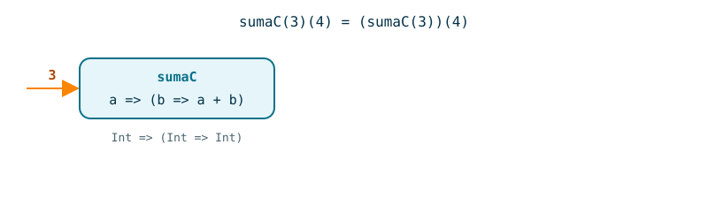
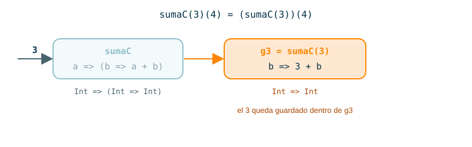
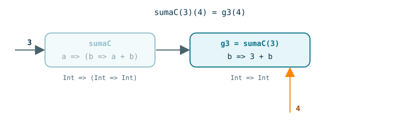
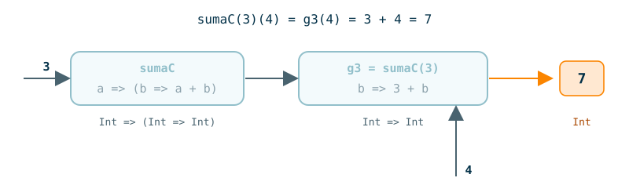
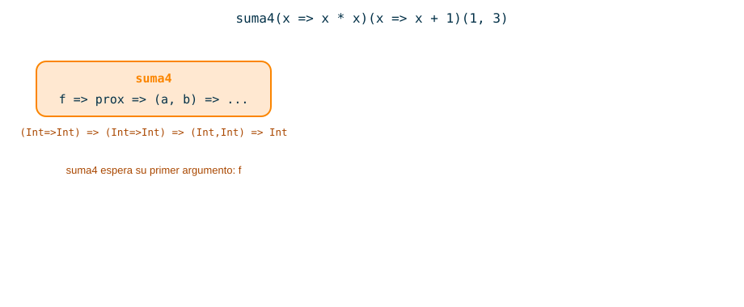
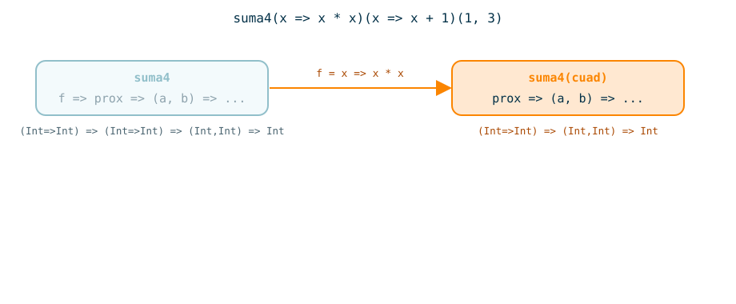
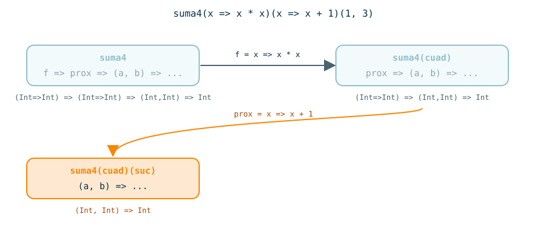
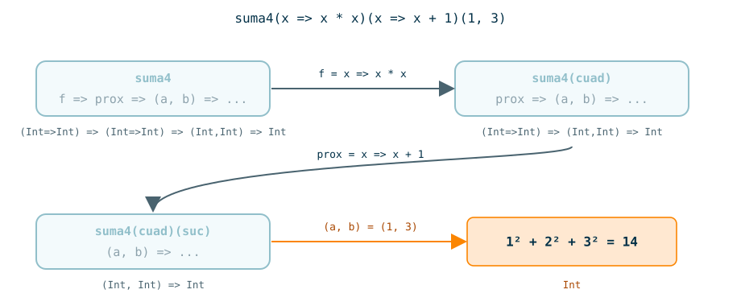

---
# Copyright (c) 2026 Angela Villota, and collaborators from the CyED block
# Licensed under the PolyForm Noncommercial License 1.0.0.
# Commercial use is prohibited without prior written authorization.
title: "Unidad 3 · Sesión 12: Funciones de alto orden (parte I)"
---

# Unidad 3 · Sesión 12: Funciones de alto orden (parte I)

## Agenda

1. Tres funciones que se parecen
2. Funciones como parámetro
3. Funciones anónimas
4. Funciones como respuesta
5. Currying
6. Costo de una función de alto orden
7. Ejercicios

Las trazas largas están en desplegables. Dentro, las pestañas **Paso 1, Paso 2, …** construyen el desarrollo como diapositivas: cada paso repite lo anterior y resalta lo nuevo.

## 1. Tres funciones que se parecen

Necesitamos tres funciones sobre listas de enteros: una que deje solo los pares, otra que deje solo los impares y otra que deje los menores que un número `x`.

```scala
def pares(lst: List[Int]): List[Int] = lst match {
  case Nil    => Nil
  case h :: t => if (h % 2 == 0) h :: pares(t) else pares(t)
}

def impares(lst: List[Int]): List[Int] = lst match {
  case Nil    => Nil
  case h :: t => if (h % 2 != 0) h :: impares(t) else impares(t)
}

def menoresQue(lst: List[Int], x: Int): List[Int] = lst match {
  case Nil    => Nil
  case h :: t => if (h < x) h :: menoresQue(t, x) else menoresQue(t, x)
}
```

**Compare las tres funciones línea por línea. ¿Qué cambia de una a otra?**

:::{admonition} Respuesta
:class: dropdown
Solo cambia la condición del `if`: `h % 2 == 0`, `h % 2 != 0`, `h < x`. El caso base, la descomposición `h :: t` y la decisión de conservar o descartar `h` son idénticos. Si mañana nos piden `mayoresQue`, escribiríamos una cuarta copia del mismo esqueleto con otra condición.
:::

Las tres funciones siguen este esqueleto, donde `cond` es lo único que varía:

```scala
def filtro(lst: List[Int]): List[Int] = lst match {
  case Nil    => Nil
  case h :: t => if (cond) h :: filtro(t) else filtro(t)
}
```

Para escribir el esqueleto una sola vez, la condición tiene que llegar como **parámetro**. Y la condición es una función: recibe un entero y devuelve un booleano.

**Funciones como valores de primera clase.** En un lenguaje funcional, una función es un valor como `3` o `"abc"`. Por eso una función puede:

1. asignarse a un nombre,
2. pasarse como argumento a otra función,
3. devolverse como resultado de otra función.

**Función de alto orden.** Es una función que recibe funciones como parámetro, devuelve una función como resultado, o ambas cosas.

En el cálculo $\lambda$ todo valor es una función, así que estas tres capacidades vienen de fábrica. Scala hereda esa idea.

## 2. Funciones como parámetro

### 2.1 El filtro de alto orden

Reemplazamos `cond` por la aplicación de un parámetro `f` de tipo `Int => Boolean`:

```scala
def filtroHO(lst: List[Int], f: Int => Boolean): List[Int] = lst match {
  case Nil    => Nil
  case h :: t => if (f(h)) h :: filtroHO(t, f) else filtroHO(t, f)
}
```

Ahora `pares` e `impares` son llamados a `filtroHO` con dos funciones distintas:

```scala
def esPar(x: Int): Boolean   = x % 2 == 0
def esImpar(x: Int): Boolean = x % 2 != 0

filtroHO(List(5, 3, 2, 4, 8, 10), esPar)    // List(2, 4, 8, 10)
filtroHO(List(5, 3, 2, 4, 8, 10), esImpar)  // List(5, 3)
```

Fíjese en que pasamos `esPar` sin paréntesis ni argumentos: no la estamos llamando, la estamos entregando para que `filtroHO` la llame cuando la necesite.

:::::{admonition} Traza de filtroHO(List(5, 2, 4), esPar)
:class: dropdown
::::{tab-set}
:::{tab-item} Paso 1
```{code-block} scala
:emphasize-lines: 1
filtroHO(List(5, 2, 4), esPar)
```

> La lista no es vacía: el patrón `h :: t` liga `h = 5`, `t = List(2, 4)` y `f = esPar`.

:::
:::{tab-item} Paso 2
```{code-block} scala
:emphasize-lines: 2
filtroHO(List(5, 2, 4), esPar)
= if (esPar(5)) 5 :: filtroHO(List(2, 4), esPar) else filtroHO(List(2, 4), esPar)
```

> **¿Cuánto vale `esPar(5)`?**

:::
:::{tab-item} Paso 3
```{code-block} scala
:emphasize-lines: 3
filtroHO(List(5, 2, 4), esPar)
= if (esPar(5)) 5 :: filtroHO(List(2, 4), esPar) else filtroHO(List(2, 4), esPar)
= filtroHO(List(2, 4), esPar)                        // esPar(5) = false
```

> El 5 se descarta. Ahora `h = 2`, `t = List(4)`.

:::
:::{tab-item} Paso 4
```{code-block} scala
:emphasize-lines: 4
filtroHO(List(5, 2, 4), esPar)
= if (esPar(5)) 5 :: filtroHO(List(2, 4), esPar) else filtroHO(List(2, 4), esPar)
= filtroHO(List(2, 4), esPar)                        // esPar(5) = false
= 2 :: filtroHO(List(4), esPar)                      // esPar(2) = true
```

> El 2 se conserva al frente. Falta filtrar `List(4)`.

:::
:::{tab-item} Paso 5
```{code-block} scala
:emphasize-lines: 5
filtroHO(List(5, 2, 4), esPar)
= if (esPar(5)) 5 :: filtroHO(List(2, 4), esPar) else filtroHO(List(2, 4), esPar)
= filtroHO(List(2, 4), esPar)                        // esPar(5) = false
= 2 :: filtroHO(List(4), esPar)                      // esPar(2) = true
= 2 :: (4 :: filtroHO(Nil, esPar))                   // esPar(4) = true
```

> **¿Qué devuelve `filtroHO(Nil, esPar)`?**

:::
:::{tab-item} Paso 6
```{code-block} scala
:emphasize-lines: 6, 7
filtroHO(List(5, 2, 4), esPar)
= if (esPar(5)) 5 :: filtroHO(List(2, 4), esPar) else filtroHO(List(2, 4), esPar)
= filtroHO(List(2, 4), esPar)                        // esPar(5) = false
= 2 :: filtroHO(List(4), esPar)                      // esPar(2) = true
= 2 :: (4 :: filtroHO(Nil, esPar))                   // esPar(4) = true
= 2 :: (4 :: Nil)                                    // caso base
= List(2, 4)
```

:::
::::
:::::

### 2.2 Tipos de las funciones

Toda función tiene un tipo. **`A => B` es el tipo de las funciones que reciben un valor de tipo `A` y devuelven un valor de tipo `B`.**

| Tipo | Se lee |
|---|---|
| `Int => Int` | recibe un entero, devuelve un entero |
| `Int => Boolean` | predicado sobre enteros |
| `(Int, Int) => Int` | recibe dos enteros, devuelve un entero |
| `(Int => Int) => Int` | recibe una **función** de enteros, devuelve un entero |
| `Int => (Int => Int)` | recibe un entero, devuelve una **función** de enteros |

El tipo de `filtroHO` es `(List[Int], Int => Boolean) => List[Int]`.

**Escriba el tipo de cada función.**

1. `def doble(x: Int): Int = 2 * x`
2. `def esVocal(c: Char): Boolean = "aeiou".contains(c)`
3. `def promedio(x: Double, y: Double): Double = (x + y) / 2`
4. `def enCero(f: Int => Int): Int = f(0)`
5. `def aplicar(f: Int => Int, x: Int): Int = f(x)`

:::{admonition} Respuestas
:class: dropdown
1. `Int => Int`
2. `Char => Boolean`
3. `(Double, Double) => Double`
4. `(Int => Int) => Int`. Recibe una función y devuelve un entero: `enCero(doble)` vale `0`.
5. `(Int => Int, Int) => Int`. Recibe dos argumentos; el primero es una función.
:::

### 2.3 La sumatoria generalizada

Nos piden tres sumas:

$$
\begin{aligned}
&a + (a+1) + (a+2) + \cdots + b \\
&a^2 + (a+1)^2 + (a+2)^2 + \cdots + b^2 \\
&a^2 + (a+2)^2 + (a+4)^2 + \cdots + c^2, \qquad b - 1 \le c \le b
\end{aligned}
$$

La versión directa son tres funciones:

```scala
def sumaEnteros(a: Int, b: Int): Int =
  if (a > b) 0 else a + sumaEnteros(a + 1, b)

def sumaCuadrados(a: Int, b: Int): Int =
  if (a > b) 0 else a * a + sumaCuadrados(a + 1, b)

def sumaAlternada(a: Int, b: Int): Int =
  if (a > b) 0 else a * a + sumaAlternada(a + 2, b)
```

**¿Qué cambia entre las tres?**

:::{admonition} Respuesta
:class: dropdown
Dos cosas: el término que se suma (`a` o `a * a`) y la forma de avanzar al siguiente índice (`a + 1` o `a + 2`). Las tres calculan $\sum f(i)$ para distintas `f` y distintos pasos.
:::

Parametrizamos las dos cosas que cambian: el término `f` y el sucesor `prox`.

```scala
def suma(f: Int => Int, prox: Int => Int, a: Int, b: Int): Int =
  if (a > b) 0
  else f(a) + suma(f, prox, prox(a), b)
```

Con cuatro funciones pequeñas recuperamos las tres sumas:

```scala
def ident(x: Int): Int    = x
def cuadrado(x: Int): Int = x * x
def suc(x: Int): Int      = x + 1
def sum2(x: Int): Int     = x + 2

suma(ident, suc, 1, 10)       // 55
suma(cuadrado, suc, 1, 10)    // 385
suma(cuadrado, sum2, 1, 10)   // 1² + 3² + 5² + 7² + 9² = 165
```

:::::{admonition} Traza de suma(ident, suc, 1, 3)
:class: dropdown
::::{tab-set}
:::{tab-item} Paso 1
```{code-block} scala
:emphasize-lines: 1, 2
suma(ident, suc, 1, 3)
= ident(1) + suma(ident, suc, suc(1), 3)
```

> Como `1 > 3` es falso, se toma la rama `else`. Fíjese en que `suc(1)` todavía no se ha evaluado.

:::
:::{tab-item} Paso 2
```{code-block} scala
:emphasize-lines: 3
suma(ident, suc, 1, 3)
= ident(1) + suma(ident, suc, suc(1), 3)
= 1 + suma(ident, suc, 2, 3)
```

:::
:::{tab-item} Paso 3
```{code-block} scala
:emphasize-lines: 4
suma(ident, suc, 1, 3)
= ident(1) + suma(ident, suc, suc(1), 3)
= 1 + suma(ident, suc, 2, 3)
= 1 + 2 + suma(ident, suc, 3, 3)
```

:::
:::{tab-item} Paso 4
```{code-block} scala
:emphasize-lines: 5
suma(ident, suc, 1, 3)
= ident(1) + suma(ident, suc, suc(1), 3)
= 1 + suma(ident, suc, 2, 3)
= 1 + 2 + suma(ident, suc, 3, 3)
= 1 + 2 + 3 + suma(ident, suc, 4, 3)
```

> **¿Cuándo se detiene la recursión?**

:::
:::{tab-item} Paso 5
```{code-block} scala
:emphasize-lines: 6, 7
suma(ident, suc, 1, 3)
= ident(1) + suma(ident, suc, suc(1), 3)
= 1 + suma(ident, suc, 2, 3)
= 1 + 2 + suma(ident, suc, 3, 3)
= 1 + 2 + 3 + suma(ident, suc, 4, 3)
= 1 + 2 + 3 + 0                      // 4 > 3: caso base
= 6
```

:::
::::
:::::

### 2.4 Ejemplos

#### Ejemplo 1

Aplicar una función dos veces seguidas.

```scala
def aplicarDosVeces(f: Int => Int, x: Int): Int = f(f(x))

def triple(x: Int): Int = 3 * x

aplicarDosVeces(triple, 5)
aplicarDosVeces(suc, 5)
```

:::{admonition} Resultado
:class: dropdown
`aplicarDosVeces(triple, 5) = triple(triple(5)) = triple(15) = 45`.

`aplicarDosVeces(suc, 5) = suc(suc(5)) = 7`.

El tipo de `aplicarDosVeces` es `(Int => Int, Int) => Int`.
:::

#### Ejemplo 2

Contar cuántos elementos de una lista cumplen una condición.

```scala
def contarSi(lst: List[Int], p: Int => Boolean): Int = lst match {
  case Nil    => 0
  case h :: t => (if (p(h)) 1 else 0) + contarSi(t, p)
}

contarSi(List(4, 7, 10, 13), esPar)
contarSi(List(4, 7, 10, 13), esImpar)
```

:::{admonition} Resultado
:class: dropdown
`2` y `2`. Con `esPar` cuentan 4 y 10; con `esImpar`, 7 y 13. `contarSi` tiene el mismo esqueleto de `filtroHO`, pero en lugar de construir una lista suma unos.
:::

#### Ejemplo 3

Devolver el elemento de una lista no vacía que tiene la **mayor clave**, donde la clave la decide una función.

```scala
def maximoSegun(lst: List[Int], clave: Int => Int): Int = lst match {
  case h :: Nil => h
  case h :: t =>
    val mejorDelResto = maximoSegun(t, clave)
    if (clave(h) >= clave(mejorDelResto)) h else mejorDelResto
}

def valorAbsoluto(x: Int): Int = if (x < 0) -x else x
def ultimoDigito(x: Int): Int  = x % 10

maximoSegun(List(3, -7, 5), valorAbsoluto)
maximoSegun(List(18, 25, 39, 41), ultimoDigito)
```

:::{admonition} Resultado
:class: dropdown
`maximoSegun(List(3, -7, 5), valorAbsoluto) = -7`, porque $|-7| = 7$ es la clave más grande.

`maximoSegun(List(18, 25, 39, 41), ultimoDigito) = 39`, porque los últimos dígitos son 8, 5, 9, 1.

La función no compara los elementos: compara `clave(h)` con `clave(mejorDelResto)` y devuelve el elemento, no la clave. El patrón no cubre `Nil`; el contrato exige una lista no vacía.
:::

#### Ejemplo 4

Construir la tabla de valores de una función entre `a` y `b`.

```scala
def tabla(f: Int => Int, a: Int, b: Int): List[(Int, Int)] =
  if (a > b) Nil
  else (a, f(a)) :: tabla(f, a + 1, b)

tabla(cuadrado, 1, 4)
tabla(triple, 0, 2)
```

:::{admonition} Resultado
:class: dropdown
`tabla(cuadrado, 1, 4) = List((1, 1), (2, 4), (3, 9), (4, 16))`.

`tabla(triple, 0, 2) = List((0, 0), (1, 3), (2, 6))`.

El tipo es `(Int => Int, Int, Int) => List[(Int, Int)]`: la función entra como dato y sale convertida en pares.
:::

#### Ejemplo 5

En la [Sesión 10](../../Unidad2-InduccionRecursividad/Sesion10-DivideVenceras/index.md) escribimos `insertionSort` para ordenar de menor a mayor. Si el criterio de orden llega como parámetro, la misma función ordena de cualquier forma.

```scala
def insertar(x: Int, lst: List[Int], menor: (Int, Int) => Boolean): List[Int] = lst match {
  case Nil                      => List(x)
  case y :: ys if menor(x, y)   => x :: lst
  case y :: ys                  => y :: insertar(x, ys, menor)
}

def ordenar(lst: List[Int], menor: (Int, Int) => Boolean): List[Int] = lst match {
  case Nil     => Nil
  case x :: xs => insertar(x, ordenar(xs, menor), menor)
}

def ascendente(x: Int, y: Int): Boolean      = x <= y
def descendente(x: Int, y: Int): Boolean     = x >= y
def porValorAbsoluto(x: Int, y: Int): Boolean = valorAbsoluto(x) <= valorAbsoluto(y)

ordenar(List(3, -5, 1, 4), ascendente)
ordenar(List(3, -5, 1, 4), descendente)
ordenar(List(3, -5, 1, 4), porValorAbsoluto)
```

:::{admonition} Resultado
:class: dropdown
| Criterio | Resultado |
|---|---|
| `ascendente` | `List(-5, 1, 3, 4)` |
| `descendente` | `List(4, 3, 1, -5)` |
| `porValorAbsoluto` | `List(1, 3, 4, -5)` |

`menor` tiene tipo `(Int, Int) => Boolean`: es una función de **dos** argumentos. `ordenar` la recibe y se la pasa a `insertar` sin usarla directamente.
:::

## 3. Funciones anónimas

Para usar `suma` creamos cuatro funciones con nombre: `ident`, `cuadrado`, `suc` y `sum2`. Cada una se usa una sola vez.

Con las cadenas no hacemos eso. Para imprimir `"abc"` no escribimos

```scala
val cad = "abc"
println(cad)
```

sino `println("abc")`, porque `"abc"` es un **literal**: un valor escrito directamente donde se usa. Scala también tiene literales de funciones.

**Función anónima.** Se escribe `(parámetros) => cuerpo`:

```scala
(x: Int) => x * x * x             // eleva al cubo
(x: Int, y: Int) => (x + y) / 2   // promedio entero de dos números
```

`(x: Int)` es el parámetro y `x * x * x` es el cuerpo. La expresión `(x: Int) => x * x * x` corresponde a la abstracción $\lambda x.\, x \cdot x \cdot x$ del cálculo $\lambda$: la flecha `=>` hace el papel de $\lambda$ y del punto.

**Inferencia de tipos.** Si Scala puede deducir el tipo del parámetro por el contexto, se puede omitir. Como `suma` declara `f: Int => Int`, el compilador sabe que `x` es `Int`:

```scala
suma(x => x, x => x + 1, 1, 10)        // 55
suma(x => x * x, x => x + 1, 1, 10)    // 385
suma(x => x * x, x => x + 2, 1, 10)    // 165
```

**Sintaxis de marcador `_`.** Si cada parámetro aparece **una sola vez** en el cuerpo y en el mismo orden en que se declara, se puede escribir con `_`. Cada `_` es un parámetro nuevo:

| Con marcador | Equivale a |
|---|---|
| `_ + 1` | `x => x + 1` |
| `_ * 2` | `x => x * 2` |
| `_ + _` | `(x, y) => x + y` |
| `_ % 2 == 0` | `x => x % 2 == 0` |

### 3.1 Ejemplos

#### Ejemplo 1

Una función anónima se puede aplicar en el mismo lugar donde se escribe, o guardarse en un `val`.

```scala
((x: Int) => x * x * x)(3)

val cubo: Int => Int = x => x * x * x
cubo(4)
```

:::{admonition} Resultado
:class: dropdown
`27` y `64`. En el primer caso la función nunca recibe nombre. En el segundo, `cubo` es un `val` cuyo valor es una función; su tipo `Int => Int` está escrito a la izquierda, y por eso `x` no necesita anotación.
:::

#### Ejemplo 2

```scala
suma(x => 2 * x - 1, x => x + 1, 1, 5)
```

**¿Qué suma esta expresión? ¿Qué valor da si cambiamos el 5 por cualquier $n$?**

:::{admonition} Resultado
:class: dropdown
Suma los cinco primeros impares: $1 + 3 + 5 + 7 + 9 = 25$. Para cualquier $n$ el resultado es $n^2$, la identidad $\sum_{i=1}^{n}(2i-1) = n^2$ que se demuestra por inducción.
:::

#### Ejemplo 3

```scala
filtroHO(List(15, 8, 21, 30, 7), x => x % 3 == 0 || x % 5 == 0)
filtroHO(List(15, 8, 21, 30, 7), _ % 3 == 0)
```

:::{admonition} Resultado
:class: dropdown
`List(15, 21, 30)` y `List(15, 21, 30)`.

El primer predicado no se puede escribir con marcador: `_ % 3 == 0 || _ % 5 == 0` define una función de **dos** parámetros, porque cada `_` es un parámetro distinto. Cuando la variable aparece más de una vez, hay que nombrarla.
:::

#### Ejemplo 4

¿Compilan estas definiciones?

```scala
val sumar: (Int, Int) => Int    = _ + _
val promedio: (Int, Int) => Int = (_ + _) / 2
```

:::{admonition} Resultado
:class: dropdown
La primera sí. La segunda **no compila**. Scala expande el marcador en la expresión más pequeña que lo contiene y que no es solo `_`. Esa expresión es `(_ + _)`, entonces se lee como

```scala
((x, y) => x + y) / 2
```

es decir, una función dividida entre 2. Hay que nombrar los parámetros:

```scala
val promedio: (Int, Int) => Int = (x, y) => (x + y) / 2
promedio(7, 10)   // 8
```
:::

#### Ejemplo 5

Una función anónima puede usar variables que no son sus parámetros.

```scala
def multiplosDe(k: Int, lst: List[Int]): List[Int] =
  filtroHO(lst, x => x % k == 0)

def entre(a: Int, b: Int, lst: List[Int]): List[Int] =
  filtroHO(lst, x => a <= x && x <= b)

multiplosDe(4, List(6, 8, 12, 15, 20))
entre(10, 20, List(4, 15, 9, 22, 11))
```

:::{admonition} Resultado
:class: dropdown
`List(8, 12, 20)` y `List(15, 11)`.

En `x => x % k == 0`, `x` es el parámetro y `k` es una **variable libre**: no la declara la función anónima. Su valor sale del entorno donde se escribió la función, aquí el parámetro `k` de `multiplosDe`. Cuando llamamos `multiplosDe(4, …)`, `filtroHO` recibe la función `x => x % 4 == 0`. Una función junto con los valores de sus variables libres se llama **clausura** (*closure*).
:::

## 4. Funciones como respuesta

Mire otra vez las sumas con funciones anónimas:

```scala
def sumaEnteros(a: Int, b: Int): Int    = suma(x => x, x => x + 1, a, b)
def sumaCuadrados(a: Int, b: Int): Int  = suma(x => x * x, x => x + 1, a, b)
def sumaAlternada(a: Int, b: Int): Int  = suma(x => x * x, x => x + 2, a, b)
```

`a` y `b` entran y se pasan a `suma` sin tocarse. Lo que distingue a cada función es el par `(f, prox)`. **¿Podemos fijar `f` y `prox` una vez y obtener una función que espere `a` y `b`?**

Sí, si `suma` **devuelve** una función:

```scala
def suma2(f: Int => Int, prox: Int => Int): (Int, Int) => Int = {
  def sumaF(a: Int, b: Int): Int =
    if (a > b) 0
    else f(a) + sumaF(prox(a), b)
  sumaF
}
```

`suma2` define adentro una función local `sumaF` y la devuelve. El tipo de retorno `(Int, Int) => Int` lo dice:

$$
\texttt{suma2} : \underbrace{(\texttt{Int => Int})}_{f} \times \underbrace{(\texttt{Int => Int})}_{prox} \longrightarrow \underbrace{(\texttt{Int, Int}) \texttt{ => Int}}_{\text{resultado: una función}}
$$

Ahora las tres sumas son valores:

```scala
val sumaEnteros: (Int, Int) => Int   = suma2(x => x, x => x + 1)
val sumaCuadrados: (Int, Int) => Int = suma2(x => x * x, x => x + 1)
val sumaAlternada: (Int, Int) => Int = suma2(x => x * x, x => x + 2)

sumaEnteros(1, 10)     // 55
sumaCuadrados(1, 10)   // 385
sumaAlternada(1, 10)   // 165
```

`sumaF` usa `f` y `prox`, que son parámetros de `suma2` y no de `sumaF`. Cuando `suma2` termina, la función devuelta **se lleva** esos valores: es una clausura, como en el ejemplo 5 de la sección anterior.

:::::{admonition} Traza: construir sumaCubos y aplicarla a (1, 2)
:class: dropdown
::::{tab-set}
:::{tab-item} Paso 1
```{code-block} scala
:emphasize-lines: 1
val sumaCubos = suma2(x => x * x * x, x => x + 1)
```

> **¿Qué valor queda guardado en `sumaCubos`? ¿Un número?**

:::
:::{tab-item} Paso 2
```{code-block} scala
:emphasize-lines: 2, 3, 4
val sumaCubos = suma2(x => x * x * x, x => x + 1)
// sumaCubos = sumaF, con
//   f    = x => x * x * x
//   prox = x => x + 1
```

> No es un número. `suma2` no suma nada todavía: solo devuelve `sumaF` con `f` y `prox` fijados. Su tipo es `(Int, Int) => Int`.

:::
:::{tab-item} Paso 3
```{code-block} scala
:emphasize-lines: 6, 7
val sumaCubos = suma2(x => x * x * x, x => x + 1)
// sumaCubos = sumaF, con
//   f    = x => x * x * x
//   prox = x => x + 1

sumaCubos(1, 2)
= f(1) + sumaF(prox(1), 2)
```

> Ahora sí se suma. `sumaF` busca `f` y `prox` en los valores que guardó.

:::
:::{tab-item} Paso 4
```{code-block} scala
:emphasize-lines: 8, 9
val sumaCubos = suma2(x => x * x * x, x => x + 1)
// sumaCubos = sumaF, con
//   f    = x => x * x * x
//   prox = x => x + 1

sumaCubos(1, 2)
= f(1) + sumaF(prox(1), 2)
= 1 + sumaF(2, 2)
= 1 + f(2) + sumaF(prox(2), 2)
```

:::
:::{tab-item} Paso 5
```{code-block} scala
:emphasize-lines: 10, 11, 12
val sumaCubos = suma2(x => x * x * x, x => x + 1)
// sumaCubos = sumaF, con
//   f    = x => x * x * x
//   prox = x => x + 1

sumaCubos(1, 2)
= f(1) + sumaF(prox(1), 2)
= 1 + sumaF(2, 2)
= 1 + f(2) + sumaF(prox(2), 2)
= 1 + 8 + sumaF(3, 2)
= 1 + 8 + 0                      // 3 > 2: caso base
= 9
```

:::
::::
:::::

### 4.1 Ejemplos

#### Ejemplo 1

```scala
def sumador(n: Int): Int => Int = x => x + n

val masDiez = sumador(10)
masDiez(5)
sumador(3)(4)
```

:::{admonition} Resultado
:class: dropdown
`masDiez(5) = 15` y `sumador(3)(4) = 7`.

`sumador(3)` es la función `x => x + 3`, y `(4)` la aplica. La expresión `sumador(3)(4)` tiene dos aplicaciones seguidas; volveremos a ella en la sección de currying.
:::

#### Ejemplo 2

En la sección anterior `entre` recibía la lista. Esta versión devuelve el predicado y deja que `filtroHO` lo use:

```scala
def entre(a: Int, b: Int): Int => Boolean = x => a <= x && x <= b

filtroHO(List(4, 15, 9, 22, 11), entre(10, 20))
contarSi(List(4, 15, 9, 22, 11), entre(0, 9))
```

:::{admonition} Resultado
:class: dropdown
`List(15, 11)` y `2` (el 4 y el 9). `entre(10, 20)` es un valor de tipo `Int => Boolean`, así que encaja en el parámetro `f` de `filtroHO` y en el `p` de `contarSi`.
:::

#### Ejemplo 3

Una función que devuelve funciones puede ser recursiva.

```scala
def potencia(n: Int): Int => Int =
  if (n == 0) x => 1
  else x => x * potencia(n - 1)(x)

potencia(3)(2)
```

:::{admonition} Resultado
:class: dropdown
```scala
potencia(3)(2)
= (x => x * potencia(2)(x))(2)
= 2 * potencia(2)(2)
= 2 * (2 * potencia(1)(2))
= 2 * (2 * (2 * potencia(0)(2)))
= 2 * (2 * (2 * 1))
= 8
```

`potencia(3)` es la función "elevar al cubo". Cada llamado `potencia(n - 1)` construye otra función y la aplica de inmediato al mismo `x`.
:::

#### Ejemplo 4

La derivada de $g$ en $x$ se aproxima con el cociente $\dfrac{g(x + dx) - g(x)}{dx}$ para un $dx$ pequeño. En matemáticas la derivada toma una función y devuelve otra función: es una función de alto orden.

```scala
val dx = 0.00001

def derivada(g: Double => Double): Double => Double =
  x => (g(x + dx) - g(x)) / dx

val cuboD: Double => Double = x => x * x * x
derivada(cuboD)(5)
```

:::{admonition} Resultado
:class: dropdown
Aproximadamente `75.00015`. La derivada exacta de $x^3$ es $3x^2$, que en $x = 5$ vale $75$. El error, cercano a $3x\,dx = 0.00015$, sale de usar un $dx$ finito.

`derivada(cuboD)` es un valor de tipo `Double => Double`; se puede guardar y evaluar en otros puntos: `val d = derivada(cuboD); d(1)` da aproximadamente `3.0`.
:::

#### Ejemplo 5

El método de Newton busca una raíz de $g$ mejorando una aproximación $x$ con la regla

$$
x_{\text{nuevo}} = x - \frac{g(x)}{g'(x)}
$$

Con `derivada` del ejemplo anterior, escribimos una función que recibe $g$ y devuelve la función "mejorar una aproximación":

```scala
def pasoNewton(g: Double => Double): Double => Double =
  x => x - g(x) / derivada(g)(x)

val mejorar = pasoNewton(x => x * x - 2)   // raíz de x² - 2: √2

mejorar(1.0)
mejorar(mejorar(1.0))
mejorar(mejorar(mejorar(1.0)))
```

:::{admonition} Resultado
:class: dropdown
| Iteración | $x$ |
|---|---|
| 0 | `1.0` |
| 1 | `1.4999975…` |
| 2 | `1.4166668…` |
| 3 | `1.4142157…` |
| 4 | `1.4142135623…` |

$\sqrt{2} = 1.41421356\ldots$ En cuatro iteraciones hay diez cifras correctas. Fíjese en las capas: `pasoNewton` devuelve una función que llama a `derivada`, que a su vez devuelve otra función. Ningún paso usa un ciclo ni una variable mutable.
:::

## 5. Currying

### 5.1 Una función de dos argumentos como cadena de funciones de un argumento

En la sección 4, `suma2` separó los argumentos en dos grupos: primero `(f, prox)` y luego `(a, b)`. Llevemos la idea al extremo: **toda función de varios argumentos se puede ver como una cadena de funciones de un solo argumento.** Esa transformación se llama **currying**, en honor al lógico Haskell Curry (1900–1982); la describieron antes Moses Schönfinkel y Gottlob Frege.

**Notación.** Dados dos conjuntos $A$ y $B$, $B^A$ es el conjunto de todas las funciones de $A$ en $B$:

$$
B^A = \{\, g \mid g : A \to B \,\}
$$

Tomemos la suma de naturales como función de dos argumentos:

$$
\mathit{suma} : \mathbb{N} \times \mathbb{N} \to \mathbb{N}, \qquad \mathit{suma}(a, b) = a + b
$$

Su versión currificada recibe **solo** $a$ y devuelve una función que espera $b$:

$$
\mathit{suma}_c : \mathbb{N} \to \mathbb{N}^{\mathbb{N}}, \qquad \mathit{suma}_c(a) = g_a, \quad \text{donde } g_a(b) = a + b
$$

Fíjese en el codominio: $\mathit{suma}_c$ no devuelve números, devuelve elementos de $\mathbb{N}^{\mathbb{N}}$, es decir, funciones. Cada fila de esta tabla es **una** función $g_a$:

| $a$ | $\mathit{suma}_c(a)$ | $g_a(0)$ | $g_a(1)$ | $g_a(2)$ | $g_a(3)$ |
|---|---|---|---|---|---|
| $0$ | $g_0 : b \mapsto 0 + b$ | $0$ | $1$ | $2$ | $3$ |
| $1$ | $g_1 : b \mapsto 1 + b$ | $1$ | $2$ | $3$ | $4$ |
| $2$ | $g_2 : b \mapsto 2 + b$ | $2$ | $3$ | $4$ | $5$ |
| $5$ | $g_5 : b \mapsto 5 + b$ | $5$ | $6$ | $7$ | $8$ |

La suma original se recupera aplicando dos veces:

$$
\mathit{suma}(a, b) = \big(\mathit{suma}_c(a)\big)(b)
$$

Pero $\mathit{suma}_c$ da algo más que la suma: la familia de funciones $\{g_a : a \in \mathbb{N}\}$. $\mathit{suma}_c(2)$ es "sumar 2" y $\mathit{suma}_c(5)$ es "sumar 5".

### 5.2 Forma general

Sea $f : A \times B \to C$. Existe una única función

$$
f_c : A \to C^B, \qquad f_c(a) = g_a, \qquad g_a(b) = f(a, b)
$$

tal que $f(a, b) = \big(f_c(a)\big)(b)$ para todo $a \in A$, $b \in B$. Decimos que $f_c$ es $f$ **después de aplicar currying**, o $f$ **currificada**.

```{list-table}
:header-rows: 1

* - Original
  - Currificada
  - Al fijar el primer argumento
* - $f : A \times B \to C$
  - $f_c : A \to C^B$
  - $f_c(a_1) = g_{a_1} : B \to C$, $\;f_c(a_2) = g_{a_2} : B \to C$, $\;\ldots$
```

Con tres argumentos se repite el proceso:

$$
f : A \times B \times C \to D \qquad\leadsto\qquad f_c : A \to \big(B \to (C \to D)\big), \qquad f(a, b, c) = \big((f_c(a))(b)\big)(c)
$$

### 5.3 Un ejemplo finito: contar funciones

Sea $A = B = C = \{0, 1\}$ y $f(a, b) = a \wedge b$ (el "y" lógico, con $1$ = verdadero).

| $a$ | $b$ | $f(a, b)$ |
|---|---|---|
| 0 | 0 | 0 |
| 0 | 1 | 0 |
| 1 | 0 | 0 |
| 1 | 1 | 1 |

**¿Qué funciones son $f_c(0)$ y $f_c(1)$?**

:::{admonition} Respuesta
:class: dropdown
$f_c(0) = g_0$ con $g_0(0) = f(0,0) = 0$ y $g_0(1) = f(0,1) = 0$: la **función constante 0**.

$f_c(1) = g_1$ con $g_1(0) = f(1,0) = 0$ y $g_1(1) = f(1,1) = 1$: la **identidad**.

"$a \wedge b$" leído en forma currificada dice: si $a = 0$ el resultado es $0$ sin importar $b$; si $a = 1$ el resultado es $b$.
:::

**¿Cuántas funciones hay de cada lado?** Para conjuntos finitos, $|Y^X| = |Y|^{|X|}$, porque cada uno de los $|X|$ elementos del dominio escoge su imagen entre $|Y|$ opciones. Entonces

$$
\big|\,C^{A \times B}\big| = |C|^{|A|\cdot|B|} = 2^{4} = 16
\qquad\qquad
\big|\,(C^B)^A\big| = \big(|C|^{|B|}\big)^{|A|} = (2^2)^2 = 16
$$

Hay tantas funciones de dos argumentos como funciones currificadas. No es casualidad: currying es una **biyección** entre $C^{A \times B}$ y $(C^B)^A$. Su inversa, que convierte $f_c$ de nuevo en $f$, se llama **uncurrying**. La igualdad de cardinales es la ley de exponentes $\left(c^{b}\right)^{a} = c^{a b}$.

### 5.4 Cómo se leen los tipos y las aplicaciones

Dos convenciones hacen que la notación currificada no necesite paréntesis:

- **La flecha `=>` asocia a la derecha.** `Int => Int => Int` significa `Int => (Int => Int)`: recibe un entero y devuelve una función.
- **La aplicación asocia a la izquierda.** `f(a)(b)(c)` significa `((f(a))(b))(c)`: primero se aplica `f` a `a`, al resultado se le aplica `b`, y así.

Las dos reglas encajan: si `f: A => B => C => D`, entonces `f(a): B => C => D`, `f(a)(b): C => D` y `f(a)(b)(c): D`. Cada aplicación quita una flecha de la izquierda.

Los paréntesis a la izquierda de la flecha **sí** cambian el tipo:

| Tipo | Significado |
|---|---|
| `Int => (Int => Int)` | igual a `Int => Int => Int`: recibe un entero, devuelve una función |
| `(Int => Int) => Int` | recibe una función, devuelve un entero |
| `(Int, Int) => Int` | recibe **dos** enteros a la vez; no está currificada |

**Si `g: (Int => Int) => Int => Boolean`, ¿qué tipo tienen `g(x => x + 1)` y `g(x => x + 1)(7)`?**

:::{admonition} Respuesta
:class: dropdown
`g(x => x + 1): Int => Boolean` y `g(x => x + 1)(7): Boolean`. El tipo de `g` se lee `(Int => Int) => (Int => Boolean)`: el primer argumento es una función y el resultado es un predicado.
:::

### 5.5 Currying en Scala

Hay tres formas de escribir la suma currificada en Scala.

**(a) Funciones anónimas anidadas.** Es la traducción literal de $\mathit{suma}_c$:

```scala
val sumaC: Int => Int => Int = a => b => a + b
```

**(b) Varias listas de parámetros.** Scala permite escribir un `def` con una lista de parámetros por argumento:

```scala
def sumaC(a: Int)(b: Int): Int = a + b
```

**(c) El método `.curried` de un valor función.** Convierte una función de varios argumentos en su versión currificada. `Function.uncurried` hace lo contrario:

```scala
val suma: (Int, Int) => Int = (a, b) => a + b
val sumaC: Int => Int => Int = suma.curried
val deNuevo: (Int, Int) => Int = Function.uncurried(sumaC)
```

Las tres formas producen lo mismo porque Scala trata la definición con varias listas de parámetros como **azúcar sintáctico** de funciones anidadas:

```scala
def f(arg1)(arg2)...(argn) = E
```

equivale a

```scala
def f(arg1)(arg2)...(arg_n-1) = (argn => E)
```

y, repitiendo $n$ veces,

```scala
def f = (arg1 => (arg2 => ... (argn => E) ...))
```

Por ejemplo, `def multiplicar(x: Int)(y: Int): Int = x * y` equivale a `def multiplicar: Int => (Int => Int) = x => (y => x * y)`, que es $\lambda x.\,\lambda y.\, x \cdot y$.

#### Cómo se evalúa `sumaC(3)(4)`

Seguimos el **modelo de sustitución**: reemplazar un nombre por su definición y aplicar una función anónima a un argumento reemplazando el parámetro por el argumento en el cuerpo. Ese último paso es la **β-reducción** del cálculo $\lambda$: $(\lambda x.\, E)\, v \;\to\; E[x := v]$.

:::::{admonition} Traza de sumaC(3)(4)
:class: dropdown
::::{tab-set}
:::{tab-item} Paso 1


```{code-block} scala
:emphasize-lines: 2, 3
sumaC(3)(4)
= (a => b => a + b)(3)(4)          // sumaC por su definición
= ((a => b => a + b)(3))(4)        // la aplicación asocia a la izquierda
```

> `sumaC` es una caja que espera **un** argumento. Los paréntesis muestran que primero recibe el 3; el 4 tendrá que esperar.

:::
:::{tab-item} Paso 2


```{code-block} scala
:emphasize-lines: 4
sumaC(3)(4)
= (a => b => a + b)(3)(4)          // sumaC por su definición
= ((a => b => a + b)(3))(4)        // la aplicación asocia a la izquierda
= (b => 3 + b)(4)                  // β-reducción: a := 3
```

> Al aplicar `a => (b => a + b)` al 3, se reemplaza `a` por `3` en el cuerpo. El cuerpo es otra función, `b => 3 + b`: esa es la $g_3$ de la tabla de la sección 5.1. **El 3 queda guardado dentro de $g_3$.** Hasta aquí no se ha sumado nada.

:::
:::{tab-item} Paso 3


```{code-block} scala
:emphasize-lines: 5
sumaC(3)(4)
= (a => b => a + b)(3)(4)          // sumaC por su definición
= ((a => b => a + b)(3))(4)        // la aplicación asocia a la izquierda
= (b => 3 + b)(4)                  // β-reducción: a := 3
= 3 + 4                            // β-reducción: b := 4
```

> Ahora sí entra el 4, como argumento de $g_3$, y se reemplaza `b`.

:::
:::{tab-item} Paso 4


```{code-block} scala
:emphasize-lines: 6
sumaC(3)(4)
= (a => b => a + b)(3)(4)          // sumaC por su definición
= ((a => b => a + b)(3))(4)        // la aplicación asocia a la izquierda
= (b => 3 + b)(4)                  // β-reducción: a := 3
= 3 + 4                            // β-reducción: b := 4
= 7
```

> Dos aplicaciones, dos β-reducciones, y cada una consumió **un** argumento. Los tipos acompañan: `sumaC: Int => (Int => Int)`, `sumaC(3): Int => Int`, `sumaC(3)(4): Int`.

:::
::::
:::::

#### Aplicación parcial: `suma4(f)(prox)(a, b)`

La versión currificada de la sumatoria tiene tres listas de parámetros:

```scala
def suma4(f: Int => Int)(prox: Int => Int)(a: Int, b: Int): Int =
  if (a > b) 0
  else f(a) + suma4(f)(prox)(prox(a), b)
```

Dar solo las primeras listas de argumentos se llama **aplicación parcial**: el resultado es la función que espera las listas que faltan.

```scala
val conCuadrado   = suma4(x => x * x)         // (Int => Int) => (Int, Int) => Int
val sumaCuadrados = conCuadrado(x => x + 1)   // (Int, Int) => Int
sumaCuadrados(1, 3)                           // 14

suma4(x => x)(x => x + 1)(1, 10)              // 55
suma4(x => x * x)(x => x + 1)(1, 10)          // 385
suma4(x => x * x)(x => x + 2)(1, 10)          // 165
```

En Scala 3 la conversión de `suma4(x => x * x)` en función es automática. En Scala 2 hay que pedirla con un guion bajo al final: `suma4(x => x * x) _`.

:::::{admonition} Traza de suma4(x => x * x)(x => x + 1)(1, 3)
:class: dropdown
::::{tab-set}
:::{tab-item} Paso 1


```{code-block} scala
:emphasize-lines: 1
suma4 : (Int => Int) => (Int => Int) => (Int, Int) => Int
```

> El tipo tiene tres flechas "de afuera". Con la regla de asociación a la derecha se lee `(Int => Int) => ((Int => Int) => ((Int, Int) => Int))`.

:::
:::{tab-item} Paso 2


```{code-block} scala
:emphasize-lines: 2
suma4 : (Int => Int) => (Int => Int) => (Int, Int) => Int
suma4(x => x * x) : (Int => Int) => (Int, Int) => Int
```

> Entró `f = x => x * x`. Desapareció la primera flecha. Lo que queda es una función que todavía espera `prox`.

:::
:::{tab-item} Paso 3


```{code-block} scala
:emphasize-lines: 3
suma4 : (Int => Int) => (Int => Int) => (Int, Int) => Int
suma4(x => x * x) : (Int => Int) => (Int, Int) => Int
suma4(x => x * x)(x => x + 1) : (Int, Int) => Int
```

> Entró `prox = x => x + 1`. Esta es la `sumaCuadrados` de arriba: una función de dos enteros que lleva guardados `f` y `prox`.

:::
:::{tab-item} Paso 4


```{code-block} scala
:emphasize-lines: 4, 5, 6, 7, 8, 9
suma4 : (Int => Int) => (Int => Int) => (Int, Int) => Int
suma4(x => x * x) : (Int => Int) => (Int, Int) => Int
suma4(x => x * x)(x => x + 1) : (Int, Int) => Int
suma4(x => x * x)(x => x + 1)(1, 3) : Int
= 1 * 1 + suma4(f)(prox)(2, 3)
= 1 + 2 * 2 + suma4(f)(prox)(3, 3)
= 1 + 4 + 3 * 3 + suma4(f)(prox)(4, 3)
= 1 + 4 + 9 + 0                       // 4 > 3: caso base
= 14
```

> La última lista `(a: Int, b: Int)` recibe dos argumentos a la vez: en Scala una lista de parámetros puede tener varios. Currificar por completo sería escribir `(a: Int)(b: Int)`.

:::
::::
:::::

### 5.6 Ejemplos

#### Ejemplo 1

```scala
def multiplicar(x: Int)(y: Int): Int = x * y

val doble  = multiplicar(2)
val triple = multiplicar(3)

doble(21)
triple(doble(5))
```

:::{admonition} Resultado
:class: dropdown
`doble(21) = 42` y `triple(doble(5)) = triple(10) = 30`. `doble` y `triple` tienen tipo `Int => Int`; salieron de la misma definición fijando el primer argumento.
:::

#### Ejemplo 2

Un filtro currificado y un predicado currificado:

```scala
def filtroCurry(p: Int => Boolean)(lst: List[Int]): List[Int] = lst match {
  case Nil    => Nil
  case h :: t => if (p(h)) h :: filtroCurry(p)(t) else filtroCurry(p)(t)
}

def enRango(min: Int)(max: Int)(x: Int): Boolean = min <= x && x <= max

val esDigito      = enRango(0)(9)
val dosCifras     = enRango(10)(99)
val soloDosCifras = filtroCurry(dosCifras)

esDigito(7)
soloDosCifras(List(7, 42, 100, 99, 10))
```

:::{admonition} Resultado
:class: dropdown
`esDigito(7) = true` y `soloDosCifras(List(7, 42, 100, 99, 10)) = List(42, 99, 10)`.

`enRango` tiene tres listas; fijamos dos y queda un predicado `Int => Boolean`, justo el tipo que `filtroCurry` espera en su primera lista. `soloDosCifras` es otra aplicación parcial: un filtro con el criterio ya puesto, de tipo `List[Int] => List[Int]`.
:::

#### Ejemplo 3

```scala
val volumen: (Int, Int, Int) => Int = (l, a, h) => l * a * h

val volumenC = volumen.curried     // Int => Int => Int => Int
val baseDosPorTres = volumenC(2)(3)

baseDosPorTres(4)
baseDosPorTres(10)

val volumenDeNuevo: (Int, Int, Int) => Int = Function.uncurried(volumenC)
volumenDeNuevo(2, 3, 4)
```

:::{admonition} Resultado
:class: dropdown
`24`, `60` y `24`. `baseDosPorTres` es el volumen de todas las cajas con base $2 \times 3$ en función de la altura. `Function.uncurried` deshace el currying y la función vuelve a recibir los tres argumentos juntos.
:::

#### Ejemplo 4

Con currying solo se puede fijar el **primer** argumento.

```scala
def potencia(base: Int)(exp: Int): Int =
  if (exp == 0) 1 else base * potencia(base)(exp - 1)

val dosALa = potencia(2)
dosALa(10)
```

`dosALa(10) = 1024`. Pero si queremos la función "elevar al cuadrado", el argumento fijo es el exponente, que está en segundo lugar. **¿Cómo la obtenemos sin reescribir `potencia`?**

:::{admonition} Resultado
:class: dropdown
Escribimos una función de alto orden que intercambie el orden de los argumentos:

```scala
def voltear[A, B, C](f: A => B => C): B => A => C =
  b => a => f(a)(b)

val alCuadrado = voltear(potencia)(2)
val alCubo     = voltear(potencia)(3)

alCuadrado(7)   // 49
alCubo(4)       // 64
```

`potencia` se convierte automáticamente en un valor `Int => Int => Int`. `voltear(potencia)` tiene tipo `Int => Int => Int` con el exponente primero, así que `voltear(potencia)(2)` fija el exponente en 2. Los parámetros de tipo `[A, B, C]` permiten usar `voltear` con cualquier función currificada de dos argumentos.
:::

#### Ejemplo 5

Escribamos nosotros `curry` y `uncurry`, y comprobemos que una deshace a la otra.

```scala
def curry[A, B, C](f: (A, B) => C): A => B => C =
  a => b => f(a, b)

def uncurry[A, B, C](g: A => B => C): (A, B) => C =
  (a, b) => g(a)(b)

val resta: (Int, Int) => Int = (x, y) => x - y
curry(resta)(10)(3)
uncurry(curry(resta))(10, 3)
```

**Demuestre que `uncurry(curry(f))` se comporta igual que `f` para cualquier `f`.**

:::::{admonition} Resultado y demostración
:class: dropdown
`curry(resta)(10)(3) = 7` y `uncurry(curry(resta))(10, 3) = 7`.

Para cualquier `f` y cualquier par `(a, b)`:

::::{tab-set}
:::{tab-item} Paso 1
```{code-block} scala
:emphasize-lines: 1, 2
uncurry(curry(f))(a, b)
= curry(f)(a)(b)                      // definición de uncurry
```

:::
:::{tab-item} Paso 2
```{code-block} scala
:emphasize-lines: 3
uncurry(curry(f))(a, b)
= curry(f)(a)(b)                      // definición de uncurry
= (a1 => b1 => f(a1, b1))(a)(b)       // definición de curry
```

> Renombramos los parámetros de `curry` como `a1`, `b1` para no confundirlos con los argumentos `a`, `b`.

:::
:::{tab-item} Paso 3
```{code-block} scala
:emphasize-lines: 4
uncurry(curry(f))(a, b)
= curry(f)(a)(b)                      // definición de uncurry
= (a1 => b1 => f(a1, b1))(a)(b)       // definición de curry
= (b1 => f(a, b1))(b)                 // β-reducción: a1 := a
```

:::
:::{tab-item} Paso 4
```{code-block} scala
:emphasize-lines: 5
uncurry(curry(f))(a, b)
= curry(f)(a)(b)                      // definición de uncurry
= (a1 => b1 => f(a1, b1))(a)(b)       // definición de curry
= (b1 => f(a, b1))(b)                 // β-reducción: a1 := a
= f(a, b)                             // β-reducción: b1 := b
```

> Para todo `(a, b)`, `uncurry(curry(f))(a, b) = f(a, b)`. De la misma forma se prueba `curry(uncurry(g))(a)(b) = g(a)(b)`. Las dos igualdades dicen que `curry` y `uncurry` son inversas: la biyección de la sección 5.3 escrita en Scala.

:::
::::
:::::

## 6. Costo de una función de alto orden

El costo de una función de alto orden depende del costo de las funciones que recibe.

**`filtroHO`.** Sea $T(n)$ el número de operaciones sobre una lista de $n$ elementos. Si evaluar `f(h)` cuesta una constante, cada llamado hace trabajo constante $c_1$ y un llamado recursivo sobre la cola:

$$
T(n) =
\begin{cases}
c_0 & n = 0 \\
T(n-1) + c_1 & n > 0
\end{cases}
$$

Por iteración, $T(n) = c_0 + n\,c_1 \in \Theta(n)$.

**`suma(f, prox, a, b)`.** Sea $n$ el número de términos de la suma. Si `f` y `prox` cuestan una constante, la recurrencia es la misma y $T(n) \in \Theta(n)$. Si `f` cuesta más, el costo cambia. Por ejemplo, para sumar los números triangulares $\sum_{i=1}^{n} \frac{i(i+1)}{2}$ con

```scala
suma(i => sumaEnteros(1, i), x => x + 1, 1, n)
```

el término $i$-ésimo cuesta $\Theta(i)$ porque `sumaEnteros(1, i)` hace $i$ llamados. La recurrencia queda $T(n) = T(n-1) + c\,n$, que en el ejemplo 2 de la [Sesión 11](../../Unidad2-InduccionRecursividad/Sesion11RecurrenciasDivideYVenceras/index.md) resolvimos como $\Theta(n^2)$.

## 7. Ejercicios

### Ejercicio 1

Escriba una función de alto orden `producto`, análoga a `suma`, que calcule

$$
\prod_{i=a}^{b} f(i) = f(a) \cdot f(\mathit{prox}(a)) \cdots
$$

Defina `factorial` en términos de `producto`.

:::{admonition} Pistas y solución general
:class: dropdown
**Pistas.** Copie `suma` y cambie dos cosas: el operador y el valor del caso base. ¿Qué número no altera un producto?

**Solución general.** El caso base devuelve `1` y la rama recursiva calcula `f(a) * producto(f, prox, prox(a), b)`. `factorial(n) = producto(x => x, x => x + 1, 1, n)`; `factorial(5) = 120`.
:::

### Ejercicio 2

Escriba una función `acumular` que generalice `suma` y `producto`. Después escriba `suma` y `producto` como llamados a `acumular`.

:::{admonition} Pistas y solución general
:class: dropdown
**Pistas.** Compare `suma` y `producto` y liste lo que cambia: el operador que combina y el valor neutro. Esos dos son los parámetros nuevos. El operador es una función de tipo `(Int, Int) => Int`.

**Solución general.** `acumular(combinar, neutro, f, prox, a, b)` devuelve `neutro` si `a > b` y si no `combinar(f(a), acumular(combinar, neutro, f, prox, prox(a), b))`. `suma` es `acumular(_ + _, 0, …)` y `producto` es `acumular(_ * _, 1, …)`.
:::

### Ejercicio 3

`suma` genera un proceso recursivo lineal: la suma `f(a) + …` queda pendiente en cada llamado. Escriba una versión que genere un proceso iterativo, recursiva de cola y anotada con `@tailrec`.

:::{admonition} Pistas y solución general
:class: dropdown
**Pistas.** Use una función auxiliar con un acumulador, como en la [Sesión 7](../../Unidad2-InduccionRecursividad/Sesion7-Estudio/index.md). ¿Con qué valor arranca el acumulador?

**Solución general.** Una función interna `iter(a, acc)` devuelve `acc` si `a > b` y si no llama `iter(prox(a), acc + f(a))`. `suma` devuelve `iter(a, 0)`. El llamado recursivo es lo último que hace `iter`, así que el compilador acepta `@tailrec`.
:::

### Ejercicio 4

Defina una función de alto orden `componer` que reciba dos funciones `f` y `g` de tipo `Int => Int` y devuelva $f \circ g$.

```scala
def componer(f: Int => Int, g: Int => Int): Int => Int = ???

componer(x => x + 1, x => x * 2)(3)   // 7: primero 3 * 2 = 6, luego 6 + 1 = 7
```

:::{admonition} Pistas y solución general
:class: dropdown
**Pistas.** El tipo de retorno es `Int => Int`, así que el cuerpo es una función anónima. $(f \circ g)(x) = f(g(x))$.

**Solución general.** `componer` devuelve `x => f(g(x))`. Pruebe también `componer(x => x * 2, x => x + 1)(3)`: da `8` y muestra que la composición no es conmutativa.
:::

### Ejercicio 5

Defina `aplicarN`, que aplica una función `f` exactamente `n` veces a un valor inicial.

```scala
def aplicarN(f: Int => Int, n: Int, x: Int): Int = ???

aplicarN(x => x + 1, 5, 0)   // 5
aplicarN(x => x * 2, 3, 1)   // 8
```

:::{admonition} Pistas y solución general
:class: dropdown
**Pistas.** Aplicar `f` cero veces deja `x` igual. Aplicar `f` $n$ veces es aplicarla una vez y luego $n - 1$ veces más.

**Solución general.** Si `n == 0` se devuelve `x`; si no, `aplicarN(f, n - 1, f(x))`. Esta versión es recursiva de cola. Una variante que devuelve una función: `def aplicarN(f: Int => Int, n: Int): Int => Int`, construida con `componer` del ejercicio 4.
:::

### Ejercicio 6

Reescriba la siguiente función con una lista de parámetros por argumento. Luego defina dos funciones especializadas mediante aplicación parcial y úselas.

```scala
def operar(a: Int, b: Int, c: Int): Int = a * b + c
```

:::{admonition} Pistas y solución general
:class: dropdown
**Pistas.** Siga la regla de la sección 5.5. Piense qué significa fijar `a`, o fijar `a` y `b`.

**Solución general.** `def operar(a: Int)(b: Int)(c: Int): Int = a * b + c`. Por ejemplo, `val dobleMas = operar(2)` tiene tipo `Int => Int => Int` y `val seisMas = operar(2)(3)` tiene tipo `Int => Int`; `seisMas(4) = 10`.
:::

### Ejercicio 7

Para la función `producto` del ejercicio 1, plantee la relación de recurrencia de su costo temporal, resuélvala y dé su orden asintótico. Suponga que `f` y `prox` cuestan una constante.

:::{admonition} Pistas y solución general
:class: dropdown
**Pistas.** Use como tamaño $n$ el número de factores. Compare con el análisis de `suma` en la sección 6.

**Solución general.** $T(0) = c_0$ y $T(n) = T(n-1) + c_1$, de donde $T(n) = c_0 + n\,c_1 \in \Theta(n)$.
:::

### Ejercicio 8

Explique por qué la siguiente línea no compila y corríjala de dos formas distintas.

```scala
suma4(x => x)(1, 10)
```

:::{admonition} Pistas y solución general
:class: dropdown
**Pistas.** Escriba el tipo de `suma4(x => x)`. ¿Qué espera recibir a continuación?

**Solución general.** `suma4(x => x)` tiene tipo `(Int => Int) => (Int, Int) => Int`: espera `prox`, no el par `(1, 10)`. El compilador rechaza `(1, 10)` porque no es una función `Int => Int`. Correcciones: dar el sucesor en la misma expresión, `suma4(x => x)(x => x + 1)(1, 10)`, o guardar la aplicación parcial y luego aplicarla, `val sumaId = suma4(x => x)(x => x + 1)` seguido de `sumaId(1, 10)`. Las dos dan `55`.
:::

### Ejercicio 9

Usando currying, defina una función que reciba un predicado y devuelva una función que cuente cuántos elementos de una lista cumplen ese predicado. Úsela para definir `contarPares` y `contarNegativos` por aplicación parcial, y analice su costo con una recurrencia.
