---
# Copyright (c) 2026 Angela Villota, and collaborators from the CyED block
# Licensed under the PolyForm Noncommercial License 1.0.0.
# Commercial use is prohibited without prior written authorization.
title: "Unidad 3 · Sesión 13: Funciones de alto orden (parte II): listas y colecciones"
---

# Unidad 3 · Sesión 13: Funciones de alto orden (parte II): listas y colecciones

## Agenda

1. Tres patrones sobre listas
2. Transformar: `map`
3. Filtrar: `filter` y sus variantes
4. Combinar: `reduceLeft`, `foldLeft` y `foldRight`
5. Composición de `filter`, `map` y `fold`
6. `flatMap` y otras operaciones sobre secuencias
7. Otras colecciones: rangos, vectores, cadenas, conjuntos y asociaciones
8. Expresiones `for`
9. Flujos perezosos: `LazyList`
10. Ejercicios

En la [Sesión 12](../Sesion12-FuncionesAltoOrdenI/index.md) escribimos `filtroHO` a mano. La clase `List` de Scala ya trae ese patrón y varios más como métodos de alto orden. En esta sesión los estudiamos uno por uno. Las trazas largas están en desplegables con pestañas **Paso 1, Paso 2, …**; las animaciones se repiten solas.

## 1. Tres patrones sobre listas

```scala
def escalar(xs: List[Double], k: Double): List[Double] = xs match {
  case Nil     => Nil
  case y :: ys => (y * k) :: escalar(ys, k)
}

def positivos(xs: List[Double]): List[Double] = xs match {
  case Nil     => Nil
  case y :: ys => if (y > 0) y :: positivos(ys) else positivos(ys)
}

def suma(xs: List[Int]): Int = xs match {
  case Nil     => 0
  case y :: ys => y + suma(ys)
}
```

**¿Qué hace cada función con los elementos de la lista? ¿Qué tipo de resultado produce?**

:::{admonition} Respuesta
:class: dropdown
| Función | Qué hace con cada elemento | Resultado |
|---|---|---|
| `escalar` | lo **transforma** (`y * k`) | una lista de la misma longitud |
| `positivos` | decide si lo **conserva** (`y > 0`) | una lista igual o más corta |
| `suma` | lo **combina** con el resultado del resto (`y + …`) | un solo valor |

Cada función es un representante de una familia: cambiando `y * k` por `y * y` o `Math.abs(y)` obtenemos otras transformaciones; cambiando `y > 0` por otra condición, otros filtros; cambiando `+` y `0` por `*` y `1`, el producto.
:::

Los tres patrones tienen nombre en la biblioteca de Scala:

| Patrón | Método | Lo que se parametriza |
|---|---|---|
| Transformar cada elemento | `map` | la transformación `f: T => U` |
| Conservar los que cumplen un criterio | `filter` | el predicado `p: T => Boolean` |
| Combinar todos con un operador | `foldLeft`, `foldRight` | el operador y el valor inicial |

## 2. Transformar: `map`

`xs.map(f)` aplica `f` a cada elemento de `xs` y devuelve la lista de resultados, en el mismo orden. Dentro de la clase `List[T]` se define así:

```scala
abstract class List[T] {
  def map[U](f: T => U): List[U] = this match {
    case Nil     => Nil
    case x :: xs => f(x) :: xs.map(f)
  }
}
```

`map` es genérica en dos tipos: los elementos de entrada son `T` y los de salida son `U`. Con `map`, `escalar` cabe en una línea:

```scala
def escalar(xs: List[Double], k: Double): List[Double] = xs.map(x => x * k)
```

`xs.map(f)` se lee "aplicar `f` a cada elemento de `xs`". La recursión queda escondida dentro de `map`.

:::::{admonition} Traza de List(2, 3, 4).map(_ + 10)
:class: dropdown
::::{tab-set}
:::{tab-item} Paso 1
```{code-block} scala
:emphasize-lines: 1, 2
List(2, 3, 4).map(f)                      // f = _ + 10
= f(2) :: List(3, 4).map(f)
```

> Patrón `x :: xs` con `x = 2`, `xs = List(3, 4)`.

:::
:::{tab-item} Paso 2
```{code-block} scala
:emphasize-lines: 3
List(2, 3, 4).map(f)                      // f = _ + 10
= f(2) :: List(3, 4).map(f)
= 12 :: (f(3) :: List(4).map(f))
```

:::
:::{tab-item} Paso 3
```{code-block} scala
:emphasize-lines: 4
List(2, 3, 4).map(f)                      // f = _ + 10
= f(2) :: List(3, 4).map(f)
= 12 :: (f(3) :: List(4).map(f))
= 12 :: (13 :: (f(4) :: Nil.map(f)))
```

> **¿Cuánto vale `Nil.map(f)`?**

:::
:::{tab-item} Paso 4
```{code-block} scala
:emphasize-lines: 5, 6
List(2, 3, 4).map(f)                      // f = _ + 10
= f(2) :: List(3, 4).map(f)
= 12 :: (f(3) :: List(4).map(f))
= 12 :: (13 :: (f(4) :: Nil.map(f)))
= 12 :: (13 :: (14 :: Nil))               // caso base: Nil
= List(12, 13, 14)
```

> Tres elementos de entrada, tres de salida: `map` hace una correspondencia uno a uno.

:::
::::
:::::

### 2.1 `map` en movimiento

Cada elemento sale de `xs`, pasa por la caja `f` y su resultado cae en la misma posición de la lista nueva.


Con `map` el tipo puede cambiar. Aquí entra una `List[String]` y sale una `List[Int]`:


La caja puede ser cualquier fórmula. Esta convierte grados Celsius a Fahrenheit con aritmética entera:


**Propiedades.** Para toda lista `xs` y funciones `f`, `g`:

| Propiedad | Igualdad |
|---|---|
| Caso base | `Nil.map(f) == Nil` |
| Conserva la longitud | `xs.map(f).length == xs.length` |
| Identidad | `xs.map(x => x) == xs` |
| Fusión | `xs.map(f).map(g) == xs.map(x => g(f(x)))` |

Las cuatro se demuestran por inducción estructural sobre `xs`, como en la [Sesión 8](../../Unidad2-InduccionRecursividad/Sesion8-InduccionEstructural/Estudio/index.md). La fusión dice que dos recorridos se pueden reemplazar por uno.

### 2.2 Ejemplos

#### Ejemplo 1

```scala
List(1.5, 2.0, 4.25).map(x => x * 2)
```

:::{admonition} Resultado
:class: dropdown
`List(3.0, 4.0, 8.5)`. Es `escalar` con `k = 2`.
:::

#### Ejemplo 2

```scala
List("ana", "luis", "sofia").map(_.capitalize)
```

:::{admonition} Resultado
:class: dropdown
`List("Ana", "Luis", "Sofia")`. `_.capitalize` es `s => s.capitalize`: pone en mayúscula la primera letra. Entra `List[String]` y sale `List[String]`.
:::

#### Ejemplo 3

Una lista de pedidos `(producto, cantidad)` se convierte en líneas de texto.

```scala
val pedidos = List(("arepa", 3), ("jugo", 2), ("pan", 6))

pedidos.map { case (producto, cantidad) => s"$cantidad x $producto" }
pedidos.map(_._2)
```

:::{admonition} Resultado
:class: dropdown
`List("3 x arepa", "2 x jugo", "6 x pan")` y `List(3, 2, 6)`.

`{ case (producto, cantidad) => … }` es una función anónima que desarma la pareja con reconocimiento de patrones. `_._2` extrae la segunda componente: `p => p._2`.
:::

#### Ejemplo 4

`map` sobre una lista de listas.

```scala
val grupos = List(List(1, 2), List(3), List())

grupos.map(_.length)
grupos.map(g => g.map(_ * 10))
```

:::{admonition} Resultado
:class: dropdown
`List(2, 1, 0)` y `List(List(10, 20), List(30), List())`.

En el segundo caso hay un `map` adentro de otro: el de afuera recorre los grupos y el de adentro recorre los elementos de cada grupo. El resultado conserva la forma de `grupos`.
:::

#### Ejemplo 5

Los elementos de una lista pueden ser funciones.

```scala
val multiplicadores: List[Int => Int] = List(1, 2, 3).map(k => (x: Int) => k * x)

multiplicadores.map(f => f(10))
multiplicadores.map(f => f(f(10)))
```

:::{admonition} Resultado
:class: dropdown
`List(10, 20, 30)` y `List(10, 40, 90)`.

El primer `map` convierte cada entero `k` en la función "multiplicar por `k`": cada una es una clausura que guarda su propio `k`, como `sumador` en la Sesión 12. El segundo `map` aplica cada función a 10. El tercero aplica cada una dos veces: $k \cdot (k \cdot 10)$.
:::

## 3. Filtrar: `filter` y sus variantes

`xs.filter(p)` conserva los elementos de `xs` que cumplen el predicado `p` y descarta el resto, sin cambiar el orden. Es el `filtroHO` de la Sesión 12, escrito como método:

```scala
abstract class List[T] {
  def filter(p: T => Boolean): List[T] = this match {
    case Nil     => Nil
    case x :: xs => if (p(x)) x :: xs.filter(p) else xs.filter(p)
  }
}
```

A diferencia de `map`, `filter` no cambia el tipo de los elementos: entra `List[T]` y sale `List[T]`.

```scala
def positivos(xs: List[Double]): List[Double] = xs.filter(x => x > 0)
```

:::::{admonition} Traza de List(8, 3, 6, 1).filter(_ > 4)
:class: dropdown
::::{tab-set}
:::{tab-item} Paso 1
```{code-block} scala
:emphasize-lines: 1, 2
List(8, 3, 6, 1).filter(p)                // p = _ > 4
= 8 :: List(3, 6, 1).filter(p)            // p(8) = true: se conserva
```

:::
:::{tab-item} Paso 2
```{code-block} scala
:emphasize-lines: 3
List(8, 3, 6, 1).filter(p)                // p = _ > 4
= 8 :: List(3, 6, 1).filter(p)            // p(8) = true: se conserva
= 8 :: List(6, 1).filter(p)               // p(3) = false: se descarta
```

> Al descartar el 3 no se agrega nada: la lista pendiente sigue siendo `8 :: …`.

:::
:::{tab-item} Paso 3
```{code-block} scala
:emphasize-lines: 4
List(8, 3, 6, 1).filter(p)                // p = _ > 4
= 8 :: List(3, 6, 1).filter(p)            // p(8) = true: se conserva
= 8 :: List(6, 1).filter(p)               // p(3) = false: se descarta
= 8 :: (6 :: List(1).filter(p))           // p(6) = true
```

:::
:::{tab-item} Paso 4
```{code-block} scala
:emphasize-lines: 5, 6, 7
List(8, 3, 6, 1).filter(p)                // p = _ > 4
= 8 :: List(3, 6, 1).filter(p)            // p(8) = true: se conserva
= 8 :: List(6, 1).filter(p)               // p(3) = false: se descarta
= 8 :: (6 :: List(1).filter(p))           // p(6) = true
= 8 :: (6 :: Nil.filter(p))               // p(1) = false
= 8 :: (6 :: Nil)
= List(8, 6)
```

:::
::::
:::::

### 3.1 `filter` en movimiento

Cada elemento pasa por el predicado `p`. Si `p` responde `true`, el elemento baja al resultado; si responde `false`, sale tachado.


El predicado puede mirar cualquier propiedad del elemento:


`partition` hace el mismo recorrido pero no descarta nada: separa la lista en dos, los que cumplen y los que no.


### 3.2 Variantes de `filter`

| Método | Devuelve |
|---|---|
| `xs.filterNot(p)` | los que **no** cumplen `p`; igual a `xs.filter(x => !p(x))` |
| `xs.partition(p)` | la pareja `(xs.filter(p), xs.filterNot(p))`, en **un solo** recorrido |
| `xs.takeWhile(p)` | el **prefijo** más largo cuyos elementos cumplen `p` |
| `xs.dropWhile(p)` | lo que queda después de quitar ese prefijo |
| `xs.span(p)` | la pareja `(xs.takeWhile(p), xs.dropWhile(p))`, en un solo recorrido |

Con `val xs = List(2, 4, 7, 8, 9)` y `p = _ % 2 == 0`, **¿qué devuelven `xs.filter(p)` y `xs.takeWhile(p)`?**

:::{admonition} Respuesta
:class: dropdown
| Expresión | Resultado |
|---|---|
| `xs.filter(p)` | `List(2, 4, 8)` |
| `xs.takeWhile(p)` | `List(2, 4)` |
| `xs.filterNot(p)` | `List(7, 9)` |
| `xs.dropWhile(p)` | `List(7, 8, 9)` |
| `xs.partition(p)` | `(List(2, 4, 8), List(7, 9))` |
| `xs.span(p)` | `(List(2, 4), List(7, 8, 9))` |

`takeWhile` **se detiene** en el primer elemento que no cumple (el 7), así que el 8 nunca se examina. `filter` revisa la lista completa. Por eso `dropWhile` deja el 8 en el resultado aunque sea par.
:::

### 3.3 Ejemplos

#### Ejemplo 1

```scala
List(-4, 9, 0, 13, -2).filter(_ > 0)
```

:::{admonition} Resultado
:class: dropdown
`List(9, 13)`. El 0 no pasa porque `0 > 0` es falso.
:::

#### Ejemplo 2

```scala
List("Cali", "bogota", "Medellin", "pasto").filter(_.head.isUpper)
```

:::{admonition} Resultado
:class: dropdown
`List("Cali", "Medellin")`. `_.head` es el primer carácter de la cadena e `isUpper` pregunta si es mayúscula.
:::

#### Ejemplo 3

```scala
val notas = List(("Ana", 4.1), ("Beto", 2.7), ("Caro", 3.0), ("Dani", 2.95))

notas.filter { case (_, nota) => nota >= 3.0 }
notas.partition(_._2 >= 3.0)
```

:::{admonition} Resultado
:class: dropdown
`List(("Ana", 4.1), ("Caro", 3.0))` y `(List(("Ana", 4.1), ("Caro", 3.0)), List(("Beto", 2.7), ("Dani", 2.95)))`.

En el patrón `case (_, nota)`, el `_` ignora el nombre. Caro pasa porque la condición es `>=`. Dani no pasa: 2.95 es menor que 3.0.
:::

#### Ejemplo 4

El predicado puede salir de una función que devuelve funciones, como en la Sesión 12.

```scala
def multiploDe(k: Int): Int => Boolean = _ % k == 0

val unoAVeinte = (1 to 20).toList

unoAVeinte.filter(multiploDe(6))
unoAVeinte.filter(multiploDe(4)).filterNot(multiploDe(8))
```

:::{admonition} Resultado
:class: dropdown
`List(6, 12, 18)` y `List(4, 12, 20)`.

La segunda expresión encadena dos filtros: primero los múltiplos de 4 (`List(4, 8, 12, 16, 20)`) y después quita los múltiplos de 8. `(1 to 20).toList` construye la lista de 1 a 20; los rangos se estudian en la sección 7.
:::

#### Ejemplo 5

Divisores, primos y números perfectos con `filter`:

```scala
def divisores(n: Int): List[Int] = (1 to n).toList.filter(d => n % d == 0)

def esPrimo(n: Int): Boolean = divisores(n).length == 2

divisores(12)
List(2, 9, 11, 15, 17, 21).filter(esPrimo)
(1 to 30).toList.filter(n => divisores(n).sum == 2 * n)
```

:::{admonition} Resultado
:class: dropdown
`List(1, 2, 3, 4, 6, 12)`, `List(2, 11, 17)` y `List(6, 28)`.

Un primo tiene exactamente dos divisores: 1 y él mismo. Un número es **perfecto** si la suma de todos sus divisores es $2n$, es decir, si la suma de sus divisores propios es $n$: $6 = 1 + 2 + 3$ y $28 = 1 + 2 + 4 + 7 + 14$. `esPrimo` se pasa a `filter` por nombre, igual que `esPar` en la Sesión 12.
:::

## 4. Combinar: `reduceLeft`, `foldLeft` y `foldRight`

Sumar y multiplicar los elementos de una lista siguen el mismo esquema:

$$
\mathit{suma}(\langle x_1, \ldots, x_n \rangle) = 0 + x_1 + \cdots + x_n
\qquad\qquad
\mathit{prod}(\langle x_1, \ldots, x_n \rangle) = 1 \cdot x_1 \cdots x_n
$$

```scala
def suma(xs: List[Int]): Int = xs match {
  case Nil     => 0
  case y :: ys => y + suma(ys)
}

def prod(xs: List[Int]): Int = xs match {
  case Nil     => 1
  case y :: ys => y * prod(ys)
}
```

El caso base devuelve un **elemento neutro** (0 para la suma, 1 para el producto) y el caso recursivo combina la cabeza con el resultado del resto mediante un **operador binario**. Hay que parametrizar los dos.

### 4.1 `reduceLeft`

`xs.reduceLeft(op)` combina los elementos con `op` asociando a la izquierda:

$$
\langle x_1, \ldots, x_n \rangle.\mathtt{reduceLeft}(op) = (\cdots((x_1 \;op\; x_2) \;op\; x_3) \cdots) \;op\; x_n
$$

```scala
List(1, 2, 3, 4).reduceLeft(_ + _)        // ((1 + 2) + 3) + 4 = 10
List(5, 2, 8, 1, 4).reduceLeft(_ max _)   // 8
List("ab", "cd", "ef").reduceLeft(_ + _)  // "abcdef"
List(10, 3, 2).reduceLeft(_ - _)          // (10 - 3) - 2 = 5
```

`_ + _` es la función `(x, y) => x + y`: cada `_` se liga, en orden, a un parámetro distinto.

**¿Qué devuelve `List[Int]().reduceLeft(_ + _)`?**

:::{admonition} Respuesta
:class: dropdown
Lanza una excepción (`UnsupportedOperationException: empty.reduceLeft`). `reduceLeft` arranca con el primer elemento y una lista vacía no tiene primer elemento. Para que `suma(Nil)` valga 0 hace falta dar el neutro de forma explícita: eso es lo que hace `foldLeft`.
:::

### 4.2 `foldLeft`

`xs.foldLeft(z)(op)` recibe un **valor inicial** `z` y lo combina con los elementos de izquierda a derecha:

$$
\langle x_1, \ldots, x_n \rangle.\mathtt{foldLeft}(z)(op) = (\cdots((z \;op\; x_1) \;op\; x_2) \cdots) \;op\; x_n
\qquad\qquad
\langle\rangle.\mathtt{foldLeft}(z)(op) = z
$$

```scala
abstract class List[T] {
  def foldLeft[U](z: U)(op: (U, T) => U): U = this match {
    case Nil     => z
    case x :: xs => xs.foldLeft(op(z, x))(op)
  }

  def reduceLeft(op: (T, T) => T): T = this match {
    case Nil     => throw new Error("Nil.reduceLeft")
    case x :: xs => xs.foldLeft(x)(op)
  }
}
```

Fíjese en tres cosas de la definición:

1. **El acumulador.** `z` es el valor acumulado hasta el momento. En cada paso se reemplaza por `op(z, x)` y se sigue con la cola. El llamado recursivo es lo último que se hace: `foldLeft` es **recursiva de cola**.
2. **Dos tipos.** Los elementos son de tipo `T`, pero el acumulador es de tipo `U`, que puede ser otro. Con `reduceLeft` el resultado tiene que ser del mismo tipo de los elementos.
3. **Dos listas de parámetros.** `foldLeft` está currificada: `(z: U)` va en una lista y `op` en otra. Scala infiere los tipos lista por lista, de izquierda a derecha: cuando llega a `op`, ya sabe qué es `U` por el valor de `z`, y por eso podemos escribir `(acc, x) => …` sin anotar tipos.

Ahora `suma` y `prod` caben en una línea:

```scala
def suma(xs: List[Int]): Int = xs.foldLeft(0)(_ + _)
def prod(xs: List[Int]): Int = xs.foldLeft(1)(_ * _)
```

:::::{admonition} Traza de List(2, 3, 4).foldLeft(1)(_ * _)
:class: dropdown
::::{tab-set}
:::{tab-item} Paso 1
```{code-block} scala
:emphasize-lines: 1, 2
List(2, 3, 4).foldLeft(1)(op)             // op = _ * _
= List(3, 4).foldLeft(op(1, 2))(op)
```

> El acumulador arranca en `z = 1`. Patrón `x :: xs` con `x = 2`.

:::
:::{tab-item} Paso 2
```{code-block} scala
:emphasize-lines: 3, 4
List(2, 3, 4).foldLeft(1)(op)             // op = _ * _
= List(3, 4).foldLeft(op(1, 2))(op)
= List(3, 4).foldLeft(2)(op)
= List(4).foldLeft(op(2, 3))(op)
```

> **¿Queda alguna operación pendiente afuera del llamado recursivo?**

:::
:::{tab-item} Paso 3
```{code-block} scala
:emphasize-lines: 5, 6
List(2, 3, 4).foldLeft(1)(op)             // op = _ * _
= List(3, 4).foldLeft(op(1, 2))(op)
= List(3, 4).foldLeft(2)(op)
= List(4).foldLeft(op(2, 3))(op)
= List(4).foldLeft(6)(op)
= Nil.foldLeft(op(6, 4))(op)
```

> No. Cada línea es un único llamado a `foldLeft`, sin nada esperando alrededor. Todo el estado viaja en el acumulador.

:::
:::{tab-item} Paso 4
```{code-block} scala
:emphasize-lines: 7, 8
List(2, 3, 4).foldLeft(1)(op)             // op = _ * _
= List(3, 4).foldLeft(op(1, 2))(op)
= List(3, 4).foldLeft(2)(op)
= List(4).foldLeft(op(2, 3))(op)
= List(4).foldLeft(6)(op)
= Nil.foldLeft(op(6, 4))(op)
= Nil.foldLeft(24)(op)
= 24                                      // caso base: devuelve el acumulador
```

:::
::::
:::::

#### `foldLeft` en movimiento

El acumulador `acc` viaja a la caja `op` junto con el siguiente elemento, y regresa con el valor nuevo. La línea "expresión" muestra cómo crecen los paréntesis hacia la izquierda.


Con un operador que no es conmutativo, como la resta, la asociación a la izquierda determina el resultado:


El acumulador puede ser de otro tipo. Aquí es una lista, y como cada elemento se pone **al frente** del acumulador, la lista sale invertida:

)((acc, x) => x :: acc): el acumulador pasa por Nil, List(3), List(1, 3) y List(2, 1, 3)](images/foldleft-03.svg)

**¿Compila la siguiente versión del último ejemplo?**

```scala
List(3, 1, 2).foldLeft(Nil)((acc, x) => x :: acc)
```

:::{admonition} Respuesta
:class: dropdown
No. Scala infiere `U` con la primera lista de parámetros, y el tipo de `Nil` es `Nil.type`, la lista vacía y nada más. Después, `x :: acc` tiene tipo `List[Int]`, que no es `Nil.type`, y el compilador rechaza `op`. Hay que darle a `z` el tipo del acumulador: `List[Int]()` o `Nil: List[Int]`. Es el costo de que la inferencia vaya de una lista de parámetros a la siguiente.
:::

#### Ejemplos con `foldLeft`

##### Ejemplo 1

```scala
List(5, 3, 8).foldLeft(1)(_ * _)
```

:::{admonition} Resultado
:class: dropdown
`120`: $((1 \cdot 5) \cdot 3) \cdot 8$.
:::

##### Ejemplo 2

Contar las vocales de una palabra. Una `String` también tiene `foldLeft`: recorre sus caracteres.

```scala
"murcielago".foldLeft(0)((acc, c) => if ("aeiou".contains(c)) acc + 1 else acc)
```

:::{admonition} Resultado
:class: dropdown
`5` (u, i, e, a, o). El acumulador es un `Int` y los elementos son `Char`: `U` y `T` son distintos. El elemento solo decide si el contador sube.
:::

##### Ejemplo 3

Convertir una lista de dígitos en el número que representan.

```scala
List(2, 0, 2, 6).foldLeft(0)((acc, d) => acc * 10 + d)
List(1, 0, 1, 1).foldLeft(0)((acc, b) => acc * 2 + b)
```

:::{admonition} Resultado
:class: dropdown
`2026` y `11`.

| Paso | `d` | `acc * 10 + d` |
|---|---|---|
| inicio | | `0` |
| 1 | `2` | `2` |
| 2 | `0` | `20` |
| 3 | `2` | `202` |
| 4 | `6` | `2026` |

Cada paso desplaza el acumulado una posición y agrega el dígito nuevo. Es la **regla de Horner**: $2026 = ((2 \cdot 10 + 0) \cdot 10 + 2) \cdot 10 + 6$. Con base 2 en lugar de 10 se obtiene el valor de $1011_2 = 11$. Volveremos a las bases numéricas en teoría de números.
:::

##### Ejemplo 4

El mínimo y el máximo en un solo recorrido, con una pareja como acumulador.

```scala
List(7, 2, 9, 4).foldLeft((Int.MaxValue, Int.MinValue)) {
  case ((menor, mayor), x) => (menor min x, mayor max x)
}
```

:::{admonition} Resultado
:class: dropdown
`(2, 9)`. El acumulador empieza en `(Int.MaxValue, Int.MinValue)`, los neutros de `min` y `max`: cualquier entero `x` cumple `Int.MaxValue min x == x`. El patrón `case ((menor, mayor), x)` desarma el acumulador y el elemento en la misma línea.
:::

##### Ejemplo 5

Decidir si los paréntesis de una cadena están balanceados.

```scala
def balanceado(s: String): Boolean =
  s.foldLeft(0) { (abiertos, c) =>
    if (abiertos < 0) abiertos
    else if (c == '(') abiertos + 1
    else if (c == ')') abiertos - 1
    else abiertos
  } == 0

balanceado("(a(b)c)")
balanceado("())(")
balanceado("(()")
```

:::{admonition} Resultado
:class: dropdown
`true`, `false` y `false`.

El acumulador cuenta los paréntesis abiertos sin cerrar. Si alguna vez baja a $-1$, apareció un `)` sin pareja y el valor se queda en $-1$ hasta el final. Traza de `"())("`:

| Carácter | `abiertos` |
|---|---|
| inicio | `0` |
| `(` | `1` |
| `)` | `0` |
| `)` | `-1` |
| `(` | `-1` (ya no cambia) |

Sin la primera condición, `"())("` terminaría en `0` y la función diría que está balanceada.
:::

### 4.3 `foldRight`

`xs.foldRight(z)(op)` asocia a la **derecha**: el valor inicial `z` queda al final.

$$
\langle x_1, \ldots, x_n \rangle.\mathtt{foldRight}(z)(op) = x_1 \;op\; (x_2 \;op\; (\cdots (x_n \;op\; z)\cdots))
\qquad\qquad
\langle\rangle.\mathtt{foldRight}(z)(op) = z
$$

```scala
abstract class List[T] {
  def foldRight[U](z: U)(op: (T, U) => U): U = this match {
    case Nil     => z
    case x :: xs => op(x, xs.foldRight(z)(op))
  }

  def reduceRight(op: (T, T) => T): T = this match {
    case Nil      => throw new Error("Nil.reduceRight")
    case x :: Nil => x
    case x :: xs  => op(x, xs.reduceRight(op))
  }
}
```

Compare con `foldLeft`:

- El operador recibe `(T, U)`: el elemento a la izquierda y el acumulado a la derecha.
- El llamado recursivo **no** es lo último: `op(x, …)` queda pendiente hasta que el resto de la lista se resuelva. `foldRight` no es recursiva de cola.

:::::{admonition} Traza de List(2, 3, 4).foldRight(1)(_ * _)
:class: dropdown
::::{tab-set}
:::{tab-item} Paso 1
```{code-block} scala
:emphasize-lines: 1, 2
List(2, 3, 4).foldRight(1)(op)            // op = _ * _
= op(2, List(3, 4).foldRight(1)(op))
```

> El 2 no se puede multiplicar todavía: falta el resultado de la cola.

:::
:::{tab-item} Paso 2
```{code-block} scala
:emphasize-lines: 3
List(2, 3, 4).foldRight(1)(op)            // op = _ * _
= op(2, List(3, 4).foldRight(1)(op))
= op(2, op(3, List(4).foldRight(1)(op)))
```

:::
:::{tab-item} Paso 3
```{code-block} scala
:emphasize-lines: 4
List(2, 3, 4).foldRight(1)(op)            // op = _ * _
= op(2, List(3, 4).foldRight(1)(op))
= op(2, op(3, List(4).foldRight(1)(op)))
= op(2, op(3, op(4, Nil.foldRight(1)(op))))
```

> Hay tres operaciones pendientes, una por elemento. **¿Cuál se calcula primero?**

:::
:::{tab-item} Paso 4
```{code-block} scala
:emphasize-lines: 5, 6
List(2, 3, 4).foldRight(1)(op)            // op = _ * _
= op(2, List(3, 4).foldRight(1)(op))
= op(2, op(3, List(4).foldRight(1)(op)))
= op(2, op(3, op(4, Nil.foldRight(1)(op))))
= op(2, op(3, op(4, 1)))                  // caso base
= op(2, op(3, 4))                         // 4 * 1
```

> La más interna, la del último elemento.

:::
:::{tab-item} Paso 5
```{code-block} scala
:emphasize-lines: 7, 8
List(2, 3, 4).foldRight(1)(op)            // op = _ * _
= op(2, List(3, 4).foldRight(1)(op))
= op(2, op(3, List(4).foldRight(1)(op)))
= op(2, op(3, op(4, Nil.foldRight(1)(op))))
= op(2, op(3, op(4, 1)))                  // caso base
= op(2, op(3, 4))                         // 4 * 1
= op(2, 12)                               // 3 * 4
= 24                                      // 2 * 12
```

> Mismo resultado que `foldLeft` en la sección anterior, con otro proceso: `foldLeft` multiplicó $((1 \cdot 2) \cdot 3) \cdot 4$ y `foldRight` multiplicó $2 \cdot (3 \cdot (4 \cdot 1))$.

:::
::::
:::::

#### `foldRight` en movimiento

La animación tiene dos fases. En la bajada, cada elemento queda en una llamada pendiente, esperando el resultado de la cola. En la subida, los resultados se combinan desde el caso base hacia arriba.


Con la resta, `foldRight` y `foldLeft` dan resultados distintos sobre los mismos datos:


El operador `::` recibe un elemento a la izquierda y una lista a la derecha. Esa forma `(T, U) => U` encaja con `foldRight`, que así concatena dos listas:


#### Ejemplos con `foldRight`

##### Ejemplo 1

```scala
List(3, 4, 5).foldRight(0)((x, acc) => x * x + acc)
```

:::{admonition} Resultado
:class: dropdown
`50`: $3^2 + (4^2 + (5^2 + 0)) = 9 + 16 + 25$.
:::

##### Ejemplo 2

```scala
List("a", "b", "c").foldRight("")(_ + _)
List("a", "b", "c").foldLeft("")(_ + _)
List("a", "b", "c").foldRight("")((s, acc) => acc + s)
```

:::{admonition} Resultado
:class: dropdown
`"abc"`, `"abc"` y `"cba"`.

La concatenación no es conmutativa (`"a" + "b" != "b" + "a"`) y aun así `foldLeft` y `foldRight` coinciden: `(("" + "a") + "b") + "c"` y `"a" + ("b" + ("c" + ""))` dan lo mismo porque la concatenación es **asociativa** y `""` es su **neutro**. En la tercera línea el operador pone el elemento al final del acumulado, y la lista sale al revés.
:::

##### Ejemplo 3

`map` escrito con `foldRight`:

```scala
def mapConFold[T, U](xs: List[T])(f: T => U): List[U] =
  xs.foldRight(List[U]())((x, acc) => f(x) :: acc)

mapConFold(List(1, 2, 3))(x => x * x)
```

:::{admonition} Resultado
:class: dropdown
`List(1, 4, 9)`. El acumulador es la lista de resultados, que se construye desde el final: primero `9 :: Nil`, luego `4 :: List(9)`, luego `1 :: List(4, 9)`. Con `foldLeft` y el mismo operador la lista saldría invertida.
:::

##### Ejemplo 4

Aplanar una lista de listas.

```scala
List(List(1, 2), List(3), List(4, 5)).foldRight(List[Int]())(_ ::: _)
```

:::{admonition} Resultado
:class: dropdown
`List(1, 2, 3, 4, 5)`. `:::` concatena dos listas: `List(1, 2) ::: (List(3) ::: (List(4, 5) ::: Nil))`. Con `foldRight`, cada `:::` copia solo la lista de su izquierda, que es un grupo; con `foldLeft`, la izquierda sería el acumulado completo, que crece en cada paso.
:::

##### Ejemplo 5

En la [Sesión 10](../../Unidad2-InduccionRecursividad/Sesion10-DivideVenceras/index.md) definimos `insertionSort` con `insertar`. Ese ordenamiento es un `foldRight`:

```scala
def insertar(x: Int, lista: List[Int]): List[Int] = lista match {
  case Nil               => List(x)
  case y :: ys if x <= y => x :: lista
  case y :: ys           => y :: insertar(x, ys)
}

def insertionSort(xs: List[Int]): List[Int] = xs.foldRight(List[Int]())(insertar)

insertionSort(List(5, 2, 8, 1))
```

:::{admonition} Resultado
:class: dropdown
`List(1, 2, 5, 8)`.

```scala
insertionSort(List(5, 2, 8, 1))
= insertar(5, insertar(2, insertar(8, insertar(1, Nil))))
= insertar(5, insertar(2, insertar(8, List(1))))
= insertar(5, insertar(2, List(1, 8)))
= insertar(5, List(1, 2, 8))
= List(1, 2, 5, 8)
```

`insertar` tiene tipo `(Int, List[Int]) => List[Int]`: elemento a la izquierda, acumulado a la derecha. Es justo la forma del operador de `foldRight`, y se pasa por nombre. La definición recursiva de la Sesión 10, `insertar(x, insertionSort(xs))`, es el caso `x :: xs => op(x, xs.foldRight(z)(op))` de `foldRight`.
:::

### 4.4 `foldLeft` contra `foldRight`

Dibujemos las dos expresiones como árboles: cada `op` es un nodo con sus dos operandos como hijos.

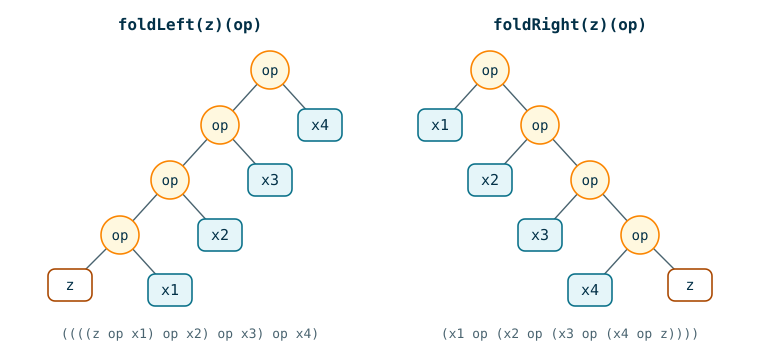

**¿Cuándo dan el mismo resultado?** Si `op` es asociativo y `z` es su neutro, los dos árboles valen lo mismo; también si `op` es asociativo y conmutativo, para cualquier `z`. Con la suma o el producto de números y su neutro se cumplen ambas. Con la resta, la división o `::` no se cumple ninguna, y los árboles dan cosas distintas, o ni siquiera tienen sentido de tipos.

**¿Se puede escribir la concatenación con `foldLeft`?**

```scala
def concat[T](xs: List[T], ys: List[T]): List[T] = xs.foldRight(ys)(_ :: _)
```

:::{admonition} Respuesta
:class: dropdown
No directamente. En `foldLeft` el operador tiene tipo `(List[T], T) => List[T]`, con el acumulado a la izquierda, y `_ :: _` necesita el elemento a la izquierda: `xs.foldLeft(ys)(_ :: _)` no compila. Si volteamos los argumentos, `xs.foldLeft(ys)((acc, x) => x :: acc)` compila, pero con `xs = List(1, 2, 3)` y `ys = List(4, 5)` da `List(3, 2, 1, 4, 5)`: los elementos de `xs` quedan invertidos.
:::

**Costo.** Las dos hacen una aplicación de `op` por elemento, así que con un `op` constante cuestan $T(n) = T(n-1) + c \in \Theta(n)$. La diferencia está en la memoria:

| | `foldLeft` | `foldRight` (definición recursiva) |
|---|---|---|
| Recursiva de cola | sí | no |
| Operaciones pendientes | ninguna | una por elemento |
| Pila | $O(1)$ | $O(n)$ |

Con la definición recursiva de `foldRight` y una lista de cientos de miles de elementos, la pila puede desbordarse (`StackOverflowError`). La biblioteca de Scala evita ese problema: su `List.foldRight` invierte la lista y la recorre con un ciclo, a costa de un recorrido adicional.

Regla práctica: use `foldLeft` por defecto; use `foldRight` cuando el operador tenga la forma `(T, U) => U` y el orden importe desde el final, como al construir una lista con `::`.

## 5. Composición de `filter`, `map` y `fold`

**Problema.** Dada una lista de enteros, calcular la suma de los cuadrados de los pares.

La versión recursiva mezcla las tres tareas en una sola función:

```scala
def sumaCuadradosPares(xs: List[Int]): Int = xs match {
  case Nil => 0
  case y :: ys =>
    if (y % 2 == 0) y * y + sumaCuadradosPares(ys)
    else sumaCuadradosPares(ys)
}
```

Con funciones de alto orden, cada tarea es una etapa:

```scala
def sumaCuadradosPares(xs: List[Int]): Int =
  xs.filter(_ % 2 == 0)
    .map(x => x * x)
    .foldLeft(0)(_ + _)
```

Se lee de arriba abajo: "de `xs`, filtro los pares, los elevo al cuadrado y los sumo desde 0".

:::::{admonition} Traza de sumaCuadradosPares(List(1, 2, 3, 4, 5, 6))
:class: dropdown
::::{tab-set}
:::{tab-item} Paso 1
```{code-block} scala
:emphasize-lines: 1
List(1, 2, 3, 4, 5, 6)
```

:::
:::{tab-item} Paso 2
```{code-block} scala
:emphasize-lines: 2
List(1, 2, 3, 4, 5, 6)
  .filter(_ % 2 == 0)       // List(2, 4, 6)
```

:::
:::{tab-item} Paso 3
```{code-block} scala
:emphasize-lines: 3
List(1, 2, 3, 4, 5, 6)
  .filter(_ % 2 == 0)       // List(2, 4, 6)
  .map(x => x * x)          // List(4, 16, 36)
```

:::
:::{tab-item} Paso 4
```{code-block} scala
:emphasize-lines: 4
List(1, 2, 3, 4, 5, 6)
  .filter(_ % 2 == 0)       // List(2, 4, 6)
  .map(x => x * x)          // List(4, 16, 36)
  .foldLeft(0)(_ + _)       // ((0 + 4) + 16) + 36 = 56
```

> Cada etapa produce una lista nueva que la siguiente consume. **¿Cuántas veces se recorre una lista en total?**

:::
:::{tab-item} Paso 5
```{code-block} scala
:emphasize-lines: 6, 7, 8
List(1, 2, 3, 4, 5, 6)
  .filter(_ % 2 == 0)       // List(2, 4, 6)
  .map(x => x * x)          // List(4, 16, 36)
  .foldLeft(0)(_ + _)       // ((0 + 4) + 16) + 36 = 56

// una sola pasada
List(1, 2, 3, 4, 5, 6).foldLeft(0)((acc, y) => if (y % 2 == 0) acc + y * y else acc)   // 56
```

> Tres recorridos, uno por etapa. La versión recursiva y la de un solo `foldLeft` hacen uno. Las tres son $\Theta(n)$; la composición cambia la constante y crea listas intermedias a cambio de legibilidad.

:::
::::
:::::

### 5.1 Ejemplos

#### Ejemplo 1

```scala
List("scala", "", "map", "  ", "fold").filter(_.trim.nonEmpty).map(_.length)
```

:::{admonition} Resultado
:class: dropdown
`List(5, 3, 4)`. `_.trim` quita los espacios de los extremos, así que `"  "` queda vacía y se descarta.
:::

#### Ejemplo 2

Promedio de las notas aprobadas (mayores o iguales a 3.0).

```scala
val notas = List(2.5, 3.5, 4.2, 1.8, 4.0, 3.0)

val (suma, conteo) =
  notas.filter(_ >= 3.0)
       .foldLeft((0.0, 0)) { case ((s, c), n) => (s + n, c + 1) }

val promedio = if (conteo == 0) 0.0 else suma / conteo
```

:::{admonition} Resultado
:class: dropdown
`suma = 14.7`, `conteo = 4` y `promedio = 3.675`.

`filter` deja `List(3.5, 4.2, 4.0, 3.0)`. `foldLeft` acumula la suma y la cantidad en una sola pasada usando una pareja. La condición `conteo == 0` evita dividir entre cero si nadie aprobó.
:::

#### Ejemplo 3

Longitud de la palabra más larga que empieza por vocal.

```scala
List("arbol", "casa", "elefante", "uva", "mesa")
  .filter(p => "aeiou".contains(p.head))
  .map(_.length)
  .foldLeft(0)(_ max _)
```

:::{admonition} Resultado
:class: dropdown
`8`. Después de `filter` queda `List("arbol", "elefante", "uva")`; después de `map`, `List(5, 8, 3)`; `foldLeft` con `max` y neutro 0 da 8. Si ninguna palabra empieza por vocal, el resultado es 0.
:::

#### Ejemplo 4

`empaquetar` agrupa los elementos repetidos **consecutivos**. `codificar` resume cada grupo como (elemento, cantidad).

```scala
def empaquetar[T](xs: List[T]): List[List[T]] = xs match {
  case Nil => Nil
  case y :: _ =>
    val (iguales, resto) = xs.span(_ == y)
    iguales :: empaquetar(resto)
}

def codificar[T](xs: List[T]): List[(T, Int)] =
  empaquetar(xs).map(grupo => (grupo.head, grupo.length))

empaquetar(List("a", "a", "a", "b", "c", "c", "a"))
codificar(List("a", "a", "a", "b", "c", "c", "a"))
```

:::{admonition} Resultado
:class: dropdown
`List(List("a", "a", "a"), List("b"), List("c", "c"), List("a"))` y `List(("a", 3), ("b", 1), ("c", 2), ("a", 1))`.

`span(_ == y)` corta el prefijo de elementos iguales a la cabeza: con `xs = List("a", "a", "a", "b", …)` devuelve `(List("a", "a", "a"), List("b", "c", "c", "a"))`. La última `"a"` forma su propio grupo porque no es consecutiva a las primeras. `codificar` es la compresión por longitud de corridas (*run-length encoding*).
:::

#### Ejemplo 5

Sumar los grupos consecutivos de una lista de enteros.

```scala
def sumar(xs: List[Int]): List[(Int, Int)] =
  empaquetar(xs).map(grupo => (grupo.head, grupo.foldLeft(0)(_ + _)))

sumar(List(2, 2, 2, 3, 4, 4, 2))
```

:::{admonition} Resultado
:class: dropdown
`List((2, 6), (3, 3), (4, 8), (2, 2))`.

Hay un `foldLeft` dentro del `map`: `empaquetar` segmenta, `map` transforma cada grupo en una pareja y `foldLeft` suma el grupo. `empaquetar` es genérica en `T`, así que sirve igual para cadenas y para enteros.
:::

## 6. `flatMap` y otras operaciones sobre secuencias

**`flatMap`.** Si `f` devuelve una colección por cada elemento, `xs.map(f)` produce una lista de listas. `xs.flatMap(f)` produce la misma información en una sola lista:

```scala
List(1, 2, 3).map(x => List(x, x * 10))       // List(List(1, 10), List(2, 20), List(3, 30))
List(1, 2, 3).flatMap(x => List(x, x * 10))   // List(1, 10, 2, 20, 3, 30)
```

Es decir, `xs.flatMap(f) == xs.map(f).flatten`.

Otras operaciones de las secuencias:

| Operación | Devuelve |
|---|---|
| `xs.exists(p)` | `true` si **algún** elemento cumple `p` |
| `xs.forall(p)` | `true` si **todos** los elementos cumplen `p` |
| `xs.zip(ys)` | las parejas de elementos en la misma posición |
| `xys.unzip` | separa una lista de parejas en dos listas |
| `xs.sum`, `xs.product` | suma y producto de una secuencia numérica |
| `xs.max`, `xs.min` | máximo y mínimo de una secuencia no vacía con orden |

### 6.1 Ejemplos

#### Ejemplo 1

```scala
List(3, 1, 2).flatMap(n => List.fill(n)(n))
List("hola", "mundo").flatMap(_.toList)
```

:::{admonition} Resultado
:class: dropdown
`List(3, 3, 3, 1, 2, 2)` y `List('h', 'o', 'l', 'a', 'm', 'u', 'n', 'd', 'o')`.

`List.fill(n)(n)` crea una lista con `n` copias de `n`; `flatMap` pega las listas. En el segundo caso cada palabra aporta sus caracteres.
:::

#### Ejemplo 2

`decodificar` deshace `codificar` de la sección 5:

```scala
def decodificar[T](pares: List[(T, Int)]): List[T] =
  pares.flatMap { case (e, n) => List.fill(n)(e) }

decodificar(List(("a", 3), ("b", 1), ("c", 2)))
```

:::{admonition} Resultado
:class: dropdown
`List("a", "a", "a", "b", "c", "c")`. Para toda lista `xs`, `decodificar(codificar(xs)) == xs`.
:::

#### Ejemplo 3

Producto escalar de dos vectores: $\sum_i x_i\, y_i$.

```scala
def prodEscalar(xs: Vector[Double], ys: Vector[Double]): Double =
  xs.zip(ys).map { case (x, y) => x * y }.sum

prodEscalar(Vector(0.5, 1, 1.5), Vector(1.5, 2, 2.5))
```

:::{admonition} Resultado
:class: dropdown
`6.5` $= 0.5 \cdot 1.5 + 1 \cdot 2 + 1.5 \cdot 2.5 = 0.75 + 2 + 3.75$. `zip` produce `Vector((0.5, 1.5), (1.0, 2.0), (1.5, 2.5))`.
:::

#### Ejemplo 4

Pruebas de primalidad de alto nivel, que privilegian la claridad sobre la eficiencia.

```scala
def esPrimo(n: Int): Boolean     = n > 1 && (2 until n).forall(d => n % d != 0)
def esCompuesto(n: Int): Boolean = n > 1 && (2 until n).exists(d => n % d == 0)

(1 to 12).filter(esPrimo)
(1 to 12).filter(esCompuesto)
```

:::{admonition} Resultado
:class: dropdown
`Vector(2, 3, 5, 7, 11)` y `Vector(4, 6, 8, 9, 10, 12)`.

`esPrimo` se lee "ningún $d$ entre 2 y $n-1$ divide a $n$" y `esCompuesto` "algún $d$ entre 2 y $n-1$ divide a $n$". El 1 no es primo ni compuesto. `filter` sobre un rango devuelve un `Vector`.
:::

#### Ejemplo 5

Dado $n$, generar las parejas $(i, j)$ con $1 \le j < i < n$ tales que $i + j$ es primo.

```scala
def parejasPrimas(n: Int): Seq[(Int, Int)] =
  (2 until n)
    .flatMap(i => (1 until i).map(j => (i, j)))
    .filter { case (i, j) => esPrimo(i + j) }

parejasPrimas(7)
```

**¿Por qué se usa `flatMap` y no `map` en la segunda línea?**

:::{admonition} Resultado
:class: dropdown
`Vector((2, 1), (3, 2), (4, 1), (4, 3), (5, 2), (6, 1), (6, 5))`.

Para cada `i`, `(1 until i).map(j => (i, j))` produce una secuencia de parejas. Con `map` tendríamos una secuencia de secuencias, una por cada `i`, y `filter` recibiría secuencias en lugar de parejas. `flatMap` las une en una sola secuencia de 15 parejas, y `filter` deja las 7 cuya suma es prima.
:::

## 7. Otras colecciones

`List` es una de varias colecciones inmutables de Scala. Casi todas comparten `map`, `filter`, `foldLeft` y el resto de métodos de esta sesión.

- **`List`** es una lista enlazada: acceder a la cabeza o agregar al frente es $O(1)$; acceder al elemento $i$ es $O(i)$.
- **`Vector`** está implementado como un árbol muy ancho: acceder, actualizar o agregar en cualquiera de los extremos cuesta casi lo mismo. No tiene `::`; usa `x +: v` (agregar al inicio) y `v :+ x` (agregar al final).
- **`Range`** es una secuencia de enteros igualmente espaciados. Se guarda con tres números: inicio, fin y paso. Se crea con `to` (incluye el final), `until` (lo excluye) y `by` (el paso).
- **`Array`** y **`String`** vienen de Java, pero Scala les da las mismas operaciones de las secuencias.
- **`Set`** es un conjunto: no tiene orden ni elementos repetidos. Su operación principal es `contains`, que pregunta si un elemento pertenece al conjunto.
- **`Map[K, V]`** asocia claves de tipo `K` con valores de tipo `V`. `clave -> valor` es otra forma de escribir la pareja `(clave, valor)`. Un `Map` es también una función `K => V`.

Todas son inmutables: una operación que "modifica" devuelve una colección nueva.

### 7.1 Ejemplos

#### Ejemplo 1

```scala
(1 to 10 by 3).toList
(6 to 1 by -2).toList
(1 until 5).sum
```

:::{admonition} Resultado
:class: dropdown
`List(1, 4, 7, 10)`, `List(6, 4, 2)` y `10` (1 + 2 + 3 + 4; el 5 queda por fuera con `until`).
:::

#### Ejemplo 2

```scala
val v = Vector(10, 12, 6)

4 +: v
v :+ 8
v(1)
v
```

:::{admonition} Resultado
:class: dropdown
`Vector(4, 10, 12, 6)`, `Vector(10, 12, 6, 8)`, `12` y `Vector(10, 12, 6)`. La última línea muestra que `v` no cambió: `+:` y `:+` construyeron vectores nuevos. `v(1)` accede por posición, empezando en 0.
:::

#### Ejemplo 3

```scala
"Hola Mundo".filter(_.isUpper)
"abc".map(_.toUpper)
"banana".count(_ == 'a')
Array(1, 2, 3).map(x => 2 * x)
```

:::{admonition} Resultado
:class: dropdown
`"HM"`, `"ABC"`, `3` y `Array(2, 4, 6)`. Una `String` se trata como una secuencia de `Char`; si la función devuelve caracteres, el resultado vuelve a ser una `String`.
:::

#### Ejemplo 4

```scala
val s = (1 to 6).toSet

s.map(_ / 2)
s.contains(5)
List(3, 1, 3, 2, 1).toSet.size
Set("lulo", "banano", "curuba", "chontaduro").filter(_.startsWith("c"))
```

:::{admonition} Resultado
:class: dropdown
`Set(0, 1, 2, 3)`, `true`, `3` y `Set("curuba", "chontaduro")`.

En la primera línea, $1/2 = 0$, $2/2 = 3/2 = 1$, $4/2 = 5/2 = 2$ y $6/2 = 3$ (división entera). Los repetidos desaparecen, así que el resultado tiene 4 elementos y no 6. El orden en que Scala imprime un `Set` puede variar.
:::

#### Ejemplo 5

Un `Map` usado como función para convertir números romanos.

```scala
val valor = Map('I' -> 1, 'V' -> 5, 'X' -> 10, 'L' -> 50, 'C' -> 100, 'D' -> 500, 'M' -> 1000)

"XVI".map(valor).sum

def romano(s: String): Int = {
  val vs = s.toList.map(valor)
  vs.zip(vs.tail :+ 0).map { case (a, siguiente) => if (a < siguiente) -a else a }.sum
}

romano("XIV")
romano("MCMXCIV")
```

:::{admonition} Resultado
:class: dropdown
`16`, `14` y `1994`.

`valor` tiene tipo `Map[Char, Int]`, que también es `Char => Int`, así que se puede pasar a `map` como cualquier función. `"XVI".map(valor)` produce la secuencia de valores 10, 5, 1.

`romano` aplica la regla de resta: un símbolo menor que el siguiente se resta. Para `"XIV"`, `vs = List(10, 1, 5)` y `vs.tail :+ 0 = List(1, 5, 0)`:

| `a` | `siguiente` | aporta |
|---|---|---|
| 10 | 1 | +10 |
| 1 | 5 | −1 |
| 5 | 0 | +5 |

Si se consulta una clave que no está, como `valor('Z')`, se lanza `NoSuchElementException`. `valor.withDefaultValue(0)` construye un `Map` que devuelve 0 para cualquier clave ausente.
:::

## 8. Expresiones `for`

Cuando se encadenan varios `map`, `flatMap` y `filter`, la expresión se vuelve difícil de leer. Scala ofrece las **expresiones `for`**:

```scala
for (s) yield e
```

donde `s` es una secuencia de **generadores** de la forma `p <- colección` y **filtros** de la forma `if condición`, y `e` es la expresión que se produce en cada iteración. La secuencia empieza con un generador. Si hay varios generadores, el último varía más rápido. Con llaves en lugar de paréntesis, cada generador o filtro puede ir en su propia línea.

El compilador **traduce** cada `for` a llamados de `map`, `flatMap` y `withFilter` (una versión de `filter` que no construye la colección intermedia):

| Expresión `for` | Traducción |
|---|---|
| `for (x <- e1) yield e2` | `e1.map(x => e2)` |
| `for (x <- e1 if f; s) yield e2` | `for (x <- e1.withFilter(x => f); s) yield e2` |
| `for (x <- e1; y <- e2; s) yield e3` | `e1.flatMap(x => for (y <- e2; s) yield e3)` |

La traducción se aplica regla por regla hasta que no queda ningún `for`. Por eso un `for` sirve para cualquier tipo que defina `map`, `flatMap` y `withFilter`, no solo para colecciones.

### 8.1 Ejemplos

#### Ejemplo 1

```scala
for (x <- List(1, 2, 3)) yield x * x
```

:::{admonition} Resultado
:class: dropdown
`List(1, 4, 9)`. Por la primera regla es `List(1, 2, 3).map(x => x * x)`.
:::

#### Ejemplo 2

```scala
case class Persona(nombre: String, edad: Int)

val personas = List(Persona("Ana", 19), Persona("Luis", 25), Persona("Sofía", 31))

for (p <- personas if p.edad > 20) yield p.nombre
```

:::{admonition} Resultado
:class: dropdown
`List("Luis", "Sofía")`. Equivale a `personas.withFilter(p => p.edad > 20).map(p => p.nombre)`, y produce lo mismo que `personas.filter(_.edad > 20).map(_.nombre)`.
:::

#### Ejemplo 3

Las parejas de la sección 6, ejemplo 5, con `for`:

```scala
for {
  i <- 2 until 7
  j <- 1 until i
  if esPrimo(i + j)
} yield (i, j)
```

**Traduzca la expresión a `flatMap`, `withFilter` y `map`.**

:::{admonition} Resultado
:class: dropdown
El mismo `Vector((2, 1), (3, 2), (4, 1), (4, 3), (5, 2), (6, 1), (6, 5))`.

```scala
(2 until 7).flatMap(i =>
  (1 until i).withFilter(j => esPrimo(i + j))
             .map(j => (i, j)))
```

El primer generador produce el `flatMap`, el filtro se pega al segundo generador y el `yield` se convierte en el `map` final.
:::

#### Ejemplo 4

```scala
val xs = Vector(0.5, 1.0, 1.5)
val ys = Vector(1.5, 2.0, 2.5)

(for ((x, y) <- xs.zip(ys)) yield x * y).sum
```

:::{admonition} Resultado
:class: dropdown
`6.5`, el producto escalar de la sección 6. El generador `(x, y) <- …` usa un patrón para desarmar cada pareja.
:::

#### Ejemplo 5

Consultas sobre una pequeña base de datos de libros.

```scala
case class Libro(titulo: String, autores: List[String])

val libros = List(
  Libro("Structure and Interpretation of Computer Programs", List("Abelson, Harold", "Sussman, Gerald J.")),
  Libro("Programming in Scala", List("Odersky, Martin", "Spoon, Lex", "Venners, Bill")),
  Libro("Learning Concurrent Programming in Scala", List("Prokopec, Aleksandar")),
  Libro("Working Hard to Keep It Simple", List("Odersky, Martin"))
)

// 1. Títulos de los libros de Odersky
for (l <- libros; a <- l.autores if a.startsWith("Odersky")) yield l.titulo

// 2. Títulos que contienen "Program"
for (l <- libros if l.titulo.contains("Program")) yield l.titulo

// 3. Autores con al menos dos libros
(for {
  l1 <- libros
  l2 <- libros
  if l1 != l2
  a1 <- l1.autores
  a2 <- l2.autores
  if a1 == a2
} yield a1).distinct
```

:::{admonition} Resultado
:class: dropdown
1. `List("Programming in Scala", "Working Hard to Keep It Simple")`
2. `List("Structure and Interpretation of Computer Programs", "Programming in Scala", "Learning Concurrent Programming in Scala")`
3. `List("Odersky, Martin")`

En la consulta 3, sin `.distinct` el resultado es `List("Odersky, Martin", "Odersky, Martin")`: la pareja de libros aparece en los dos órdenes, `(l1, l2)` y `(l2, l1)`. Otra forma de quitar repetidos es recorrer `libros.toSet`: el `for` sobre un `Set` produce un `Set`.
:::

## 9. Flujos perezosos: `LazyList`

**Problema.** Encontrar el segundo primo mayor o igual a 1000.

```scala
(1000 to 10000).filter(esPrimo)(1)
```

La expresión es corta, pero calcula **todos** los primos entre 1000 y 10000 para usar solo el segundo. Bajar la cota 10000 no es una solución: no sabemos hasta dónde podemos bajarla sin perder el primo que buscamos.

La idea es no calcular la cola de una colección hasta que alguien la necesite. Eso hace **`LazyList`**: una lista cuya cola se evalúa **por demanda**.

- `LazyList.empty` es el flujo vacío y `x #:: resto` construye un flujo; `resto` no se evalúa en ese momento.
- `LazyList` tiene casi todas las operaciones de `List`. `#::` también sirve en patrones.
- En versiones anteriores de Scala la clase se llamaba `Stream`.

Scala evalúa de forma **ansiosa** por defecto. Un `lazy val` posterga la evaluación hasta el primer uso, y la hace una sola vez.

### 9.1 Ejemplos

#### Ejemplo 1

**¿Qué se imprime al evaluar `expr`, y cuánto vale?**

```scala
def expr = {
  val x: Int = { print("x"); 1 }
  lazy val y: Int = { print("y"); 2 }
  val z: Int = { print("z"); 3 }
  z + y + x + z + y + x
}

expr
```

:::{admonition} Resultado
:class: dropdown
Imprime `xzy` y el valor es `12`.

`x` y `z` se evalúan al definirse, en ese orden. `y` es perezoso: se evalúa la primera vez que la suma lo necesita, después de `z`. El segundo uso de `y` no vuelve a imprimir porque el valor quedó guardado.
:::

#### Ejemplo 2

Un flujo infinito.

```scala
def enterosDesde(n: Int): LazyList[Int] = n #:: enterosDesde(n + 1)

val naturales = enterosDesde(0)
naturales.take(5).toList
naturales(100)
```

:::{admonition} Resultado
:class: dropdown
`List(0, 1, 2, 3, 4)` y `100`. `enterosDesde` no tiene caso base y aun así termina: `#::` no evalúa `enterosDesde(n + 1)` hasta que se pida el elemento siguiente. Con `::` en lugar de `#::` la recursión no terminaría.
:::

#### Ejemplo 3

El problema del inicio de la sección:

```scala
enterosDesde(1000).filter(esPrimo)(1)
```

:::{admonition} Resultado
:class: dropdown
`1013`. Los primos a partir de 1000 son 1009, 1013, … El `filter` de un `LazyList` también es perezoso: se revisan los números 1000, 1001, …, 1013 y ninguno más.
:::

#### Ejemplo 4

La sucesión de Fibonacci como flujo:

```scala
def fibDesde(a: Int, b: Int): LazyList[Int] = a #:: fibDesde(b, a + b)

fibDesde(0, 1).take(10).toList
fibDesde(0, 1).filter(_ % 2 == 0).take(4).toList
```

:::{admonition} Resultado
:class: dropdown
`List(0, 1, 1, 2, 3, 5, 8, 13, 21, 34)` y `List(0, 2, 8, 34)`. Cada elemento guarda los dos números que necesita para generar el siguiente; no hay recálculo como en la versión de árbol de la Sesión 7.
:::

#### Ejemplo 5

La **criba de Eratóstenes**: empezar con los enteros desde 2; el primero es primo; quitar del resto sus múltiplos; el primero de lo que queda es primo; quitar sus múltiplos; y así sin fin.

```scala
def criba(s: LazyList[Int]): LazyList[Int] =
  s.head #:: criba(s.tail.filter(_ % s.head != 0))

val primos = criba(enterosDesde(2))

primos.take(10).toList
primos(20)
```

:::{admonition} Resultado
:class: dropdown
`List(2, 3, 5, 7, 11, 13, 17, 19, 23, 29)` y `73`.

Con listas ansiosas la criba no se puede escribir así: `enterosDesde(2)` tendría que construirse completo antes de empezar a filtrar. Con `LazyList` cada `filter` queda pendiente y solo se aplica a los números que alguien pide.
:::

## 10. Ejercicios

### Ejercicio 1

Escriba `elevarCuadrado`, que recibe una `List[Double]` y devuelve la lista de los cuadrados, de dos formas: con reconocimiento de patrones y con `map`.

:::{admonition} Pistas y solución general
:class: dropdown
**Pistas.** La versión recursiva tiene el esqueleto de `escalar` de la sección 1.

**Solución general.** Recursiva: `Nil => Nil` y `y :: ys => y * y :: elevarCuadrado(ys)`. Con `map`: `xs.map(x => x * x)`.
:::

### Ejercicio 2

Reescriba la siguiente función con `filter` y `map`.

```scala
def positivosCuadrados(xs: List[Int]): List[Int] = xs match {
  case Nil => Nil
  case y :: ys =>
    if (y > 0) (y * y) :: positivosCuadrados(ys)
    else positivosCuadrados(ys)
}
```

:::{admonition} Pistas y solución general
:class: dropdown
**Pistas.** Identifique la condición y la transformación. ¿En qué orden van?

**Solución general.** `xs.filter(_ > 0).map(y => y * y)`. El orden importa: si primero se eleva al cuadrado, todos los resultados distintos de cero son positivos.
:::

### Ejercicio 3

Implemente `longitud[T](xs: List[T]): Int` y `reverso[T](xs: List[T]): List[T]` con `foldLeft`, sin recursión explícita.

:::{admonition} Pistas y solución general
:class: dropdown
**Pistas.** En `longitud` el elemento no importa, solo que exista. Para `reverso`, revise la tercera animación de `foldLeft`.

**Solución general.** `xs.foldLeft(0)((acc, _) => acc + 1)` y `xs.foldLeft(List[T]())((acc, x) => x :: acc)`.
:::

### Ejercicio 4

Implemente `filtrar[T](xs: List[T])(p: T => Boolean): List[T]` con `foldRight`.

:::{admonition} Pistas y solución general
:class: dropdown
**Pistas.** Parta de `mapConFold` (sección 4.3, ejemplo 3). El operador decide si pone `x` delante del acumulado o deja el acumulado igual.

**Solución general.** `xs.foldRight(List[T]())((x, acc) => if (p(x)) x :: acc else acc)`.
:::

### Ejercicio 5

Dada `val palabras: List[String]`, devuelva en una sola expresión las palabras de más de 4 letras, convertidas a mayúsculas.

:::{admonition} Pistas y solución general
:class: dropdown
**Pistas.** Una etapa selecciona y otra transforma.

**Solución general.** `palabras.filter(_.length > 4).map(_.toUpperCase)`. Con `List("sol", "lluvia", "viento", "mar")` da `List("LLUVIA", "VIENTO")`.
:::

### Ejercicio 6

Dada `val transacciones: List[(String, Double)]` de la forma (concepto, monto), calcule el saldo total ignorando las devoluciones, es decir, los conceptos que empiezan por `"DEV"`.

:::{admonition} Pistas y solución general
:class: dropdown
**Pistas.** `filterNot` con un predicado sobre la primera componente, y después un `foldLeft` sobre la segunda.

**Solución general.** `transacciones.filterNot(_._1.startsWith("DEV")).map(_._2).foldLeft(0.0)(_ + _)`.
:::

### Ejercicio 7

Implemente `paraTodo[T](xs: List[T])(p: T => Boolean): Boolean` y `existe[T](xs: List[T])(p: T => Boolean): Boolean` con `foldLeft`. Compruebe que coinciden con `forall` y `exists` en listas vacías.

:::{admonition} Pistas y solución general
:class: dropdown
**Pistas.** ¿Cuál es el neutro de `&&`? ¿Y el de `||`? Ese neutro es la respuesta para la lista vacía.

**Solución general.** `xs.foldLeft(true)((acc, x) => acc && p(x))` y `xs.foldLeft(false)((acc, x) => acc || p(x))`. Sobre `Nil` dan `true` y `false`, igual que `Nil.forall(p)` y `Nil.exists(p)`. A diferencia de `forall` y `exists` de la biblioteca, estas versiones recorren la lista completa aunque la respuesta ya se conozca.
:::

### Ejercicio 8

Para cada operador y valor inicial, decida si `xs.foldLeft(z)(op) == xs.foldRight(z)(op)` para toda lista de enteros `xs`. Si no, dé un contraejemplo.

1. `max` con `z = Int.MinValue`
2. `-` con `z = 0`
3. `(x, y) => x * y` con `z = 1`
4. `(x, y) => (x + y) / 2` con `z = 0`

:::{admonition} Pistas y solución general
:class: dropdown
**Pistas.** Revise la condición de la sección 4.4. Para encontrar contraejemplos, pruebe listas de dos o tres elementos.

**Solución general.** 1 y 3 coinciden siempre: los operadores son asociativos y `z` es su neutro. 2 falla: con `List(1, 2)`, `foldLeft` da $(0-1)-2 = -3$ y `foldRight` da $1-(2-0) = -1$. 4 falla porque el promedio entero no es asociativo: con `List(4, 8)`, `foldLeft` da $((0+4)/2 + 8)/2 = 5$ y `foldRight` da $(4 + (8+0)/2)/2 = 4$.
:::

### Ejercicio 9

Traduzca a `flatMap`, `withFilter` y `map` la consulta 1 de la sección 8, ejemplo 5.

:::{admonition} Pistas y solución general
:class: dropdown
**Pistas.** Hay dos generadores y un filtro pegado al segundo. Aplique las reglas de la tabla de la sección 8 de arriba abajo.

**Solución general.** `libros.flatMap(l => l.autores.withFilter(a => a.startsWith("Odersky")).map(a => l.titulo))`.
:::

### Ejercicio 10

Muestre que **no** se puede calcular la longitud de una `List[String]` con `reduceLeft`, aunque la lista no sea vacía.

:::{admonition} Pistas y solución general
:class: dropdown
**Pistas.** Escriba el tipo del operador de `reduceLeft` para `T = String` y el tipo del resultado.

**Solución general.** `reduceLeft` recibe `op: (String, String) => String` y devuelve un `String`: el acumulador tiene que ser del mismo tipo de los elementos, y una longitud es un `Int`. `foldLeft` sí sirve porque separa el tipo del acumulador (`U = Int`) del tipo de los elementos (`T = String`).
:::

### Ejercicio 11

Escriba `empaquetar` de la sección 5 con `foldRight`, sin usar `span` ni recursión explícita.
