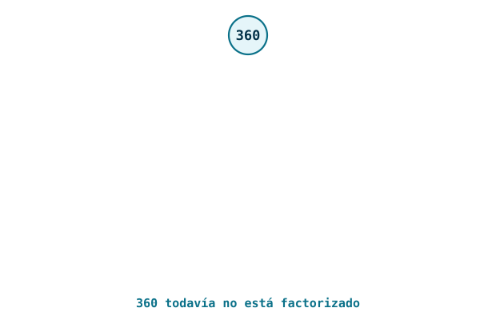
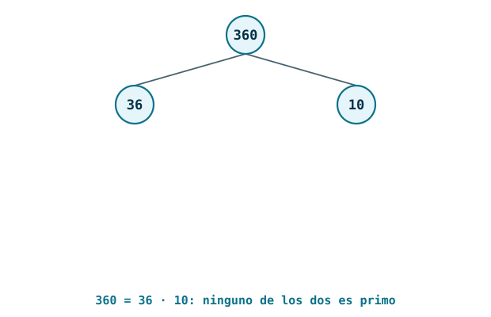
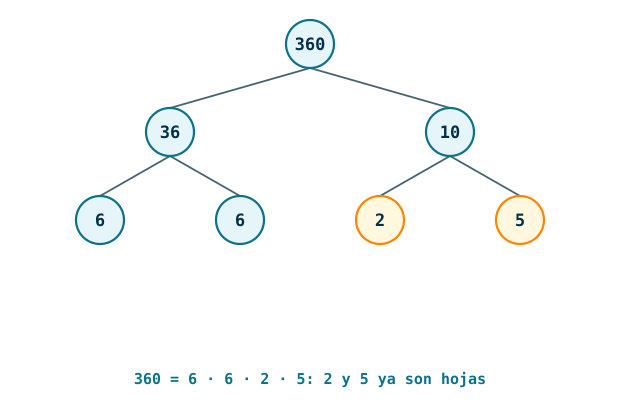
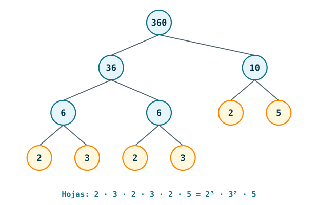
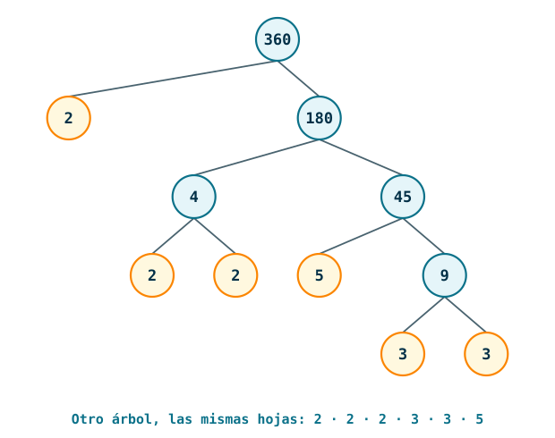

---
# Copyright (c) 2026 Angela Villota, and collaborators from the CyED block
# Licensed under the PolyForm Noncommercial License 1.0.0.
# Commercial use is prohibited without prior written authorization.
title: "Unidad 3 · Sesión 14: Divisibilidad y factorización prima"
---

# Unidad 3 · Sesión 14: Divisibilidad y factorización prima

## Agenda

1. Divisibilidad
2. Propiedades de la divisibilidad
3. Algoritmo de la división y el operador `mod`
4. Criterios de divisibilidad
5. Números primos
6. Teorema fundamental de la aritmética
7. Máximo común divisor y mínimo común múltiplo por factorización

La **teoría de números** estudia los enteros y sus propiedades. En la [Sesión 13](../Sesion13-FuncionesAltoOrdenII/index.md) escribimos

```scala
def divisores(n: Int): List[Int] = (1 to n).toList.filter(d => n % d == 0)
```

El predicado `n % d == 0` pregunta "¿`d` divide a `n`?". En esta sesión le damos a esa pregunta una definición precisa y sacamos de ella todo lo demás: el residuo, los criterios, los primos y la factorización. Las trazas largas están en desplegables con pestañas **Paso 1, Paso 2, …**.

## 1. Divisibilidad

**Se quieren repartir 12 fichas en 3 grupos iguales, sin que sobre ninguna. ¿Se puede? ¿Y con 7 fichas?**

:::{admonition} Respuesta
:class: dropdown
Probamos los múltiplos de 3, uno por uno:

| $c$ | 1 | 2 | 3 | 4 |
|---|---|---|---|---|
| $3c$ | 3 | 6 | 9 | 12 |

Con 12 fichas sí: $3 \cdot 4 = 12$, cada grupo recibe 4. Con 7 fichas no: $3 \cdot 2 = 6$ se queda corto, $3 \cdot 3 = 9$ se pasa, y ningún entero $c$ da $3c = 7$.
:::

La pregunta es siempre la misma: ¿existe un entero $c$ que complete la multiplicación?

:::{admonition} Definición
Sean $a$ y $b$ enteros con $a \neq 0$. Decimos que **$a$ divide a $b$**, y escribimos $a \mid b$, si existe un entero $c$ tal que $b = ac$. En ese caso decimos que $a$ es un **factor** o **divisor** de $b$ y que $b$ es un **múltiplo** de $a$. Si $a$ no divide a $b$ escribimos $a \nmid b$.
:::

Con cuantificadores, sobre el dominio de los enteros:

$$
a \mid b \iff \exists c\, (ac = b)
$$

Fíjese en la diferencia de notación: $a \mid b$ es una **proposición**, verdadera o falsa; $a / b$ es un **número**. $3 \mid 12$ es verdadero, y $12 / 3$ es 4.

**¿Es cierto que $5 \mid 0$? ¿Y que $0 \mid 5$? ¿Y que $0 \mid 0$?**

:::{admonition} Respuesta
:class: dropdown
$5 \mid 0$ es verdadero: $0 = 5 \cdot 0$. Todo entero distinto de cero divide a 0. Por eso, de $d \mid 0$ no se puede concluir nada sobre $d$: en particular, $d \mid 0$ **no** obliga a que $d = 0$.

$0 \mid 5$ y $0 \mid 0$ quedan por fuera de la definición, porque esta exige que el divisor sea distinto de cero.

Algunos textos definen $a \mid b$ sin esa condición. Con esa versión, $0 \mid b$ significa que existe $k$ con $0 \cdot k = b$; como $0 \cdot k = 0$ para todo $k$, se cumple solo cuando $b = 0$. Así, $0 \mid 5$ es falso y $0 \mid 0$ es verdadero. En este curso seguimos a Rosen y pedimos $a \neq 0$.
:::

En Scala, $a \mid b$ se decide con el residuo:

```scala
def divide(a: Int, b: Int): Boolean = b % a == 0   // requiere a != 0
```

Funciona también con negativos: `-12 % 3` y `12 % -3` valen 0. En la sección 3 veremos que `%` sí se comporta distinto con negativos cuando el residuo no es cero.

**¿Cuántos enteros positivos menores o iguales que 25 son divisibles por 4?**

:::{admonition} Respuesta
:class: dropdown
Los múltiplos son $4, 8, 12, 16, 20, 24$: seis. Listarlos sirve con 25, no con $10^9$.

En general, sean $n$ y $d$ enteros positivos. Los enteros positivos divisibles por $d$ son los de la forma $kd$ con $k$ entero positivo. Si además $kd \le n$, entonces $0 < k \le n/d$. Por tanto hay exactamente

$$
\left\lfloor \frac{n}{d} \right\rfloor
$$

enteros positivos menores o iguales que $n$ divisibles por $d$. Con los datos de la pregunta, $\lfloor 25/4 \rfloor = 6$.
:::

### 1.1 Ejemplos

#### Ejemplo 1

Decida cuáles afirmaciones son verdaderas.

1. $3 \mid 6$
2. $4 \mid 28$
3. $2 \mid 5$
4. $-5 \mid 35$
5. $6 \mid -42$
6. $7 \mid 0$
7. $12 \mid 4$

:::{admonition} Resultado
:class: dropdown
| Afirmación | ¿Verdadera? | Por qué |
|---|---|---|
| $3 \mid 6$ | sí | $6 = 3 \cdot 2$ |
| $4 \mid 28$ | sí | $28 = 4 \cdot 7$ |
| $2 \mid 5$ | no | no existe un entero $c$ con $2c = 5$ |
| $-5 \mid 35$ | sí | $35 = (-5) \cdot (-7)$ |
| $6 \mid -42$ | sí | $-42 = 6 \cdot (-7)$ |
| $7 \mid 0$ | sí | $0 = 7 \cdot 0$ |
| $12 \mid 4$ | no | $4 = 12c$ obliga a $c = 1/3$, que no es entero |

El signo no cambia la respuesta: $a \mid b$ si y solo si $-a \mid b$, si y solo si $a \mid -b$.
:::

#### Ejemplo 2

Encuentre todos los divisores de 36.

:::{admonition} Resultado
:class: dropdown
Los divisores positivos son $1, 2, 3, 4, 6, 9, 12, 18, 36$. Con sus opuestos, 36 tiene 18 divisores enteros.

Los divisores positivos aparecen en parejas $d \cdot (36/d)$:

$$
1 \cdot 36 \qquad 2 \cdot 18 \qquad 3 \cdot 12 \qquad 4 \cdot 9 \qquad 6 \cdot 6
$$

Por eso basta probar hasta $\sqrt{36} = 6$. La pareja $6 \cdot 6$ tiene un solo divisor, y por eso 36 tiene una cantidad impar de divisores positivos: eso pasa exactamente con los cuadrados perfectos.

Con `divide` y `filter`:

```scala
(1 to 36).filter(d => divide(d, 36))   // Vector(1, 2, 3, 4, 6, 9, 12, 18, 36)
```
:::

#### Ejemplo 3

¿Cuántos enteros positivos menores o iguales que 1000 son divisibles por 7? ¿Cuántos hay entre 100 y 1000, inclusive?

:::{admonition} Resultado
:class: dropdown
$\lfloor 1000/7 \rfloor = 142$. En efecto, $7 \cdot 142 = 994 \le 1000 < 1001 = 7 \cdot 143$.

Entre 100 y 1000 hay que quitar los múltiplos de 7 que son menores o iguales que 99:

$$
\left\lfloor \frac{1000}{7} \right\rfloor - \left\lfloor \frac{99}{7} \right\rfloor = 142 - 14 = 128
$$

Se resta $\lfloor 99/7 \rfloor$ y no $\lfloor 100/7 \rfloor$ porque el 100 está dentro del intervalo. Comprobación: el primer múltiplo es $105 = 7 \cdot 15$ y el último es $994 = 7 \cdot 142$; de 15 a 142 hay $142 - 15 + 1 = 128$ valores de $k$.
:::

#### Ejemplo 4

Compruebe el ejemplo anterior con `count`, y cuente los enteros entre 1 y 100 que son divisibles por 3 o por 5.

```scala
(1 to 1000).count(n => divide(7, n))
(1 to 100).count(n => divide(3, n) || divide(5, n))
```

:::{admonition} Resultado
:class: dropdown
`142` y `47`.

El segundo valor también se obtiene con la fórmula, con un cuidado: los múltiplos de 15 son múltiplos de 3 y de 5, y se contarían dos veces.

$$
\left\lfloor \frac{100}{3} \right\rfloor + \left\lfloor \frac{100}{5} \right\rfloor - \left\lfloor \frac{100}{15} \right\rfloor = 33 + 20 - 6 = 47
$$

`count(p)` es `filter(p).length` en un solo recorrido.
:::

#### Ejemplo 5

Demuestre que para todo entero $n$, $2 \mid n(n+1)$.

:::{admonition} Demostración
:class: dropdown
Todo entero es par o impar. Separamos en dos casos y en cada uno buscamos el entero $c$ de la definición.

- **$n$ par**, $n = 2k$: $\;n(n+1) = 2k(n+1) = 2\,\big(k(n+1)\big)$. El entero es $c = k(n+1)$.
- **$n$ impar**, $n = 2k+1$: $\;n + 1 = 2k + 2 = 2(k+1)$, así que $n(n+1) = 2\,\big(n(k+1)\big)$. El entero es $c = n(k+1)$.

En ambos casos $n(n+1) = 2c$ con $c$ entero. $\blacksquare$

El producto de dos enteros consecutivos siempre es par porque uno de los dos lo es.
:::

#### Ejemplo 6

Demuestre que para todo entero $n$, $3 \mid n^3 - n$.

:::{admonition} Demostración
:class: dropdown
Primero factorizamos: $n^3 - n = n(n^2 - 1) = (n-1)\,n\,(n+1)$, el producto de tres enteros consecutivos. Todo entero es de la forma $3k$, $3k+1$ o $3k+2$.

| Caso | Factor divisible por 3 | $n^3 - n = 3c$ con |
|---|---|---|
| $n = 3k$ | $n = 3k$ | $c = k(n-1)(n+1)$ |
| $n = 3k+1$ | $n - 1 = 3k$ | $c = k\,n\,(n+1)$ |
| $n = 3k+2$ | $n + 1 = 3(k+1)$ | $c = (k+1)(n-1)\,n$ |

En los tres casos aparece el entero $c$ de la definición. $\blacksquare$

Para $n = 5$: $5^3 - 5 = 120 = 3 \cdot 40$. Con la misma idea de casos se demuestra que $6 \mid n^3 - n$: entre tres consecutivos siempre hay un par y un múltiplo de 3.
:::

## 2. Propiedades de la divisibilidad

**Sabiendo que $4 \mid 12$ y $4 \mid 20$, ¿qué pasa con $4 \mid 32$, $\;4 \mid 84$, $\;4 \mid 8$ y $\;4 \mid (3 \cdot 12 - 2 \cdot 20)$? Pruebe antes de seguir leyendo.**

:::{admonition} Respuesta
:class: dropdown
Las cuatro son verdaderas, y ninguna necesita dividir:

| Número | Cómo sale de 12 y 20 | Múltiplo de 4 |
|---|---|---|
| 32 | $12 + 20$ | $4 \cdot 8$ |
| 84 | $12 \cdot 7$ | $4 \cdot 21$ |
| 8 | $20 - 12$ | $4 \cdot 2$ |
| $-4$ | $3 \cdot 12 - 2 \cdot 20$ | $4 \cdot (-1)$ |

Si $12 = 4 \cdot 3$ y $20 = 4 \cdot 5$, el 4 se puede sacar como factor común de cualquier expresión que combine al 12 y al 20.
:::

Eso que acabamos de hacer con 4, 12 y 20 vale en general.

:::{admonition} Teorema 1
Sean $a$, $b$ y $c$ enteros con $a \neq 0$. Entonces:

1. si $a \mid b$ y $a \mid c$, entonces $a \mid (b + c)$;
2. si $a \mid b$, entonces $a \mid bc$ para todo entero $c$;
3. si $a \mid b$ y $b \mid c$, con $b \neq 0$, entonces $a \mid c$.
:::

:::{admonition} Demostración de (1)
:class: dropdown
Como $a \mid b$, existe un entero $s$ con $b = as$. Como $a \mid c$, existe un entero $t$ con $c = at$. Entonces

$$
b + c = as + at = a(s + t)
$$

y $s + t$ es entero. Por tanto $a \mid (b + c)$. $\blacksquare$
:::

**¿Cómo se demuestra (3)?**

:::{admonition} Respuesta
:class: dropdown
De $a \mid b$ sale $b = as$, y de $b \mid c$ sale $c = bt$. Sustituyendo, $c = (as)t = a(st)$, y $st$ es entero. Todas las demostraciones de esta sección siguen ese esquema: escribir cada hipótesis como una igualdad con un entero desconocido, operar y encontrar el entero que pide la conclusión.
:::

:::{admonition} Corolario (combinación lineal)
Si $a \mid b$ y $a \mid c$, entonces $a \mid (mb + nc)$ para todo par de enteros $m$ y $n$.
:::

Por (2), $a \mid mb$ y $a \mid nc$; por (1), $a$ divide su suma. La expresión $mb + nc$ se llama **combinación lineal** de $b$ y $c$: si $a$ divide a dos números, divide a todas sus combinaciones lineales. Con este corolario demostraremos el algoritmo de Euclides en la [Sesión 16](../Sesion16-AlgoritmoEuclides/index.md).

Otros hechos básicos, que salen directamente de la definición:

| Hecho | Por qué |
|---|---|
| $a \mid a$ | $a = a \cdot 1$ |
| $1 \mid a$ | $a = 1 \cdot a$ |
| $a \mid 0$ | $0 = a \cdot 0$ |
| si $a \mid b$ y $b \neq 0$, entonces $\lvert a \rvert \le \lvert b \rvert$ | $b = ac$ con $c \neq 0$, así que $\lvert c \rvert \ge 1$ y $\lvert b \rvert = \lvert a \rvert\,\lvert c \rvert \ge \lvert a \rvert$ |

Sobre los enteros positivos, la relación "divide a" es reflexiva ($a \mid a$), transitiva (propiedad 3) y antisimétrica: si $a \mid b$ y $b \mid a$, el último hecho de la tabla da $a \le b$ y $b \le a$, así que $a = b$. Es un **orden parcial**, como los de la [Sesión 3](../../Unidad1-RelacionesOrdenParcial/Sesion3-EquivalenciaOrdenParcial/index.md), y no es total: $2 \nmid 3$ y $3 \nmid 2$. Sobre todos los enteros no es antisimétrica: $3 \mid -3$ y $-3 \mid 3$, pero $3 \neq -3$.

### 2.1 Ejemplos

#### Ejemplo 1

Justifique sin dividir:

1. $3 \mid 42$, sabiendo que $3 \mid 6$ y $6 \mid 42$.
2. $5 \mid 3 \cdot 15 - 2 \cdot 25$.

:::{admonition} Resultado
:class: dropdown
1. Por la propiedad (3), la transitividad.
2. Por el corolario con $b = 15$, $c = 25$, $m = 3$ y $n = -2$: como $5 \mid 15$ y $5 \mid 25$, 5 divide a cualquier combinación lineal de ellos. En efecto, $45 - 50 = -5 = 5 \cdot (-1)$.
:::

#### Ejemplo 2

Ilustre el corolario con $a = 6$, $b = 18$ y $c = 30$.

:::{admonition} Resultado
:class: dropdown
$6 \mid 18$ y $6 \mid 30$. Algunas combinaciones lineales:

| $m$ | $n$ | $18m + 30n$ | Como múltiplo de 6 |
|---|---|---|---|
| 2 | 1 | 66 | $6 \cdot 11$ |
| 1 | $-1$ | $-12$ | $6 \cdot (-2)$ |
| $-5$ | 3 | 0 | $6 \cdot 0$ |
| 2 | $-1$ | 6 | $6 \cdot 1$ |

Todas son múltiplos de 6, como dice el corolario. La última fila muestra algo más: con $m = 2$ y $n = -1$ la combinación vale exactamente 6, el mayor divisor común de 18 y 30. Que esto siempre se pueda lograr es el teorema de la combinación lineal, que veremos con el algoritmo de Euclides.
:::

#### Ejemplo 3

¿Son ciertos los recíprocos de las propiedades (1) y (2)?

1. Si $a \mid (b + c)$, ¿entonces $a \mid b$ y $a \mid c$?
2. Si $a \mid bc$, ¿entonces $a \mid b$ o $a \mid c$?

:::{admonition} Resultado
:class: dropdown
Ninguno de los dos. Basta un contraejemplo para cada uno.

1. $2 \mid (3 + 5)$, pero $2 \nmid 3$ y $2 \nmid 5$.
2. $6 \mid 4 \cdot 9 = 36$, pero $6 \nmid 4$ y $6 \nmid 9$. El factor 2 de 6 está en el 4 y el factor 3 está en el 9.

La segunda afirmación sí es cierta cuando $a$ es primo: es el **lema de Euclides**, de la sección 6.
:::

#### Ejemplo 4

Demuestre que si $a \mid b$ y $a \mid (b + c)$, entonces $a \mid c$. Úselo para justificar, sin dividir, que $7 \nmid 703$.

:::{admonition} Resultado
:class: dropdown
$c = (b + c) - b$ es una combinación lineal de $b + c$ y $b$, con coeficientes $1$ y $-1$. Por el corolario, $a \mid c$. $\blacksquare$

Para el 703: $703 = 700 + 3$ y $7 \mid 700$. Si fuera cierto que $7 \mid 703$, la propiedad que acabamos de demostrar daría $7 \mid 3$, que es falso. Por tanto $7 \nmid 703$.

Este es el argumento que se usa en general: si $a$ divide a uno de dos sumandos, entonces $a$ divide a la suma **si y solo si** divide al otro sumando.
:::

#### Ejemplo 5

Demuestre que para todo entero $n$, si $d \mid (3n + 5)$ y $d \mid (2n + 3)$, entonces $d = 1$ o $d = -1$. Concluya que la fracción $\dfrac{3n+5}{2n+3}$ no se puede simplificar para ningún $n$.

:::{admonition} Resultado
:class: dropdown
La idea es encontrar una combinación lineal de $3n + 5$ y $2n + 3$ en la que se cancele la $n$. Multiplicando la primera por 2 y la segunda por $-3$:

$$
2(3n + 5) - 3(2n + 3) = 6n + 10 - 6n - 9 = 1
$$

Por el corolario, $d \mid 1$, y los únicos divisores de 1 son $1$ y $-1$. $\blacksquare$

Simplificar la fracción significa dividir numerador y denominador entre un divisor común distinto de $\pm 1$, y acabamos de ver que no existe. Por ejemplo, con $n = 4$ queda $17/11$, y con $n = 10$ queda $35/23$.
:::

## 3. Algoritmo de la división y el operador `mod`

**Divida $-14$ entre 3. ¿Cuál es el cociente y cuál es el residuo?**

:::{admonition} Respuesta
:class: dropdown
Hay dos candidatos, y los dos cumplen la igualdad:

$$
-14 = 3 \cdot (-4) + (-2) \qquad\qquad -14 = 3 \cdot (-5) + 1
$$

La igualdad sola no decide: hace falta una regla que escoja uno. El teorema siguiente la da, y resulta que Scala escoge el otro.
:::

:::{admonition} Teorema (algoritmo de la división)
Sean $a$ un entero y $d$ un entero positivo. Existen enteros **únicos** $q$ y $r$, con $0 \le r < d$, tales que

$$
a = dq + r
$$
:::

En esa igualdad, $a$ es el **dividendo**, $d$ el **divisor**, $q$ el **cociente** y $r$ el **residuo** (o resto). Se escribe

$$
q = a \;\mathbf{div}\; d \qquad\qquad r = a \;\mathbf{mod}\; d
$$

A esta división, la que cumple $0 \le r < d$, la llamamos **división canónica**. Lo esencial es esa condición: el residuo nunca es negativo, aunque $a$ lo sea. Para hallar $q$ se toma el múltiplo de $d$ **más cercano a $a$ por debajo**. Con $a = 14$ y $d = 3$, ese múltiplo es $12 = 3 \cdot 4$ y $14 = 3 \cdot 4 + 2$. Con $a = -14$, el múltiplo de 3 inmediatamente por debajo es $-15 = 3 \cdot (-5)$, y

$$
-14 = 3 \cdot (-5) + 1
$$

así que $-14 \;\mathbf{div}\; 3 = -5$ y $-14 \;\mathbf{mod}\; 3 = 1$. El otro candidato, $-14 = 3 \cdot (-4) + (-2)$, es una igualdad cierta pero **no** es la división canónica: $r = -2$ incumple $0 \le r$.


**En Scala.** Los operadores `/` y `%` de `Int` **truncan hacia cero**: `-14 / 3` es `-4` y el residuo hereda el signo del dividendo, `-14 % 3` es `-2`. Para negativos, `%` **no** es el $\mathbf{mod}$ matemático. Hay dos formas de obtenerlo:

| Expresión | $a = 14$ | $a = -14$ |
|---|---|---|
| `a / 3` | `4` | `-4` |
| `a % 3` | `2` | `-2` |
| `Math.floorDiv(a, 3)` | `4` | `-5` |
| `Math.floorMod(a, 3)` | `2` | `1` |
| `((a % 3) + 3) % 3` | `2` | `1` |

Con $a \ge 0$ todas coinciden; la diferencia solo aparece con dividendos negativos.

**Propiedades del operador.** Para todo entero $a$ y todo entero positivo $d$:

| Propiedad | Comentario |
|---|---|
| $0 \le a \;\mathbf{mod}\; d < d$ | hay exactamente $d$ residuos posibles: $0, 1, \ldots, d-1$ |
| $d \mid a \iff a \;\mathbf{mod}\; d = 0$ | la divisibilidad es el caso de residuo cero |
| $a \;\mathbf{mod}\; d = a \iff 0 \le a < d$ | si $a$ ya está en el rango, el residuo es $a$ |
| $(a + kd) \;\mathbf{mod}\; d = a \;\mathbf{mod}\; d$ para todo entero $k$ | sumar múltiplos de $d$ no cambia el residuo |
| $a \;\mathbf{div}\; d = \lfloor a/d \rfloor$ y $a \;\mathbf{mod}\; d = a - d\lfloor a/d \rfloor$ | se demuestra en el ejemplo 7 |

### 3.1 Ejemplos

#### Ejemplo 1

Calcule el cociente y el residuo de dividir 101 entre 11, y 44 entre 8.

:::{admonition} Resultado
:class: dropdown
$101 = 11 \cdot 9 + 2$: $\;101 \;\mathbf{div}\; 11 = 9$ y $101 \;\mathbf{mod}\; 11 = 2$.

$44 = 8 \cdot 5 + 4$: $\;44 \;\mathbf{div}\; 8 = 5$ y $44 \;\mathbf{mod}\; 8 = 4$.

En los dos casos se verifica $0 \le r < d$.
:::

#### Ejemplo 2

Calcule:

1. $17 \;\mathbf{mod}\; 5$
2. $9 \;\mathbf{mod}\; 4$
3. $2 \;\mathbf{mod}\; 2$
4. $7 \;\mathbf{mod}\; 9$
5. $73 \;\mathbf{mod}\; 8$
6. $0 \;\mathbf{mod}\; 17$

:::{admonition} Resultado
:class: dropdown
| Expresión | $a = dq + r$ | Resultado |
|---|---|---|
| $17 \;\mathbf{mod}\; 5$ | $17 = 5 \cdot 3 + 2$ | 2 |
| $9 \;\mathbf{mod}\; 4$ | $9 = 4 \cdot 2 + 1$ | 1 |
| $2 \;\mathbf{mod}\; 2$ | $2 = 2 \cdot 1 + 0$ | 0 |
| $7 \;\mathbf{mod}\; 9$ | $7 = 9 \cdot 0 + 7$ | 7 |
| $73 \;\mathbf{mod}\; 8$ | $73 = 8 \cdot 9 + 1$ | 1 |
| $0 \;\mathbf{mod}\; 17$ | $0 = 17 \cdot 0 + 0$ | 0 |

Cuando $0 \le a < d$, como en $7 \;\mathbf{mod}\; 9$, el cociente es 0 y el residuo es el mismo $a$.
:::

#### Ejemplo 3

Calcule los siguientes módulos de números negativos:

1. $-7 \;\mathbf{mod}\; 3$
2. $-5 \;\mathbf{mod}\; 2$
3. $-21 \;\mathbf{mod}\; 9$
4. $-12 \;\mathbf{mod}\; 5$
5. $-34 \;\mathbf{mod}\; 4$
6. $-24 \;\mathbf{mod}\; 7$

:::{admonition} Resultado
:class: dropdown
En cada caso se busca el múltiplo de $d$ inmediatamente por debajo de $a$:

| Expresión | Múltiplo por debajo | $a = dq + r$ | Resultado |
|---|---|---|---|
| $-7 \;\mathbf{mod}\; 3$ | $-9$ | $-7 = 3 \cdot (-3) + 2$ | 2 |
| $-5 \;\mathbf{mod}\; 2$ | $-6$ | $-5 = 2 \cdot (-3) + 1$ | 1 |
| $-21 \;\mathbf{mod}\; 9$ | $-27$ | $-21 = 9 \cdot (-3) + 6$ | 6 |
| $-12 \;\mathbf{mod}\; 5$ | $-15$ | $-12 = 5 \cdot (-3) + 3$ | 3 |
| $-34 \;\mathbf{mod}\; 4$ | $-36$ | $-34 = 4 \cdot (-9) + 2$ | 2 |
| $-24 \;\mathbf{mod}\; 7$ | $-28$ | $-24 = 7 \cdot (-4) + 4$ | 4 |

Un atajo: si $d \nmid a$, entonces $(-a) \;\mathbf{mod}\; d = d - (a \;\mathbf{mod}\; d)$. Por ejemplo, $21 \;\mathbf{mod}\; 9 = 3$ y $-21 \;\mathbf{mod}\; 9 = 9 - 3 = 6$.
:::

#### Ejemplo 4

Para la división de $-100$ entre 7:

1. Halle $q$ y $r$ de la división canónica.
2. ¿Qué devuelven en Scala `-100 / 7` y `-100 % 7`?
3. ¿Por qué $-100 = 7 \cdot (-14) + (-2)$ no es la división canónica, si la igualdad es cierta?

:::{admonition} Resultado
:class: dropdown
1. El múltiplo de 7 inmediatamente por debajo de $-100$ es $-105 = 7 \cdot (-15)$. Así, $-100 = 7 \cdot (-15) + 5$, con $q = -15$ y $r = 5$.
2. `-100 / 7` es `-14`, por el truncamiento hacia cero, y `-100 % 7` es `-2`, porque `%` hereda el signo del dividendo.
3. Porque $r = -2$ no cumple $0 \le r < 7$. Por eso el resto canónico (5) y el valor de `%` (-2) son distintos: difieren exactamente en $d$, ya que $5 - (-2) = 7$.
:::

#### Ejemplo 5

¿Qué devuelve Scala en cada línea?

```scala
-14 / 3
-14 % 3
Math.floorDiv(-14, 3)
Math.floorMod(-14, 3)
((-14 % 3) + 3) % 3
```

**¿Por qué la última fórmula necesita el `% 3` final?**

:::{admonition} Resultado
:class: dropdown
`-4`, `-2`, `-5`, `1` y `1`.

`/` y `%` truncan hacia cero: $-14 = 3 \cdot (-4) + (-2)$, con residuo negativo. `floorDiv` y `floorMod` redondean hacia abajo y coinciden con $\mathbf{div}$ y $\mathbf{mod}$.

`a % 3` está entre $-2$ y $2$, así que `(a % 3) + 3` está entre 1 y 5: ya no es negativa, pero puede pasarse de 2. Con $a = 14$, `(14 % 3) + 3` es 5; con $a = -15$, `(-15 % 3) + 3` es 3. El `% 3` final la devuelve al rango $0, 1, 2$.
:::

#### Ejemplo 6

Hoy es miércoles. ¿Qué día de la semana será dentro de 100 días? ¿Qué día fue hace 101 días?

:::{admonition} Resultado
:class: dropdown
Numeramos los días: lunes = 0, martes = 1, miércoles = 2, …, domingo = 6. Avanzar $k$ días es sumar $k$ y tomar el residuo módulo 7.

- Dentro de 100 días: $(2 + 100) \;\mathbf{mod}\; 7 = 102 \;\mathbf{mod}\; 7 = 4$, porque $102 = 7 \cdot 14 + 4$. Será **viernes**.
- Hace 101 días: $(2 - 101) \;\mathbf{mod}\; 7 = -99 \;\mathbf{mod}\; 7 = 6$, porque $-99 = 7 \cdot (-15) + 6$. Fue **domingo**.

```scala
val dias = Vector("lunes", "martes", "miércoles", "jueves", "viernes", "sábado", "domingo")

def diaDentroDe(hoy: Int, k: Int): String = dias(Math.floorMod(hoy + k, 7))

diaDentroDe(2, 100)    // "viernes"
diaDentroDe(2, -101)   // "domingo"
```

Con `%` en lugar de `floorMod`, la segunda llamada calcula `-99 % 7 = -1` y `dias(-1)` lanza `IndexOutOfBoundsException`. El mismo razonamiento sirve para un reloj de 24 horas: 50 horas después de las 15:00 son las $(15 + 50) \;\mathbf{mod}\; 24 = 17$, es decir, las 17:00.
:::

#### Ejemplo 7

Demuestre que el cociente y el residuo de dividir $a$ entre $d > 0$ son

$$
q = \left\lfloor \frac{a}{d} \right\rfloor \qquad\qquad r = a - d\left\lfloor \frac{a}{d} \right\rfloor
$$

:::{admonition} Demostración
:class: dropdown
Sea $q = \lfloor a/d \rfloor$. Por definición de la parte entera inferior, $q$ es el único entero con

$$
q \le \frac{a}{d} < q + 1
$$

Multiplicando por $d > 0$, que no cambia las desigualdades:

$$
dq \le a < dq + d
$$

y restando $dq$:

$$
0 \le a - dq < d
$$

Así, $r = a - dq$ cumple $a = dq + r$ con $0 \le r < d$. Como el teorema garantiza que esa pareja es única, $q$ y $r$ son el cociente y el residuo. $\blacksquare$

Con $a = -14$ y $d = 3$: $\lfloor -14/3 \rfloor = \lfloor -4.67 \rfloor = -5$ y $r = -14 - 3 \cdot (-5) = 1$. La parte entera inferior redondea hacia $-\infty$; por eso la función de Scala se llama `floorMod`.
:::

#### Ejemplo 8

La siguiente función calcula $(a \;\mathbf{div}\; d,\; a \;\mathbf{mod}\; d)$ con sumas y restas. Explique por qué es correcta y úsela para demostrar el teorema del algoritmo de la división.

```scala
def divMod(a: Int, d: Int): (Int, Int) = {   // requiere d > 0
  @annotation.tailrec
  def loop(q: Int, r: Int): (Int, Int) =
    if (r < 0) loop(q - 1, r + d)
    else if (r >= d) loop(q + 1, r - d)
    else (q, r)
  loop(0, a)
}

divMod(-14, 3)
(-50 to 50).forall(a => divMod(a, 7) == (Math.floorDiv(a, 7), Math.floorMod(a, 7)))
```

:::{admonition} Resultado
:class: dropdown
`(-5, 1)` y `true`.

**Invariante.** En cada llamado a `loop` se cumple $a = dq + r$. Al inicio, $a = d \cdot 0 + a$. Si $r < 0$, el llamado siguiente usa $q - 1$ y $r + d$, y $d(q-1) + (r + d) = dq + r$. Si $r \ge d$, usa $q + 1$ y $r - d$, y el cálculo es el mismo.

**Terminación.** Si $r$ es negativo, sube de $d$ en $d$ hasta llegar a $[0, d)$; no se pasa, porque antes del último paso $r < 0$ y después $r + d < d$. Si $r \ge d$, baja de $d$ en $d$ y por la misma razón no queda negativo. Hay unos $\lvert a \rvert / d$ pasos.

**Existencia.** Cuando `loop` termina, se cumplen $a = dq + r$ (el invariante) y $0 \le r < d$ (la condición de parada). Eso demuestra que $q$ y $r$ existen para cualquier $a$.

**Unicidad.** Supongamos que $a = dq + r = dq' + r'$, con $0 \le r, r' < d$. Restando, $d(q - q') = r' - r$, así que $d \mid r' - r$. Pero $-d < r' - r < d$. Por la tabla de la sección 2, un múltiplo de $d$ distinto de cero tiene valor absoluto al menos $d$; entonces $r' - r = 0$. De ahí $r = r'$ y $q = q'$. $\blacksquare$

El `forall` comprueba 101 casos, incluidos negativos, contra la biblioteca. Esto no es una demostración, pero es una buena forma de detectar errores. Como algoritmo, `divMod` es lento: $\Theta(\lvert a \rvert / d)$ pasos. El hardware calcula `/` y `%` en tiempo constante.
:::

## 4. Criterios de divisibilidad

**Sin hacer la división: ¿4830 es divisible por 2? ¿Por 5? ¿Por 3? ¿Por 6?**

:::{admonition} Respuesta
:class: dropdown
Por 2 y por 5 sí, porque termina en 0. Por 3 sí, porque $4 + 8 + 3 + 0 = 15$ y $3 \mid 15$. Por 6 también: $4830 = 6 \cdot 805$.

Lo que sigue explica por qué bastó mirar la última cifra, y por qué bastó sumar las cifras.
:::

**La última cifra.** Escribimos $n = 10q + u$, donde $u$ es la cifra de las unidades. Como $2 \mid 10q$, el ejemplo 4 de la sección 2 dice que $2 \mid n$ si y solo si $2 \mid u$. El mismo argumento funciona con 5 y con 10, porque también dividen a $10q$.

**La suma de las cifras.** Tomemos $n = 7425$ y $s = 7 + 4 + 2 + 5 = 18$. Restando:

$$
n - s = 7 \cdot (1000 - 1) + 4 \cdot (100 - 1) + 2 \cdot (10 - 1) + 5 \cdot (1 - 1) = 7 \cdot 999 + 4 \cdot 99 + 2 \cdot 9
$$

En general, si $n = d_k 10^k + \cdots + d_1 10 + d_0$ y $s = d_k + \cdots + d_1 + d_0$, entonces

$$
n - s = d_k (10^k - 1) + \cdots + d_1 (10 - 1)
$$

1. Cada $10^i - 1 = 99\ldots9$ es igual a $9 \cdot 11\ldots1$, así que $9 \mid 10^i - 1$.
2. Por las propiedades (2) y (1), 9 divide a cada sumando $d_i(10^i - 1)$ y a su suma: $9 \mid n - s$.
3. Como $n = (n - s) + s$ y 9 divide al primer sumando, el ejemplo 4 de la sección 2 dice que $9 \mid n$ si y solo si $9 \mid s$. $\blacksquare$

Con $n = 7425$, $s = 18$ es divisible por 9, así que $9 \mid 7425$ (en efecto, $7425 = 9 \cdot 825$). El mismo argumento funciona para el 3, porque $3 \mid 9$ y por transitividad $3 \mid 10^i - 1$. En Scala:

```scala
def sumaDigitos(n: Int): Int = n.toString.map(_.asDigit).sum

sumaDigitos(7425)   // 18
7425 % 9            // 0
```

**El 6 no tiene criterio propio de cifras: se combina el del 2 con el del 3.**

:::{admonition} Proposición
$6 \mid n$ si y solo si $2 \mid n$ y $3 \mid n$.
:::

:::{admonition} Demostración
:class: dropdown
**(⇒)** Por transitividad: $2 \mid 6$ y $6 \mid n$ dan $2 \mid n$. Igual con el 3.

**(⇐)** Si $2 \mid n$, entonces $6 \mid 3n$. Si $3 \mid n$, entonces $6 \mid 2n$. Por el corolario de la combinación lineal, 6 divide a $3n - 2n = n$. $\blacksquare$
:::

Esta proposición funciona porque 2 y 3 no comparten factores mayores que 1. La sección 7 da la regla general. La condición es necesaria: $2 \mid 6$ y $6 \mid 6$, pero $2 \cdot 6 = 12 \nmid 6$.

**Notación.** $6 \mid n$ también se escribe $n \equiv 0 \pmod{6}$. Con esa escritura, la implicación (⇒) dice: si $n \equiv 0 \pmod{6}$, entonces $n \equiv 0 \pmod{2}$ y $n \equiv 0 \pmod{3}$. Es la misma transitividad en otra notación. La [Sesión 15](../Sesion15-CongruenciasLineales/index.md) desarrolla esta notación.

| Divisor | Basta mirar |
|---|---|
| 2 | la última cifra es par |
| 5 | la última cifra es 0 o 5 |
| 10 | la última cifra es 0 |
| 3 | la suma de las cifras es divisible por 3 |
| 9 | la suma de las cifras es divisible por 9 |
| 6 | el número es par **y** la suma de sus cifras es divisible por 3 |

### 4.1 Ejemplos

#### Ejemplo 1

Sin dividir, decida si cada número es divisible por 2, por 3 y por 6.

1. 54
2. 2946
3. 4831
4. 715

:::{admonition} Resultado
:class: dropdown
| $n$ | ¿Par? | Suma de cifras | ¿Divisible por 3? | ¿Divisible por 6? |
|---|---|---|---|---|
| 54 | sí | 9 | sí | sí |
| 2946 | sí | 21 | sí | sí |
| 4831 | no | 16 | no | no |
| 715 | no | 13 | no | no |
:::

#### Ejemplo 2

Decida si cada afirmación es verdadera. Si es falsa, dé un contraejemplo.

1. "$n$ es divisible por 6" equivale a "$n$ es divisible por 12".
2. "$n$ es divisible por 6" equivale a "la suma de las cifras de $n$ es divisible por 6".
3. Si $n$ es par y la suma de sus cifras es divisible por 3, entonces $6 \mid n$.
4. Si $12 \mid n$, entonces $6 \mid n$.

:::{admonition} Resultado
:class: dropdown
1. **Falsa.** $6 \mid 18$, pero $12 \nmid 18$. Solo vale una dirección, la del punto 4.
2. **Falsa, en las dos direcciones.** $6 \mid 12$, pero la suma de cifras es 3. Y 15 tiene suma de cifras 6, pero $6 \nmid 15$. El criterio de sumar cifras funciona para 3 y 9 porque esos números dividen a $10^i - 1$; 6 no divide a 9.
3. **Verdadera.** Ser par da $2 \mid n$ y la suma de cifras da $3 \mid n$; la proposición da $6 \mid n$.
4. **Verdadera.** Transitividad: $6 \mid 12$ y $12 \mid n$.
:::

## 5. Números primos

**¿Es 101 primo? Decídalo probando divisores, y cuente cuántas divisiones necesita.**

:::{admonition} Respuesta
:class: dropdown
La prueba ingenua divide 101 entre $2, 3, 4, \ldots, 100$: son 99 divisiones, y ninguna es exacta. Funciona, pero con un número de 10 cifras serían unos $10^{10}$ intentos.

Volvamos a las parejas del ejemplo 2 de la sección 1: $1 \cdot 36$, $2 \cdot 18$, $3 \cdot 12$, $4 \cdot 9$, $6 \cdot 6$. En cada pareja, el factor menor es a lo sumo $\sqrt{36}$. Si 101 tuviera un divisor, tendría uno menor o igual que $\sqrt{101} \approx 10.05$. Eso deja poquísimos candidatos.
:::

:::{admonition} Definición
Un entero $p > 1$ es **primo** si sus únicos divisores positivos son 1 y $p$. Un entero mayor que 1 que no es primo es **compuesto**: $n$ es compuesto si y solo si existe un entero $a$ con $a \mid n$ y $1 < a < n$.
:::

7 es primo. 9 es compuesto: $9 = 3 \cdot 3$, y $1 < 3 < 9$. El 1 no es primo ni compuesto. 2 es el único primo par, porque todo par mayor que 2 tiene al 2 como divisor. Los primeros primos son $2, 3, 5, 7, 11, 13, 17, 19, 23, 29, 31, \ldots$

:::{admonition} Teorema 2
Si $n$ es compuesto, entonces $n$ tiene un divisor primo menor o igual que $\sqrt{n}$.
:::

:::{admonition} Demostración
:class: dropdown
Si $n$ es compuesto, $n = ab$ con $1 < a \le b < n$. Entonces $a^2 \le ab = n$, así que $a \le \sqrt{n}$. Si $a$ es primo, ya está. Si no, $a$ tiene un divisor primo $p \le a \le \sqrt{n}$, y por transitividad $p \mid n$. $\blacksquare$
:::

Aplicado a 101: basta probar los primos menores o iguales que 10.

| $p$ | División | Residuo |
|---|---|---|
| 2 | $101 = 2 \cdot 50 + 1$ | 1 |
| 3 | $101 = 3 \cdot 33 + 2$ | 2 |
| 5 | $101 = 5 \cdot 20 + 1$ | 1 |
| 7 | $101 = 7 \cdot 14 + 3$ | 3 |

Ningún residuo es 0, así que 101 es primo. Pasamos de 99 divisiones a 4. En Scala, sin raíz cuadrada flotante, usando $k^2 > n$ como condición de parada:

```scala
def esPrimo(n: Int): Boolean = {
  @annotation.tailrec
  def buscar(k: Int): Boolean =
    if (k.toLong * k > n) true
    else if (n % k == 0) false
    else buscar(k + 2)
  n match {
    case n if n < 2      => false
    case 2               => true
    case n if n % 2 == 0 => false
    case _               => buscar(3)
  }
}

esPrimo(101)    // true
esPrimo(2047)   // false
esPrimo(7919)   // true
esPrimo(2147483647)   // true
```

La función hace $O(\sqrt{n})$ divisiones en el peor caso. Prueba divisores impares aunque no todos sean primos, y no pasa nada: si $n$ tuviera un divisor compuesto, antes habría encontrado un divisor primo menor. El `toLong` no es decorativo: con `k * k` en `Int`, el producto se desborda cuando $k$ pasa de 46340, y `esPrimo(2147483647)` daría `false`, aunque ese número es primo.

| `k` | `k * k > 101` | `101 % k` | Sigue |
|---|---|---|---|
| 3 | no | 2 | `buscar(5)` |
| 5 | no | 1 | `buscar(7)` |
| 7 | no | 3 | `buscar(9)` |
| 9 | no | 2 | `buscar(11)` |
| 11 | sí, $121 > 101$ | | `true` |

**Criba de Eratóstenes.** Si en lugar de un número queremos todos los primos hasta $n$: se escribe la lista $2, 3, \ldots, n$; el primero que queda es primo; se tachan sus múltiplos; se repite con lo que queda.

:::::{admonition} Traza de la criba con n = 30
:class: dropdown
::::{tab-set}
:::{tab-item} Paso 1
```{code-block} text
:emphasize-lines: 1
2 3 4 5 6 7 8 9 10 11 12 13 14 15 16 17 18 19 20 21 22 23 24 25 26 27 28 29 30
```

> El primero es 2. Es primo: nadie lo tachó.

:::
:::{tab-item} Paso 2
```{code-block} text
:emphasize-lines: 2
2 3 4 5 6 7 8 9 10 11 12 13 14 15 16 17 18 19 20 21 22 23 24 25 26 27 28 29 30
2 | 3 5 7 9 11 13 15 17 19 21 23 25 27 29
```

> Se tacharon los múltiplos de 2. **¿Quién queda de primero?**

:::
:::{tab-item} Paso 3
```{code-block} text
:emphasize-lines: 3
2 3 4 5 6 7 8 9 10 11 12 13 14 15 16 17 18 19 20 21 22 23 24 25 26 27 28 29 30
2 | 3 5 7 9 11 13 15 17 19 21 23 25 27 29
2 3 | 5 7 11 13 17 19 23 25 29
```

:::
:::{tab-item} Paso 4
```{code-block} text
:emphasize-lines: 4
2 3 4 5 6 7 8 9 10 11 12 13 14 15 16 17 18 19 20 21 22 23 24 25 26 27 28 29 30
2 | 3 5 7 9 11 13 15 17 19 21 23 25 27 29
2 3 | 5 7 11 13 17 19 23 25 29
2 3 5 | 7 11 13 17 19 23 29
```

> El 7 ya no tacha nada: $7^2 = 49 > 30$. **¿Por qué se puede parar aquí?**

:::
:::{tab-item} Paso 5
```{code-block} text
:emphasize-lines: 5
2 3 4 5 6 7 8 9 10 11 12 13 14 15 16 17 18 19 20 21 22 23 24 25 26 27 28 29 30
2 | 3 5 7 9 11 13 15 17 19 21 23 25 27 29
2 3 | 5 7 11 13 17 19 23 25 29
2 3 5 | 7 11 13 17 19 23 29
2 3 5 7 11 13 17 19 23 29
```

> Por el teorema 2: un compuesto menor o igual que 30 tiene un divisor primo menor o igual que $\sqrt{30} < 6$, y ya se tacharon los múltiplos de 2, 3 y 5. Quedan 10 primos.

:::
::::
:::::

Cada paso es: tomar la cabeza, filtrar sus múltiplos del resto y repetir. Eso es exactamente una función recursiva sobre listas con `filter`:

```scala
def criba(n: Int): List[Int] = {
  def filtrar(xs: List[Int]): List[Int] = xs match {
    case Nil       => Nil
    case p :: rest => p :: filtrar(rest.filter(x => x % p != 0))
  }
  filtrar((2 to n).toList)
}

criba(30)          // List(2, 3, 5, 7, 11, 13, 17, 19, 23, 29)
criba(30).length   // 10
```

Esta versión no es de cola, y su pila crece con el número de primos. Sirve para valores pequeños de $n$.

### 5.1 Ejemplos

#### Ejemplo 1

Decida cuáles son primos: 37, 51, 91, 1, 2.

:::{admonition} Resultado
:class: dropdown
| $n$ | Primos que hay que probar | Resultado |
|---|---|---|
| 37 | 2, 3, 5 ($\sqrt{37} \approx 6.08$) | primo: ninguno lo divide |
| 51 | 2, 3, 5, 7 ($\sqrt{51} \approx 7.14$) | compuesto: $51 = 3 \cdot 17$ |
| 91 | 2, 3, 5, 7 ($\sqrt{91} \approx 9.54$) | compuesto: $91 = 7 \cdot 13$ |
| 1 | ninguno | no es primo, por definición |
| 2 | ninguno | primo |

51 y 91 parecen primos porque no son pares ni terminan en 5. El criterio del 3 descarta el 51, porque $5 + 1 = 6$.
:::

#### Ejemplo 2

**Primos de Mersenne.** Un primo de Mersenne es un primo de la forma $M_p = 2^p - 1$, con $p$ primo. Calcule $M_2$, $M_3$, $M_5$, $M_7$ y $M_{11}$, y decida cuáles son primos.

:::{admonition} Resultado
:class: dropdown
| $p$ | $M_p$ | ¿Primo? |
|---|---|---|
| 2 | 3 | sí |
| 3 | 7 | sí |
| 5 | 31 | sí |
| 7 | 127 | sí |
| 11 | 2047 | no: $2047 = 23 \cdot 89$ |

Que $p$ sea primo no garantiza que $M_p$ lo sea. Los primos más grandes que se conocen son de esta forma, y los busca el proyecto distribuido GIMPS; tienen decenas de millones de cifras.

```scala
def potencia(b: Int, e: Int): Int = e match {
  case 0 => 1
  case e => b * potencia(b, e - 1)
}

def mersennes(limite: Int): List[Int] =
  (2 to limite).toList
    .filter(p => esPrimo(p) && esPrimo(potencia(2, p) - 1))
    .map(p => potencia(2, p) - 1)

mersennes(13)   // List(3, 7, 31, 127, 8191)
```

`Int` se desborda en $p = 31$; para exponentes mayores hace falta `BigInt`.
:::

#### Ejemplo 3

Demuestre que hay infinitos primos.

:::{admonition} Demostración
:class: dropdown
Por contradicción. Suponga que solo hay finitos primos $p_1, p_2, \ldots, p_k$, y considere

$$
N = p_1 p_2 \cdots p_k + 1
$$

$N > 1$, así que $N$ tiene un divisor primo $q$. Si $q$ fuera alguno de los $p_i$, entonces $q$ dividiría a $N$ y a $p_1 \cdots p_k$; por el ejemplo 4 de la sección 2 dividiría a $N - p_1 \cdots p_k = 1$, lo cual es imposible. Así que $q$ es un primo que no estaba en la lista. $\blacksquare$

$N$ no tiene que ser primo. Con los primos $2, 3, 5, 7, 11, 13$: $N = 30031 = 59 \cdot 509$. Lo que el argumento garantiza es que sus factores primos son nuevos.
:::

## 6. Teorema fundamental de la aritmética

**Factorice 360. ¿Basta con escribir $360 = 2 \cdot 180$?**

:::{admonition} Respuesta
:class: dropdown
No. $360 = 2 \cdot 180$ es cierto, pero 180 no es primo. Hay que seguir partiendo hasta que todos los factores sean primos. Eso es un árbol, y lo construimos nivel por nivel.
:::

:::::{admonition} Árbol de factorización de 360
:class: dropdown
::::{tab-set}
:::{tab-item} Paso 1

:::
:::{tab-item} Paso 2

:::
:::{tab-item} Paso 3


> **¿Cuáles nodos faltan por partir?**
:::
:::{tab-item} Paso 4

:::
::::
:::::

**Si otra persona empieza con $360 = 2 \cdot 180$, ¿llega a las mismas hojas?**

:::{admonition} Respuesta
:class: dropdown
Sí, con otro árbol:



El árbol cambia, las hojas no. Esto no es casualidad.
:::

:::{admonition} Teorema (fundamental de la aritmética)
Todo entero $n > 1$ se puede escribir como un producto de primos, y esa escritura es única salvo el orden de los factores:

$$
n = p_1^{e_1} p_2^{e_2} \cdots p_k^{e_k}, \qquad p_1 < p_2 < \cdots < p_k \text{ primos}, \quad e_i \ge 1
$$

Esta forma se llama **factorización canónica** de $n$.
:::

El teorema dice dos cosas:

1. **Existencia.** Todo $n > 1$ tiene alguna factorización. Se demuestra por inducción fuerte, como en la [Sesión 6](../../Unidad2-InduccionRecursividad/Sesion6-Estudio/index.md): si $n$ es primo, ya está; si no, $n = ab$ con $1 < a, b < n$, y por hipótesis de inducción $a$ y $b$ tienen factorización. Juntándolas sale la de $n$.
2. **Unicidad.** Salvo el orden, esa factorización es una sola. Se demuestra con el **lema de Euclides**: si $p$ es primo y $p \mid ab$, entonces $p \mid a$ o $p \mid b$. Si un primo aparece en una factorización, tiene que aparecer en la otra; se cancela y se repite. El lema se demuestra en la [Sesión 16](../Sesion16-AlgoritmoEuclides/index.md).

Tres precisiones sobre el alcance del teorema:

- Aplica a enteros $n > 1$. El 1 y los negativos necesitan convenciones adicionales: el 1 es el producto vacío y un negativo lleva un signo aparte.
- Por la unicidad, dos enteros mayores que 1 son iguales si y solo si tienen la misma factorización canónica.
- Garantiza que la factorización **existe**, pero no da una forma eficiente de hallarla, ni de decidir si un número es primo. Es un teorema de existencia.

**Método: divisiones de prueba.** Empiece con $p = 2$. Mientras $p \mid n$, emita $p$ y reemplace $n$ por $n/p$. Si $p \nmid n$, avance $p$. Pare cuando $n = 1$ o cuando $p^2 > n$, y en este último caso lo que queda de $n$ es primo.

| `n` | `p` | ¿Qué pasa? | Emite |
|---|---|---|---|
| 360 | 2 | $2 \mid 360$ | 2 |
| 180 | 2 | $2 \mid 180$ | 2 |
| 90 | 2 | $2 \mid 90$ | 2 |
| 45 | 2 | $2 \nmid 45$: avanza | |
| 45 | 3 | $3 \mid 45$ | 3 |
| 15 | 3 | $3 \mid 15$ | 3 |
| 5 | 3 | $9 > 5$: el 5 es primo | 5 |

Resultado: $360 = 2^3 \cdot 3^2 \cdot 5$. Cada fila de la tabla es un caso de la función:

```scala
def factorizar(n: Int): List[Int] = {
  def aux(n: Int, p: Int): List[Int] = (n, p) match {
    case (1, _)                     => Nil
    case (n, p) if p.toLong * p > n => List(n)
    case (n, p) if n % p == 0       => p :: aux(n / p, p)
    case (n, p)                     => aux(n, p + 1)
  }
  aux(n, 2)
}

def canonica(xs: List[Int]): List[(Int, Int)] = xs match {
  case Nil    => Nil
  case p :: _ =>
    val (iguales, resto) = xs.span(_ == p)
    (p, iguales.length) :: canonica(resto)
}

factorizar(360)               // List(2, 2, 2, 3, 3, 5)
canonica(factorizar(360))     // List((2,3), (3,2), (5,1))
```

**De la factorización se leen varias cosas.** Para $n = p_1^{e_1} \cdots p_k^{e_k}$:

| Dato | Fórmula | Con $360 = 2^3 \cdot 3^2 \cdot 5$ |
|---|---|---|
| menor factor primo | $p_1$ | 2 |
| factores primos distintos | $\{p_1, \ldots, p_k\}$ | $\{2, 3, 5\}$ |
| factores primos contando multiplicidad | $e_1 + \cdots + e_k$ | $3 + 2 + 1 = 6$ |
| divisores positivos | $(e_1 + 1)\cdots(e_k + 1)$ | $4 \cdot 3 \cdot 2 = 24$ |

La última fórmula sale de contar: un divisor de $n$ escoge, para cada primo, un exponente entre 0 y $e_i$.

**Cuadrados y cubos perfectos.** Mire los exponentes de estos cuadrados: $36 = 2^2 \cdot 3^2$, $\;100 = 2^2 \cdot 5^2$, $\;144 = 2^4 \cdot 3^2$. Y los de estos cubos: $8 = 2^3$, $\;216 = 2^3 \cdot 3^3$, $\;1000 = 2^3 \cdot 5^3$. **¿Qué tienen en común?**

:::{admonition} Respuesta
:class: dropdown
En los cuadrados todos los exponentes son pares. En los cubos todos son múltiplos de 3. La razón: si $m = p_1^{f_1} \cdots p_k^{f_k}$, entonces $m^2 = p_1^{2f_1} \cdots p_k^{2f_k}$ y $m^3 = p_1^{3f_1} \cdots p_k^{3f_k}$. Por la unicidad, esos son los exponentes de $m^2$ y de $m^3$.

Recíprocamente, si todos los exponentes de $n$ son pares, tomando la mitad de cada uno se construye un $m$ con $m^2 = n$. Lo mismo para cubos, con la tercera parte.
:::

:::{admonition} Proposición
Sea $n > 1$ con factorización canónica $p_1^{e_1} \cdots p_k^{e_k}$. Entonces $n$ es un **cuadrado perfecto** si y solo si todos los $e_i$ son pares, y es un **cubo perfecto** si y solo si todos los $e_i$ son múltiplos de 3.
:::

### 6.1 Ejemplos

#### Ejemplo 1

Escriba la factorización canónica de 100, 641, 999 y 1024.

:::{admonition} Resultado
:class: dropdown
| $n$ | Factorización canónica |
|---|---|
| 100 | $2^2 \cdot 5^2$ |
| 641 | $641$, que es primo |
| 999 | $3^3 \cdot 37$ |
| 1024 | $2^{10}$ |
:::

#### Ejemplo 2

Considere $n = 1540$.

1. Halle su factorización canónica.
2. ¿Cuál es su menor factor primo? ¿Cuáles son sus factores primos distintos?
3. ¿Cuántos factores primos tiene contando multiplicidad? ¿Cuántos divisores positivos?
4. ¿Es múltiplo de 13?
5. ¿$1540 = 2 \cdot 770$ es su factorización canónica?

:::{admonition} Resultado
:class: dropdown
1. $1540 = 2^2 \cdot 5 \cdot 7 \cdot 11$.
2. El menor es 2; los distintos son $\{2, 5, 7, 11\}$.
3. Contando multiplicidad, $2 + 1 + 1 + 1 = 5$. Divisores positivos: $3 \cdot 2 \cdot 2 \cdot 2 = 24$.
4. No: 13 no aparece en la factorización y, por la unicidad, no puede aparecer en ninguna otra.
5. No: es una igualdad cierta, pero 770 no es primo.
:::

#### Ejemplo 3

Decida si cada número es cuadrado perfecto, cubo perfecto, ambos o ninguno.

1. $4900 = 2^2 \cdot 5^2 \cdot 7^2$
2. $216 = 2^3 \cdot 3^3$
3. $64 = 2^6$
4. $360 = 2^3 \cdot 3^2 \cdot 5$

:::{admonition} Resultado
:class: dropdown
| $n$ | Exponentes | ¿Cuadrado? | ¿Cubo? |
|---|---|---|---|
| 4900 | $2, 2, 2$ | sí, $70^2$ | no |
| 216 | $3, 3$ | no | sí, $6^3$ |
| 64 | $6$ | sí, $8^2$ | sí, $4^3$ |
| 360 | $3, 2, 1$ | no | no |

Para ser ambos a la vez, los exponentes deben ser múltiplos de 2 y de 3, es decir, múltiplos de 6. $729 = 3^6$ es otro caso.
:::

#### Ejemplo 4

Muestre que las siguientes justificaciones están **mal**.

1. "$1000 = 2^3 \cdot 5^3$ es cuadrado perfecto porque sus exponentes $\{3, 3\}$ son iguales."
2. "$100 = 2^2 \cdot 5^2$ es cubo perfecto porque sus exponentes $\{2, 2\}$ son iguales."
3. "$400 = 2^4 \cdot 5^2$ no es cuadrado perfecto, porque su raíz 20 no aparece como factor en la descomposición."

:::{admonition} Resultado
:class: dropdown
1. Lo que importa es que sean pares, no que sean iguales. 3 es impar: 1000 no es cuadrado, porque $31^2 = 961$ y $32^2 = 1024$.
2. Lo que importa es que sean múltiplos de 3. 2 no lo es: 100 no es cubo, porque $4^3 = 64$ y $5^3 = 125$.
3. La factorización canónica solo contiene primos, y 20 no lo es. Los exponentes 4 y 2 son pares, así que 400 sí es cuadrado perfecto: $400 = (2^2 \cdot 5)^2 = 20^2$.
:::

## 7. Máximo común divisor y mínimo común múltiplo por factorización

**Tres tareas programadas se ejecutan cada 8, 12 y 20 días. Hoy coincidieron. ¿En cuántos días vuelven a coincidir?**

:::{admonition} Respuesta
:class: dropdown
Una forma es listar los múltiplos de cada periodo:

| Periodo | Múltiplos |
|---|---|
| 8 | 8, 16, 24, 32, 40, 48, 56, 64, 72, 80, 88, 96, 104, 112, **120** |
| 12 | 12, 24, 36, 48, 60, 72, 84, 96, 108, **120** |
| 20 | 20, 40, 60, 80, 100, **120** |

Vuelven a coincidir en 120 días. Funciona, pero con números grandes las listas no terminan nunca. Mire las factorizaciones: $8 = 2^3$, $\;12 = 2^2 \cdot 3$, $\;20 = 2^2 \cdot 5$ y $120 = 2^3 \cdot 3 \cdot 5$. Cada primo aparece en el 120 con su **mayor** exponente.
:::

:::{admonition} Definición
Sean $a$ y $b$ enteros positivos.

- El **máximo común divisor** $\text{mcd}(a, b)$ (o MCD) es el mayor entero que divide a $a$ y a $b$.
- El **mínimo común múltiplo** $\text{mcm}(a, b)$ (o MCM) es el menor entero positivo que es múltiplo de $a$ y de $b$.
- $a$ y $b$ son **coprimos** (o primos relativos) si $\text{mcd}(a, b) = 1$.
:::

Por la unicidad de la factorización, $d \mid a$ si y solo si cada exponente de $d$ es menor o igual que el de $a$ en el mismo primo. Entonces, escribiendo $a$ y $b$ con los mismos primos y permitiendo exponente 0:

$$
a = p_1^{a_1} \cdots p_k^{a_k}, \qquad b = p_1^{b_1} \cdots p_k^{b_k}
$$

$$
\text{mcd}(a, b) = p_1^{\min(a_1, b_1)} \cdots p_k^{\min(a_k, b_k)}, \qquad
\text{mcm}(a, b) = p_1^{\max(a_1, b_1)} \cdots p_k^{\max(a_k, b_k)}
$$

**Método.** Mínimos sobre los exponentes para el mcd, máximos para el mcm.

:::::{admonition} Traza de mcd y mcm de 12 y 18
:class: dropdown
::::{tab-set}
:::{tab-item} Paso 1
```{code-block} text
:emphasize-lines: 1, 2
12 = 2^2 · 3^1
18 = 2^1 · 3^2
```

> Se escribe cada número con los mismos primos.

:::
:::{tab-item} Paso 2
```{code-block} text
:emphasize-lines: 3
12 = 2^2 · 3^1
18 = 2^1 · 3^2
mcd = 2^min(2,1) · 3^min(1,2) = 2^1 · 3^1 = 6
```

> **¿Y el mcm?**

:::
:::{tab-item} Paso 3
```{code-block} text
:emphasize-lines: 4
12 = 2^2 · 3^1
18 = 2^1 · 3^2
mcd = 2^min(2,1) · 3^min(1,2) = 2^1 · 3^1 = 6
mcm = 2^max(2,1) · 3^max(1,2) = 2^2 · 3^2 = 36
```

:::
:::{tab-item} Paso 4
```{code-block} text
:emphasize-lines: 5
12 = 2^2 · 3^1
18 = 2^1 · 3^2
mcd = 2^min(2,1) · 3^min(1,2) = 2^1 · 3^1 = 6
mcm = 2^max(2,1) · 3^max(1,2) = 2^2 · 3^2 = 36
mcd · mcm = 6 · 36 = 216 = 12 · 18
```

> **¿Es casualidad que $\text{mcd} \cdot \text{mcm}$ dé el producto de los dos números?**

:::
::::
:::::

No es casualidad. Para cada primo, $\min(a_i, b_i) + \max(a_i, b_i) = a_i + b_i$, porque uno de los dos exponentes es el mínimo y el otro el máximo. Sumando exponente a exponente:

:::{admonition} Teorema 3
Para enteros positivos $a$ y $b$,

$$
a \cdot b = \text{mcd}(a, b) \cdot \text{mcm}(a, b)
$$
:::

Con esta identidad, conocer el mcd da el mcm. En Scala, reutilizando `factorizar` y `potencia`:

```scala
def exponente(p: Int, n: Int): Int =
  if (n % p != 0) 0 else 1 + exponente(p, n / p)

def mcdFact(a: Int, b: Int): Int =
  factorizar(a).distinct
    .map(p => potencia(p, exponente(p, a).min(exponente(p, b))))
    .product

def mcm(a: Int, b: Int): Int = a / mcdFact(a, b) * b

mcdFact(12, 18)   // 6
mcm(12, 18)       // 36
```

**La regla general del criterio del 6.** Si $a \mid n$ y $b \mid n$, cada exponente de $n$ es por lo menos el máximo de los de $a$ y $b$. Por tanto:

$$
a \mid n \;\text{ y }\; b \mid n \iff \text{mcm}(a, b) \mid n
$$

Cuando $a$ y $b$ son coprimos, $\text{mcm}(a, b) = ab$ por el teorema 3, y queda $ab \mid n$. Por eso $6 = 2 \cdot 3$ funciona: $\text{mcd}(2, 3) = 1$. Con 4 y 6, que no son coprimos, lo que se obtiene es $12 \mid n$, y no $24 \mid n$: $4 \mid 12$ y $6 \mid 12$, pero $24 \nmid 12$.

### 7.1 Ejemplos

#### Ejemplo 1

Calcule el mcd y el mcm de cada pareja.

1. 8 y 12
2. 120 y 500
3. 35 y 36
4. 12 y 12

:::{admonition} Resultado
:class: dropdown
| Pareja | Factorizaciones | mcd | mcm |
|---|---|---|---|
| 8 y 12 | $2^3$ y $2^2 \cdot 3$ | $2^2 = 4$ | $2^3 \cdot 3 = 24$ |
| 120 y 500 | $2^3 \cdot 3 \cdot 5$ y $2^2 \cdot 5^3$ | $2^2 \cdot 5 = 20$ | $2^3 \cdot 3 \cdot 5^3 = 3000$ |
| 35 y 36 | $5 \cdot 7$ y $2^2 \cdot 3^2$ | $1$ | $1260$ |
| 12 y 12 | iguales | $12$ | $12$ |

En la tercera pareja no hay primos comunes: son coprimos. La cuarta muestra que si $a = b$ entonces $\text{mcd}(a, b) = \text{mcm}(a, b) = a$, que no es 1.
:::

#### Ejemplo 2

Con los periodos $8$, $12$ y $20$ de la apertura:

1. Calcule $\text{mcd}(8, 12, 20)$ y $\text{mcm}(8, 12, 20)$ con exponentes.
2. ¿Qué responde cada uno sobre las tres tareas?
3. ¿Vale $8 \cdot 12 \cdot 20 = \text{mcd} \cdot \text{mcm}$?

:::{admonition} Resultado
:class: dropdown
Con $8 = 2^3$, $\;12 = 2^2 \cdot 3$, $\;20 = 2^2 \cdot 5$:

1. $\text{mcd} = 2^2 = 4$, porque el 2 tiene exponentes 3, 2, 2 y los primos 3 y 5 no son comunes. $\text{mcm} = 2^3 \cdot 3 \cdot 5 = 120$.
2. El mcm responde cuándo vuelven a coincidir: cada 120 días. El mcd no responde eso: es el mayor periodo que divide a los tres; las tres tareas caen en días múltiplos de 4.
3. No. $8 \cdot 12 \cdot 20 = 1920$ y $4 \cdot 120 = 480$. El teorema 3 es para dos números, y **no** se generaliza a tres.
:::

#### Ejemplo 3

Sean $a = 2^{a_1} 3^{a_2}$ y $b = 2^{b_1} 3^{b_2}$. Decida si cada afirmación es verdadera. Si es falsa, dé un contraejemplo.

1. $\text{mcd}(a, b) = 2^{\max(a_1, b_1)} 3^{\max(a_2, b_2)}$
2. $\text{mcd}(a, b) + \text{mcm}(a, b) = a + b$
3. Si $a_1 = b_1$ y $a_2 = b_2$, entonces $a$ y $b$ son coprimos.

:::{admonition} Resultado
:class: dropdown
1. **Falsa.** Esa es la fórmula del mcm. Con $a = 2$ y $b = 3$, daría 6 en lugar de 1.
2. **Falsa.** Lo que se conserva es el **producto**, no la suma. Con $a = 12$ y $b = 18$: $6 + 36 = 42$, y $12 + 18 = 30$. Sumar exponentes corresponde a multiplicar.
3. **Falsa.** Si los exponentes coinciden, $a = b$, y entonces $\text{mcd}(a, b) = a$. Con $a = b = 12$, el mcd es 12. Solo da 1 si $a = b = 1$.
:::

#### Ejemplo 4

Sean $a$ y $b$ enteros positivos con $\text{mcd}(a, b) = 4$ y $\text{mcm}(a, b) = 168$.

1. ¿Cuánto vale $ab$?
2. ¿$(4, 168)$ es una pareja válida?
3. ¿Toda pareja con ese producto sirve?
4. Encuentre todas las parejas con $a \le b$.
5. ¿Puede ser $a = b$?

:::{admonition} Resultado
:class: dropdown
1. Por el teorema 3, $ab = 4 \cdot 168 = 672$.
2. Sí: $4 \mid 168$, así que $\text{mcd}(4, 168) = 4$ y $\text{mcm}(4, 168) = 168$.
3. No. $(2, 336)$ tiene producto 672, pero su mcd es 2. El producto es condición necesaria, no suficiente.
4. Como el mcd divide a ambos, $a = 4x$ y $b = 4y$, con $x$ y $y$ coprimos, porque si compartieran un factor el mcd sería mayor que 4. Además $16xy = 672$, o sea $xy = 42$. Las descomposiciones de 42 en dos coprimos son $1 \cdot 42$, $\;2 \cdot 21$, $\;3 \cdot 14$ y $6 \cdot 7$. Las parejas son $(4, 168)$, $(8, 84)$, $(12, 56)$ y $(24, 28)$.
5. No. Si $a = b$, entonces $\text{mcd} = \text{mcm} = a$, y aquí $4 \neq 168$. También se ve con el producto: $a^2 = 672$ no tiene solución entera.
:::

#### Ejemplo 5

Compruebe el teorema 3 y la lista de parejas del ejemplo 4 con Scala.

```scala
(1 to 200).forall(a => (1 to 200).forall(b => a * b == mcdFact(a, b) * mcm(a, b)))

for {
  a <- (1 to 168).toList
  b <- (a to 168).toList
  if mcdFact(a, b) == 4 && mcm(a, b) == 168
} yield (a, b)
```

:::{admonition} Resultado
:class: dropdown
`true` y `List((4,168), (8,84), (12,56), (24,28))`.

El `forall` revisa 40 000 parejas: es una prueba de que no hay errores en esos casos, no una demostración. La búsqueda de parejas revisa 14 196 candidatos para encontrar las cuatro que el argumento del ejemplo 4 encontró con una multiplicación.
:::

Factorizar para hallar el mcd tiene un costo escondido: **factorizar es lo difícil**. Con números de cientos de cifras, nadie sabe hacerlo en un tiempo razonable. El algoritmo de Euclides, en la [Sesión 16](../Sesion16-AlgoritmoEuclides/index.md), calcula el mcd sin factorizar.
