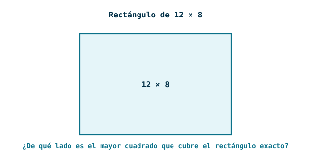
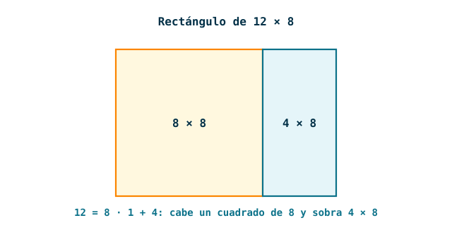
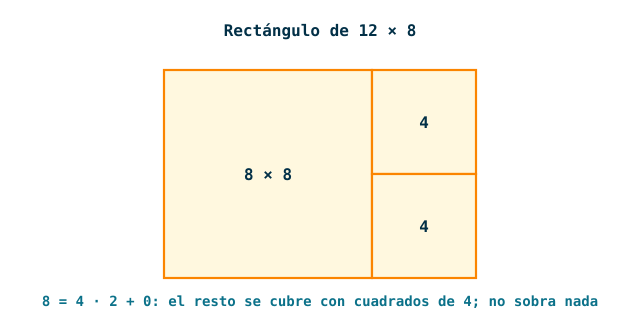
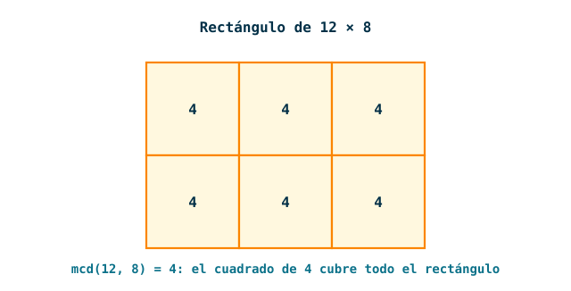
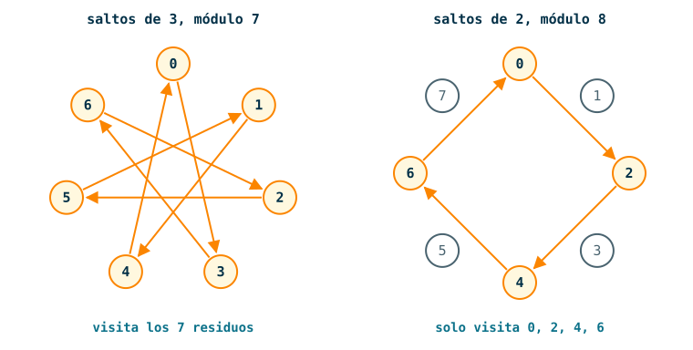

---
# Copyright (c) 2026 Angela Villota, and collaborators from the CyED block
# Licensed under the PolyForm Noncommercial License 1.0.0.
# Commercial use is prohibited without prior written authorization.
title: "Unidad 3 · Sesión 16: Algoritmo de Euclides"
---

# Unidad 3 · Sesión 16: Algoritmo de Euclides

## Agenda

1. El mcd sin factorizar
2. El algoritmo de Euclides
3. Costo: Euclides contra factorización
4. Simplificar fracciones
5. Combinación lineal
6. El inverso de $a$ módulo $m$
7. Resolver con el inverso
8. Cuando $\text{mcd}(a, m) \neq 1$
9. Congruencias lineales con módulos grandes

En la [Sesión 14](../Sesion14-Divisibilidad/index.md) calculamos el mcd con factorizaciones, y en la [Sesión 15](../Sesion15-CongruenciasLineales/index.md) resolvimos congruencias lineales probando valores. Esta sesión reemplaza los dos procedimientos por uno solo. Las trazas largas están en desplegables con pestañas **Paso 1, Paso 2, …**.

## 1. El mcd sin factorizar

**Encuentre $\text{mcd}(287, 91)$.**

:::{admonition} Respuesta
:class: dropdown
Por factorización, $287 = 7 \cdot 41$ y $91 = 7 \cdot 13$. El único primo común es 7, así que $\text{mcd}(287, 91) = 7$.

Funcionó porque factorizar 287 y 91 es fácil. Con $a = 998244359987710471$ hay que probar divisores hasta llegar a su factor primo menor, $998244353$: casi mil millones de divisiones. Y eso es un número de solo 18 cifras.
:::

**Calcule el mcd de cada pareja, por el método que quiera, y compare los resultados.**

1. $\text{mcd}(287, 91)$
2. $\text{mcd}(91, 14)$, donde $14 = 287 \;\mathbf{mod}\; 91$
3. $\text{mcd}(14, 7)$, donde $7 = 91 \;\mathbf{mod}\; 14$

:::{admonition} Respuesta
:class: dropdown
Los tres dan 7, y los números son cada vez más pequeños. Reemplazar el par $(a, b)$ por $(b, a \;\mathbf{mod}\; b)$ no cambió el mcd.
:::

:::{admonition} Lema
Sean $a$ y $b$ enteros positivos, y sea $r = a \;\mathbf{mod}\; b$. Entonces

$$
\text{mcd}(a, b) = \text{mcd}(b, r)
$$
:::

:::{admonition} Demostración
:class: dropdown
Por el algoritmo de la división, $a = bq + r$. Basta mostrar que $(a, b)$ y $(b, r)$ tienen exactamente los mismos divisores comunes, porque entonces el mayor de ellos es el mismo.

- Si $d \mid a$ y $d \mid b$, entonces $d$ divide a $r = a - bq$, por el corolario de la combinación lineal.
- Si $d \mid b$ y $d \mid r$, entonces $d$ divide a $a = bq + r$, por el mismo corolario. $\blacksquare$
:::

Se puede ver con un rectángulo. El mcd de 12 y 8 es el lado del mayor cuadrado con el que se cubre exactamente un rectángulo de $12 \times 8$.

:::::{admonition} mcd(12, 8) con cuadrados
:class: dropdown
::::{tab-set}
:::{tab-item} Paso 1

:::
:::{tab-item} Paso 2

:::
:::{tab-item} Paso 3

:::
:::{tab-item} Paso 4

:::
::::
:::::

## 2. El algoritmo de Euclides

**Método.** Divida el mayor entre el menor. Repita con el divisor y el residuo. El último residuo distinto de 0 es el mcd.

El caso más simple:

:::::{admonition} Traza de mcd(12, 8)
:class: dropdown
::::{tab-set}
:::{tab-item} Paso 1
```{code-block} text
:emphasize-lines: 1
12 = 8 · 1 + 4
```

> El residuo es 4. Seguimos con 8 y 4.

:::
:::{tab-item} Paso 2
```{code-block} text
:emphasize-lines: 2
12 = 8 · 1 + 4
 8 = 4 · 2 + 0
```

> Residuo 0: se detiene. El último residuo distinto de 0 es 4, así que $\text{mcd}(12, 8) = 4$.

:::
::::
:::::

Ahora el problema de la apertura:

:::::{admonition} Traza de mcd(287, 91)
:class: dropdown
::::{tab-set}
:::{tab-item} Paso 1
```{code-block} text
:emphasize-lines: 1
287 = 91 · ? + ?
```

> **¿Cuántas veces cabe 91 en 287?**

:::
:::{tab-item} Paso 2
```{code-block} text
:emphasize-lines: 1
287 = 91 · 3 + 14
```

> $91 \cdot 3 = 273$ y $287 - 273 = 14$.

:::
:::{tab-item} Paso 3
```{code-block} text
:emphasize-lines: 2
287 = 91 · 3 + 14
 91 = 14 · ? + ?
```

> El divisor pasa a ser dividendo y el residuo pasa a ser divisor.

:::
:::{tab-item} Paso 4
```{code-block} text
:emphasize-lines: 2
287 = 91 · 3 + 14
 91 = 14 · 6 + 7
```

:::
:::{tab-item} Paso 5
```{code-block} text
:emphasize-lines: 3
287 = 91 · 3 + 14
 91 = 14 · 6 + 7
 14 =  7 · ? + ?
```

:::
:::{tab-item} Paso 6
```{code-block} text
:emphasize-lines: 3
287 = 91 · 3 + 14
 91 = 14 · 6 + 7
 14 =  7 · 2 + 0
```

> **¿Cuándo se detiene?** Cuando el residuo es 0.

:::
:::{tab-item} Paso 7
```{code-block} text
:emphasize-lines: 4
287 = 91 · 3 + 14
 91 = 14 · 6 + 7
 14 =  7 · 2 + 0
mcd(287, 91) = 7
```

> Se toma el último residuo distinto de 0.

:::
::::
:::::

El algoritmo termina porque los residuos son enteros no negativos y cada uno es menor que el anterior. Es correcto por el lema: cada línea conserva el mcd, y al final $\text{mcd}(7, 0) = 7$.

En pseudocódigo, con una variable por cada valor que cambia:

```text
mcd(a, b):
  x ← a
  y ← b
  mientras y ≠ 0:
    r ← x mod y
    x ← y
    y ← r
  retorne x
```

| Iteración | `x` | `y` | `r` |
|---|---|---|---|
| 0 | 287 | 91 | |
| 1 | 91 | 14 | 14 |
| 2 | 14 | 7 | 7 |
| 3 | 7 | 0 | 0 |

En la iteración 3, `y` vale 0: se interrumpe y retorna 7.

En Scala no hacen falta variables mutables. El lema **ya es** la definición recursiva, y como la llamada está en posición de cola, es tan eficiente como el ciclo:

```scala
@annotation.tailrec
def mcd(a: Long, b: Long): Long = b match {
  case 0 => a
  case _ => mcd(b, a % b)
}

mcd(287, 91)   // 7

def pasos(a: Long, b: Long): Int = b match {
  case 0 => 0
  case _ => 1 + pasos(b, a % b)
}

pasos(287, 91)   // 3
```

`pasos` cuenta las divisiones. La división que da residuo 0 es la última: en $\text{mcd}(287, 91)$ hay exactamente 3, no una adicional de verificación.

### 2.1 Ejemplos

#### Ejemplo 1

Aplique el algoritmo de Euclides.

1. $\text{mcd}(342, 76)$
2. $\text{mcd}(512, 48)$
3. $\text{mcd}(252, 198)$

:::{admonition} Resultado
:class: dropdown
| $\text{mcd}(342, 76)$ | $\text{mcd}(512, 48)$ | $\text{mcd}(252, 198)$ |
|---|---|---|
| $342 = 76 \cdot 4 + 38$ | $512 = 48 \cdot 10 + 32$ | $252 = 198 \cdot 1 + 54$ |
| $76 = 38 \cdot 2 + 0$ | $48 = 32 \cdot 1 + 16$ | $198 = 54 \cdot 3 + 36$ |
| | $32 = 16 \cdot 2 + 0$ | $54 = 36 \cdot 1 + 18$ |
| | | $36 = 18 \cdot 2 + 0$ |
| **38** | **16** | **18** |
:::

#### Ejemplo 2

Aplique el algoritmo a $\text{mcd}(91, 287)$, con el menor de primero. ¿Qué pasa?

:::{admonition} Resultado
:class: dropdown
El resultado es el mismo, 7. Para aplicarlo a mano se empieza siempre dividiendo el mayor entre el menor.

Si se ejecuta el código sin ordenar, la primera división es $91 = 287 \cdot 0 + 91$, que solo intercambia los argumentos:

```scala
mcd(91, 287)    // 7
pasos(91, 287)  // 4
```

Hay una división más, y de ahí en adelante todo sigue igual.
:::

#### Ejemplo 3

Prediga cuántas divisiones hace el algoritmo, y luego compruebe.

1. $\text{mcd}(7, 7)$
2. $\text{mcd}(12, 0)$
3. $\text{mcd}(7, 3)$, dos primos distintos
4. $\text{mcd}(1000000, 999999)$, dos consecutivos

:::{admonition} Resultado
:class: dropdown
| Caso | Divisiones | mcd | Por qué |
|---|---|---|---|
| $\text{mcd}(7, 7)$ | 1 | 7 | $7 = 7 \cdot 1 + 0$: si $a = b$, termina en una iteración y retorna $a$ |
| $\text{mcd}(12, 0)$ | 0 | 12 | todo entero divide a 0 |
| $\text{mcd}(7, 3)$ | 2 | 1 | $7 = 3 \cdot 2 + 1$ y $3 = 1 \cdot 3 + 0$ |
| $\text{mcd}(1000000, 999999)$ | 2 | 1 | $n + 1 = n \cdot 1 + 1$ y $n = 1 \cdot n + 0$ |

Con dos primos distintos $p > q$, la primera división nunca da residuo 0, porque $q \nmid p$. Se necesitan por lo menos 2 divisiones, así que **no** termina en un paso aunque el resultado sea 1.
:::

#### Ejemplo 4

Decida si cada afirmación es verdadera.

1. Como $\text{mcd}(287, 91) = 7$, los números 287 y 91 son coprimos.
2. Euclides y la factorización pueden dar valores distintos del mcd cuando los números tienen factores grandes.
3. Si $\text{mcd}(a, b) = 1$, entonces $a$ o $b$ es primo.

:::{admonition} Resultado
:class: dropdown
1. **Falsa.** Coprimos significa $\text{mcd} = 1$, y aquí el mcd es 7.
2. **Falsa.** El mcd es un número definido sin ambigüedad, y ambos métodos lo calculan exactamente. Euclides no aproxima: cada línea es una igualdad entre enteros. Solo cambia el costo.
3. **Falsa.** $\text{mcd}(8, 9) = 1$, y ninguno de los dos es primo.
:::

## 3. Costo: Euclides contra factorización

**Calcule `pasos` para $(89, 55)$, $(55, 34)$ y $(34, 21)$. ¿Qué tienen de especial esos números? ¿Por qué hay tantas divisiones?**

:::{admonition} Respuesta
:class: dropdown
Dan 9, 8 y 7 divisiones. Son números de Fibonacci consecutivos, y en cada división el cociente es 1:

```text
89 = 55 · 1 + 34
55 = 34 · 1 + 21
34 = 21 · 1 + 13
...
```

Es el peor caso: los residuos bajan lo más lento posible. Incluso así, con $a = 89$ fueron 9 divisiones.
:::

La razón es que cada dos divisiones el primer argumento se reduce a menos de la mitad.

:::{admonition} Lema
Si $a \ge b > 0$, entonces $a \;\mathbf{mod}\; b < a/2$.
:::

:::{admonition} Demostración
:class: dropdown
Sea $r = a \;\mathbf{mod}\; b$. Si $b \le a/2$, entonces $r < b \le a/2$. Si $b > a/2$, entonces $a = b \cdot 1 + r$ y $r = a - b < a/2$. $\blacksquare$
:::

El par $(a, b)$ pasa a $(b, r)$ y luego a $(r, b \;\mathbf{mod}\; r)$: en dos divisiones, el primer argumento pasó de $a$ a $r < a/2$. Por tanto, el algoritmo hace como máximo unas $2 \log_2 a$ divisiones: $O(\log a)$.

Divisiones que puede necesitar cada método, según el tamaño de los números:

| Tamaño de los números | Factorización (hasta $\sqrt{a}$) | Euclides (hasta $2 \log_2 a$) |
|---|---|---|
| $10^6$ | $10^3$ | 40 |
| $10^{18}$ | $10^9$ | 120 |
| $10^{100}$ | $10^{50}$ | 665 |

$\sqrt{a}$ divisiones es polinómico en el **valor** de $a$, pero exponencial en su **número de cifras**: cada 2 cifras nuevas multiplican el trabajo por 10. En Euclides, las mismas 2 cifras agregan unas 13 divisiones. Por eso, para números grandes, Euclides es mucho más eficiente; la factorización solo compite cuando los números ya vienen factorizados, porque entonces basta comparar exponentes.

```scala
val a = 1000000007L * 998244353L   // 998244359987710471
val b = 1000000009L * 998244353L   // 998244361984199177

mcd(a, b)     // 998244353
pasos(a, b)   // 4
```

Por factorización, ese mismo cálculo pasaría por casi mil millones de divisiones de prueba.

## 4. Simplificar fracciones

**Lleve $\dfrac{252}{198}$ a su mínima expresión.**

:::{admonition} Respuesta
:class: dropdown
Se puede ir por partes: entre 2 da $\frac{126}{99}$, y entre 9 da $\frac{14}{11}$. Hay que adivinar qué divisor probar y cuándo parar.

Con Euclides es un solo paso. Del ejemplo 1 de la sección 2, $\text{mcd}(252, 198) = 18$:

$$
\frac{252}{198} = \frac{252 / 18}{198 / 18} = \frac{14}{11}
$$
:::

:::{admonition} Proposición
Una fracción $\dfrac{a}{b}$ está en su **mínima expresión** si y solo si $a$ y $b$ son coprimos. Si $d = \text{mcd}(a, b)$, entonces $\dfrac{a/d}{b/d}$ es la mínima expresión de $\dfrac{a}{b}$.
:::

:::{admonition} Demostración
:class: dropdown
Una fracción se puede simplificar exactamente cuando numerador y denominador tienen un divisor común mayor que 1, y eso equivale a que su mcd sea mayor que 1.

Para la segunda parte, si $c$ dividiera a $a/d$ y a $b/d$ con $c > 1$, entonces $cd$ dividiría a $a$ y a $b$, y sería un divisor común mayor que $d$. Eso contradice que $d$ sea el máximo. $\blacksquare$
:::

### 4.1 Ejemplos

#### Ejemplo 1

Simplifique con Euclides.

1. $\dfrac{287}{91}$
2. $\dfrac{342}{76}$
3. $\dfrac{48}{512}$

:::{admonition} Resultado
:class: dropdown
| Fracción | mcd | Mínima expresión |
|---|---|---|
| $287/91$ | 7 | $41/13$ |
| $342/76$ | 38 | $9/2$ |
| $48/512$ | 16 | $3/32$ |

En cada resultado se puede comprobar que los dos números son coprimos: por ejemplo, $41$ es primo y no divide a 13.
:::

#### Ejemplo 2

Decida si cada afirmación es verdadera.

1. Para llevar $\frac{252}{198}$ a su mínima expresión se divide entre $\text{mcm}(252, 198)$.
2. Para todo entero positivo $n$, $\dfrac{n}{n+1}$ ya está en su mínima expresión.
3. $14$ y $11$ son coprimos.

:::{admonition} Resultado
:class: dropdown
1. **Falsa.** Es entre el **mcd**. El mcm es múltiplo de los dos números: ni siquiera los divide, salvo cuando son iguales.
2. **Verdadera.** $n + 1 = n \cdot 1 + 1$ y $n = 1 \cdot n + 0$, así que $\text{mcd}(n, n+1) = 1$.
3. **Verdadera.** $14 = 2 \cdot 7$ y 11 es primo: no comparten factores primos.
:::

#### Ejemplo 3

Escriba `simplificar` para fracciones representadas como pares de enteros positivos.

:::{admonition} Resultado
:class: dropdown
```scala
def simplificar(f: (Long, Long)): (Long, Long) = {
  val (n, d) = f
  val g = mcd(n, d)
  (n / g, d / g)
}

simplificar((252, 198))   // (14,11)
simplificar((14, 11))     // (14,11)
```

La segunda línea muestra que simplificar dos veces no cambia nada: una fracción en su mínima expresión tiene mcd 1.
:::

## 5. Combinación lineal

**¿Se puede escribir 18 como $252x + 198y$, con $x$ y $y$ enteros?**

:::{admonition} Respuesta
:class: dropdown
Sí: $18 = 252 \cdot (4) + 198 \cdot (-5)$. En efecto, $1008 - 990 = 18$.

Esos coeficientes no salen de probar valores. Salen de las divisiones del algoritmo de Euclides, leídas de abajo hacia arriba.
:::

**Método.** Despeje los residuos de las divisiones y sustitúyalos, de abajo hacia arriba, en la ecuación que tiene al mcd.

:::::{admonition} Traza de 18 = 252 s + 198 t
:class: dropdown
::::{tab-set}
:::{tab-item} Paso 1
```{code-block} text
:emphasize-lines: 1, 2, 3, 4
252 = 198 · 1 + 54
198 =  54 · 3 + 36
 54 =  36 · 1 + 18
 36 =  18 · 2 + 0
```

> Las divisiones de Euclides: $\text{mcd}(252, 198) = 18$.

:::
:::{tab-item} Paso 2
```{code-block} text
:emphasize-lines: 1, 2, 3
54 = 252 - 198 · 1
36 = 198 -  54 · 3
18 =  54 -  36 · 1
```

> Se despejan los residuos. La última es la ecuación que tiene al mcd.

:::
:::{tab-item} Paso 3
```{code-block} text
:emphasize-lines: 3
54 = 252 - 198 · 1
36 = 198 -  54 · 3
18 =  54 - (198 - 54 · 3) · 1
```

> Se reemplaza el 36, siempre en la ecuación que tiene al mcd.

:::
:::{tab-item} Paso 4
```{code-block} text
:emphasize-lines: 2
54 = 252 - 198 · 1
18 = 54 - 198 · 1 + 54 · 3
```

> Se quitan los paréntesis.

:::
:::{tab-item} Paso 5
```{code-block} text
:emphasize-lines: 2
54 = 252 - 198 · 1
18 = 54 · 4 - 198 · 1
```

> Se agrupa el 54: ya no hay 36 en la ecuación.

:::
:::{tab-item} Paso 6
```{code-block} text
:emphasize-lines: 1
18 = (252 - 198 · 1) · 4 - 198 · 1
```

> Se reemplaza el 54.

:::
:::{tab-item} Paso 7
```{code-block} text
:emphasize-lines: 2
18 = (252 - 198 · 1) · 4 - 198 · 1
18 = 252 · 4 - 198 · 4 - 198 · 1
```

:::
:::{tab-item} Paso 8
```{code-block} text
:emphasize-lines: 3, 4
18 = (252 - 198 · 1) · 4 - 198 · 1
18 = 252 · 4 - 198 · 4 - 198 · 1
18 = 252 · 4 - 198 · 5
18 = 252 · (4) + 198 · (-5)
```

> Solo quedan 252 y 198, los dos números originales.

:::
::::
:::::

Esto funciona con cualquier pareja: el algoritmo siempre termina en una ecuación con el mcd, y cada sustitución elimina un residuo.

:::{admonition} Teorema 1 (combinación lineal)
Si $a$ y $b$ son enteros positivos, existen enteros $s$ y $t$ tales que

$$
\text{mcd}(a, b) = a \cdot s + b \cdot t
$$
:::

Este resultado también se conoce como **identidad de Bézout**. Los coeficientes no son únicos: si $(s, t)$ sirve, $\big(s + k\frac{b}{d},\; t - k\frac{a}{d}\big)$ también sirve para todo entero $k$, donde $d = \text{mcd}(a, b)$. Por ejemplo, $18 = 252 \cdot (-7) + 198 \cdot (9)$.

### 5.1 Ejemplos

#### Ejemplo 1

Exprese $\text{mcd}(512, 48) = 16$ como una combinación lineal.

:::{admonition} Resultado
:class: dropdown
Divisiones:

```text
512 = 48 · 10 + 32
 48 = 32 ·  1 + 16
 32 = 16 ·  2 + 0
```

Se despejan $32 = 512 - 48 \cdot 10$ y $16 = 48 - 32 \cdot 1$. Sustituyendo:

```text
16 = 48 - (512 - 48 · 10) · 1
16 = 48 - 512 · 1 + 48 · 10
16 = 48 · 11 - 512 · 1
16 = 48 · (11) + 512 · (-1)
```
:::

#### Ejemplo 2

Exprese $\text{mcd}(322, 51) = 1$ como una combinación lineal.

:::{admonition} Resultado
:class: dropdown
Divisiones:

```text
322 = 51 · 6 + 16
 51 = 16 · 3 + 3
 16 =  3 · 5 + 1
  3 =  1 · 3 + 0
```

Se despejan $16 = 322 - 51 \cdot 6$, $\;3 = 51 - 16 \cdot 3$ y $1 = 16 - 3 \cdot 5$. Sustituyendo:

```text
1 = 16 - (51 - 16 · 3) · 5  = 16 · 16 - 51 · 5
1 = (322 - 51 · 6) · 16 - 51 · 5
1 = 322 · 16 - 51 · 96 - 51 · 5
1 = 322 · (16) + 51 · (-101)
```
:::

#### Ejemplo 3

Exprese $\text{mcd}(235, 37) = 1$ como una combinación lineal.

:::{admonition} Resultado
:class: dropdown
Divisiones:

```text
235 = 37 · 6 + 13
 37 = 13 · 2 + 11
 13 = 11 · 1 + 2
 11 =  2 · 5 + 1
  2 =  1 · 2 + 0
```

Se despejan $13 = 235 - 37 \cdot 6$, $\;11 = 37 - 13 \cdot 2$, $\;2 = 13 - 11 \cdot 1$ y $1 = 11 - 2 \cdot 5$. Sustituyendo de abajo hacia arriba:

```text
1 = 11 - (13 - 11 · 1) · 5      = 11 · 6 - 13 · 5
1 = (37 - 13 · 2) · 6 - 13 · 5  = 37 · 6 - 13 · 17
1 = 37 · 6 - (235 - 37 · 6) · 17
1 = 37 · 6 - 235 · 17 + 37 · 102
1 = 37 · (108) + 235 · (-17)
```
:::

#### Ejemplo 4

Las sustituciones también se pueden hacer con recursión. Suponga que ya tiene $g = b \cdot s + (a \;\mathbf{mod}\; b) \cdot t$. Reemplazando $a \;\mathbf{mod}\; b = a - (a \;\mathbf{div}\; b) \cdot b$ se obtiene

$$
g = a \cdot t + b \cdot \big(s - (a \;\mathbf{div}\; b) \cdot t\big)
$$

Escriba `bezout(a, b)`, que retorna $(g, s, t)$ con $g = \text{mcd}(a, b) = as + bt$, y siga su ejecución para $(252, 198)$.

:::{admonition} Resultado
:class: dropdown
```scala
def bezout(a: Long, b: Long): (Long, Long, Long) = b match {
  case 0 => (a, 1, 0)
  case _ =>
    val (g, s, t) = bezout(b, a % b)
    (g, t, s - (a / b) * t)
}

bezout(252, 198)   // (18,4,-5)
```

Se conoce como **algoritmo de Euclides extendido**. La tabla se llena de abajo hacia arriba: cada fila usa los valores de la fila inferior.

| `a` | `b` | `a / b` | Retorna $(g, s, t)$ |
|---|---|---|---|
| 252 | 198 | 1 | $(18,\; 4,\; -5)$ |
| 198 | 54 | 3 | $(18,\; -1,\; 4)$ |
| 54 | 36 | 1 | $(18,\; 1,\; -1)$ |
| 36 | 18 | 2 | $(18,\; 0,\; 1)$ |
| 18 | 0 | | $(18,\; 1,\; 0)$ |

En la primera fila, por ejemplo: $s = -1$ y $t = 4$ vienen de abajo, y retorna $(18,\; 4,\; -1 - 1 \cdot 4) = (18, 4, -5)$.
:::

#### Ejemplo 5

**Lema de Euclides.** Demuestre que si $p$ es primo y $p \mid ab$, entonces $p \mid a$ o $p \mid b$. Este es el lema que sostiene la unicidad de la factorización.

:::{admonition} Demostración
:class: dropdown
Si $p \mid a$, ya está. Si no, $\text{mcd}(p, a) = 1$, porque los únicos divisores positivos de $p$ son 1 y $p$. Por el teorema 1, $1 = ps + at$ para algunos enteros $s$ y $t$. Multiplicando por $b$:

$$
b = psb + (ab)t
$$

$p$ divide a $psb$, y $p$ divide a $ab$ por hipótesis. Por el corolario de la combinación lineal, $p \mid b$. $\blacksquare$

La demostración del teorema 1 no usa la factorización única, así que no hay un razonamiento circular.
:::

#### Ejemplo 6

Demuestre que si $a$ y $b$ son coprimos, $a \mid n$ y $b \mid n$, entonces $ab \mid n$.

:::{admonition} Demostración
:class: dropdown
Por el teorema 1, $1 = as + bt$. Multiplicando por $n$:

$$
n = ans + bnt
$$

Como $b \mid n$, se tiene $ab \mid an$. Como $a \mid n$, se tiene $ab \mid bn$. Por el corolario de la combinación lineal, $ab \mid n$. $\blacksquare$

Es la versión general del criterio del 6 de la Sesión 14, con $a = 2$ y $b = 3$: allí la combinación era $1 = 3 \cdot 1 + 2 \cdot (-1)$.
:::

## 6. El inverso de $a$ módulo $m$

**Para resolver $3x = 4$ en los reales, se multiplica por $\frac{1}{3}$. Módulo 7 no hay fracciones. ¿Qué entero, multiplicado por 3, da 1 módulo 7?**

:::{admonition} Respuesta
:class: dropdown
Uno de ellos es $-2$. Se puede verificar: $(-2) \cdot 3 = -6 \equiv 1 \pmod{7}$.
:::

:::{admonition} Definición
Dado $a$ módulo $m$, su **inverso** se denota como $\overline{a}$. Se cumple que

$$
\overline{a} \cdot a \equiv 1 \pmod{m}
$$
:::

Para 3 módulo 7 se tiene $\overline{3} = -2$.

**¿Todo número tiene inverso? Calcule los múltiplos de 3 módulo 7 y los de 2 módulo 8. ¿Aparece el 1?**

:::{admonition} Respuesta
:class: dropdown
| $c$ | 0 | 1 | 2 | 3 | 4 | 5 | 6 | 7 |
|---|---|---|---|---|---|---|---|---|
| $3c \;\mathbf{mod}\; 7$ | 0 | 3 | 6 | 2 | 5 | **1** | 4 | |
| $2c \;\mathbf{mod}\; 8$ | 0 | 2 | 4 | 6 | 0 | 2 | 4 | 6 |

Módulo 7 aparece: $3 \cdot 5 \equiv 1$, y $5 \equiv -2 \pmod{7}$. Módulo 8, nunca: los múltiplos de 2 solo pasan por los pares. 2 no tiene inverso módulo 8, y $\text{mcd}(2, 8) = 2$.
:::

Cada fila es una vuelta alrededor de un reloj de $m$ posiciones, dando saltos de tamaño $a$. Con saltos de 3 sobre 7 posiciones se visitan todas, incluida la del 1. Con saltos de 2 sobre 8 se visitan solo los pares.



Solo existe un inverso si $\text{mcd}(a, m) = 1$. Para encontrarlo se usa la combinación lineal de la sección 5.

:::{admonition} Fórmula del inverso
Para encontrar $\overline{a}$:

1. Calcule $\text{mcd}(a, m)$. Debe ser 1.
2. Exprese $\text{mcd}(a, m) = 1$ como una combinación lineal:

   $$
   1 = a \cdot (s) + m \cdot (t)
   $$

3. El coeficiente que acompaña a $a$, es decir $s$, es el inverso:

   $$
   \overline{a} = s
   $$
:::

:::::{admonition} Traza del inverso de 3 módulo 7
:class: dropdown
::::{tab-set}
:::{tab-item} Paso 1
```{code-block} text
:emphasize-lines: 1, 2
7 = 3 · 2 + 1
3 = 1 · 3 + 0
```

> Se verifica que $\text{mcd}(7, 3) = 1$. **¿Qué sigue?**

:::
:::{tab-item} Paso 2
```{code-block} text
:emphasize-lines: 3
7 = 3 · 2 + 1
3 = 1 · 3 + 0
1 = 7 - 3 · 2
```

> Ahora se expresa como combinación lineal: se despeja el residuo.

:::
:::{tab-item} Paso 3
```{code-block} text
:emphasize-lines: 4
7 = 3 · 2 + 1
3 = 1 · 3 + 0
1 = 7 - 3 · 2
1 = 3 · (-2) + 7 · (1)
```

> Queda en la forma $1 = a \cdot (s) + m \cdot (t)$, con $a = 3$ y $m = 7$. **¿Cuál es el coeficiente que acompaña a 3?**

:::
:::{tab-item} Paso 4
```{code-block} text
:emphasize-lines: 5
7 = 3 · 2 + 1
3 = 1 · 3 + 0
1 = 7 - 3 · 2
1 = 3 · (-2) + 7 · (1)
inverso de 3 mod 7 = -2
```

> $\overline{3} = -2$. Se puede verificar: $(-2) \cdot 3 \equiv 1 \pmod{7}$, porque $-6 = 7 \cdot (-1) + 1$.

:::
::::
:::::

### 6.1 Ejemplos

#### Ejemplo 1

Encuentre el inverso de 7 módulo 3.

:::{admonition} Resultado
:class: dropdown
Son los dos números de la traza anterior, y la combinación lineal es la misma:

$$
1 = 3 \cdot (-2) + 7 \cdot (1)
$$

Ahora $a = 7$, y el coeficiente que acompaña a 7 es 1. El inverso de 7 módulo 3 es 1. Se puede verificar: $1 \cdot 7 = 7 \equiv 1 \pmod{3}$.
:::

#### Ejemplo 2

Encuentre el inverso de 5 módulo 7.

:::::{admonition} Resultado
:class: dropdown
::::{tab-set}
:::{tab-item} Paso 1
```{code-block} text
:emphasize-lines: 1, 2, 3
7 = 5 · 1 + 2
5 = 2 · 2 + 1
2 = 1 · 2 + 0
```

> Se verifica que $\text{mcd}(5, 7) = 1$. Ahora se expresa como combinación lineal.

:::
:::{tab-item} Paso 2
```{code-block} text
:emphasize-lines: 1, 2
2 = 7 - 5 · 1
1 = 5 - 2 · 2
```

> Se despejan los residuos. La última ecuación tiene al mcd.

:::
:::{tab-item} Paso 3
```{code-block} text
:emphasize-lines: 3
2 = 7 - 5 · 1
1 = 5 - 2 · 2
1 = 5 - (7 - 5 · 1) · 2
```

> Se reemplaza el 2.

:::
:::{tab-item} Paso 4
```{code-block} text
:emphasize-lines: 4
2 = 7 - 5 · 1
1 = 5 - 2 · 2
1 = 5 - (7 - 5 · 1) · 2
1 = 5 - 7 · 2 + 5 · 2
```

> Se quitan los paréntesis.

:::
:::{tab-item} Paso 5
```{code-block} text
:emphasize-lines: 5
2 = 7 - 5 · 1
1 = 5 - 2 · 2
1 = 5 - (7 - 5 · 1) · 2
1 = 5 - 7 · 2 + 5 · 2
1 = 5 · 3 - 7 · 2
```

> Se agrupa el 5.

:::
:::{tab-item} Paso 6
```{code-block} text
:emphasize-lines: 6
2 = 7 - 5 · 1
1 = 5 - 2 · 2
1 = 5 - (7 - 5 · 1) · 2
1 = 5 - 7 · 2 + 5 · 2
1 = 5 · 3 - 7 · 2
1 = 5 · (3) + 7 · (-2)
```

> **¿Cuál es el coeficiente que acompaña a 5?**

:::
:::{tab-item} Paso 7
```{code-block} text
:emphasize-lines: 7
2 = 7 - 5 · 1
1 = 5 - 2 · 2
1 = 5 - (7 - 5 · 1) · 2
1 = 5 - 7 · 2 + 5 · 2
1 = 5 · 3 - 7 · 2
1 = 5 · (3) + 7 · (-2)
inverso de 5 mod 7 = 3
```

> $\overline{5} = 3$. Se puede verificar: $3 \cdot 5 = 15 \equiv 1 \pmod{7}$.

:::
::::
:::::

#### Ejemplo 3

Encuentre el inverso de 3 módulo 17.

:::::{admonition} Resultado
:class: dropdown
::::{tab-set}
:::{tab-item} Paso 1
```{code-block} text
:emphasize-lines: 1, 2, 3
17 = 3 · 5 + 2
 3 = 2 · 1 + 1
 2 = 1 · 2 + 0
```

> Se verifica que $\text{mcd}(3, 17) = 1$. Ahora se expresa como combinación lineal.

:::
:::{tab-item} Paso 2
```{code-block} text
:emphasize-lines: 1, 2
2 = 17 - 3 · 5
1 = 3 - 2 · 1
```

> Se despejan los residuos.

:::
:::{tab-item} Paso 3
```{code-block} text
:emphasize-lines: 3
2 = 17 - 3 · 5
1 = 3 - 2 · 1
1 = 3 - (17 - 3 · 5) · 1
```

> Se reemplaza el 2.

:::
:::{tab-item} Paso 4
```{code-block} text
:emphasize-lines: 4
2 = 17 - 3 · 5
1 = 3 - 2 · 1
1 = 3 - (17 - 3 · 5) · 1
1 = 3 - 17 · 1 + 3 · 5
```

> Se quitan los paréntesis.

:::
:::{tab-item} Paso 5
```{code-block} text
:emphasize-lines: 5
2 = 17 - 3 · 5
1 = 3 - 2 · 1
1 = 3 - (17 - 3 · 5) · 1
1 = 3 - 17 · 1 + 3 · 5
1 = 3 · 6 - 17 · 1
```

> Se agrupa el 3.

:::
:::{tab-item} Paso 6
```{code-block} text
:emphasize-lines: 6
2 = 17 - 3 · 5
1 = 3 - 2 · 1
1 = 3 - (17 - 3 · 5) · 1
1 = 3 - 17 · 1 + 3 · 5
1 = 3 · 6 - 17 · 1
1 = 3 · (6) + 17 · (-1)
```

> **¿Cuál es el coeficiente que acompaña a 3?**

:::
:::{tab-item} Paso 7
```{code-block} text
:emphasize-lines: 7
2 = 17 - 3 · 5
1 = 3 - 2 · 1
1 = 3 - (17 - 3 · 5) · 1
1 = 3 - 17 · 1 + 3 · 5
1 = 3 · 6 - 17 · 1
1 = 3 · (6) + 17 · (-1)
inverso de 3 mod 17 = 6
```

> $\overline{3} = 6$. Se puede verificar: $6 \cdot 3 = 18 \equiv 1 \pmod{17}$.

:::
::::
:::::

#### Ejemplo 4

Encuentre el inverso de 7 módulo 26.

:::::{admonition} Resultado
:class: dropdown
::::{tab-set}
:::{tab-item} Paso 1
```{code-block} text
:emphasize-lines: 1, 2, 3, 4
26 = 7 · 3 + 5
 7 = 5 · 1 + 2
 5 = 2 · 2 + 1
 2 = 1 · 2 + 0
```

> Se verifica que $\text{mcd}(26, 7) = 1$. Ahora se expresa como combinación lineal.

:::
:::{tab-item} Paso 2
```{code-block} text
:emphasize-lines: 1, 2, 3
5 = 26 - 7 · 3
2 = 7 - 5 · 1
1 = 5 - 2 · 2
```

> Se despejan los residuos.

:::
:::{tab-item} Paso 3
```{code-block} text
:emphasize-lines: 4
5 = 26 - 7 · 3
2 = 7 - 5 · 1
1 = 5 - 2 · 2
1 = 5 - (7 - 5 · 1) · 2
```

> Se reemplaza el 2.

:::
:::{tab-item} Paso 4
```{code-block} text
:emphasize-lines: 5
5 = 26 - 7 · 3
2 = 7 - 5 · 1
1 = 5 - 2 · 2
1 = 5 - (7 - 5 · 1) · 2
1 = 5 - 7 · 2 + 5 · 2
```

> Se quitan los paréntesis.

:::
:::{tab-item} Paso 5
```{code-block} text
:emphasize-lines: 6
5 = 26 - 7 · 3
2 = 7 - 5 · 1
1 = 5 - 2 · 2
1 = 5 - (7 - 5 · 1) · 2
1 = 5 - 7 · 2 + 5 · 2
1 = 5 · 3 - 7 · 2
```

> Se agrupa el 5. **¿Qué residuo falta por reemplazar?**

:::
:::{tab-item} Paso 6
```{code-block} text
:emphasize-lines: 7
5 = 26 - 7 · 3
2 = 7 - 5 · 1
1 = 5 - 2 · 2
1 = 5 - (7 - 5 · 1) · 2
1 = 5 - 7 · 2 + 5 · 2
1 = 5 · 3 - 7 · 2
1 = (26 - 7 · 3) · 3 - 7 · 2
```

> Se reemplaza el 5.

:::
:::{tab-item} Paso 7
```{code-block} text
:emphasize-lines: 8
5 = 26 - 7 · 3
2 = 7 - 5 · 1
1 = 5 - 2 · 2
1 = 5 - (7 - 5 · 1) · 2
1 = 5 - 7 · 2 + 5 · 2
1 = 5 · 3 - 7 · 2
1 = (26 - 7 · 3) · 3 - 7 · 2
1 = 26 · 3 - 7 · 9 - 7 · 2
```

> Se quitan los paréntesis.

:::
:::{tab-item} Paso 8
```{code-block} text
:emphasize-lines: 9
5 = 26 - 7 · 3
2 = 7 - 5 · 1
1 = 5 - 2 · 2
1 = 5 - (7 - 5 · 1) · 2
1 = 5 - 7 · 2 + 5 · 2
1 = 5 · 3 - 7 · 2
1 = (26 - 7 · 3) · 3 - 7 · 2
1 = 26 · 3 - 7 · 9 - 7 · 2
1 = 26 · 3 - 7 · 11
```

> Se agrupa el 7.

:::
:::{tab-item} Paso 9
```{code-block} text
:emphasize-lines: 10
5 = 26 - 7 · 3
2 = 7 - 5 · 1
1 = 5 - 2 · 2
1 = 5 - (7 - 5 · 1) · 2
1 = 5 - 7 · 2 + 5 · 2
1 = 5 · 3 - 7 · 2
1 = (26 - 7 · 3) · 3 - 7 · 2
1 = 26 · 3 - 7 · 9 - 7 · 2
1 = 26 · 3 - 7 · 11
1 = 26 · (3) + 7 · (-11)
```

> Solo quedan 26 y 7. **¿Cuál es el coeficiente que acompaña a 7?**

:::
:::{tab-item} Paso 10
```{code-block} text
:emphasize-lines: 11
5 = 26 - 7 · 3
2 = 7 - 5 · 1
1 = 5 - 2 · 2
1 = 5 - (7 - 5 · 1) · 2
1 = 5 - 7 · 2 + 5 · 2
1 = 5 · 3 - 7 · 2
1 = (26 - 7 · 3) · 3 - 7 · 2
1 = 26 · 3 - 7 · 9 - 7 · 2
1 = 26 · 3 - 7 · 11
1 = 26 · (3) + 7 · (-11)
inverso de 7 mod 26 = -11
```

> $\overline{7} = -11$. Se puede verificar: $(-11) \cdot 7 = -77 = 26 \cdot (-3) + 1$.

:::
::::
:::::

#### Ejemplo 5

Encuentre el inverso de 235 módulo 37.

:::::{admonition} Resultado
:class: dropdown
::::{tab-set}
:::{tab-item} Paso 1
```{code-block} text
:emphasize-lines: 1, 2, 3, 4, 5
235 = 37 · 6 + 13
 37 = 13 · 2 + 11
 13 = 11 · 1 + 2
 11 =  2 · 5 + 1
  2 =  1 · 2 + 0
```

> Se verifica que $\text{mcd}(235, 37) = 1$. Ahora se expresa como combinación lineal.

:::
:::{tab-item} Paso 2
```{code-block} text
:emphasize-lines: 1, 2, 3, 4
13 = 235 - 37 · 6
11 = 37 - 13 · 2
 2 = 13 - 11 · 1
 1 = 11 - 2 · 5
```

> Se despejan los residuos.

:::
:::{tab-item} Paso 3
```{code-block} text
:emphasize-lines: 5
13 = 235 - 37 · 6
11 = 37 - 13 · 2
 2 = 13 - 11 · 1
 1 = 11 - 2 · 5
1 = 11 - (13 - 11 · 1) · 5
```

> Se reemplaza el 2.

:::
:::{tab-item} Paso 4
```{code-block} text
:emphasize-lines: 6
13 = 235 - 37 · 6
11 = 37 - 13 · 2
 2 = 13 - 11 · 1
 1 = 11 - 2 · 5
1 = 11 - (13 - 11 · 1) · 5
1 = 11 · 6 - 13 · 5
```

> Se agrupa el 11.

:::
:::{tab-item} Paso 5
```{code-block} text
:emphasize-lines: 7
13 = 235 - 37 · 6
11 = 37 - 13 · 2
 2 = 13 - 11 · 1
 1 = 11 - 2 · 5
1 = 11 - (13 - 11 · 1) · 5
1 = 11 · 6 - 13 · 5
1 = (37 - 13 · 2) · 6 - 13 · 5
```

> Se reemplaza el 11.

:::
:::{tab-item} Paso 6
```{code-block} text
:emphasize-lines: 8
13 = 235 - 37 · 6
11 = 37 - 13 · 2
 2 = 13 - 11 · 1
 1 = 11 - 2 · 5
1 = 11 - (13 - 11 · 1) · 5
1 = 11 · 6 - 13 · 5
1 = (37 - 13 · 2) · 6 - 13 · 5
1 = 37 · 6 - 13 · 17
```

> Se agrupa el 13.

:::
:::{tab-item} Paso 7
```{code-block} text
:emphasize-lines: 9
13 = 235 - 37 · 6
11 = 37 - 13 · 2
 2 = 13 - 11 · 1
 1 = 11 - 2 · 5
1 = 11 - (13 - 11 · 1) · 5
1 = 11 · 6 - 13 · 5
1 = (37 - 13 · 2) · 6 - 13 · 5
1 = 37 · 6 - 13 · 17
1 = 37 · 6 - (235 - 37 · 6) · 17
```

> Se reemplaza el 13.

:::
:::{tab-item} Paso 8
```{code-block} text
:emphasize-lines: 10
13 = 235 - 37 · 6
11 = 37 - 13 · 2
 2 = 13 - 11 · 1
 1 = 11 - 2 · 5
1 = 11 - (13 - 11 · 1) · 5
1 = 11 · 6 - 13 · 5
1 = (37 - 13 · 2) · 6 - 13 · 5
1 = 37 · 6 - 13 · 17
1 = 37 · 6 - (235 - 37 · 6) · 17
1 = 37 · 108 - 235 · 17
```

> Se agrupa el 37.

:::
:::{tab-item} Paso 9
```{code-block} text
:emphasize-lines: 11
13 = 235 - 37 · 6
11 = 37 - 13 · 2
 2 = 13 - 11 · 1
 1 = 11 - 2 · 5
1 = 11 - (13 - 11 · 1) · 5
1 = 11 · 6 - 13 · 5
1 = (37 - 13 · 2) · 6 - 13 · 5
1 = 37 · 6 - 13 · 17
1 = 37 · 6 - (235 - 37 · 6) · 17
1 = 37 · 108 - 235 · 17
1 = 37 · (108) + 235 · (-17)
```

> **¿Cuál es el coeficiente que acompaña a 235?**

:::
:::{tab-item} Paso 10
```{code-block} text
:emphasize-lines: 12
13 = 235 - 37 · 6
11 = 37 - 13 · 2
 2 = 13 - 11 · 1
 1 = 11 - 2 · 5
1 = 11 - (13 - 11 · 1) · 5
1 = 11 · 6 - 13 · 5
1 = (37 - 13 · 2) · 6 - 13 · 5
1 = 37 · 6 - 13 · 17
1 = 37 · 6 - (235 - 37 · 6) · 17
1 = 37 · 108 - 235 · 17
1 = 37 · (108) + 235 · (-17)
inverso de 235 mod 37 = -17
```

> El coeficiente que acompaña a 235, es decir $-17$, es el inverso. Se puede verificar: $-17 \cdot 235 \equiv 1 \pmod{37}$, porque $-3995 = 37 \cdot (-108) + 1$.

:::
::::
:::::

#### Ejemplo 6

Encuentre el inverso de 6 módulo 9.

:::{admonition} Resultado
:class: dropdown
Se aplica la primera instrucción: $9 = 6 \cdot 1 + 3$ y $6 = 3 \cdot 2 + 0$. Entonces $\text{mcd}(6, 9) = 3$, que no es 1. El inverso **no existe**.
:::

### 6.2 Por qué funciona la fórmula

**En $1 = 3 \cdot (-2) + 7 \cdot (1)$, ¿qué le pasa al término $7 \cdot (1)$ al reducir módulo 7?**

:::{admonition} Respuesta
:class: dropdown
Desaparece, porque es múltiplo de 7. Queda $1 \equiv 3 \cdot (-2) \pmod{7}$, que es exactamente la definición de inverso.
:::

:::{admonition} Teorema 2
Sean $a$ un entero y $m > 1$. El inverso de $a$ módulo $m$ existe si y solo si $\text{mcd}(a, m) = 1$. Cuando existe, es único módulo $m$.
:::

:::{admonition} Demostración
:class: dropdown
**Si existe el inverso, $\text{mcd}(a, m) = 1$.** Si $\overline{a} \cdot a \equiv 1 \pmod{m}$, entonces $\overline{a} \cdot a - 1 = km$, o sea $1 = \overline{a} \cdot a - km$. Sea $d = \text{mcd}(a, m)$. Como $d \mid a$ y $d \mid m$, el corolario de la combinación lineal da $d \mid 1$, así que $d = 1$.

**Si $\text{mcd}(a, m) = 1$, existe el inverso.** Por el teorema 1, $1 = a \cdot s + m \cdot t$. Reduciendo módulo $m$, $a \cdot s \equiv 1 \pmod{m}$: $s$ es un inverso de $a$.

**Unicidad.** Si $c$ y $c'$ son inversos de $a$, entonces $c \equiv c(ac') = (ca)c' \equiv c' \pmod{m}$. $\blacksquare$
:::

La unicidad es módulo $m$: $-2$ y $5$ son el mismo inverso de 3 módulo 7, porque $-2 \equiv 5 \pmod{7}$. Si se quiere un residuo entre $0$ y $m - 1$, se le suma $m$ a un inverso negativo. Así, $\overline{7} = -11 \equiv 15 \pmod{26}$ y $\overline{235} = -17 \equiv 20 \pmod{37}$.

En Scala, normalizando a ese residuo:

```scala
def inversoEuclides(a: Long, m: Long): Option[Long] = {
  val (g, s, _) = bezout(a, m)
  if (g == 1) Some(Math.floorMod(s, m)) else None
}

inversoEuclides(3, 7)   // Some(5)
inversoEuclides(6, 9)   // None
```

**Compare el número de intentos para hallar el inverso de 1234 módulo $1000003$ probando valores de $c$ y con Euclides.**

```scala
pasos(1000003, 1234)
inversoEuclides(1234, 1000003)
```

:::{admonition} Respuesta
:class: dropdown
`inversoEuclides` retorna `Some(496760)`, y lo hace con muy pocas divisiones: `pasos(1000003, 1234)` da `7`.

Probar $c = 1, 2, 3, \ldots$ exigiría llegar hasta 496760: casi medio millón de intentos para el mismo resultado.
:::

## 7. Resolver con el inverso

**Método.** Multiplique ambos lados de la congruencia por el inverso de $a$.

:::::{admonition} Traza de 3x ≡ 4 (mod 7)
:class: dropdown
::::{tab-set}
:::{tab-item} Paso 1
```{code-block} text
:emphasize-lines: 1
3x ≡ 4 (mod 7)
```

> **¿Cuánto vale el inverso de 3 módulo 7?**

:::
:::{tab-item} Paso 2
```{code-block} text
:emphasize-lines: 2
3x ≡ 4 (mod 7)
5 · 3x ≡ 5 · 4 (mod 7)
```

> En la traza de la sección 6, $\overline{3} = -2$, y como residuo es 5. El teorema 2 de la Sesión 15 permite multiplicar ambos lados por el mismo número.

:::
:::{tab-item} Paso 3
```{code-block} text
:emphasize-lines: 3
3x ≡ 4 (mod 7)
5 · 3x ≡ 5 · 4 (mod 7)
1 · x ≡ 20 (mod 7)
```

> $5 \cdot 3 = 15 \equiv 1$: el coeficiente de $x$ desaparece.

:::
:::{tab-item} Paso 4
```{code-block} text
:emphasize-lines: 4
3x ≡ 4 (mod 7)
5 · 3x ≡ 5 · 4 (mod 7)
1 · x ≡ 20 (mod 7)
x ≡ 6 (mod 7)
```

> Reducimos: $20 = 7 \cdot 2 + 6$. Coincide con el tanteo de la Sesión 15.

:::
::::
:::::

En una línea: si $\text{mcd}(a, m) = 1$, la solución de $ax \equiv b \pmod{m}$ es $x \equiv \overline{a}\,b \pmod{m}$, y es única módulo $m$.

**Dividir no es lo mismo que multiplicar por el inverso.** En la sección 2 de la [Sesión 15](../Sesion15-CongruenciasLineales/index.md) vimos que $14 \equiv 8 \pmod{6}$ no permite dividir entre 2. Lo que sí vale es:

:::{admonition} Proposición (cancelación)
Si $ca \equiv cb \pmod{m}$ y $\text{mcd}(c, m) = 1$, entonces $a \equiv b \pmod{m}$.
:::

La demostración es el mismo paso del método: se multiplica por $\overline{c}$. En $14 \equiv 8 \pmod{6}$ falla porque $\text{mcd}(2, 6) = 2$, y 2 no tiene inverso módulo 6.

### 7.1 Ejemplos

#### Ejemplo 1

Resuelva con el inverso.

1. $5x \equiv 2 \pmod{7}$
2. $7x \equiv 3 \pmod{5}$
3. $11x \equiv 5 \pmod{6}$
4. $4x \equiv 3 \pmod{9}$

:::{admonition} Resultado
:class: dropdown
| Congruencia | Reducida | Inverso | $x \equiv \overline{a}\,b$ | Solución |
|---|---|---|---|---|
| $5x \equiv 2 \pmod{7}$ | igual | $\overline{5} = 3$ | $3 \cdot 2 = 6$ | $x \equiv 6 \pmod{7}$ |
| $7x \equiv 3 \pmod{5}$ | $2x \equiv 3$ | $\overline{2} = 3$ | $3 \cdot 3 = 9$ | $x \equiv 4 \pmod{5}$ |
| $11x \equiv 5 \pmod{6}$ | $5x \equiv 5$ | $\overline{5} = 5$ | $5 \cdot 5 = 25$ | $x \equiv 1 \pmod{6}$ |
| $4x \equiv 3 \pmod{9}$ | igual | $\overline{4} = 7$ | $7 \cdot 3 = 21$ | $x \equiv 3 \pmod{9}$ |

Las tres primeras coinciden con el tanteo de la sección 3 de la Sesión 15.
:::

#### Ejemplo 2

Escriba `resolverUnica`, que aplica el método cuando $\text{mcd}(a, m) = 1$.

:::{admonition} Resultado
:class: dropdown
```scala
def resolverUnica(a: Long, b: Long, m: Long): Option[Long] =
  inversoEuclides(a, m).map(c => Math.floorMod(c * b, m))

resolverUnica(3, 4, 7)    // Some(6)
resolverUnica(4, 3, 9)    // Some(3)
resolverUnica(2, 1, 8)    // None
```

`Option` también tiene `map`: si hay inverso, lo transforma; si no, se queda en `None`. El caso `None` no significa siempre que no haya solución, como muestra la sección siguiente.
:::

## 8. Cuando $\text{mcd}(a, m) \neq 1$

**Resuelva por tanteo $2x \equiv 1 \pmod{4}$ y $2x \equiv 2 \pmod{4}$.**

:::{admonition} Respuesta
:class: dropdown
| $x$ | 0 | 1 | 2 | 3 |
|---|---|---|---|---|
| $2x \;\mathbf{mod}\; 4$ | 0 | 2 | 0 | 2 |

$2x \equiv 1 \pmod{4}$ **no tiene solución**: el 1 nunca aparece. $2x \equiv 2 \pmod{4}$ tiene **dos**: $x \equiv 1$ y $x \equiv 3 \pmod{4}$.

Mismo coeficiente, mismo módulo, y el número de soluciones cambió de 0 a 2. El método del inverso no aplica en ninguno de los dos casos, porque $\text{mcd}(2, 4) = 2$.
:::

**Repita con $6x \equiv 3 \pmod{10}$ y $6x \equiv 4 \pmod{10}$. ¿Qué tiene de especial el lado derecho?**

:::{admonition} Respuesta
:class: dropdown
| $x$ | 0 | 1 | 2 | 3 | 4 | 5 | 6 | 7 | 8 | 9 |
|---|---|---|---|---|---|---|---|---|---|---|
| $6x \;\mathbf{mod}\; 10$ | 0 | 6 | 2 | 8 | **4** | 0 | 6 | 2 | 8 | **4** |

El 3 no aparece y el 4 aparece dos veces, en $x = 4$ y $x = 9$. Solo salen múltiplos de 2, y $\text{mcd}(6, 10) = 2$. Tiene solución cuando el lado derecho es múltiplo del mcd.
:::

**¿Por qué?** Si $ax \equiv b \pmod{m}$, entonces $b = ax - km$ para algún entero $k$. Sea $d = \text{mcd}(a, m)$. Como $d \mid a$ y $d \mid m$, el corolario de la combinación lineal da $d \mid b$. Si $d \nmid b$, no hay solución.

Si $d \mid b$, se divide todo entre $d$. Esto sí es válido, porque $m \mid (ax - b)$ equivale a $\frac{m}{d} \mid \big(\frac{a}{d}x - \frac{b}{d}\big)$, y además $\frac{a}{d}$ y $\frac{m}{d}$ ya son coprimos.

:::::{admonition} Traza de 6x ≡ 4 (mod 10)
:class: dropdown
::::{tab-set}
:::{tab-item} Paso 1
```{code-block} text
:emphasize-lines: 1
6x ≡ 4 (mod 10)                    d = mcd(6, 10) = 2, y 2 | 4
```

> Hay solución. **¿Cuántas?**

:::
:::{tab-item} Paso 2
```{code-block} text
:emphasize-lines: 2
6x ≡ 4 (mod 10)                    d = mcd(6, 10) = 2, y 2 | 4
3x ≡ 2 (mod 5)                     se divide todo entre 2
```

> Ahora $\text{mcd}(3, 5) = 1$: aplica el método del inverso.

:::
:::{tab-item} Paso 3
```{code-block} text
:emphasize-lines: 3
6x ≡ 4 (mod 10)                    d = mcd(6, 10) = 2, y 2 | 4
3x ≡ 2 (mod 5)                     se divide todo entre 2
x ≡ 2 · 2 = 4 (mod 5)              el inverso de 3 módulo 5 es 2
```

:::
:::{tab-item} Paso 4
```{code-block} text
:emphasize-lines: 4
6x ≡ 4 (mod 10)                    d = mcd(6, 10) = 2, y 2 | 4
3x ≡ 2 (mod 5)                     se divide todo entre 2
x ≡ 2 · 2 = 4 (mod 5)              el inverso de 3 módulo 5 es 2
x ≡ 4 o x ≡ 9 (mod 10)             4 + 5k, con k = 0, 1
```

> La clase módulo 5 se parte en dos clases módulo 10. Coincide con la tabla.

:::
::::
:::::

:::{admonition} Teorema 3
Sea $d = \text{mcd}(a, m)$. La congruencia $ax \equiv b \pmod{m}$ tiene solución si y solo si $d \mid b$. En ese caso tiene exactamente $d$ soluciones módulo $m$: si $x_0$ es una de ellas, son

$$
x_0,\quad x_0 + \frac{m}{d},\quad x_0 + 2\frac{m}{d},\quad \ldots,\quad x_0 + (d-1)\frac{m}{d}
$$
:::

Con $d = 1$ queda el caso de la sección 7: una sola solución módulo $m$.

### 8.1 Ejemplos

#### Ejemplo 1

Sin resolver, diga cuántas soluciones módulo $m$ tiene cada congruencia.

1. $9x \equiv 12 \pmod{15}$
2. $9x \equiv 10 \pmod{15}$
3. $10x \equiv 6 \pmod{14}$
4. $8x \equiv 5 \pmod{15}$

:::{admonition} Resultado
:class: dropdown
| Congruencia | $d$ | ¿$d \mid b$? | Soluciones |
|---|---|---|---|
| $9x \equiv 12 \pmod{15}$ | 3 | sí | 3 |
| $9x \equiv 10 \pmod{15}$ | 3 | no | 0 |
| $10x \equiv 6 \pmod{14}$ | 2 | sí | 2 |
| $8x \equiv 5 \pmod{15}$ | 1 | sí | 1 |
:::

#### Ejemplo 2

Resuelva $9x \equiv 12 \pmod{15}$ y $10x \equiv 6 \pmod{14}$.

:::{admonition} Resultado
:class: dropdown
**Primera.** Dividiendo entre 3: $3x \equiv 4 \pmod{5}$. Con $\overline{3} = 2$: $x \equiv 8 \equiv 3 \pmod{5}$. Módulo 15: $x \equiv 3, 8, 13$.

**Segunda.** Dividiendo entre 2: $5x \equiv 3 \pmod{7}$. Con $\overline{5} = 3$: $x \equiv 9 \equiv 2 \pmod{7}$. Módulo 14: $x \equiv 2, 9$.
:::

## 9. Congruencias lineales con módulos grandes

Ya tenemos todas las piezas: Euclides para el mcd, sustitución para la combinación lineal, y el inverso para despejar $x$.

**Resuelva $235x \equiv 5 \pmod{37}$.**

:::{admonition} Respuesta
:class: dropdown
$\text{mcd}(235, 37) = 1$ y $\overline{235} = -17$. Multiplicando por el inverso:

$$
x \equiv -17 \cdot 5 = -85 \equiv 26 \pmod{37}
$$

Se verifica: $235 \cdot 26 = 6110 = 37 \cdot 165 + 5$.
:::

**¿Y cuando $\text{mcd}(a, m) = d > 1$?** La combinación lineal sirve igual. De $d = as + mt$, dividiendo entre $d$, sale $1 = \frac{a}{d} s + \frac{m}{d} t$: el mismo $s$ es el inverso de $\frac{a}{d}$ módulo $\frac{m}{d}$. Eso permite aplicar el teorema 3 en una sola función:

```scala
def resolver(a: Long, b: Long, m: Long): List[Long] = {
  val (d, s, _) = bezout(a, m)
  if (b % d != 0) Nil
  else {
    val m1 = m / d
    val x0 = Math.floorMod((b / d) * s, m1)
    (0L until d).toList.map(k => x0 + k * m1)
  }
}

resolver(235, 5, 37)        // List(26)
resolver(6, 4, 10)          // List(4, 9)
resolver(6, 3, 10)          // List()
resolver(9, 12, 15)         // List(3, 8, 13)
resolver(1234, 5, 1000003)  // List(483794)
```

El único costo es el de `bezout`, que es $O(\log m)$. El tanteo de la Sesión 15 costaba $O(m)$.

### 9.1 Ejemplos

#### Ejemplo 1

Resuelva con el método completo: Euclides, combinación lineal e inverso.

1. $3x \equiv 4 \pmod{7}$
2. $5x \equiv 2 \pmod{7}$
3. $3x \equiv 7 \pmod{17}$
4. $7x \equiv 2 \pmod{26}$

:::{admonition} Resultado
:class: dropdown
| Congruencia | Inverso | $x \equiv \overline{a}\,b$ | Solución |
|---|---|---|---|
| $3x \equiv 4 \pmod{7}$ | $-2$ | $-8$ | $x \equiv 6 \pmod{7}$ |
| $5x \equiv 2 \pmod{7}$ | $3$ | $6$ | $x \equiv 6 \pmod{7}$ |
| $3x \equiv 7 \pmod{17}$ | $6$ | $42$ | $x \equiv 8 \pmod{17}$ |
| $7x \equiv 2 \pmod{26}$ | $-11$ | $-22$ | $x \equiv 4 \pmod{26}$ |

Es la misma estructura en las cuatro. Si el inverso es negativo, se suma el módulo al final, no en medio.
:::

#### Ejemplo 2

En el ejercicio 3 de la sección 4 de la [Sesión 15](../Sesion15-CongruenciasLineales/index.md) ciframos con $c = (7p + 3) \;\mathbf{mod}\; 26$ y desciframos probando valores de $p$. Escriba la fórmula para descifrar, descifre `RDZD` con ella y actualice `descifrar` en Scala.

:::::{admonition} Solución: la fórmula para descifrar
:class: dropdown
::::{tab-set}
:::{tab-item} Paso 1
```{code-block} text
:emphasize-lines: 1
c ≡ 7p + 3 (mod 26)
```

> Se conoce $c$ y se busca $p$.

:::
:::{tab-item} Paso 2
```{code-block} text
:emphasize-lines: 2
c ≡ 7p + 3 (mod 26)
7p ≡ c - 3 (mod 26)
```

> Es una congruencia lineal en $p$.

:::
:::{tab-item} Paso 3
```{code-block} text
:emphasize-lines: 3
c ≡ 7p + 3 (mod 26)
7p ≡ c - 3 (mod 26)
15 · 7p ≡ 15(c - 3) (mod 26)
```

> Por el ejemplo 4 de la sección 6, $\overline{7} = -11 \equiv 15 \pmod{26}$.

:::
:::{tab-item} Paso 4
```{code-block} text
:emphasize-lines: 4
c ≡ 7p + 3 (mod 26)
7p ≡ c - 3 (mod 26)
15 · 7p ≡ 15(c - 3) (mod 26)
p ≡ 15(c - 3) (mod 26)
```

> $15 \cdot 7 \equiv 1$: queda una fórmula directa.

:::
::::
:::::

:::{admonition} Solución: descifrar RDZD
:class: dropdown
| Letra cifrada | $c$ | $15(c - 3)$ | $p$ | Letra |
|---|---|---|---|---|
| R | 17 | 210 | 2 | C |
| D | 3 | 0 | 0 | A |
| Z | 25 | 330 | 18 | S |
| D | 3 | 0 | 0 | A |

El mensaje es `CASA`, el mismo resultado del tanteo, pero sin probar valores.
:::

:::{admonition} Solución: implementación
:class: dropdown
`descifrar` ya no recibe el coeficiente $a$, sino su inverso:

```scala
def descifrar(aInv: Int, k: Int)(c: Int): Int = Math.floorMod(aInv * (c - k), 26)

val ida    = cifrar(7, 3)
val vuelta = descifrar(15, 3)

aTexto(aNumeros("RDZD").map(vuelta))            // "CASA"
(0 until 26).forall(p => vuelta(ida(p)) == p)   // true
```
:::

#### Ejemplo 3

Cambie la clave: $c = (11p + 4) \;\mathbf{mod}\; 26$. Halle el inverso de 11 con la fórmula, escriba la fórmula para descifrar y descifre `EPA`.

:::{admonition} Resultado
:class: dropdown
Divisiones: $26 = 11 \cdot 2 + 4$; $\;11 = 4 \cdot 2 + 3$; $\;4 = 3 \cdot 1 + 1$; $\;3 = 1 \cdot 3 + 0$.

Combinación lineal: $1 = 11 \cdot (-7) + 26 \cdot (3)$. Por tanto, $\overline{11} = -7 \equiv 19 \pmod{26}$.

De $11p \equiv c - 4$ sale $p \equiv 19(c - 4) \pmod{26}$.

| Letra | $c$ | $19(c - 4)$ | $p$ | Letra original |
|---|---|---|---|---|
| E | 4 | 0 | 0 | A |
| P | 15 | 209 | 1 | B |
| A | 0 | $-76$ | 2 | C |

El mensaje es `ABC`.
:::

#### Ejemplo 4

Diga por qué $\text{mcd}(a, m)$ debe calcularse **antes** de buscar el inverso, con el caso $6x \equiv 4 \pmod{9}$.

:::{admonition} Resultado
:class: dropdown
$\text{mcd}(6, 9) = 3$, y $3 \nmid 4$. Por el teorema 3 no hay solución, y por el teorema 2 el inverso de 6 módulo 9 no existe. Euclides lo detecta en las primeras líneas: $9 = 6 \cdot 1 + 3$ y $6 = 3 \cdot 2 + 0$. Sin esa verificación, se buscaría un número que no existe.
:::
